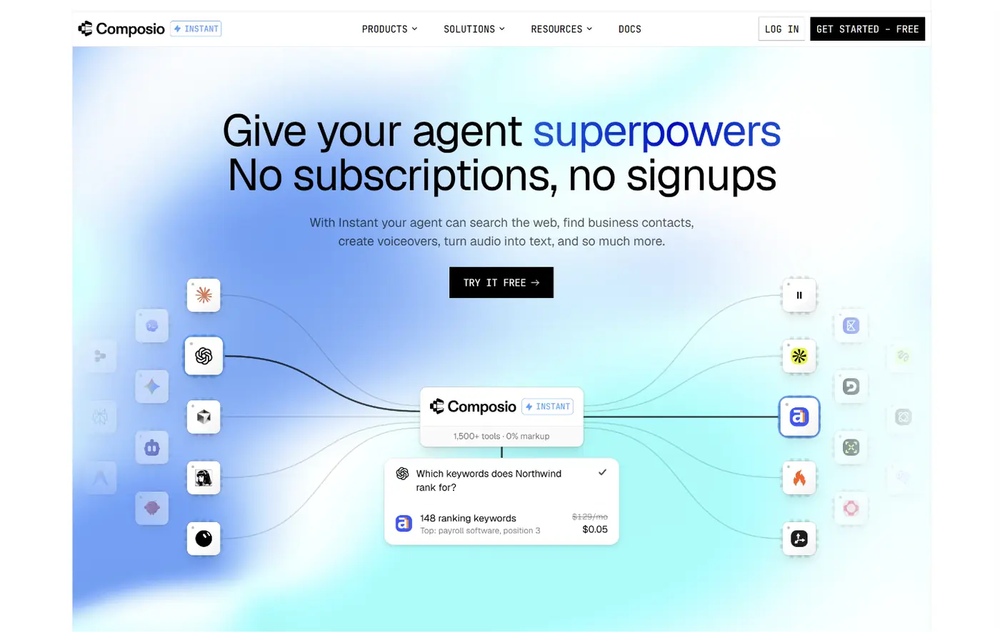
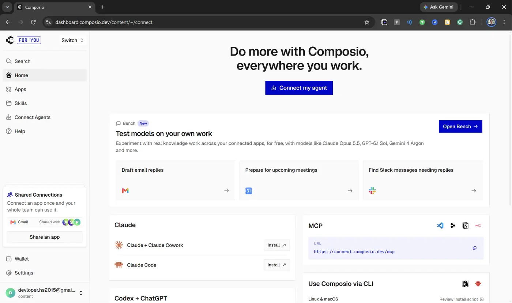
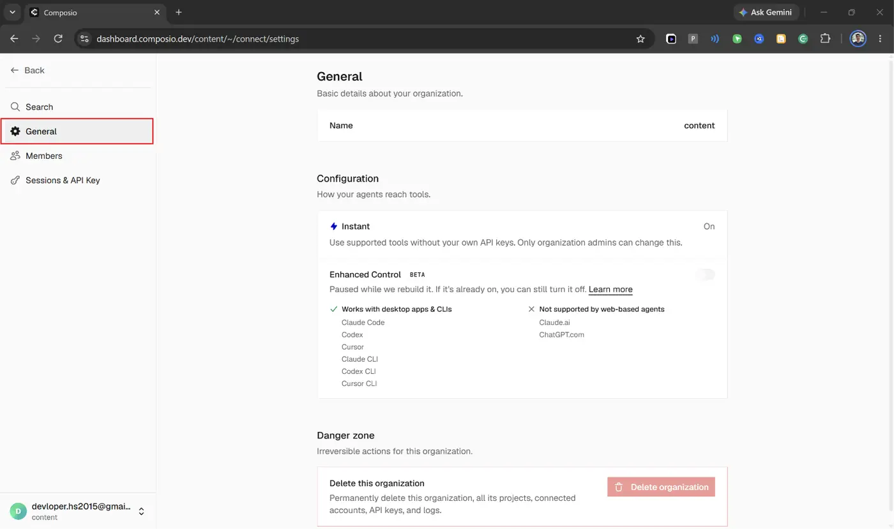
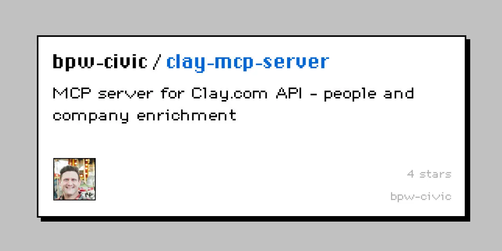
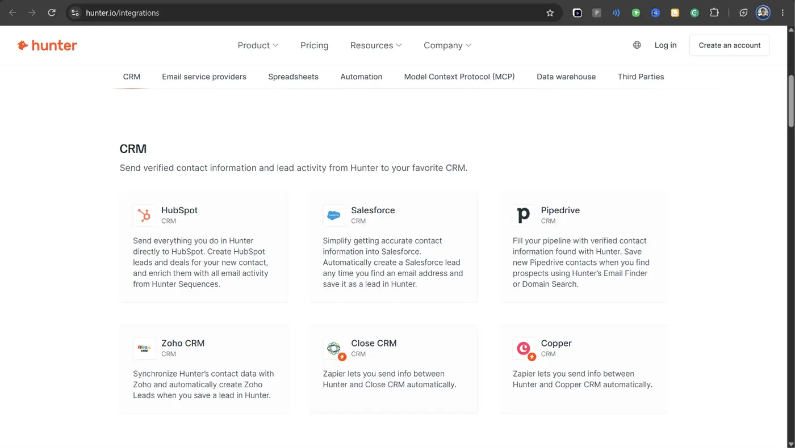
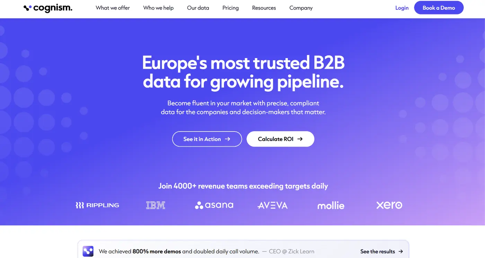
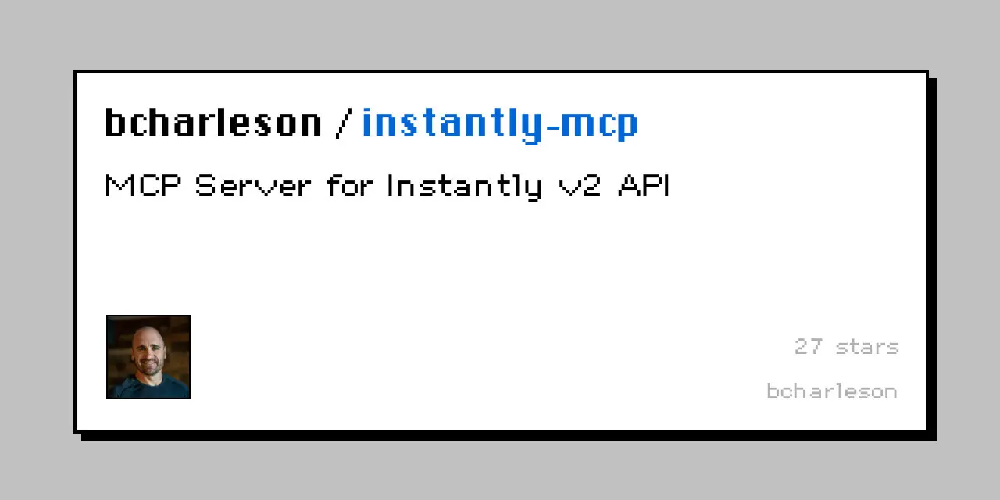
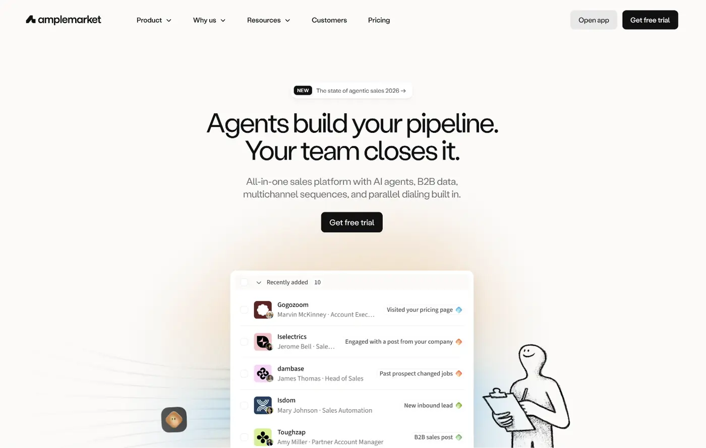

# 10 Best Apollo Alternatives for AI Agents & MCP Workflows (2026)

Recently, I have been automating a lot of manual work as part of workplace automation.

As part of the same, I looked into building a lead research agent that could:

- find companies matching my ICP,
- identify decision-makers,
- enrich their contact details,
- check CRM records,
- and prepare personalised outreach.

[Apollo.io](http://apollo.io/) seemed like a good option since it offers B2B prospecting, enrichment, email sequencing, and even an official MCP server.

But I wasn't sure whether its subscription and credit-based pricing made sense for an agent running these workflows regularly.

So I started looking for details on Apollo's pricing, data reliability, and agent automation options. Here is my honest review.

---

## What I Found During My Research

I explored Apollo across a few key parameters;

**Pricing**

- Free: \$0, includes 900 credits/year.
- Basic: \$49/user/month, billed annually
- Professional: \$79/user/month, billed annually
- Organisation: \$119/user/month, billed annually (minimum 3 seats)

Apollo also charges credits for contact reveals, enrichment, and certain AI features, which can affect costs when agents run repeated tasks.

**Data Accuracy**

Apollo reports 91% email accuracy and uses a seven-step verification process, but verified emails can still bounce.

It also supports waterfall enrichment, though available providers and costs depend on the setup.

**Agent Readiness**

Apollo already has an API, official MCP server, and workflow automation; that means you can use it with your favourite agent like Claude Code, Cursor, Codex, and so on. So this functionality is spot on.

**Why the need**

With core parameters in place, I looked for more flexible pricing, specialised enrichment, better data coverage, and simpler agent integrations.

That's how I narrowed it down to ten alternatives covering prospecting, enrichment, outreach, and CRM workflows.

---

## Top 10 Apollo Alternatives for AI Agents and MCP Workflows

I narrowed the options down to ten platforms that address different parts of B2B prospecting and sales automation.

Some can replace Apollo's prospecting workflow, while others focus on contact enrichment, email outreach, CRM operations, or account intelligence.

I have also included how each platform works with AI agents through MCP, APIs, or supported integrations, so you can see where it fits before choosing one.

### 1. [Composio Instant](https://composio.dev/instant)



It’s not 1:1 replacement for Apollo but rather an alternate way to get things done.

It let’s you access Apollo and other people search providers like People Data Labs, Contact Out, Hunter, Lusha, etc behind a single wallet. You don’t have to manage multiple subscriptions just pay as you go.

It lets agents use supported paid tools on Composio-managed provider accounts, so users can access eligible Apollo search and enrichment operations without creating a separate Apollo account or managing its API key.

You can also connect your CRMs, Slack, Excel, Sheets, etc through Composio. So you can unify search-to-CRM updates from your agent.

> Note: New accounts receive \$2 in introductory credit, and you can review tool usage and charges in Composio. There is zero-markup on API calls and you get charged only for successful tool calls.

Composio Instant still uses Apollo's underlying data for those actions, so it is an alternative way to access Apollo rather than a separate prospect database.

The best part is you are not limited to Apollo, if the search fail the agent will query Contact Out, People Data Labs, Hunter, Clay, etc, until you get the outcome you want.

It's especially useful when the agent also needs Google Sheets, Gmail, HubSpot, or other connected applications to complete the workflow.

**When to use**

I would use Composio Instant when an agent needs access to paid prospecting tools without separate provider subscriptions and connections to CRMs and communication services.

- **Multi-tool research:** Combine Apollo search with other supported [people search API tools](https://composio.dev/content/best-people-search-apis) like PDL, Hunter, Clay, Conatct Out, and more.
- **Pay as you go**: Pay when you need it. You don’t have to maintain multiple subscriptions to use them. A single wallet for all the subscritions.
- **Agent-driven sales workflows:** Research leads, check existing CRM records, and save results to connected Google Sheets or HubSpot accounts.
- **Prospecting:** Find people and companies matching an ICP, then enrich selected contacts.
- **Lead list prototyping:** Test different industries, job titles, and company sizes before committing to a larger prospecting plan.

**How to use with agents**

The first step is to enable Composio Instant so you can use it with multiple tools. Connect to Composio Instant by following the instructions:

- Open the C[omposio dashboard](https://dashboard.composio.dev/), log in, and make sure you're on this screen.

   

- Head to Settings → General

   

- Under Configuration, enable Composio Instant

   

Now you have your instant enabled. Fund your wallet once by clicking the wallet shown in the dashboard (1st image).

Next, use it within agents. You can prompt the agent using a similar format:

```text
Using Apollo through Composio Instant, find 20 CTOs at US-based B2B SaaS companies with 50 to 200 employees. Enrich their work emails where available, then check for existing records in my connected HubSpot account. 

Remove duplicates and save the remaining qualified leads to Google Sheets with their names, titles, companies, LinkedIn URLs, and available emails. 

Show the expected paid-tool usage before running enrichment. (Very important)
```

The agent searches Apollo through eligible Instant actions (`APOLLO_PEOPLE_SEARCH`, `APOLLO_ORGANIZATION_SEARCH`), enriches the selected records, checks HubSpot for duplicates, and writes the approved results to Google Sheets.

You can also use the Composio SDK when building custom agents. Instant provides the paid data access, while your own connected accounts handle actions such as writing to Google Sheets or creating CRM records.

> **Note**: Actions that need private Apollo account access still require an Apollo connection.

This is useful when you want to validate a prospecting workflow without committing to another full subscription.

But if you need custom enrichment logic across many providers, Clay offers more control over that process.

### 2. Clay



[**Clay**](https://www.clay.com/) combines company research, enrichment, AI-assisted analysis, and workflow automation.

- It can search for prospects,
- enrich records using multiple providers,
- and run custom workflows through reusable Functions.

One of its main strengths is how much control it gives you over enrichment.

You can build waterfalls that query different data providers in sequence, use AI to research missing fields, and apply scoring rules before exporting leads.

Apollo also supports waterfall enrichment, but Clay provides a broader workspace for building and reusing custom research processes.

Clay's free plan supports basic experimentation, while its paid Launch plan starts at \$185 per month and Growth starts at \$495 per month.

So it makes more sense when you need repeatable enrichment workflows, not a few occasional contact lookups.

**Where to use**

Clay is useful when your prospecting workflow needs more research steps or custom logic than a standard contact search.

- **Multi-provider enrichment:** Query several data sources to improve email or phone coverage.
- **Lead qualification:** Combine company attributes, research results, and custom scoring rules.
- **Sales operations:** Let teams reuse enrichment Functions without rebuilding them for every campaign.
- **Meeting preparation:** Research an account, identify key contacts, and collect relevant company information.

**How to use with agents**

Clay provides an official remote MCP server at `https://api.clay.com/v3/mcp`. Add the endpoint to your MCP-compatible client and authenticate with your Clay account using OAuth.

After authorisation, the agent can access supported find-and-enrich tools and Functions made available by your workspace.  Administrators can control user access, set monthly credit limits, and decide which Functions are available through MCP.

For a larger workflow, I would have Clay handle enrichment and qualification, then use a separate CRM or outreach connector for the next action.

You can also combine Clay with other applications through Composio where those integrations are supported.

Clay works well when enrichment is the main task. But some teams also need deeper company intelligence, buying signals, and enterprise account research, which brings us to ZoomInfo.

Related: [Best Clay alternatives](https://composio.dev/content/best-clay-alternatives)

---

### 3. ZoomInfo


[**ZoomInfo**](https://www.zoominfo.com/) is a B2B sales intelligence platform that provides company information, professional contacts, buying signals, and account research capabilities.

Compared with Apollo, ZoomInfo becomes particularly interesting when a team needs detailed firmographic data, technographic information, or signals related to account activity.

Its MCP tools support:

- company and contact discovery,
- enrichment,
- similar-account searches,
- and research using additional connected business context.

ZoomInfo's MCP documentation also describes a credit-based system.

Many search operations do not consume credits, while enriching new records uses data credits and certain research agents use AI credits.

Access depends on your ZoomInfo account, entitlements, and available credit balance.

**Where to use**

ZoomInfo is worth considering when account intelligence matters as much as finding contact information.

- **Enterprise prospecting:** Search companies and decision-makers using firmographic and role-based filters.
- **Buying-signal research:** Find accounts with relevant intent, news, or other business signals.
- **Account discovery:** Identify companies similar to existing customers.
- **Meeting preparation:** Combine contact details and account research before a sales conversation.

**How to use with agents**

For a complete workflow: I use ZoomInfo to identify and research accounts, then connect HubSpot or Salesforce for record management. Composio can provide access to those CRM applications separately, depending on the connected-account permissions.

ZoomInfo works well for detailed account intelligence. But if you mainly need contact details and buying signals through an AI assistant, Lusha offers a more focused option.

### 4. Lusha


[**Lusha**](https://www.lusha.com/) helps sales teams find business contacts, enrich company records, and access verified work emails and phone numbers.

Its approach is useful when you care more about identifying specific decision-makers than running a complete outbound platform.

Lusha also provides buying signals, company lookalikes, account scoring, and CRM export capabilities.

Lusha offers a free plan with 40 credits per month.

According to its pricing, revealing an email generally costs one credit, while revealing a phone number costs five. Its MCP tools use the same credit balance as the rest of the platform.

**Where to use**

I would consider Lusha when the agent needs targeted contact enrichment and additional account context.

- **Contact discovery:** Find decision-makers at companies matching your target criteria.
- **Email and phone enrichment:** Retrieve available verified contact details.
- **Buying-signal research:** Identify accounts using available signals and company scores.
- **CRM exports:** Send selected contacts to supported CRMs such as Salesforce or HubSpot.

**How to use with agents**

Lusha provides an official MCP server at `https://mcp.lusha.com`. Claude and ChatGPT support sign-in-based access, while supported developer clients can use API-key authentication where the account permits it.

Once connected, the agent can search contacts, enrich records, retrieve buying signals, find lookalike companies, and manage supported workspace tables. The server also supports exports to selected CRM systems.

Composio can support the remaining workflow when you want the agent to work with other connected applications.

Lusha itself does not expose email sending or sequence enrollment through its MCP server, so those actions need a separate supported integration.

**Example usage**

Suppose your sales team wants to identify sales leaders at companies showing relevant buying activity.

For teams that primarily need to find and verify email addresses, Hunter is another useful option.

### 5. Hunter



[**Hunter**](https://hunter.io/) is an email discovery and verification platform. It helps users find professional email addresses, search companies and people, verify email deliverability, and organise leads.

Hunter is more focused than Apollo.

It offers company discovery and lead management, but its main strength is finding and checking email addresses before outreach.

That makes it useful when your agent already knows which companies or people to target.

Hunter offers a free plan, and its Starter plan begins at \$34 per month with annual billing.

Its official MCP server is also available on the free plan, although the account's credit and request limits still apply.

**Where to use**

Hunter is a practical choice when email quality and verification matter most.

- **Domain-based research:** Find professional email addresses associated with a company domain.
- **Named-contact discovery:** Search for a specific person's business email.
- **Email verification:** Check deliverability before adding contacts to an outreach list.
- **Lead management:** Organise discovered contacts and prepare them for outreach.

**How to use with agents**

I would use Hunter to verify selected contacts before sending them to a CRM or email platform. To combine it with Google Sheets, Gmail, or HubSpot, you can connect those applications separately through Composio.

Imagine you have a list of target companies but still need reliable email addresses.

Hunter is a good fit for email-led workflows. But when compliance rules, international data, and mobile contact information become priorities, Cognism is worth considering.

---

### 6. Cognism



[**Cognism**](https://www.cognism.com/) provides B2B company and contact intelligence, with a strong focus on European markets, verified contact information, and data compliance controls.

For teams comparing it with Apollo, Cognism becomes relevant when they need international prospect data, mobile numbers, and access governed by their organization's compliance settings.

Its platform provides company and contact search, enrichment, and intent-related capabilities depending on the subscription.

Cognism also has an official MCP connector for its Standard and Pro customers.

It uses the organization's existing access controls, search-token allowances, and credits, so connecting an AI assistant does not bypass the account's restrictions.

**Where to use**

Cognism is useful when international prospecting requires stricter control over data access.

- **European prospecting:** Find decision-makers at companies in selected European markets.
- **Mobile contact enrichment:** Retrieve available business mobile numbers for permitted records.
- **Compliance-controlled research:** Respect geographic restrictions and do-not-call settings.
- **Audience research:** Count matching companies or contacts before spending credits on reveals.

**How to use with agents**

Connect Cognism for research and HubSpot through its own MCP server or Composio for approved record creation. Follow Cognism's data-handling requirements when configuring the AI client.

Cognism is a good fit for Compliance-focused international prospecting.

However, once an agent has qualified contacts, it still needs a way to manage outbound campaigns. Instantly focuses on that part of the process.

---

### 7. Instantly



[**Instantly**](https://instantly.ai/) is an outbound email platform that helps teams manage cold email campaigns, leads, sending accounts, and performance analytics.

Consider it when your main problem with Apollo is campaign management, not the underlying prospect database.

Instantly offers tools for email sequences, multiple sending accounts, and campaign operations, so it fits workflows that already have a reliable contact source.

Its official MCP server also exposes campaign management, lead management, email operations, analytics, and connected sending accounts.

**Where to use**

Instantly works well when the agent's main responsibility starts after lead qualification.

- **Campaign creation:** Build outbound campaigns from an approved lead list.
- **Lead management:** Add, organise, or update contacts in existing campaigns.
- **Campaign monitoring:** Review replies and performance metrics.
- **Sending-account operations:** Check available sending accounts and manage supported account settings.

**How to use with agents**

Combine Instantly with another prospecting provider and use Composio for supported Google Sheets or CRM actions if needed.

Instantly is useful when you already have the prospecting side covered.

But if you want one platform to handle prospect discovery, enrichment, and multichannel outbound, Amplemarket offers a more complete approach.

---

### 8. Amplemarket



[**Amplemarket**](https://www.amplemarket.com/) combines B2B prospecting, contact enrichment, sales engagement, and multichannel outreach in one platform.

Compared with Apollo, Amplemarket is particularly interesting for teams that want to research prospects and manage outreach sequences through connected AI assistants.

It supports prospect discovery, lead lists, engagement data, sequence operations, and sales analytics.

Amplemarket's Startup plan starts at \$600 per month on an annual term and includes two users.

So it suits teams investing in a managed outbound workflow more than someone who only needs occasional contact lookups.

**Where to use**

I would consider Amplemarket when a team wants prospecting and outreach operations under one account.

- **Complete outbound workflows:** Discover prospects, enrich contacts, and prepare outreach sequences.
- **Multichannel campaigns:** Manage supported email and LinkedIn-related sequence steps.
- **Lead qualification:** Use prospect information and available signals to prioritise targets.
- **Sales analytics:** Review outreach activity and campaign performance.

**How to use with agents**

Amplemarket can manage much of the sales workflow directly. If the agent also needs external spreadsheets, documents, or other business applications, Composio can provide supported connections for those additional actions.

This handles prospecting and outreach within one platform.

If you need more detailed person and company data for your own workflow, People Data Labs is another option.

---

### 9. People Data Labs

[**People Data Labs (PDL)**](https://www.peopledatalabs.com/) provides person and company data through APIs for search, enrichment, and data cleaning.

Compared with Apollo, PDL is more focused on providing structured data than managing outreach sequences. It is useful when you already have a list of leads and want to add details such as job titles, work history, company size, and industry.

**Where to use**

- **Lead enrichment:** Add available profile details to existing contacts.
- **Company qualification:** Enrich company records before scoring them against your ideal customer profile.
- **People search:** Find people by role, company, location, and other supported filters.
- **List cleaning:** Standardise company names and locations before enrichment.

**How to use with agents**

You can use eligible PDL search and enrichment tools through Composio Instant without a separate PDL account or API key. Ask the agent to clean and enrich a small list, score the companies, and save the results to a connected spreadsheet or CRM.

Costs depend on the tool and records returned or matched, so check the current price before running a large batch. If you need a PDL action that is not available through Instant, connect your own PDL account where supported.

PDL is useful for adding depth to existing records. If your priority is finding decision-makers and their contact details, ContactOut is another option.

---

### 10. ContactOut

[**ContactOut**](https://contactout.com/) helps teams find people and companies, identify decision-makers, and retrieve available contact details.

Compared with Apollo, I would consider ContactOut for targeted contact discovery and enrichment, especially when I already know which companies or roles I want to research.

**Where to use**

- **Decision-maker discovery:** Find relevant people at target companies.
- **Company and people search:** Build lists using supported filters such as role, location, and company size.
- **Contact enrichment:** Check availability and retrieve available work emails for selected profiles.
- **Lead qualification:** Count matching people before deciding which records to reveal.

**How to use with agents**

ContactOut offers an [official MCP server](https://api.contactout.com/) at `https://contactout.com/mcp`. Add it to an MCP-compatible client and authenticate with your ContactOut API token. Account access and credits apply.

You can also use eligible ContactOut tools through Composio Instant without a separate ContactOut account. Instant supports work-email access for eligible actions; phone numbers, personal emails, and ContactOut's email verification require your own account. Check tool availability and pricing before running a paid search or reveal.

For a complete workflow, use ContactOut to find and enrich selected contacts, then save the results to a connected spreadsheet or CRM for review.

---

## Conclusion

After comparing these ten options, I would choose based on the agent's exact needs.

- Composio Instant is useful for occasional Apollo-powered searches without a separate subscription.
- Clay for custom enrichment.
- ZoomInfo and Cognism for more specialised data requirements.
- Lusha or Hunter for targeted contact discovery.
- Instantly and Amplemarket focus more on outbound execution,
- People Data Labs is useful for structured person and company enrichment, while ContactOut focuses on finding decision-makers and their contact details.

For a practical starting point, you can [generate leads with Claude](https://composio.dev/content/how-to-generate-leads-with-claude-step-by-step-guide) by building a small workflow that finds ten qualified prospects, verifies their available contact details, checks the CRM for duplicates, and prepares an export for review.

Composio Instant is worth adding when the workflow needs several paid and connected tools, but if you already have Apollo, its official MCP server is also a valid option.

With so many options, the best choice now depends on which part of prospecting you need to improve.
