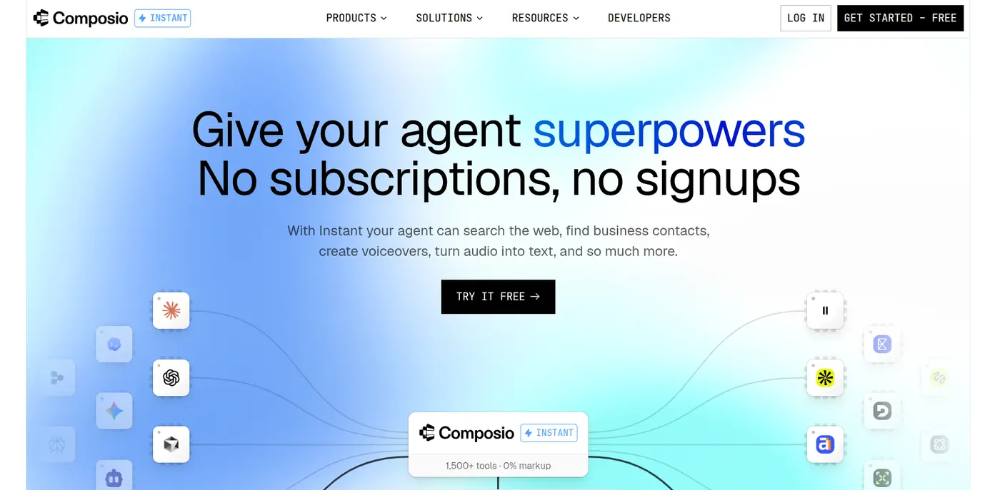
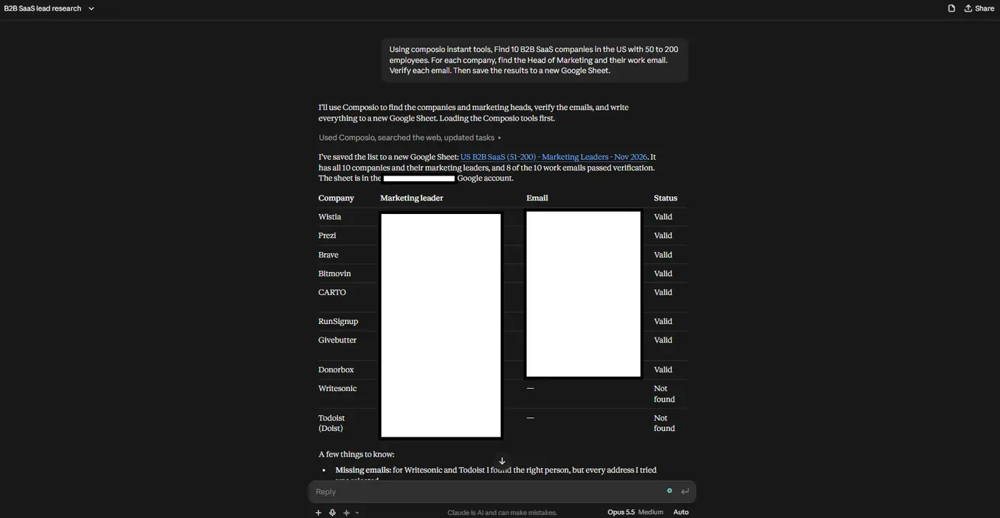
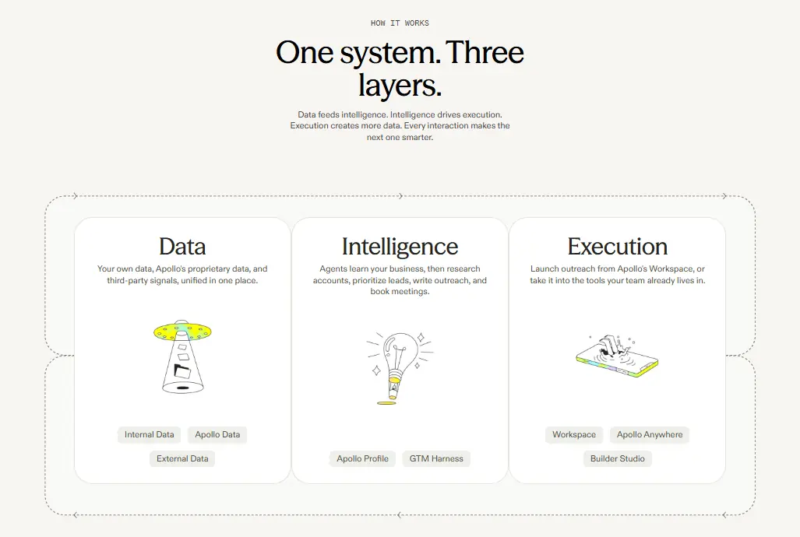
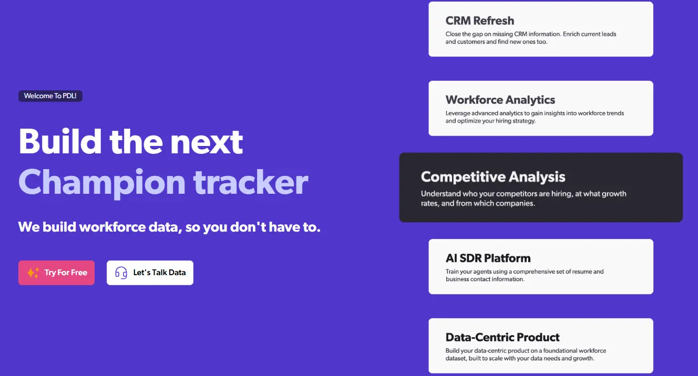
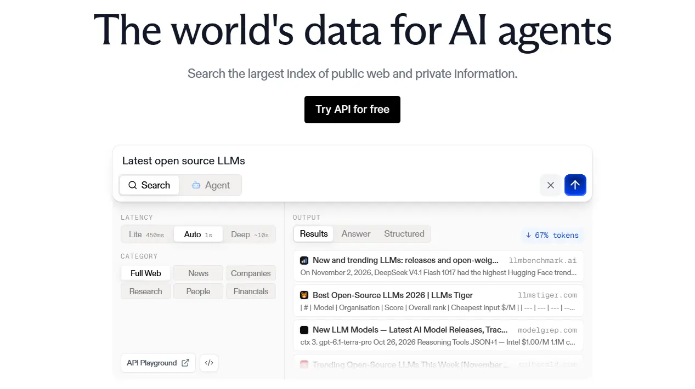
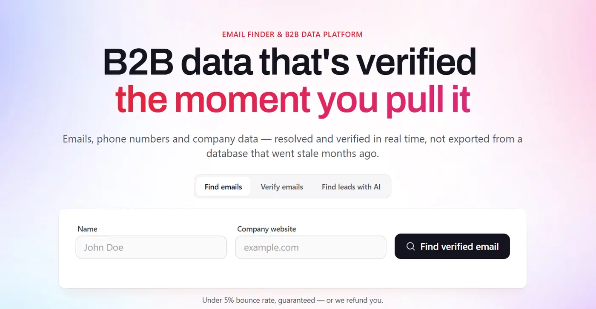
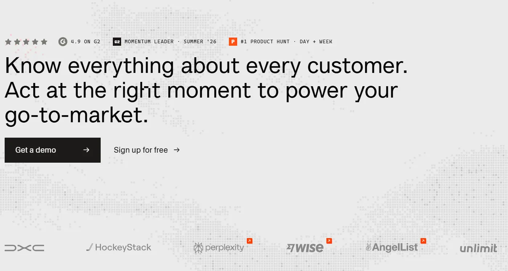
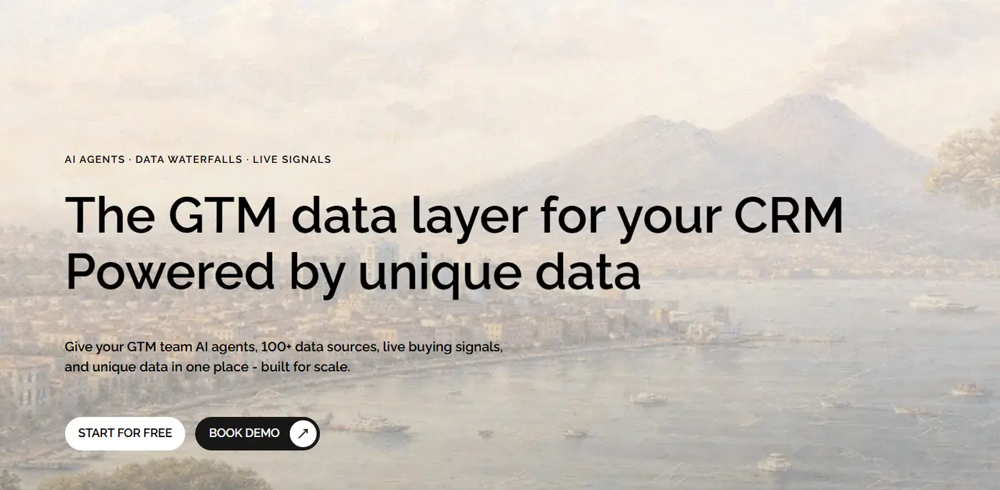
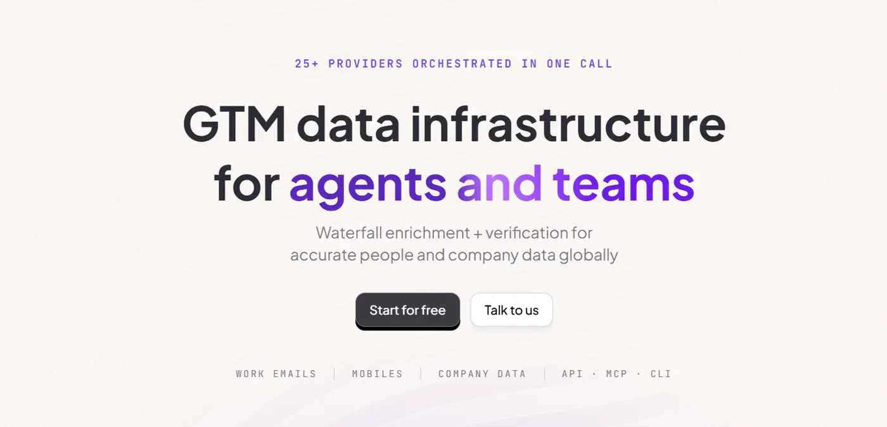
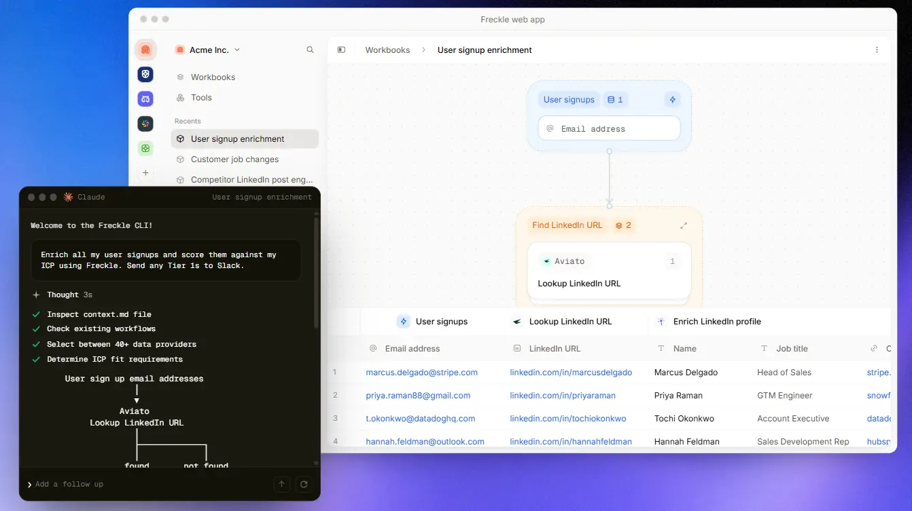

# 10 Best Clay Alternatives in 2026: My Top Picks

Clay is one of the best tools for lead enrichment. You build a table, add columns, and Clay fills them with emails, phone numbers, and company data from more than 150 providers.

But Clay changed its pricing in March 2026, and many teams now pay more than they planned. You track [two separate balances](https://www.supered.io/blog/clay-pricing/), and you need the [\$495 Growth plan](https://www.salesforge.ai/blog/clay-pricing) for CRM sync. So a lot of teams are looking for something simpler or cheaper.

AI agents also give you a new option. You can ask Claude for a lead list in plain English, and it finds the people, gets their emails, and saves them to a sheet. Data companies see this too. Firecrawl just launched what it calls [“headless Clay for agents”](https://x.com/firecrawl/status/2117297576131060140), and [Composio Instant](https://composio.dev/instant) lets Claude use paid data tools like Clay, Apollo and People Data Labs without a separate subscription for each one.

In this guide, I cover all 10 tools, with what each one does well, where it falls short, and what it costs.

#### TL;DR

| # | Tool | Best for | Starting price |
| --- | --- | --- | --- |
| 1 | [Composio Instant](https://composio.dev/instant) + Claude | Clay-style enrichment from Claude, with no extra subscriptions | Pay per call, \$2 free credit |
| 2 | [Firecrawl](https://www.firecrawl.dev/) | People and company search for AI agents | 1,000 free credits per month |
| 3 | [Apollo.io](https://www.apollo.io/) | Contact database with email sequences | Free, then \$49/user/month |
| 4 | [People Data Labs](https://www.peopledatalabs.com/) | Detailed company and person records | Pay per call through Instant |
| 5 | [Exa](https://exa.ai/) | Building lead lists from web research | Pay per call through Instant |
| 6 | [Findymail](https://www.findymail.com/) | Verified work emails | \$49/month |
| 7 | [Floqer](https://floqer.com/) | The closest like-for-like Clay swap | \$49/month |
| 8 | [Bitscale](https://bitscale.ai/) | Clay-style tables at high volume | Free, then \$349/month |
| 9 | [FullEnrich](https://fullenrich.com/) | Email and phone waterfall only | About \$55/month |
| 10 | [Freckle](https://www.freckle.io/) | Ease of use | Free, then \$99/month |

### Summary:

The right Clay alternative depends on what you use Clay for today:

- **To run enrichment from Claude**, use Composio Instant.
- **For a contact database with email sequences**, use Apollo.
- **For a Clay-style table at a lower price**, use Floqer or Bitscale.
- **For emails and phone numbers only**, use Findymail or FullEnrich.

---

## Why You Need a Clay Alternative

Clay works well for teams with a full-time operator. For everyone else, it has four problems.

**1. The pricing is hard to predict.**

In March 2026, Clay split its credits into two meters. Data Credits pay for data from Clay’s providers, and Actions pay for each step that Clay runs. So you track two balances, and [a single enriched contact can use 6 to 20 Data Credits](https://www.reachly.co/blogs/clay-pricing-in-2026).

**2. Key features need the expensive plan.**

The [Launch plan](https://www.clay.com/pricing) costs \$185 per month. CRM sync and HTTP APIs need the Growth plan, which costs \$495 per month.

**3. It’s hard to use with AI agents.**

 [Clay’s API is only on the Enterprise plan](https://www.firecrawl.dev/blog/best-company-enrichment-api). If you want Claude or ChatGPT to run your enrichment, Clay makes that hard.

**4. It takes time to learn.**

You build tables, set up waterfalls, and write formulas. If you only need 50 emails a week, that’s a lot of setup.

If any of these sound familiar, one of the tools below will likely fit you better.

---

### How I Picked These Tools

I looked at more than a dozen recent “Clay alternatives” lists and the pricing pages for each tool. Many of those lists come from the tool makers, and each one ranks itself first. So I only picked tools that show up on several lists, and I checked each price against recent sources.

I also left out Persana AI. Older lists still recommend it, but it shut down in May 2026.

---

### [1. Composio Instant](https://composio.dev/instant) + Claude



**Best for:** Teams who want Clay’s results from Claude, with no extra subscriptions.

Composio connects Claude to more than 1,500 apps. Instant is a Composio feature that gives Claude paid data tools, like Clay, Apollo, Firecrawl, People Data Labs, and Exa, without separate subscriptions or API key for each one. You only pay per successful  call from one Composio wallet.

So you get the data that Clay gives you, but you ask for it in plain English. The best part is you’re not limited to only Clay for data. If the agent can’t find from Claude it will fall back to Apollo, PDL, Findymail, until you get the data you need.

Claude picks the right tools, runs the lookups, and saves the results where you want them.

Here’s an example prompt:

```text
Find 20 B2B SaaS companies in the US with 50 to 200 employees.
For each company, find the Head of Marketing and their work email.
Verify each email. Then save the results to a new Google Sheet.
```

Claude searches for the companies and people, finds and checks the emails, and writes the sheet. You don’t build a table or set up a waterfall.



**Why it’s a good Clay alternative**

- **No subscriptions for each tool.** You don’t sign up for Apollo, Firecrawl, or a separate email finder. Instant runs them all from one balance.
- **No markup.** Composio charges each provider’s price with no extra fee.
- **It works with your other apps.** Composio also connects Claude to HubSpot, Salesforce, Gmail, and Google Sheets. So Claude can enrich a lead and update your CRM in the same chat.
- **It works in more than one AI tool.** You can use it in Claude, ChatGPT, Cursor, and other MCP clients.

**Things to know**

- No built-in enrichment table. You run workflows through Claude and can save the results to Google Sheets, Hubspot, Salesforce, or any CRM via Composio itself.
- You pay per call. Large jobs can add up, so check your execution logs to see what each call costs.
- Balance checks don’t happen on each call, so your balance isn’t a strict spending cap.

**Pricing:** New accounts get \$2 of free credit. After that, you add funds to your wallet and pay per call. Apps that you connect with your own account have no Instant charge.

---

### [2. Firecrawl](https://www.firecrawl.dev)


**Best for:** Searching people and companies from inside an AI agent.

Firecrawl started as a tool that turns web pages into clean text for AI. Its newest product is people and company data for agents, and Firecrawl calls it [“headless Clay”](https://x.com/firecrawl/status/2117297576131060140). There’s no table, so your agent does the work in Claude, ChatGPT, or other tools.

It runs on Firecrawl Alexandria, which brings many data providers under one API key. Apollo, FullEnrich, and Data Legion are already live for people data.

**Why it’s a good Clay alternative**

- **Large database.** You can search more than 250 million people and 26 million companies, and get emails, job data, and company data.
- **Many providers, one key.** You don’t need a contract with each provider.
- **Free tier.** You get 1,000 credits per month for free.

**Things to know**

- Firecrawl claims its Standard plan costs 88% less than Clay's Launch plan for a typical enriched record. It bases this comparison on a profile and work email, using November 2, 2026 list prices. Actual savings depend on the provider, the number of records, and the fields you need.
- The product is new, so expect changes.

**Pricing:** 1,000 free credits per month, then paid plans. It’s also available through Composio Instant.

---

### [3. Apollo.io](https://www.apollo.io)



**Best for:** Teams who want a contact database and email sequences in one tool.

Apollo is the most common Clay swap. It gives you a large B2B contact database, and it lets you send email sequences from the same tool. So you don’t need to connect three tools together.

**Why it’s a good Clay alternative**

- **Database and sending in one place.** You find contacts and email them without moving data between tools.
- **Free plan.** You can test the data quality before you pay.
- **Simple setup.** You search with filters, so you don’t build workflows.

**Things to know**

- Apollo uses one database. Clay pulls from many providers, so it can find some contacts that Apollo misses.
- Apollo charges per user, so the cost grows with your team.
- Phone numbers use extra credits.

**Pricing:** Free plan. Basic costs \$49 per user per month on annual billing, or \$59 on monthly billing. Professional costs \$79 per user per month, and Organization costs \$119. Apollo data is also available through Composio Instant.

---

### [4. People Data Labs](https://www.peopledatalabs.com/)



**Best for:** Teams who need detailed company and person records.

People Data Labs (PDL) is a data API with deep records on companies and people. It gives you fields like headcount, industry, funding, and job history. You can also search its data with SQL-style queries.

**Why it’s a good Clay alternative**

- **Deep data.** Each record has many fields, so you can filter and score leads in detail.
- **Built for code and agents.** PDL is an API, so it works well when Claude or another agent runs the lookups.
- **Strong company data.** Use it for company research and account scoring.

**Things to know**

- PDL has no app for non-technical users. You use it through code, an agent, or a tool like Composio.
- It doesn’t send emails or run sequences.

**Pricing:** Through Composio Instant, you pay per call from your wallet. PDL also sells its own plans.

---

### [5. Exa](https://exa.ai/)



**Best for:** Building lead lists from AI web research.

Exa is an AI search engine. You describe the companies or people you want in plain English, and Exa searches the web for matches. For example, you can ask for “fintech startups in Europe that hired a VP of Sales this year”.

**Why it’s a good Clay alternative**

- **Plain English search.** You don’t need filters or a database schema.
- **Finds companies that databases miss.** Exa searches the live web, so it can find new or small companies.
- **Good for research.** It covers much of what people use Claygent for in Clay.

**Things to know**

- Exa is better at finding companies and pages than at finding verified emails. Pair it with an email finder like Findymail.
- Its list-building product, Websets, has its own credits and plans. Exa now points new list-building work to its Agent.

**Pricing:** Free tier for the search API, then pay per use. Through Composio Instant, you pay per call from your wallet.

---

### [6. Findymail](https://www.findymail.com/)



**Best for:** Finding and verifying work emails.

Findymail does one job. It finds work emails and checks that they work before it gives them to you. If you used Clay mostly for its email waterfall, Findymail is a simpler and cheaper choice.

**Why it’s a good Clay alternative**

- **You only pay for verified emails.** Findymail charges a credit only when it finds a valid email.
- **Bounce guarantee.** If more than 5% of your emails bounce, Findymail gives your credits back.
- **Credits roll over.** Unused credits carry over, up to two times your monthly amount.

**Things to know**

- It finds emails and phone numbers only. It doesn’t search for companies or build lists.
- A phone number costs 10 credits.
- Paid plans allow up to 10 users. Bigger teams need the Enterprise plan.

**Pricing:** \$49 per month for 1,000 credits, \$99 for 5,000, and \$249 for 25,000. You can also use it through Composio Instant.

---

### [7. Floqer](https://floqer.com/)



**Best for:** Teams who like how Clay works but want a lower price.

Floqer is the closest like-for-like Clay swap. You build workflows that enrich leads from many providers, score them, and send them to your CRM. It also has an AI agent that can build the workflow for you.

**Why it’s a good Clay alternative**

- **Low entry price.** Plans start at \$49 per month, and that includes CRM sync.
- **Unlimited rows and seats.** You don’t pay more when your team grows.
- **Credits roll over.** Unused credits carry over with no limit.

**Things to know**

- Floqer is a smaller company than Clay, and it has fewer data providers.
- Clay has a bigger community and more templates.
- Moving from Clay still takes work, because you need to rebuild your workflows.

**Pricing:** Free plan with 100 credits. Paid plans cost \$49 to \$999 per month.

---

### [8. Bitscale](https://bitscale.ai/)



**Best for:** Teams who run Clay-style tables at high volume.

Bitscale gives you a table that works much like Clay’s. You enrich leads from many providers and sync them to HubSpot or Salesforce. The main difference is how it charges you.

**Why it’s a good Clay alternative**

- **Unlimited Actions on paid plans.** You only pay credits for data, so you track one balance.
- **Pay on success.** Bitscale only spends credits when it finds a valid result.
- **Waterfall enrichment.** It checks 18 or more contact providers in order to find emails and phone numbers.

**Things to know**

- Its paid plans start higher than Clay’s Launch plan.
- Clay’s AI research tool, Claygent, goes deeper on research tasks.

**Pricing:** Free plan with 200 credits. Growth costs \$349 per month for 15,000 credits, and Booster costs \$799 per month for 50,000 credits.

---

### [9. FullEnrich](https://fullenrich.com/)



**Best for:** Teams who only need emails and phone numbers.

FullEnrich does waterfall enrichment and nothing else. You upload a list or connect your CRM, and it checks many providers in order until it finds an email or phone number.

**Why it’s a good Clay alternative**

- **You get the waterfall without the table.** There’s nothing to build or set up.
- **You pay only for results.** FullEnrich only charges when it finds something.
- **Good phone coverage.** Its waterfall covers 20 or more providers.

**Things to know**

- It doesn’t search for companies or build lists. You need to bring your own list.
- It doesn’t send emails.

**Pricing:** Plans start at about \$55 per month. FullEnrich data is also available through Firecrawl.

---

### [10. Freckle](https://www.freckle.io/)



**Best for:** Teams who want an easier tool than Clay.

Freckle gives you enrichment and AI research in a simpler interface than Clay. It also has a command-line tool, so you can run it from Claude Code or Codex.

**Why it’s a good Clay alternative**

- **Easy to learn.** New users can get results without a long setup.
- **Generous free plan.** You get 250 free starting credits per month for free.
- **Works with coding agents.** The CLI lets Claude Code run your enrichment.

**Things to know**

- It has fewer advanced features than Clay.
- It’s best for small and mid-size teams.

**Pricing:** Free plan with 250 free starting credits per month. Paid plans start at \$99 per month.

---

### Which Clay Alternative Should You Pick?

Start with what you use Clay for today.

| If you need... | Pick |
| --- | --- |
| Enrichment from Claude, with no extra subscriptions | Composio Instant + Claude |
| People and company search for an AI agent | Firecrawl |
| A contact database and email sequences | Apollo.io |
| Deep company data for scoring | People Data Labs |
| Lead lists from web research | Exa |
| Verified emails only | Findymail or FullEnrich |
| A Clay-style workflow at a lower price | Floqer |
| A Clay-style table at high volume | Bitscale |
| An easier tool than Clay | Freckle |

If you already use Claude, start with Composio Instant. You can try Apollo, Firecrawl, PDL, Exa, and Findymail from one place, and you only pay for what you use. Then, if you need a table view later, move to Floqer or Bitscale.

---

### FAQ

#### **What is the best Clay alternative?**

It depends on your job. For enrichment from Claude, use Composio Instant. For a database with email sequences, use Apollo. For a Clay-style workflow tool, use Floqer or Bitscale.

#### **Is there a free Clay alternative?**

Several tools have free plans. Firecrawl gives you 1,000 credits per month, Freckle gives you 250, Bitscale gives you 200, and Apollo has a free plan. Composio Instant gives new accounts \$2 of free credit.

#### **How much does Clay cost?**

Clay’s Free plan includes 100 Data Credits and 500 Actions per month. Launch costs \$185 per month, and Growth costs \$495 per month. Enterprise has custom pricing.

#### **Can I use Clay-style enrichment in Claude or ChatGPT?**

Yes. Composio Instant and Firecrawl both let Claude and ChatGPT find people, companies, and emails. You ask in plain English, and the agent runs the lookups.

#### **What happened to Persana AI?**

Rox bought Persana AI, and it shut down in May 2026. If you used it, look at Floqer or Bitscale for a similar workflow tool.

---

### Wrapping Up

Clay is still a strong tool, but it’s no longer the only way to enrich leads. If you work in Claude, Composio Instant gives you the same data with no table to build and no extra subscriptions. If you want a table tool, Floqer and Bitscale cost less than Clay. And if you only need emails, Findymail and FullEnrich do that one job well.

Pick the tool that matches what you use Clay for today, test it on a small list, and then scale up.
