# 10 Best fal AI Alternatives for Image and Video Generation

fal is probably the first name you hear when you need image or video generation through an API.

And for good reason. It is fast, it has a huge model gallery, and new models usually show up there first.

But it is not perfect for everyone. Some teams hit rate limits. Some need custom models. Others just want a cheaper way to generate a lot of images or video.

So I went through the major options and picked the ones I would actually consider today. 💯

> **Quick Note:** These are my picks, based on what developers recommend most, my own extensive use, and what each platform is actually good at.

## TL;DR - Best [fal.ai](http://fal.ai/) alternatives

| # | Platform | I would use it for | Starts at |
| --- | --- | --- | --- |
| 1 | **Composio Instant** | fal plus other media providers on one wallet | \$2 free credit; provider prices, 0% markup |
| 2 | **Replicate** | The biggest catalog of open and community models | FLUX schnell \$3 per 1K images; H100 \$5.49/hr |
| 3 | **Runware** | The cheapest image generation at volume | \$2 free credit; from \$0.0006/image |
| 4 | **WaveSpeedAI** | New Chinese video models like Seedance, Wan and Kling | Seedance 2.0 from \$0.12/s |
| 5 | **Together AI** | LLMs and media generation on one account | FLUX schnell \~\$0.0027/image |
| 6 | **Modal** | Custom media pipelines written in Python | \$30/mo free credit; H100 \~\$3.95/hr |
| 7 | **RunPod** | Self-hosting open models on cheap GPUs | Serverless from \$0.58/hr; pods from \$0.27/hr |
| 8 | **Hugging Face** | One token for many inference providers | Provider rates, no markup; PRO \$9/mo |
| 9 | **Baseten** | Serving your own models in production | H100 \~\$6.50/hr |
| 10 | **Kie.ai** | Cheap video experiments and prototypes | 80 free credits; Kling 3.0 from \$0.07/s |

> ⚠ **NOTE:** These prices are as of November 2026. Tools like these often change their pricing, so make sure to double-check the official pricing page before making a decision.

For most teams, one multi-model API plus one way to run your own models will cover most of what you need.

Now to the actual list. 👇

## Top fal.ai Alternatives

## 1. Composio Instant

> ℹ The pick when you want fal and other media providers without juggling an account for each. Get started: [dashboard.composio.dev](http://dashboard.composio.dev).

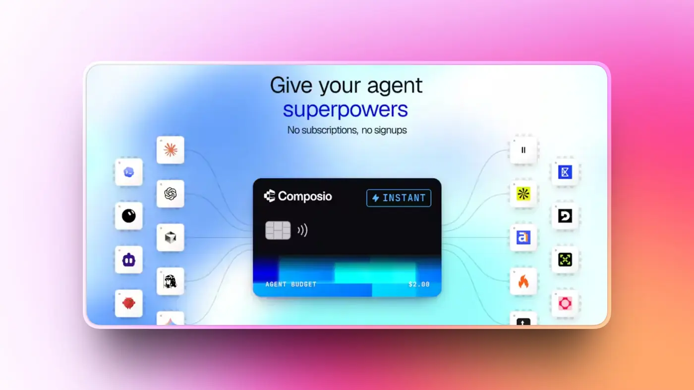

Here is something most alternative lists will not tell you. You might not need to leave fal completely.

Composio Instant is a bit different from the rest of this list. It does not host models itself. It is a wallet your agent uses to pay for media tools per call.

That includes fal itself, plus Black Forest Labs, Luma Labs, Higgsfield, ElevenLabs, MiniMax and OpenAI. One balance, no separate API keys, and every call costs the provider's own price with **0% markup** 🙈.


So instead of swapping fal for one other provider, you can spread the work across several. FLUX from Black Forest Labs, video from Luma or MiniMax, voice from ElevenLabs, and fal for everything else.

It will not fix fal's capacity limits on its own. But when one provider has issues, moving that work to another provider on the same wallet is a lot less painful.

Replicate, RunPod, Hugging Face and Kie.ai from this list are also available through Composio, but you connect your own API key for those.

Adding it to a custom agent only takes a few lines. See [Instant developer docs](https://docs.composio.dev/docs/instant-tools) for more.

```python
from composio import Composio

composio = Composio()
session = composio.sessions.create(
    user_id="test_blog_user_composio",
    toolkits=["fal_ai", "bfl", "luma_labs"],
)
tools = session.tools()
```

### What it does

- One wallet for fal and other supported media providers
- Image, video, voice and audio tools without separate API keys
- Execution logs that show what every call costs
- Your own connected accounts still work alongside Instant
- Works with Claude, ChatGPT, Cursor and any MCP client

### Pricing

- Each call costs the provider's own price with no markup
- \$2 of free credit to get started
- Calls through your own connected accounts have no Instant charge

### 💡 **When I would pick it**

When I want to keep fal but add a few other providers, especially inside an agent, without managing a new account for each one.

**Resources**

- [Composio Instant](https://composio.dev/instant)
- [Instant documentation](https://docs.composio.dev/docs/instant-tools)

## 2. Replicate

> ℹ The one I would pick when I need a model nobody else hosts.

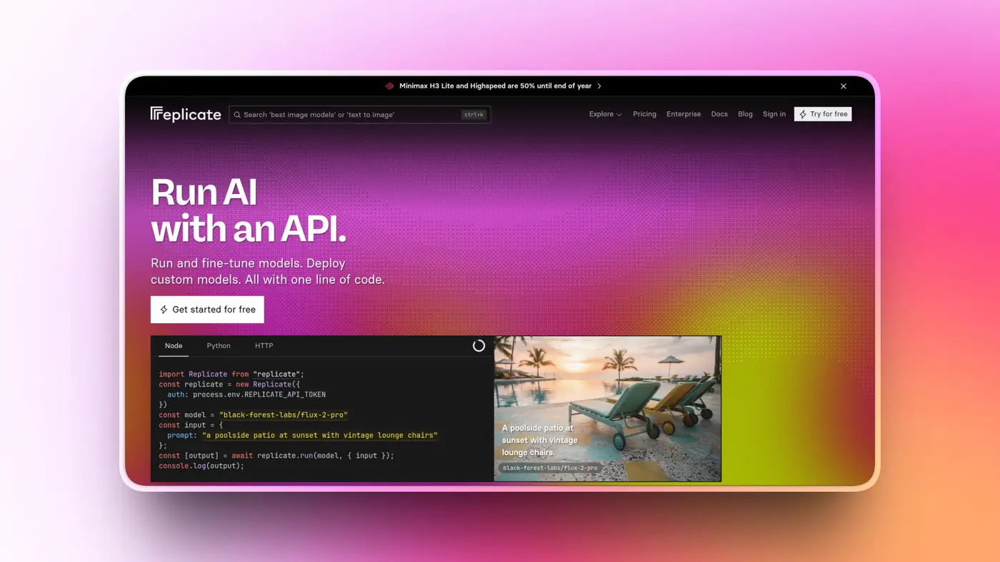

Replicate is the biggest public model hub out there. It hosts more than 50,000 models, from official releases like FLUX and Veo 3.1 to niche community fine-tunes.

You can also deploy your own private models with Cog, Replicate's open-source packaging tool. That makes it one of the most mature options if you have custom work.

The trade-off is speed and cost. fal is usually faster, and often cheaper on the models both platforms share. Idle community models can also take a while to cold start.

Replicate's founder does not fully agree with the speed part, though, and said so publicly.

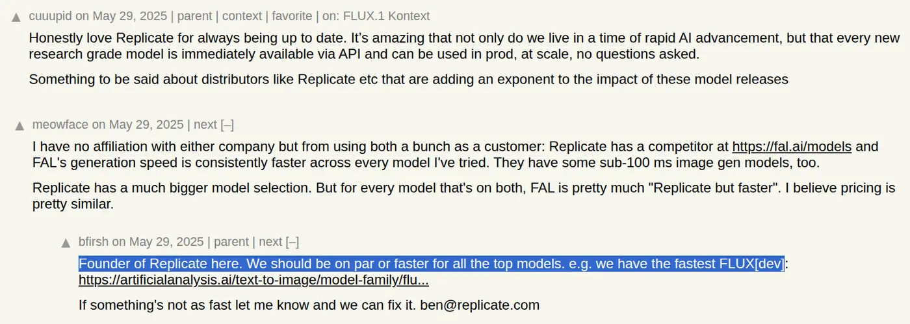

Replicate is now part of Cloudflare, but it still runs under its own brand. It is also where a lot of teams are moving their Veo 3.1 traffic as fal retires its endpoint.

### What it does

- Runs official and community models through one API
- Image, video, audio and LLM models
- LoRA and fine-tune training
- Private model deployments with Cog
- Webhooks, SDKs and a playground

### Pricing

- Official models are billed per output, like \$3 per 1,000 FLUX schnell images
- Other models are billed per second of hardware, with an H100 at \$5.49/hr
- Wan 2.1 image-to-video costs \$0.25 per second at 720p

### 💡 **When I would pick it**

When I need breadth, a niche community model, or a simple way to deploy my own model privately.

**Resources**

- [Replicate via Composio (bring your own key)](https://composio.dev/toolkits/replicate)
- [Replicate documentation](https://replicate.com/docs)

## 3. Runware

> ℹ Probably the cheapest way to generate a lot of images.

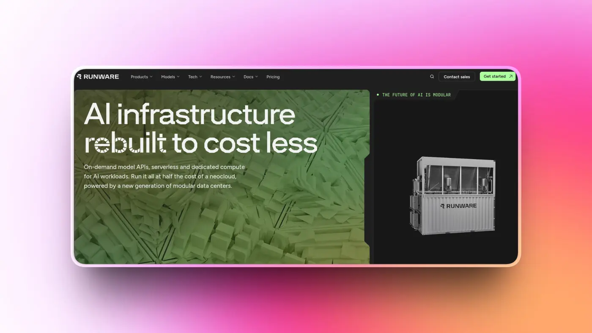

Runware is built around price. It runs on its own inference engine and custom hardware, and FLUX schnell images start at \$0.0006 each.

That is a fraction of what most other platforms charge, which makes it a strong pick for high-volume image apps.

The model catalog is huge too. Runware claims more than 400,000 models behind one API, including community checkpoints and LoRAs from Hugging Face and Civitai.

The developer experience is not as polished as fal's or Replicate's, and the speed and price claims are Runware's own. But your credits never expire, which is a nice change from fal.

### What it does

- Image, video, audio, 3D and LLM tasks through one API
- FLUX, SDXL and community checkpoints and LoRAs
- REST and WebSocket APIs
- Webhooks for each task
- Powers Together AI's image and video catalog

### Pricing

- New accounts get \$2 in free credits with a business email
- FLUX schnell from \$0.0006 per image, FLUX dev \$0.0038 and SDXL \$0.0026
- Credits do not expire

### 💡 **When I would pick it**

High-volume image apps, batch generation for product catalogs, or anything where cost per image matters more than anything else.

**Resources**

- [Runware](https://runware.ai/)
- [Runware documentation](https://runware.ai/docs)

## 4. WaveSpeedAI

> ℹ The one to watch if your app runs on Seedance, Wan or Kling.

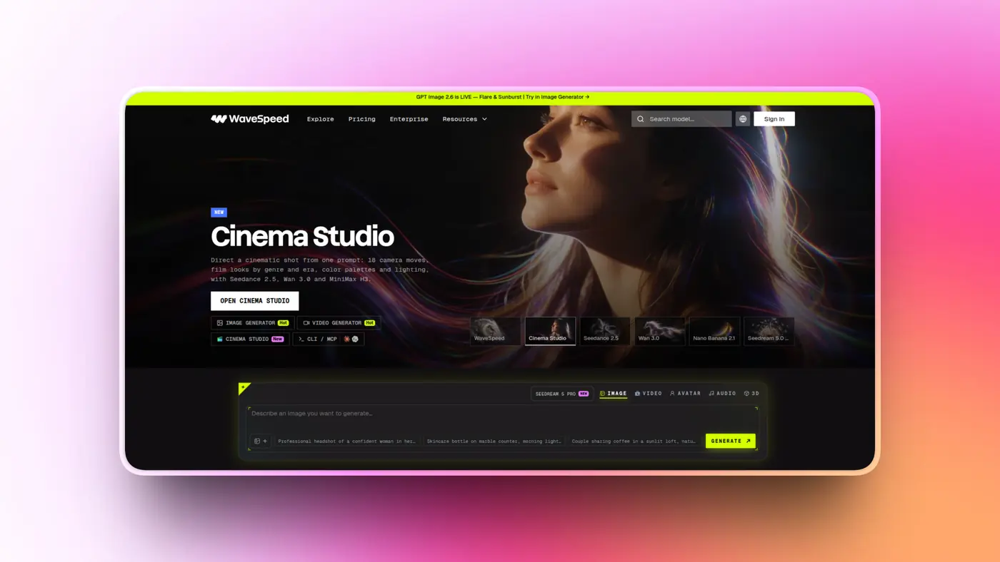

WaveSpeedAI is a multi-model media API with a clear focus. It is very good at getting new Chinese video models live quickly.

It covers every Seedance tier up to 4K, plus Wan, Kling and MiniMax. It is also one of the biggest text-to-video providers on Hugging Face's provider network.

On these video models, WaveSpeedAI is often cheaper than fal. Seedance 2.0 starts at \$0.12 per second at 480p, and credits do not expire.

The catch is that it is a small team with less funding behind it, so you are betting on a less proven vendor. Its speed claims also come from its own launch materials.

### What it does

- More than 1,000 image, video and audio models
- Seedance, Wan, Kling, MiniMax and FLUX with LoRA support
- Unified LLM API covering 260+ models
- Desktop app for non-API use
- Available through Hugging Face Inference Providers

### Pricing

- Seedance 2.0 costs \$0.12 per second at 480p and \$0.24 at 720p
- Seedance 2.5 Turbo costs \$0.20 per second at 720p
- Credits do not expire

### 💡 **When I would pick it**

Video-heavy apps built on Seedance, Wan or Kling, where getting the newest version fast matters.

**Resources**

- [WaveSpeedAI](https://wavespeed.ai/)
- [WaveSpeedAI documentation](https://wavespeed.ai/docs)

## 5. Together AI

> ℹ The pick when LLMs are your main workload and media is a side job.

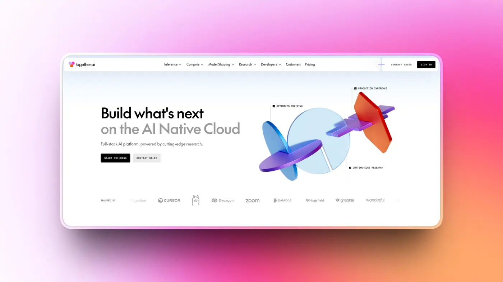

Together AI is mainly an AI cloud for open-source LLMs. It runs serverless and dedicated endpoints, GPU clusters, and fine-tuning.

In 2026 it added around 15 image models and 20+ video models, including Veo 3, Sora 2 and Kling. Those run through a partnership with Runware rather than Together's own stack.

So the media catalog is much smaller than fal's. But if you already use Together for LLMs, you get image and video on the same account and the same bill.

FLUX schnell costs about \$0.0027 per image, which is slightly under fal's price.

### What it does

- Open-source LLMs through an OpenAI-compatible API
- Image and video generation powered by Runware
- Fine-tuning and dedicated endpoints
- Batch API for large jobs
- GPU clusters for training

### Pricing

- FLUX schnell costs about \$0.0027 per image
- LLMs are billed per token
- Dedicated endpoints and clusters are billed by GPU time

### 💡 **When I would pick it**

When my main workload is open-source LLMs and I want image or video generation without adding another provider.

**Resources**

- [Together AI](https://www.together.ai/)
- [Together AI documentation](https://docs.together.ai/)

## 6. Modal

> ℹ The one I would pick when I want full control over the pipeline.

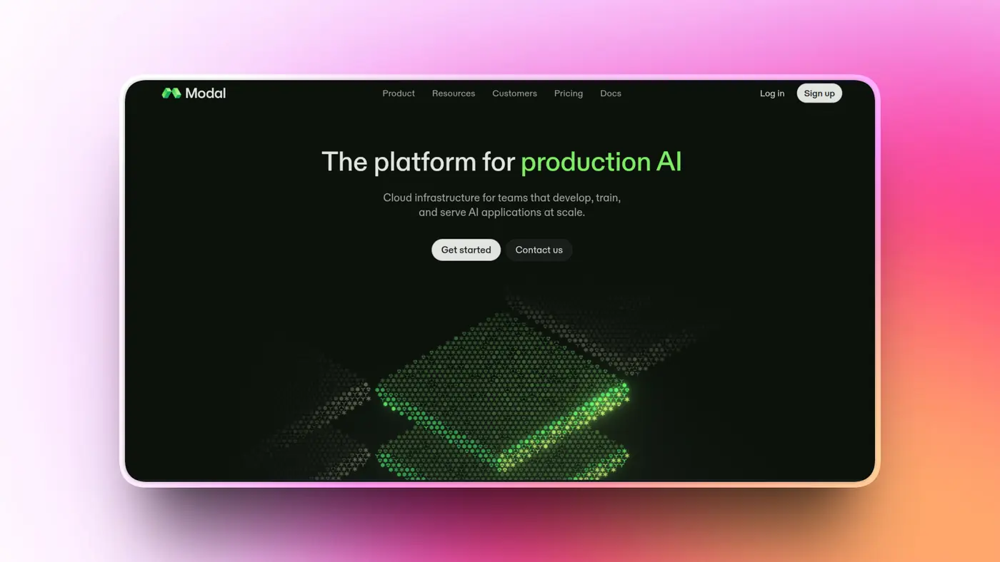

Modal is a serverless GPU platform. You write a Python function, add a decorator, and Modal runs it on GPUs that scale up and down for you.

That means you can run anything. ComfyUI workflows, custom Wan setups, multi-model chains, your own fine-tunes. You get full control over weights, samplers and LoRAs.

Cold starts are fast, and billing is per second, so you only pay while your code runs. Once your GPUs are busy most of the time, it ends up cheaper than paying per output.

The trade-off is that you build and maintain the serving yourself. There is also no ready-made catalog of closed models like Veo or Kling.

### What it does

- Serverless GPUs for any Python code
- Per-second billing with fast cold starts
- Full control over models, weights and pipelines
- Sandboxes for running agent code
- Autoscaling from zero

### Pricing

- \$30 of free credit every month
- H100 costs about \$3.95/hr and A100 80GB about \$2.50/hr
- Billed per second while your code runs

### 💡 **When I would pick it**

Custom fine-tunes, multi-step media pipelines, or anything where I need more control than a model API gives me.

**Resources**

- [Modal](https://modal.com/)
- [Modal documentation](https://modal.com/docs)

## 7. RunPod

> ℹ The community's favorite for self-hosting open models on a budget.


RunPod is a GPU cloud with on-demand Pods, a per-second Serverless product, and multi-node clusters.

It has a big template library, including ready-made ComfyUI and Stable Diffusion images, so getting a model running does not take long.

It is the cheapest raw path to running your own Flux or Wan setup. Pods start at \$0.27/hr, and there are no restrictions on which models you run.

One thing to watch: Serverless billing starts when a worker begins loading your model, not when it starts answering requests. So cold starts and idle time need some tuning.

### What it does

- On-demand GPU Pods
- Serverless endpoints for any open model
- FlashBoot to reduce cold starts
- Templates for ComfyUI and Stable Diffusion
- Multi-node clusters

### Pricing

- Pods start at \$0.27/hr for an RTX A5000, up to \$3.29/hr for an H100
- Serverless runs from \$0.58/hr up to \$9.98/hr, depending on the GPU
- Billing starts when a worker begins loading your model

### 💡 **When I would pick it**

Indie projects and startups that want to self-host open media models without paying for a managed API.

**Resources**

- [RunPod via Composio (bring your own key)](https://composio.dev/toolkits/runpod)
- [RunPod documentation](https://docs.runpod.io/)

## 8. Hugging Face Inference Providers

> ℹ One token for a bunch of inference providers, fal included.

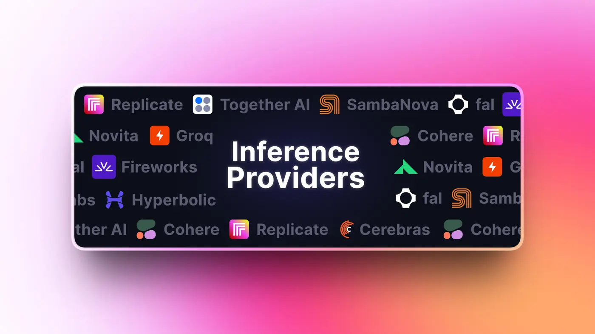

Hugging Face Inference Providers is a router. One Hugging Face token gets you access to 17 partner providers, including fal, Replicate, WaveSpeedAI, Together and Novita.

You pay each provider's own rate with no markup. And if one provider has issues, switching to another is mostly a config change.

So it is less a fal replacement and more a way to avoid being locked into any single provider. For dedicated deployments, Inference Endpoints is the separate product.

> ℹ️ **Fun fact:** AlternativeTo actually ranks Hugging Face as the top fal alternative.

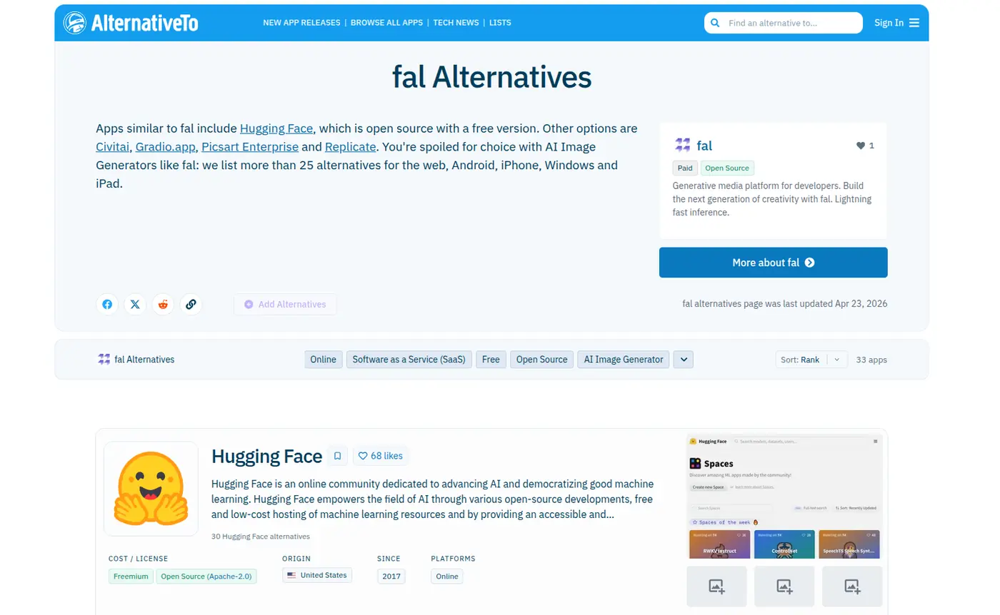

### What it does

- One token for 17 inference providers
- LLM, image, video and audio models
- Routes requests to whichever provider serves the model
- Inference Endpoints for dedicated deployments
- The home of most open-weights models

### Pricing

- Provider rates with no markup
- PRO is \$9/month and includes \$2 of inference credits
- Free accounts get a very small monthly credit

### 💡 **When I would pick it**

When I want access to open-weights models and the freedom to switch providers without rewriting my integration.

**Resources**

- [Hugging Face via Composio (bring your own key)](https://composio.dev/toolkits/hugging_face)
- [Inference Providers documentation](https://huggingface.co/docs/inference-providers)

## 9. Baseten

> ℹ Production-grade serving for your own models.

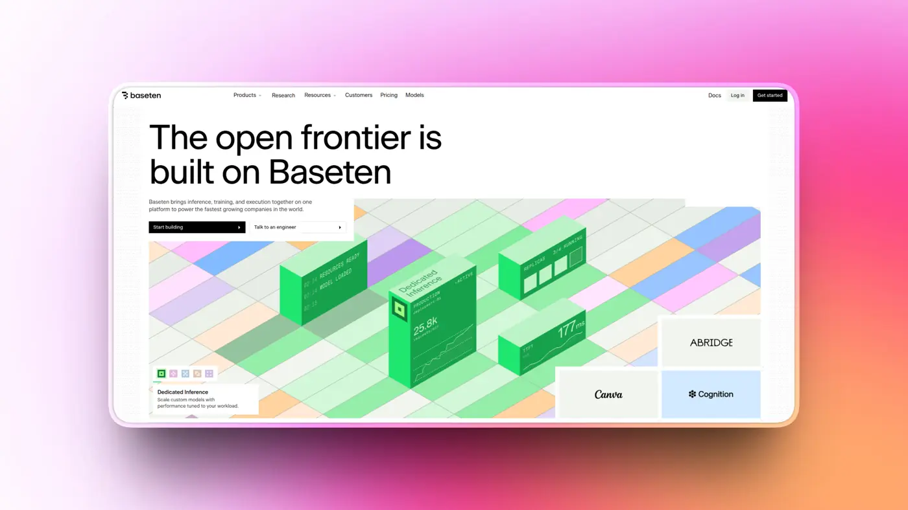

Baseten is a dedicated inference platform. You package your model with Truss, its open-source tool, and Baseten deploys and autoscales it.

It is built for companies with strict latency and reliability needs. Performance engineering is a big part of the pitch.

Baseten has even claimed the fastest Kimi K2.5 inference on Artificial Analysis. Benchmark crowns do not last long, though, and another provider is ahead on the newer K2.6.

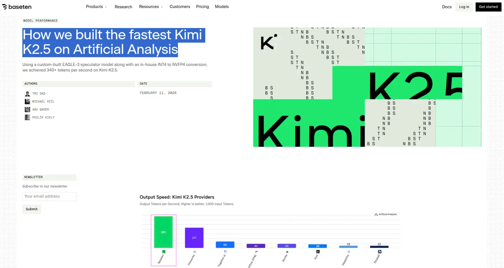

It is expensive per GPU-hour and has no ready-made media catalog. So it replaces fal's serverless side, not its model gallery.

### What it does

- Dedicated deployments for LLM, image, audio and custom models
- Truss for packaging models
- Autoscaling with strong latency engineering
- Model APIs for popular open models
- Hugging Face inference provider

### Pricing

- H100 80GB costs about \$6.50/hr
- A100 80GB costs about \$4.00/hr and B200 about \$9.98/hr
- Billed per minute of GPU time

### 💡 **When I would pick it**

When I am putting a proprietary or fine-tuned model into production and latency really matters.

**Resources**

- [Baseten](https://www.baseten.co/)
- [Baseten documentation](https://docs.baseten.co/)

## 10. Kie.ai

> ℹ The cheapest video API on this list, with a catch.


[Kie.ai](http://kie.ai/) resells popular media models at low prices. Veo 3.1, Kling 3.0, Seedance and Sora 2 are all there, often 30–50% cheaper per second of video than on fal.

Credits cost \$0.005 each and do not expire, and you get 80 free credits to test.

The catches are real, though. Even Kie's own docs admit stability may be a bit lower than going to the official providers.

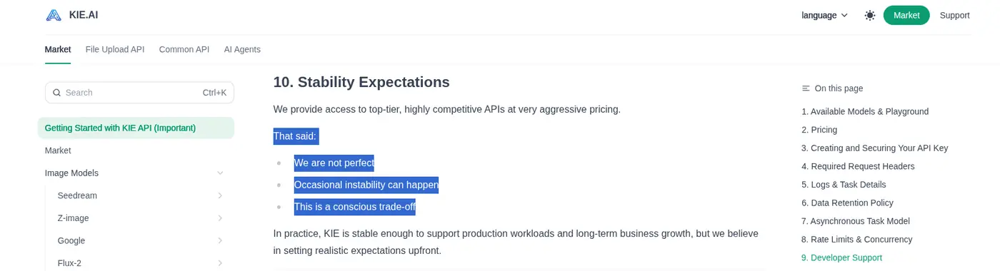

Reviews also mention outages and stuck jobs, and some reviewers question whether Kie is licensed to resell every model it offers.

### What it does

- Veo 3.1, Kling 3.0, Seedance, Sora 2 and music models
- Async jobs with webhooks or polling
- Prepaid credits that do not expire
- One API for many video models
- No custom models

### Pricing

- 80 free credits for testing
- Credits cost \$0.005 each
- Kling 3.0 Standard costs \$0.07 per second, and Seedance 2.0 \$0.205 per second at 720p

### 💡 **When I would pick it**

Prototypes and cost-driven experiments. I would not use it for anything production or compliance-sensitive.

**Resources**

- [Kie.ai via Composio (bring your own key)](https://composio.dev/toolkits/kieai)
- [Kie.ai documentation](https://docs.kie.ai/)

## So, which one should you switch to?

Honestly, it depends on why you are leaving fal in the first place. 🤷♂

Hitting **rate limits** or losing Veo 3.1? **Replicate** is the safest place to move that traffic.

Paying too much for **images**? **Runware** could help.

Mostly generating **video** with Seedance, Wan or Kling? **WaveSpeedAI** usually gets the newest versions first.

And so on and so forth.

And if none of those really apply, you might not need to switch at all. Keep fal, run it through **Composio Instant**, and add other providers to the same wallet as you need them.

Whatever you pick, test it on your own prompts before moving everything over. Price tables and benchmarks only tell you so much. 🫡

Which one are you using right now? Let me know. ✌
