# 10 Best Web Scraping APIs for AI Agents and Developers

Most modern websites are hard to scrape.

They load content with JavaScript, block repeated requests, and use CAPTCHAs and anti-bot systems to stop automated traffic.

Web scraping APIs handle all of that for you. You send a URL, and you get back HTML, markdown or structured data.

There are a lot of them, and picking one is tough. Almost every ranking you find online is written by one of the APIs being ranked, and somehow they always come out on top.

So I went through independent benchmarks, community threads and pricing pages, and picked the ten I would use today. ✅

> **Quick Note**: Success rates change a lot depending on who runs the test and how. I lean on independent benchmarks where I can, but nothing beats testing with your own URLs.

---

## TL;DR - Best web scraping APIs

| # | API | I would use it for | Starts at |
| --- | --- | --- | --- |
| 1 | **Bright Data** | Scale, enterprise and ready-made datasets | 5,000 free requests/mo; \$1.50 per 1K |
| 2 | **Firecrawl** | Clean markdown and JSON for LLMs | 1,000 free credits/mo; \$19/mo |
| 3 | **Zyte API** | The hardest, most protected sites | \$5 free credit; from \$0.13 per 1K requests |
| 4 | **Oxylabs** | E-commerce and search results at scale | \$5 free credit; \$15/mo |
| 5 | **Decodo** | Reliable scraping at a lower price | Free plan; \$19/mo |
| 6 | **ScrapingBee** | The quickest API to get working | 1,000 free credits; Freelance \$49/mo |
| 7 | **Scrapfly** | Debugging exactly why a request failed | 1,000 free credits; \$30/mo |
| 8 | **ScraperAPI** | Budget scraping on less protected sites | 1,000 free credits/mo; \$49/mo |
| 9 | **Apify** | Prebuilt scrapers for specific sites | \$5/mo free usage; \$19/mo |
| 10 | **Crawl4AI** | Open-source, self-hosted scraping | Free and open source |

> ⚠️ **NOTE:** These prices are as of November 2026. Tools like these often change their pricing, so make sure to double-check the official pricing page before making a decision.

You do not need all of them. Most teams end up with one workhorse for hard sites and one for clean, LLM-ready content.

## What is a web scraping API?

A web scraping API fetches a web page for you and handles everything that usually breaks a scraper: proxies, IP rotation, JavaScript rendering, CAPTCHAs and anti-bot systems.

Most of the tools here fall into four broad groups.

- **General-purpose unblocking APIs** focus on getting through protected sites, such as Zyte, Bright Data, Oxylabs, Decodo, ScrapingBee, Scrapfly and ScraperAPI
- **AI-ready scraping APIs** return clean markdown or JSON for LLMs, such as Firecrawl
- **Prebuilt scrapers** give you ready-made extractors for specific sites, such as Apify
- **Open-source crawlers** run on your own infrastructure, such as Crawl4AI

Cloudflare now blocks many AI crawlers by default on ad-supported pages.

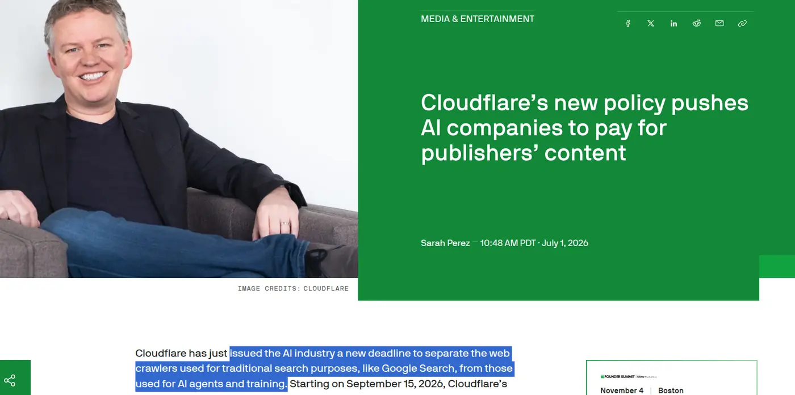

> 💁 If your agent needs to log in, click around, fill forms rather than just read pages, check out our guide to the [best browser agent APIs](https://composio.dev/content/best-browser-agent-apis).

## Use some of these through Composio Instant

> ℹ️ Firecrawl, Bright Data and Apify work through one Composio wallet, so you do not need a separate account or API key for each. Zero markup on API cost. Get started: [dashboard.composio.dev](https://dashboard.composio.dev/)

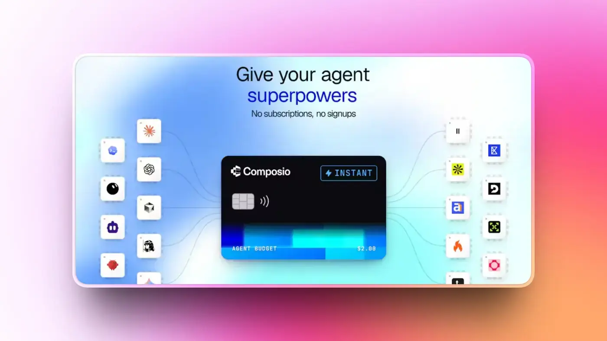

Scraping rarely stops at one tool. Your agent might use Firecrawl for docs, Bright Data for a protected site and an Apify Actor for Google Maps.

That is three accounts, three API keys and three bills.

[Composio Instant](https://composio.dev/instant) gives your agent one wallet instead. Each call costs the provider's own price with **0% markup** 🙈.

Zyte, ScrapingBee and Scrapfly are also available through Composio, but you connect your own API key for those. Adding it to a custom agent only takes a few lines. See [Instant developer docs](https://docs.composio.dev/docs/instant-tools) for more.

```python
from composio import Composio

composio = Composio()
session = composio.sessions.create(
    user_id="test_blog_user_composio",
    toolkits=["firecrawl", "brightdata", "apify"],
)
tools = session.tools()
```

Now to the actual list. 👇

## Top Web Scraping APIs

## 1. Bright Data

> ℹ️ The safe bet when you need scale, or would rather buy the data than scrape it.

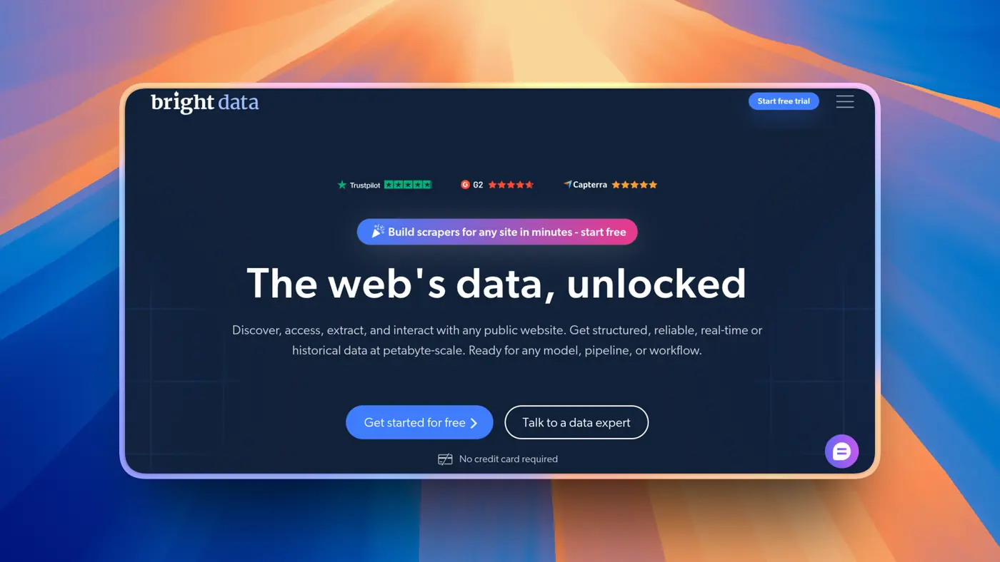

Bright Data is the biggest name in proxies and web data. For scraping, the main product is Web Unlocker: you send a URL, and it handles proxies, CAPTCHAs and rendering. It also has a SERP API, ready-made scrapers for 100+ sites like Amazon and LinkedIn, and a marketplace of datasets you can buy outright.

In String's benchmark, it placed 6th with 74.6%. It was not part of Proxyway's API test.

The free tier is generous, with 5,000 requests a month. The catch is billing. Different products bill in different ways, and settings matter.

### What it does

- Web Unlocker for protected sites
- Residential, datacenter, ISP and mobile proxies
- SERP API and 100+ site-specific scraper APIs
- Dataset marketplace
- MCP server

### Pricing

- 5,000 free requests a month
- Web Unlocker costs \$1.50 per 1,000 successful requests on pay-as-you-go
- The Scale plan is \$499/month, then \$1.30 per 1,000. With custom Web Unlocker features on, failed requests are billed too

### Pros and cons

**Pros**

- The broadest product range, from proxies to finished datasets
- Available through Composio Instant with no separate key

**Cons**

- Billing gets complicated across products
- Identity checks before production access

### 💡 **When I would pick it**

Enterprise scraping at scale, or when buying a ready-made dataset beats building a scraper.

**Resources**

- [Bright Data via Composio Instant](https://composio.dev/toolkits/brightdata)
- [Bright Data documentation](https://docs.brightdata.com/)

## 2. Firecrawl

> ℹ️ Still my default when the scraped data is headed for an LLM.

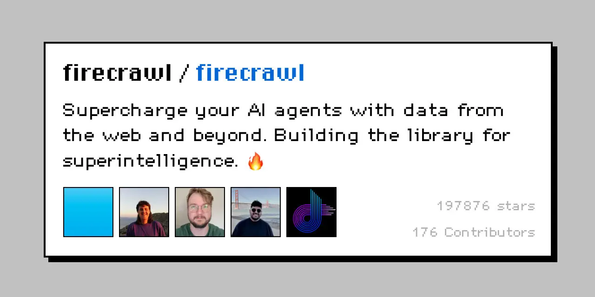

Firecrawl turns any URL into clean markdown or JSON. Give it a domain, and it can crawl the whole site. For AI work, the output quality is hard to beat. It is also the most common recommendation in RAG and agent threads.

But it has an interesting benchmark story. Firecrawl was the fastest API in Proxyway's test at 7.92 seconds, and also had the lowest success rate on heavily protected sites, at 33.69%. In String's benchmark, it came 4th with 80%.

Zyte, did not hold back on this point.

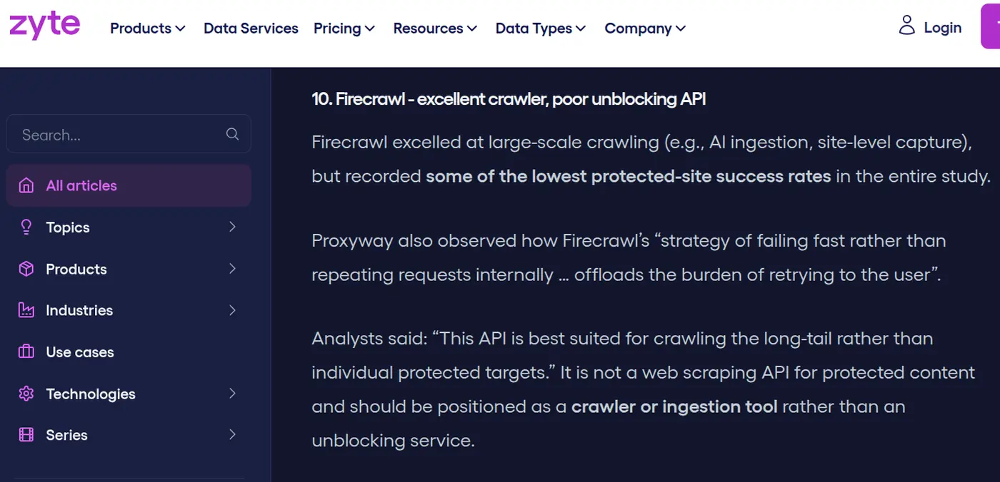

The core is open source under AGPL, which limits self-hosting for commercial use.

### What it does

- Scrape, crawl, map and search endpoints
- Clean markdown, JSON and screenshots
- PDF and DOCX parsing
- Schema-based extraction
- MCP server plus LangChain and LlamaIndex integrations

### Pricing

- Free plan with 1,000 credits a month
- Hobby is \$19/month for 5,000 credits, Standard is \$99/month for 100,000
- One credit per basic page, plus 4 more for JSON extraction

### Pros and cons

**Pros**

- The cleanest LLM-ready output
- The best developer experience for AI use cases

**Cons**

- Weaker on heavily protected sites
- AGPL license limits commercial self-hosting

### 💡 **When I would pick it**

RAG pipelines, documentation crawling, and anything where the scraped content goes straight into a model.

**Resources**

- [Firecrawl via Composio Instant](https://composio.dev/toolkits/firecrawl)
- [Firecrawl documentation](https://docs.firecrawl.dev/)

## 3. Zyte API

> ℹ️ The one I would trust with the hardest sites on the internet.

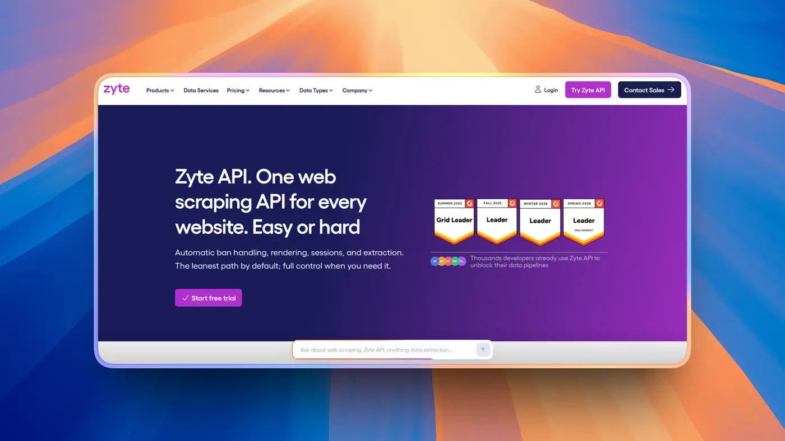

Zyte comes from the team behind Scrapy, the most popular open-source scraping framework. Its API picks the right proxy and rendering setup for each site on its own. You send a URL, and Zyte figures out how to get through.

That approach works. Zyte topped Proxyway's independent benchmark with a 93% success rate on heavily protected sites. In String's benchmark, though, it placed 11th with 68%, which shows how much results vary by test.

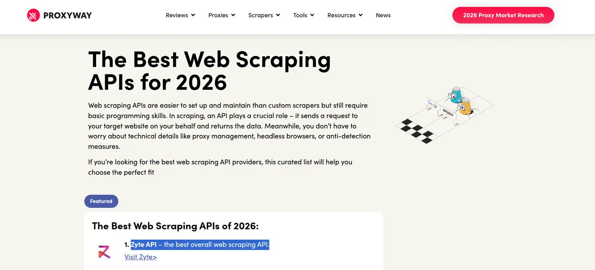

Pricing follows site difficulty. Easy sites are cheap, hard sites cost more. That is fair, but reviewers say it makes the monthly bill hard to predict.

### What it does

- Automatic ban handling, IP rotation and headless browser
- Scriptable browser actions and sessions
- Geolocation in 150+ countries
- AI extraction into typed schemas like products, articles and jobs
- Native Scrapy integration

### Pricing

- \$5 of free credit for 30 days
- Pay-as-you-go from \$0.13 to \$1.27 per 1,000 HTTP requests, depending on site difficulty
- Only successful responses are billed. Bans and rate limits are free

### Pros and cons

**Pros**

- Best independent result on protected sites
- Cost scales with how hard the site is

**Cons**

- Hard to forecast costs, especially as sites get re-tiered
- Ranked much lower in String's benchmark

### 💡 **When I would pick it**

When I am scraping a lot of different, heavily protected sites, or my team already lives in Scrapy.

**Resources**

- [Zyte via Composio (bring your own key)](https://composio.dev/toolkits/zyte_api)
- [Zyte API documentation](https://docs.zyte.com/)

## 4. Oxylabs

> ℹ️ Enterprise-grade scraping for e-commerce and search results.

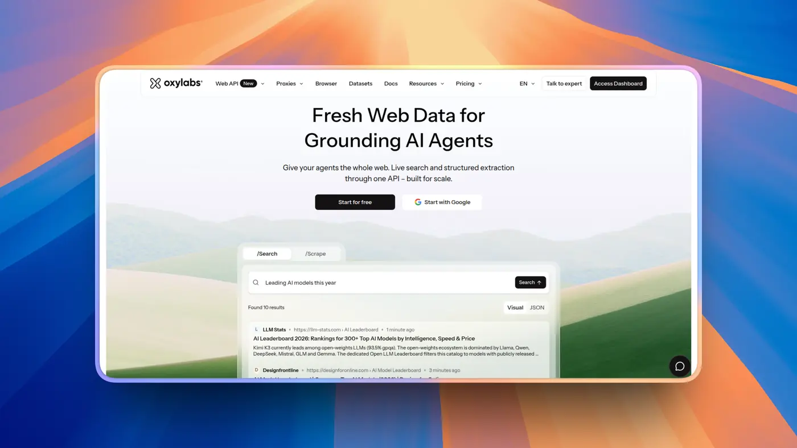

Oxylabs relaunched its scraping product as Web API in October 2026, with scrape and search endpoints on one credit pool. Its strength is ready-made parsers. Google, Amazon and even AI Overviews come back as structured data without writing selectors.

It is reliable too, with 85.8% success in Proxyway's test and 69% in String's, though responses were slower than most.

Oxylabs is also one of the companies Reddit sued over scraping. The case is still ongoing.

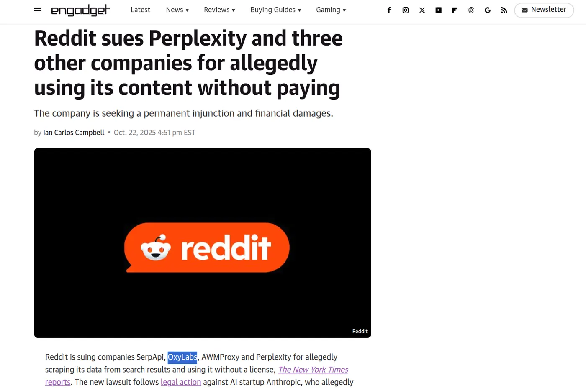

### What it does

- Scrape and search endpoints
- Prebuilt parsers for Google, Amazon and AI Overviews
- AI parser generator
- 150+ locations
- Remote MCP server

### Pricing

- \$5 welcome credit
- Plans start at \$15/month
- Generic scraping costs \$0.50 per 1,000 requests, down to \$0.25 at volume. Only successful results are billed

### Pros and cons

**Pros**

- Reliable on hard targets
- Strong prebuilt parsers for e-commerce and search

**Cons**

- Slower responses than most on this list
- Pricing changed several times in 2026

### 💡 **When I would pick it**

Price monitoring, search results and e-commerce data at scale.

**Resources**

- [Oxylabs](https://oxylabs.io/)
- [Oxylabs documentation](https://developers.oxylabs.io/)

## 5. Decodo

> ℹ️ Oxylabs-level reliability for less money.

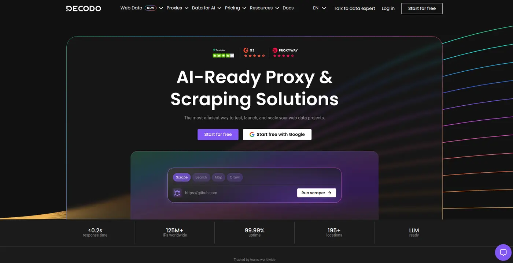

Decodo used to be Smartproxy. In October 2026, it launched its Web Data API, with scrape, search, map and crawl endpoints.

Proxyway named it the best value in its test, with about 87% success. It was also the most stable under load, with success barely moving between light and heavy traffic. In String's benchmark, it scored 50.6%.

One thing to watch: requests use the premium proxy pool by default unless you switch to standard. That can quietly double your bill.

Decodo and Oxylabs are now sister brands under the same parent company, along with ScrapingBee.

### What it does

- Scrape, search, map and crawl endpoints
- Standard and premium proxy pools
- JavaScript rendering
- Target-specific parsers
- MCP server plus Python, Go and TypeScript SDKs

### Pricing

- Free plan with up to 5,000 crawls or 10,000 pages
- Paid plans start at \$19/month
- \$0.50 to \$1.50 per 1,000 requests on the entry plan. Only successful requests are billed

### Pros and cons

**Pros**

- Great price-to-success ratio
- Stable when you send a lot of requests at once

**Cons**

- Premium proxies by default can double your bill
- Results vary a lot between benchmarks

### 💡 **When I would pick it**

When I want reliable scraping for a mid-sized project without enterprise pricing.

**Resources**

- [Decodo](https://decodo.com/)
- [Decodo documentation](https://help.decodo.com/)

## 6. ScrapingBee

> ℹ️ Probably the easiest scraping API to get working.

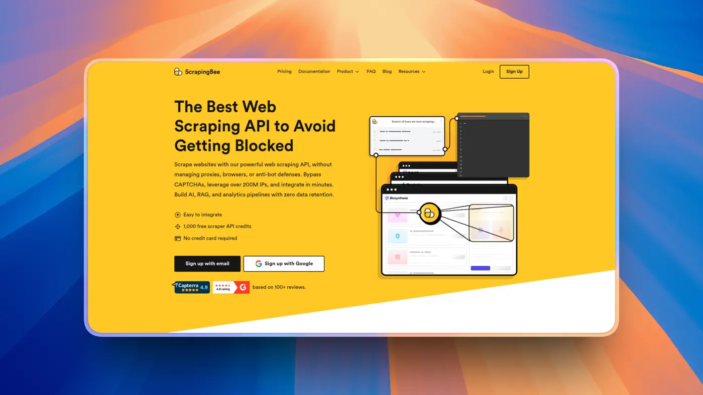

ScrapingBee keeps things simple. One endpoint, headless Chrome by default, and dedicated endpoints for Google, Amazon and Walmart. You can have a working request in a few lines of code, and the docs are some of the cleanest out there.

The thing to understand is credits. JavaScript rendering is on by default and costs 5 credits per request. Premium or stealth proxies cost even more.

The credit table is worth a look before you sign up.

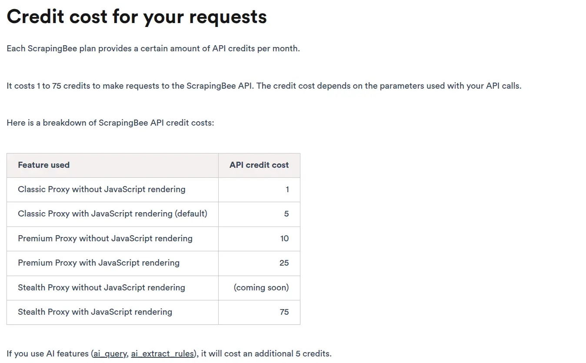

It also slows down under load. In Proxyway's test, success dropped from 84% to 73% at higher request rates, and it was the slowest API at about 24 seconds. String's benchmark put it at 73%.

### What it does

- Single endpoint with headless Chrome
- Classic, premium and stealth proxies
- Google, Amazon, Walmart and YouTube endpoints
- AI extraction and markdown output
- Screenshots and JavaScript scenarios

### Pricing

- 1,000 free credits
- Freelance is \$49/month for 250,000 credits
- 1 credit for a plain request, 5 with JavaScript, up to 75 with stealth proxies. Only successful calls are charged

### Pros and cons

**Pros**

- Very quick to get started
- Clean docs and site-specific endpoints

**Cons**

- JavaScript on by default multiplies cost 5x
- Slower and less reliable under heavy load

### 💡 **When I would pick it**

When I want a working scraper in five minutes and the target sites are not too aggressive.

**Resources**

- [ScrapingBee via Composio (bring your own key)](https://composio.dev/toolkits/scrapingbee)
- [ScrapingBee documentation](https://www.scrapingbee.com/documentation/)

## 7. Scrapfly

> ℹ️ For when you need to know exactly why a request failed.

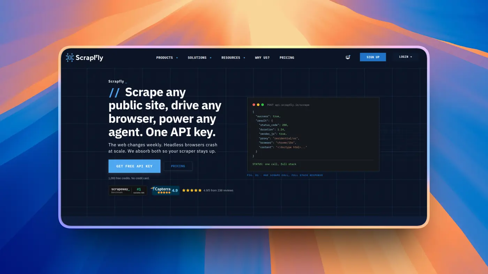

Scrapfly is a family of APIs: scraping, unblocking, cloud browser, screenshots, extraction and crawling, all on one credit pool. What sets it apart is debugging. Dashboards and session replay show what happened on every request, which saves a lot of guessing.

It did well in String's benchmark too, with 86.2% success and 2nd place. It was not part of Proxyway's test.

Costs can jump quickly on protected sites, though. One person ran into this on the very first call.

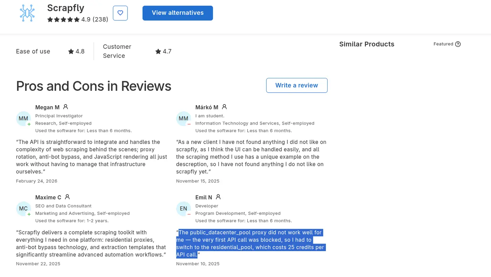

One more thing: a benchmark site that ranks Scrapfly first is owned by Scrapfly's parent company. So I would ignore that one and look at the others.

### What it does

- Scraping, unblocking and cloud browser APIs
- Datacenter and residential proxies in 190+ countries
- AI and template-based extraction
- Markdown output and screenshots
- Session replay and debugging dashboard

### Pricing

- 1,000 free credits that do not expire
- Discovery is \$30/month for 200,000 credits, Pro is \$100/month for 1M
- About 1 credit for a plain request, and around 25 to 30 for rendered residential requests

### Pros and cons

**Pros**

- Excellent visibility into every request
- Strong results in third-party tests

**Cons**

- Costs jump with residential proxies and anti-bot handling
- Its parent company owns one of the benchmark sites ranking it

### 💡 **When I would pick it**

Production scraping where my team needs to debug failures quickly.

**Resources**

- [Scrapfly via Composio (bring your own key)](https://composio.dev/toolkits/scrapfly)
- [Scrapfly documentation](https://scrapfly.io/docs)

## 8. ScraperAPI

> ℹ️ A solid budget pick for sites that are not fighting back too hard.

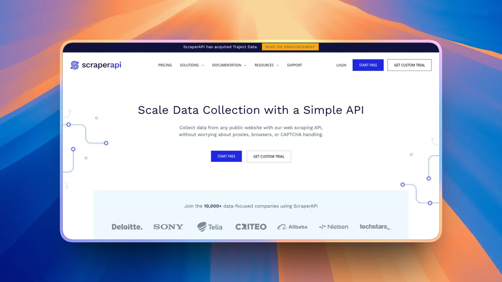

ScraperAPI is one of the older names here. It handles proxies, CAPTCHAs and rendering, and has structured endpoints for Amazon, Google and Walmart.

Proxyway found it cost-efficient on unprotected sites, with 69% success on the heavily protected ones. String's benchmark tells another story. ScraperAPI jumped from 64% to 84% once it was configured at its strongest setting. Settings matter a lot here.

On the cheaper plans, geotargeting is limited to the US and EU.

### What it does

- Proxy rotation and CAPTCHA handling
- JavaScript rendering
- Structured endpoints for Amazon, Google and Walmart
- DataPipeline for scheduled scraping
- Async batch requests

### Pricing

- 7-day trial with 5,000 credits, then 1,000 free credits a month
- Hobby is \$49/month for 100,000 credits
- JavaScript rendering uses 10 credits, and protected sites up to 75

### Pros and cons

**Pros**

- Simple, predictable plans
- Structured endpoints for popular sites

**Cons**

- Weaker on heavily protected sites
- Credit multipliers add up fast

### 💡 **When I would pick it**

Budget projects on sites with light or moderate protection.

**Resources**

- [ScraperAPI](https://www.scraperapi.com/)
- [ScraperAPI documentation](https://docs.scraperapi.com/)

## 9. Apify

> ℹ️ When someone has already built the scraper you need.

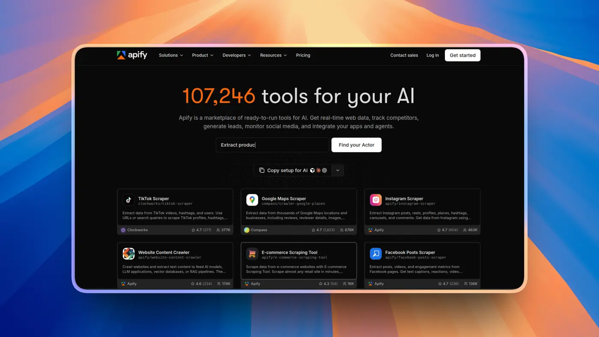

Apify's biggest strength is its Store. It has thousands of prebuilt scrapers, called Actors, for Google Maps, Instagram, Amazon and many more sites. Instead of writing selectors yourself, you pick the right Actor and run it. Its Website Content Crawler also turns whole sites into LLM-ready markdown.

If Google Maps is your target, we have a full guide on [scraping Google Maps for leads with Claude](https://composio.dev/content/how-to-scrape-google-maps-for-leads-with-claude).

With its Web Fetch Actor, Apify placed 5th in String's benchmark with 77.4%, though results depend a lot on which Actor you use.

The catch is consistency. Some Actors are built by Apify and others by the community, so quality varies a lot. Compute-based billing can also be hard to predict.

### What it does

- Thousands of prebuilt Actors for specific sites
- Website Content Crawler for LLM-ready markdown
- Scheduling, storage and proxies built in
- Crawlee open-source SDK
- MCP server

### Pricing

- \$5 of free usage every month
- Starter is \$19/month
- Compute costs \$0.20 per compute unit on Starter, and some Actors also charge per result

### Pros and cons

**Pros**

- The biggest library of ready-made scrapers
- Scheduling and storage included

**Cons**

- Actor quality varies a lot
- Compute billing is hard to predict

### 💡 **When I would pick it**

When I need data from one specific platform and a good Actor already exists for it.

**Resources**

- [Apify via Composio Instant](https://composio.dev/toolkits/apify)
- [Apify documentation](https://docs.apify.com/)

## 10. Crawl4AI

> ℹ️ The open-source pick if you would rather own the whole thing.

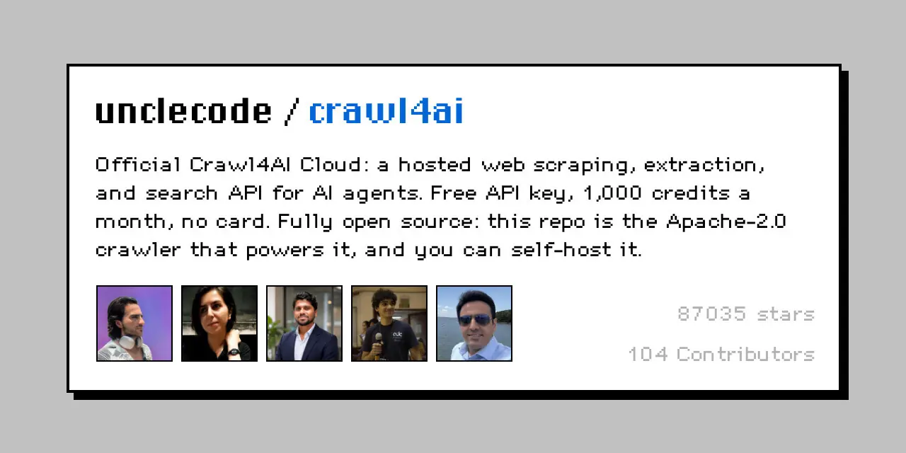

Crawl4AI is a Python crawler built on Playwright. It turns pages into LLM-ready markdown and JSON, and it is completely free. It is also one of the most-starred projects in this space, with around 87,000 GitHub stars.

The license is Apache-2.0, which is more permissive than Firecrawl's AGPL. That makes it a popular pick for teams that want to self-host.

It is not part of the unblocking benchmarks, since it is not a managed unblocker. You handle proxies and anti-bot protection yourself, so success depends on your own setup. It also had a couple of security fixes in 2026, so pin your version and keep it updated.

### What it does

- LLM-ready markdown and JSON output
- Deep crawling across whole sites
- CSS, XPath or LLM-based extraction
- Docker server for self-hosting
- Hosted Crawl4AI Cloud option

### Pricing

- Free and open source
- Crawl4AI Cloud includes 1,000 free credits a month
- You pay for your own servers and proxies

### Pros and cons

**Pros**

- No per-request bill and a permissive license
- Your data stays on your own infrastructure

**Cons**

- You fight anti-bot systems yourself
- The API changes between versions, so updates take some care

### 💡 **When I would pick it**

Python teams with engineering time, scraping sites that are not heavily protected.

**Resources**

- [Crawl4AI on GitHub](https://github.com/unclecode/crawl4ai)
- [Crawl4AI documentation](https://docs.crawl4ai.com/)

## If I were starting a scraping project today

I would not pick one API. I would pick two, maybe three.

**Firecrawl** for anything headed into an LLM.

**Zyte** for the sites that are a bit complex, or **Decodo** if the budget is tight.

And so on and so forth. Each tool has its own pros and cons, so use what fits you best.

First, I recommend that you run the ones that support it through **Composio Instant**, so your agent is not working with many keys.

Happy scraping, and make sure to be nice to the servers you scrape. 😁

## FAQs

### What is the best web scraping API?

It depends on your targets. Zyte did best on heavily protected sites in Proxyway's independent benchmark, Firecrawl is the go-to for LLM-ready content, and Bright Data is the safest pick at scale.

### Which web scraping API has the highest success rate?

In Proxyway's independent test, Zyte had the highest success rate at about 93% on heavily protected sites. Other benchmarks rank things differently, so test with your own URLs.

### Is there a free web scraping API?

Most have a free tier. Bright Data gives 5,000 requests a month, Firecrawl 1,000 credits, and Crawl4AI is fully free if you host it yourself.

### What is the best web scraping API for AI and LLMs?

Firecrawl, for clean markdown and JSON with very little setup. Crawl4AI is the open-source option if you want to self-host.

### Do I pay for failed requests?

With most APIs on this list, no. They only bill successful requests, but some have exceptions, so check the billing docs.

### Is web scraping legal?

It depends on what you scrape and how. Public data is generally treated differently from data behind a login, but legal pressure has grown in 2026, including Reddit's lawsuit against several scraping companies. Check each site's terms, and talk to a lawyer if you are unsure.
