# 10 Browser Agent APIs That Let Your AI Actually Use the Web

AI agents are already pretty good at reasoning.

But reasoning only gets them so far. At some point, they need a way to reach the web, search it, read pages, log in, click around, and actually get things done.

That is where browser agent APIs come in.

The problem is that this category is so populated. Some tools focus on search. Some turn websites into clean markdown. Others give you a remote browser to control. And some just take a goal and handle the whole task for you. So, it’s a whole spectrum and it get tougher to decide which one to pick.

So I went through the major options and picked the ones I would actually use today. ✅

> **Quick Note:** These are completely my picks based on my extensive usage for the past few months.

## TL;DR - Best browser agent APIs

| # | API | I would use it for |
| --- | --- | --- |
| 1 | **TinyFish** | Search, fetch, browsers and web agents under one key |
| 2 | **Firecrawl** | Turning pages and whole sites into LLM-ready markdown |
| 3 | **Exa** | Semantic web search on its own index |
| 4 | **Parallel** | Cheap search and structured deep research |
| 5 | **Tavily** | The fastest way to give an agent web search |
| 6 | **Browser Use** | Open-source autonomous browser agents |
| 8 | **Bright Data** | Sites that block everyone else |
| 7 | **Browserbase** | Hosted browsers when you write the agent logic yourself |
| 9 | **Kernel** | Fast, cheap browser fleets at scale |
| 10 | **Apify** | Prebuilt scrapers for specific sites |

For most agents, one good search API and one reliable way to act on websites will cover most of what you need.

## What is a browser agent API?

A browser agent API gives your agent access to the web without forcing you to build your own scraping stack, proxy setup, or headless Chrome infrastructure.

Most of the tools here fall into four broad groups.

- **Search APIs** return ranked results that are easier for LLMs to work with, such as Exa, Parallel and Tavily
- **Crawl and extract APIs** turn URLs into clean markdown or structured JSON, such as Firecrawl and Apify
- **Browser infrastructure** gives you hosted browsers that you control with Playwright, an SDK, or an agent framework, such as Browserbase, Kernel and Bright Data
- **Autonomous web agents** take a goal in plain English and handle the clicking and navigation for you, such as TinyFish and Browser Use

The first two mostly help agents **read the web**. The last two help them **act on it**.

If you are looking specifically for search, check out our guide to the [best AI search APIs for agents](https://composio.dev/content/9-top-ai-search-engine-tools).

## Access most of these through Composio Instant

> ℹ Seven of the ten tools on this list work through one Composio wallet, so you do not need a separate account, subscriptions, or API key for each one. And there is zero markup on API cost. Get started: [dashboard.composio.dev](https://dashboard.composio.dev)

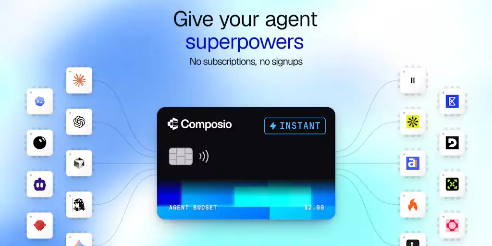

There is one sad parts of building web agents. Your agent might need a search API, a scraper, and a browser agent. Now you have three accounts, three API keys, three dashboards, and three separate bills to take care of.

And chances are your agent will barely use some of them every month.

[Composio Instant](https://composio.dev/instant) makes this much simpler. Your agent gets one wallet and pays for each call at the provider's own price with **0% markup** 🙈.

To kick things off, we loaded \$1M into agent wallets, so your agent’s first few calls are on us.

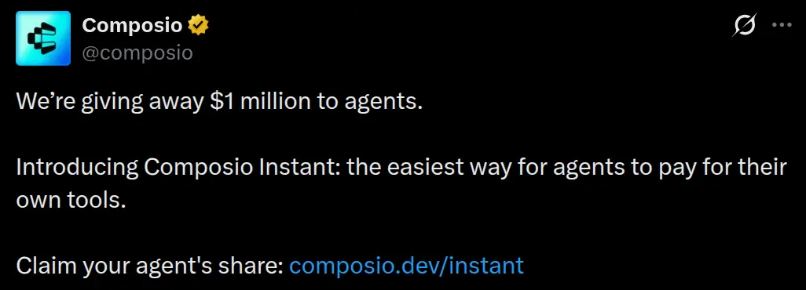

TinyFish, Firecrawl, Exa, Parallel, Tavily, Browser Use and Bright Data are available through Instant. Browserbase, Kernel and Apify are also available through Composio, but you connect your own API key for those.

Adding it to a custom agent only takes a few lines. See [Instant developer docs](https://docs.composio.dev/docs/instant-tools) for more.

```python
from composio import Composio

composio = Composio()
session = composio.sessions.create(
    user_id="test_blog_user_composio",
    toolkits=["exa", "firecrawl", "browser_use"],
)
tools = session.tools()
```

### What you get

- One wallet for all supported tools with billing per call
- Provider pricing with no markup
- No API keys to manage for Instant tools
- Execution logs that show what every call costs
- Your own connected accounts still work without an Instant charge
- Works with Claude, ChatGPT, Cursor and any MCP client
- \$2 of free credit to get started

**Resources**

- [Composio Instant](https://composio.dev/instant)
- [Instant documentation](https://docs.composio.dev/docs/instant-tools)

Now to the actual list. 👇

## Best Browser Agent APIs in 2027

## 1. TinyFish

> ℹ The one I would pick when I want both reading and acting on the web through a single API.

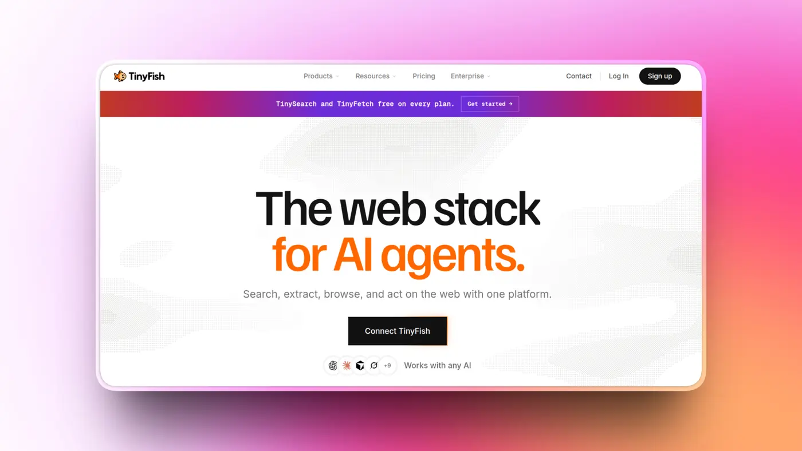

Most tools on this list are really good at one particular job. TinyFish tries to cover the whole flow.

It gives you a Search API, a Fetch API that turns URLs into markdown or JSON, a managed stealth browser, and a web agent that can complete multi-step tasks from a plain-English instruction.

Search and Fetch are free. You only start paying when the browser or agent actually does work. The agent pricing already includes the LLM, proxies, and anti-bot handling, so there is no separate model bill hiding somewhere else.

It also supports logins through stored credentials and browser profiles. Every run gives you logs, screenshots, and source URLs, which makes it much easier to understand what the agent actually did when something goes wrong.

### What it does

- Web search with structured JSON results
- Fetches and renders URLs into markdown, HTML or JSON
- Managed stealth Chrome with fast cold starts
- Goal-based agent runs with logins, forms and structured output
- Hosted MCP server plus Python and TypeScript SDKs

### 💡 **When I would pick it**

When I want the agent to find information and then act on it without wiring together three different providers.

**Resources**

- [TinyFish via Composio Instant](https://composio.dev/toolkits/tinyfish)
- [TinyFish documentation](https://docs.tinyfish.ai/)

## 2. Firecrawl

> ℹ Probably the first tool I would reach for when I need to turn the web into clean data for an LLM.

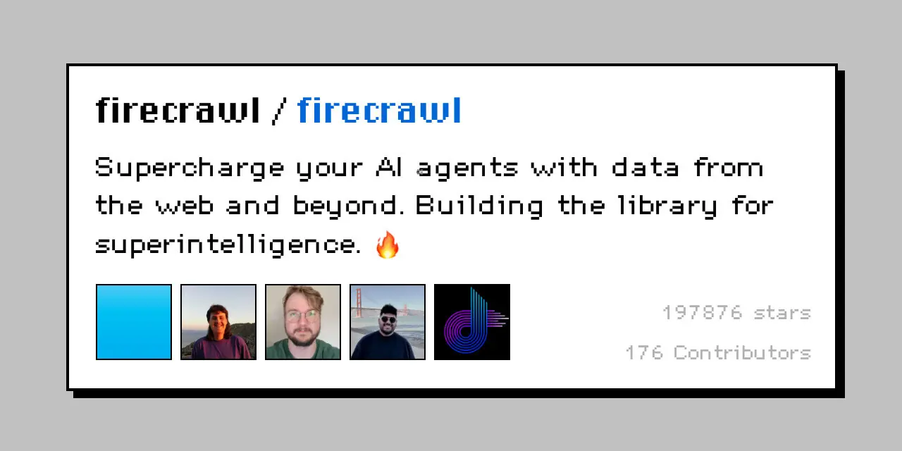

Firecrawl is very easy to understand. Give it a URL and it gives you clean markdown back. Give it a domain and it can crawl the whole site.

It also handles JavaScript rendering and anti-bot measures for you, which saves you from building that part yourself.

Pricing works through credits per page, so it is relatively easy to estimate what a crawl will cost. A basic page uses one credit, while things like structured JSON extraction use more.

Firecrawl has also been expanding beyond scraping. It recently launched Alexandria, which combines the live web with licensed data and Firecrawl's own indexes, so it is slowly becoming a broader web data layer rather than only a scraper.

Firecrawl plans to pay the publishers and experts whose knowledge ends up powering agents.

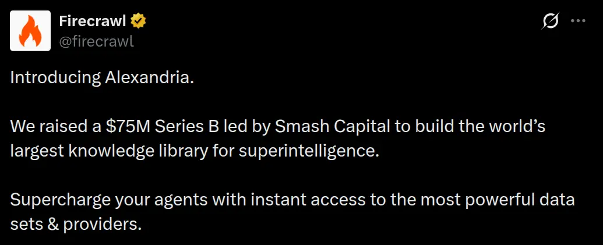

### What it does

- Scrape, crawl and map endpoints
- LLM-powered extraction into structured JSON
- Built-in web search
- Interactive browser mode and an Agent endpoint in preview
- Open-source core and an MCP server

### 💡 **When I would pick it**

RAG pipelines, documentation crawling, research systems, or pretty much any workflow where the agent mainly needs clean content from web pages.

**Resources**

- [Firecrawl via Composio Instant](https://composio.dev/toolkits/firecrawl)
- [Firecrawl documentation](https://docs.firecrawl.dev/)

## 3. Exa

> ℹ A search engine built for AI from the beginning rather than a thin layer on top of Google.

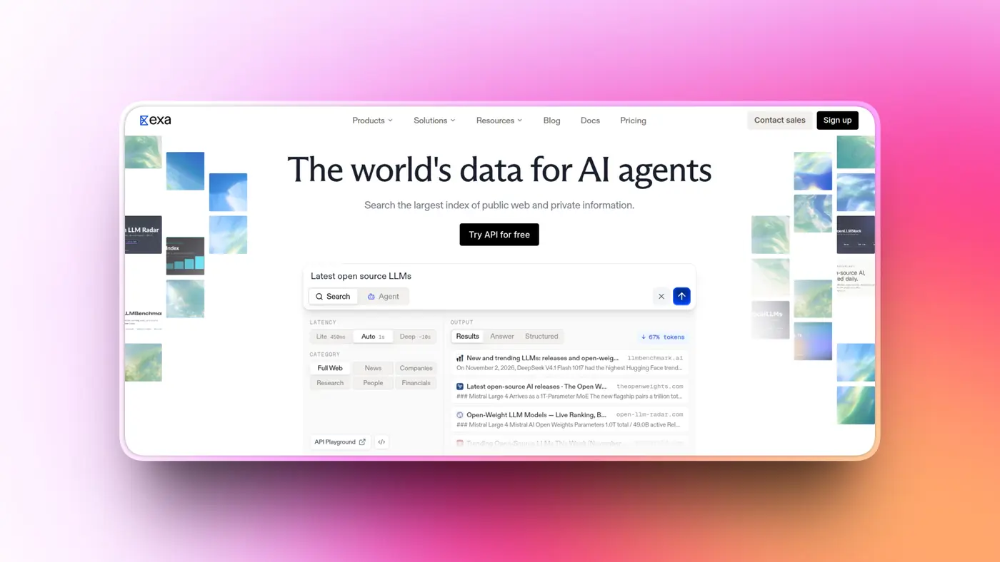

Exa runs its own search index and focuses heavily on understanding meaning rather than matching keywords. That is useful for open-ended searches such as finding companies similar to one you already know or papers that make a specific argument.

Those are the kinds of searches where normal keyword matching starts to struggle.

Exa also has deeper search modes that run multiple searches and reason across the results before returning an answer. That makes it especially useful for research agents.

It is already used as the search layer behind products such as Cursor. The main thing I would watch is cost, since asking for more results or requesting the full contents of pages can increase the price beyond the basic search call.

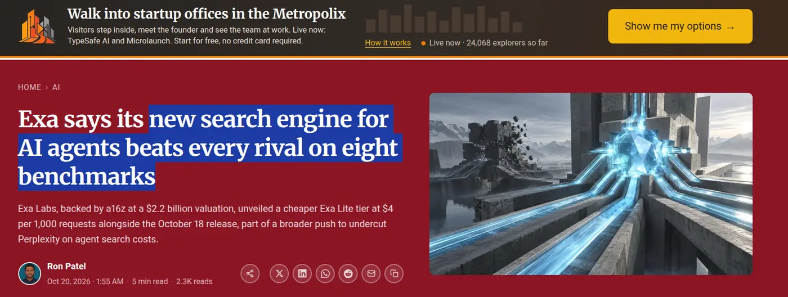

### What it does

- Semantic search with fast, deep and deep-reasoning modes
- Can return full page contents alongside search results
- Dedicated people and company search
- Monitors and Websets for tracking and list building
- Free hosted MCP server

### 💡 **When I would pick it**

Research agents, coding agents that need to search documentation, and anything where I care more about finding the right result than getting the absolute cheapest search.

**Resources**

- [Exa via Composio Instant](https://composio.dev/toolkits/exa)
- [Exa documentation](https://docs.exa.ai/)

## 4. Parallel

> ℹ Search and deep research APIs designed with agents as the main user.

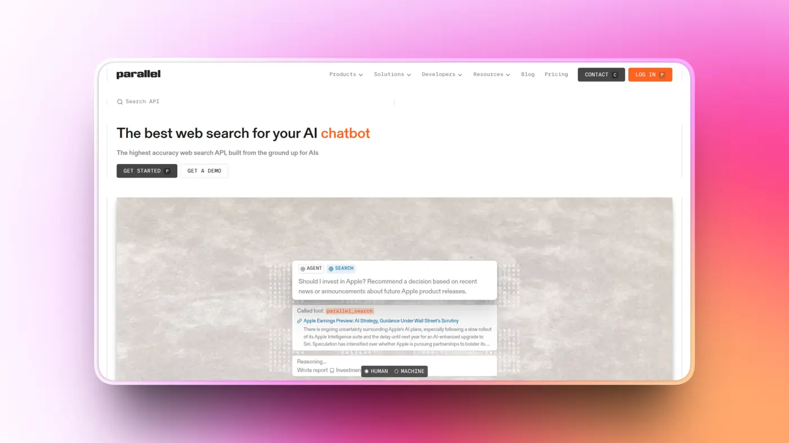

Parallel does two things particularly well. Its Search API is very cheap, while its Task API can run structured research and return answers with citations.

The research tiers range from quick lookups to longer, multi-minute research jobs. Each Task tier has a fixed price per run, which I like because it makes batch research much easier to budget.

Parallel was founded by **former Twitter CEO Parag Agrawal**, and companies such as Clay and Harvey use it. One thing to know is that Parallel is focused on reading the web, so it is not the tool I would pick for logging into websites, clicking buttons, or filling forms.

Parag’s bet is that agents will end up using the web far more than people ever have. 🥴

https://youtu.be/fORbmCMX5GA?si=RbGZDgl7XsMz6pO7

### What it does

- Web search starting at \$1 per 1,000 requests
- Extract API that works with JavaScript pages and PDFs
- Task API for structured research with citations
- FindAll for discovering lists of entities
- Monitor for tracking changes across the web

### 💡 **When I would pick it**

Lead enrichment, research at scale, or any workflow where I want structured answers and predictable pricing.

**Resources**

- [Parallel via Composio Instant](https://composio.dev/toolkits/parallel)
- [Parallel documentation](https://docs.parallel.ai/)

## 5. Tavily

> ℹ Probably the quickest way to give an agent web search.

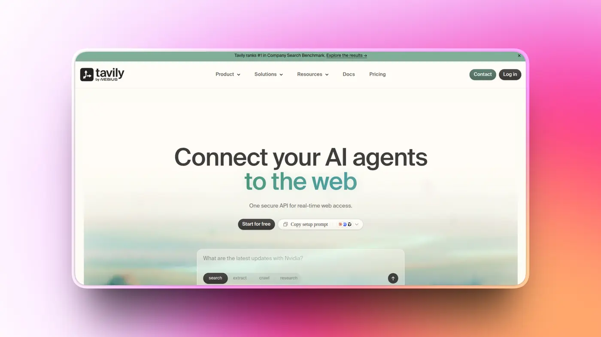

Tavily was one of the earlier search APIs built specifically for LLM applications, and the developer experience reflects that. You call the API, get clean ranked content back, and let the agent continue.

There isn't much difference I can show here, but I think you get the idea.

A single credit pool covers search, extract, map and crawl, so you are not dealing with separate quotas for each feature.

Nebius acquired Tavily in 2026, but Tavily continues to operate under its own brand. Its search can cost a little more than Parallel's cheapest option, but getting it running is about as straightforward as it gets.

Tavily also got a new bid this year.

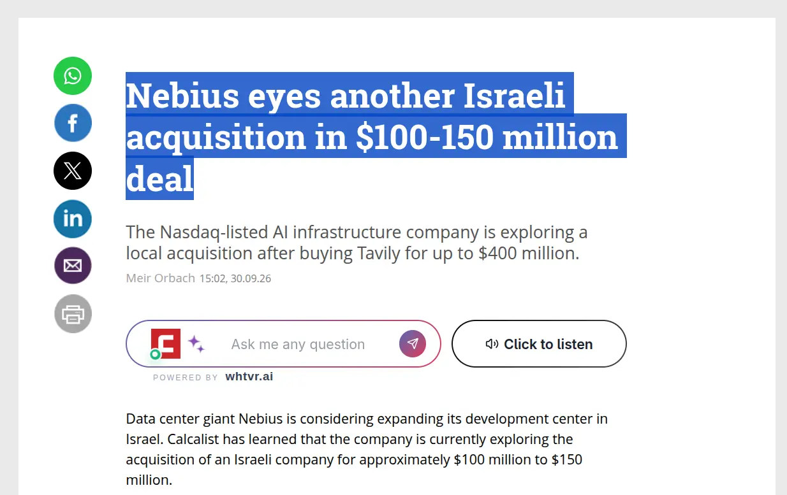

### What it does

- Search with basic, advanced and fast modes
- Extract, map and crawl endpoints
- Research endpoint for multi-step answers
- Broad support across LangChain and other frameworks
- 1,000 free credits each month

### 💡 **When I would pick it**

Prototypes, chatbots that need current information, or those moments when I just want web search working quickly without thinking too much about the setup.

**Resources**

- [Tavily via Composio Instant](https://composio.dev/toolkits/tavily)
- [Tavily documentation](https://docs.tavily.com/)

## 6. Browser Use

> ℹ One of the most popular open-source browser agents, with a managed cloud option when you need it.

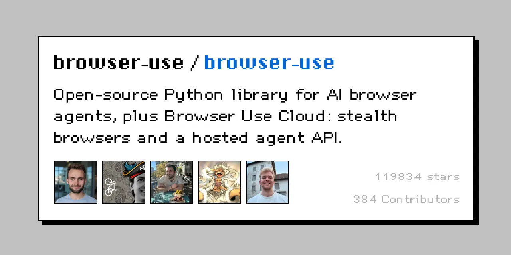

Browser Use started as an open-source library, and you can still run it that way. Browser Use Cloud gives you the managed version, where you hand it a task and it runs the agent for you using hosted browsers.

Agents can use Browser Use's own models or an LLM you choose. Pricing combines the model cost, a small margin, and the browser time used by the task.

Browser Use has also shipped a faster agent mode that can finish typical tasks in around 20 seconds. It is also what powers **Composio's own Browser Tool** under the hood.

Stealth is also where browser agents get controversial. Last year, Cloudflare accused Perplexity of disguising its crawlers to get past blocks.

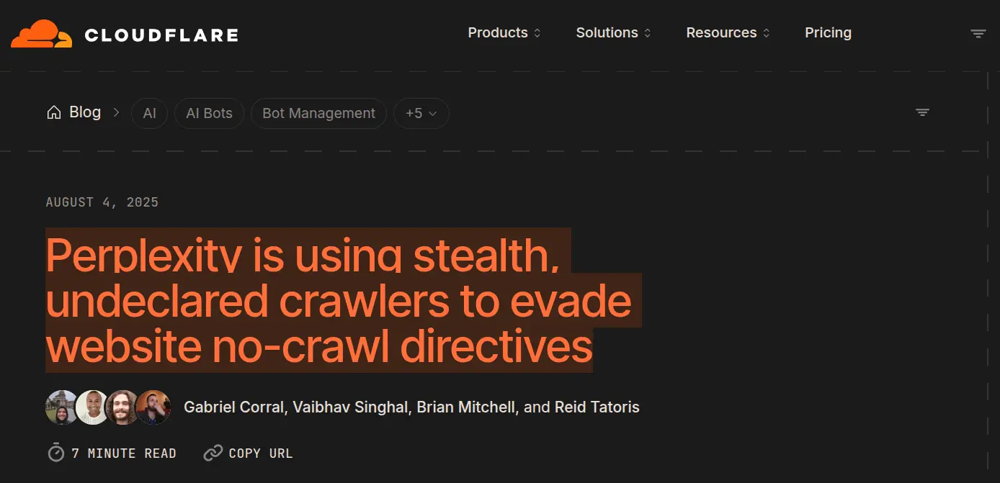

### What it does

- Plain-English tasks with navigation, forms and logins
- Persistent browser profiles that keep sessions logged in
- Live browser view with human takeover
- Stealth and CAPTCHA handling
- Browsers starting from \$0.02 per browser-hour

### 💡 **When I would pick it**

When I want the freedom of open source while developing locally, but also want a managed version when the agent goes into production.

**Resources**

- [Browser Use via Composio Instant](https://composio.dev/toolkits/browser_use)
- [Browser Use documentation](https://docs.browser-use.com/)

## 7. Browserbase

> ℹ Hosted browsers for teams that want to write the agent logic themselves.

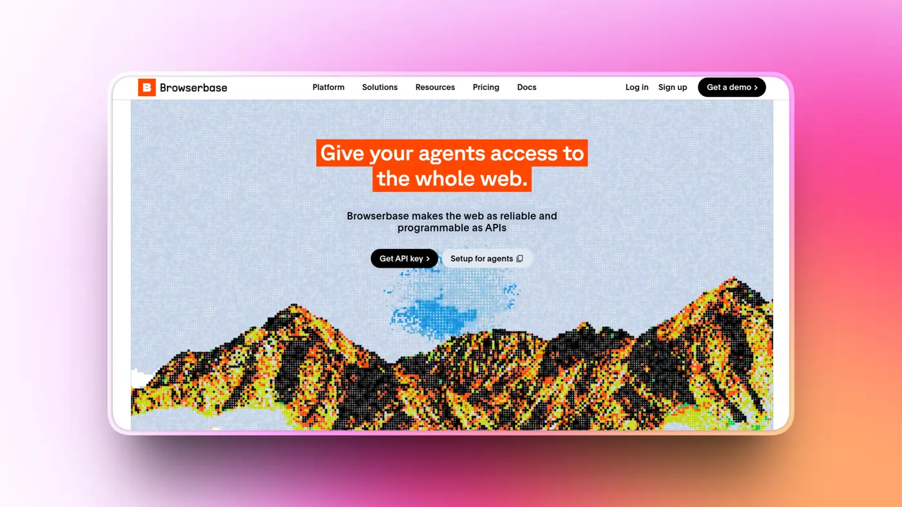

Browserbase gives you cloud-hosted Chrome that works with tools you probably already know, including Playwright, Puppeteer and Selenium. It also builds Stagehand, an open-source SDK that adds commands like `act()`, `extract()` and `observe()` on top of Playwright.

You bring your own LLM, so Browserbase mainly charges you for the browser infrastructure. There is a free browser hour for testing, and paid plans start at \$20 per month.

The feature I probably like most is session replay. When an agent fails halfway through a workflow, you can watch the session and see exactly what happened instead of trying to reconstruct everything from logs.

That becomes very useful once browser agents start doing longer tasks.

### What it does

- Hosted browsers with stealth, proxies and CAPTCHA solving
- Session replay for debugging agent runs
- Reusable browser contexts that keep accounts logged in
- Stagehand SDK for AI-driven browser actions
- Official MCP server

### 💡 **When I would pick it**

When I want to build the browser agent logic myself but do not want to spend time managing browser infrastructure.

**Resources**

- [Browserbase via Composio (bring your own key)](https://composio.dev/toolkits/browserbase_tool)
- [Browserbase documentation](https://docs.browserbase.com/)

## 8. Bright Data

> ℹ The one I would try when other tools keep getting blocked.

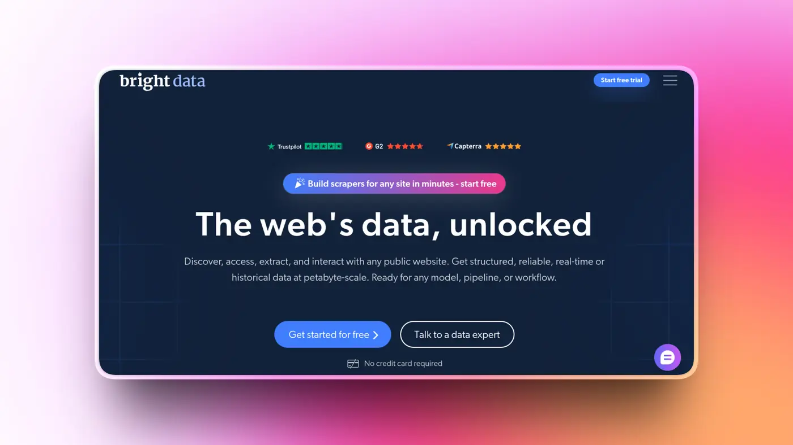

Bright Data is best known for its proxy and web-unblocking infrastructure. It now exposes much of that infrastructure to agents through its Browser API, scraping APIs and MCP server.

The free tier is shared across its products, so the same 5,000 monthly credits can be used to try the browser, search results data, and scraping tools.

The trade-off is pricing complexity. Different Bright Data products use different billing models, and browser usage is billed based on traffic, so if I were planning to use it heavily, I would model the cost before scaling anything up.

Bright Data has also fought for this in court. Meta, once a customer, sued it over scraping Facebook and Instagram, and lost. I love it. 🙂

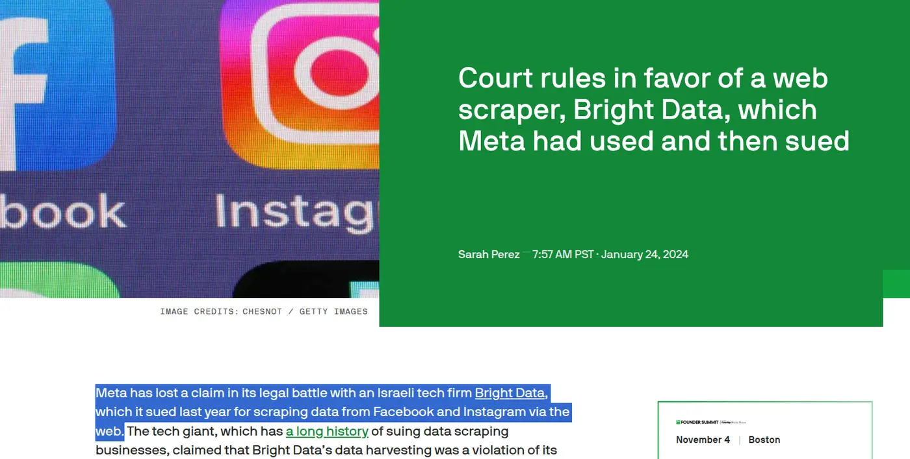

### What it does

- Remote browsers with built-in unblocking
- Search results data and scrape-as-markdown
- Ready-made scrapers for major websites
- MCP server with dozens of tools
- 5,000 free credits each month

### 💡 **When I would pick it**

Geo-restricted websites, heavily protected pages, or anything where the easier browser tools keep getting blocked.

**Resources**

- [Bright Data via Composio Instant](https://composio.dev/toolkits/brightdata)
- [Bright Data MCP on GitHub](https://github.com/brightdata/brightdata-mcp)

## 9. Kernel

> ℹ Fast browser infrastructure where idle time does not keep running up the bill.

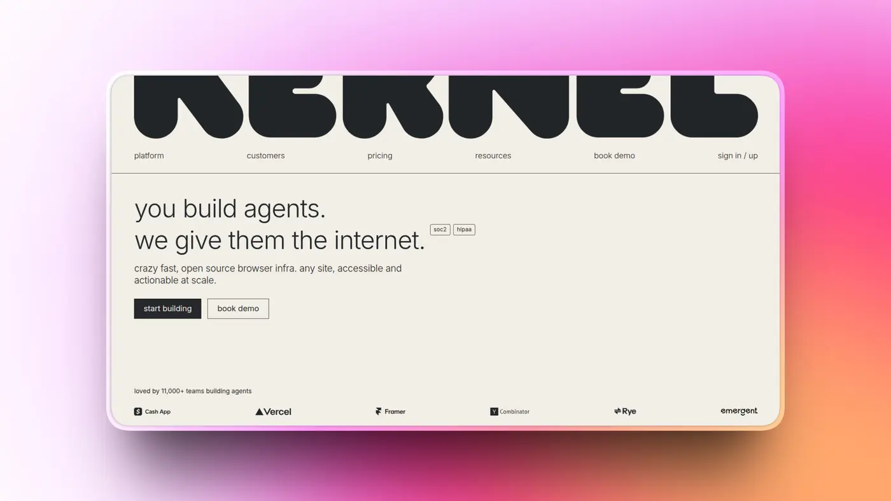

Kernel is browser infrastructure built using unikernels, which helps it start browsers very quickly. What caught my attention, though, is the billing model.

Kernel bills browser usage by the second, and idle browsers are free. That can matter a lot for agents that spend time waiting on a user, another tool, or some external process.

The browser can stay logged into the session while sitting idle, and you are not paying for all of that waiting time.

Kernel is backed by Accel and Y Combinator. Like Browserbase, it is mainly infrastructure, so you still bring the agent logic and the LLM yourself.

### What it does

- Headless, visible and GPU browsers
- Browser pools, profiles and proxies
- Managed logins for agents
- Live view and session replays
- Hosted MCP server

### 💡 **When I would pick it**

When I need to run a lot of browsers at once, or I am building an interactive agent where startup time and latency actually matter.

**Resources**

- [Kernel via Composio (bring your own key)](https://composio.dev/toolkits/kernel)
- [Kernel](https://kernel.sh/)

## 10. Apify

> ℹ A huge marketplace of ready-made scrapers that your agent can call instead of building one from scratch.

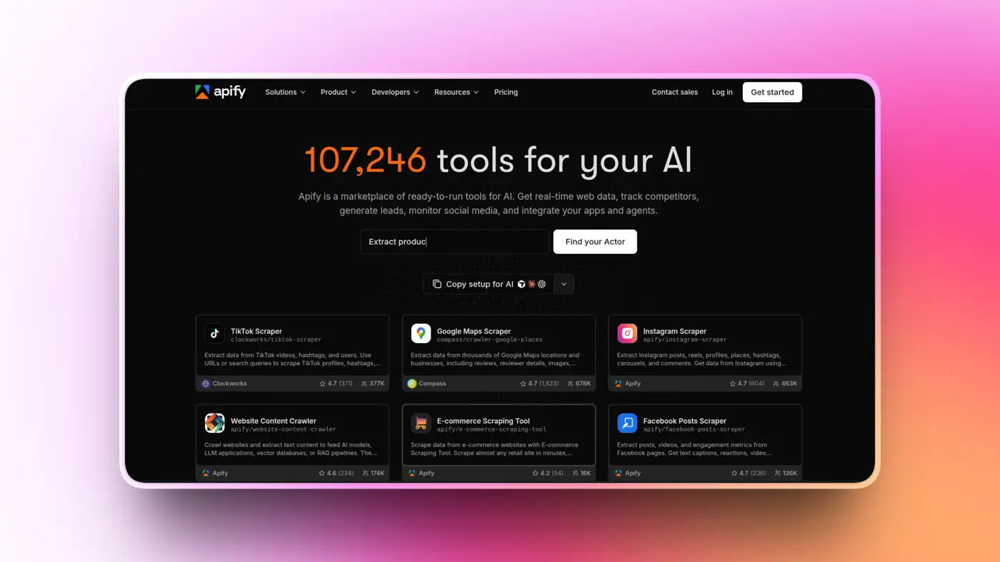

The biggest reason to use Apify is the Apify Store. It has thousands of prebuilt scrapers, which Apify calls Actors, for things like Google Maps, social platforms, marketplaces, and many other websites.

Instead of building the scraper yourself, your agent can pick the right Actor and run it.

Some Actors are built by Apify and others come from the community, so quality can vary quite a bit. I would always check reviews, usage numbers, and recent activity before depending on one in production.

Pricing is mostly based on compute, although some Actors also charge per result. Agents can even pay for Actor runs on their own without needing a separate Apify account.

### What it does

- Thousands of prebuilt Actors for specific websites
- Website Content Crawler and RAG Web Browser for LLM applications
- Scheduling and storage for recurring scraping jobs
- Hosted MCP server
- \$5 of free usage each month

### 💡 **When I would pick it**

When I need structured data from one specific platform and somebody has already done the annoying work of building a good scraper for it.

**Resources**

- [Apify via Composio (bring your own key)](https://composio.dev/toolkits/apify)
- [Apify documentation](https://docs.apify.com/)

## Wrap Up!

There is no single browser agent API that makes sense for every agent.

If I need to **read and act on the web through one API**, I would probably start with **TinyFish**.

For **clean page content and RAG pipelines**, **Firecrawl** is still the obvious starting point.

For **search**, I would use **Exa** when result quality matters most, **Parallel** when price matters most, and **Tavily** when I just want to get search working quickly.

If I am **building the browser agent logic myself**, I would look at **Browserbase** or **Kernel**.

And whichever tools I end up choosing, I would try the supported ones through **Composio Instant** first.

Managing one wallet is a lot nicer than managing ten API keys.

If I missed a good one, let me know. ✌
