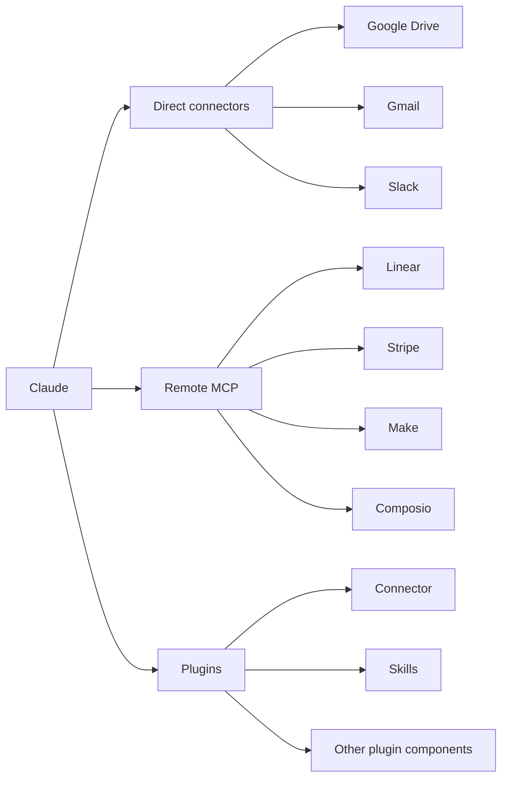

# 21 best Claude connectors to use in 2026 across categories

A few days ago, a friend and I were working on a project and needed a clean project diagram. I opened Excalidraw and started building it manually, moving boxes around, carving shapes, colours, and fonts and trying to make everything fit.

Around five minutes later, my friend had already made a much better version. I asked him how he did it, and he showed me how he was using [Claude with connectors](https://claude.com/connectors) and an [Excalidraw ](https://excalidraw.com/)plugin as part of his workflow.

That got me interested. I spent some time trying different connectors, removing the ones I rarely used, and keeping the ones that actually saved me time.

This guide covers the top 21 Claude connectors that now most often come up in my workflow.

---

## What are Claude connectors?

Claude connectors let Claude work with external apps and services. They can give it access to your files, messages, projects, payments, databases, and other tools while keeping the permissions of the connected account.

Some come directly from the Claude Connectors Directory. Others work through remote MCP servers, and some Claude Code plugins package connectors together with skills or other features.

So when I ask Claude to find a document in Drive, check a Linear issue, inspect a Stripe payment, or create something in another app, the connector gives Claude the tools it needs to do that work.



Once you understand those three paths, configuring them is much easier

---

## How to configure Claude connectors

There are three approaches I use most often. I usually start with the direct connector when one exists, then use a remote MCP when I need more control, and use a plugin when it provides a useful setup around the connector.

My basic rule is:

- Use **direct connectors** for common apps that Claude already lists.
- Use **remote MCP** when the service publishes an MCP server.
- Use **plugins** when you also want packaged skills or related tooling.
- Prefer OAuth when the service supports it.
- Add connectors when you have a real workflow for them.

### 1. Install directly from Claude

This is the easiest path for services such as Google Drive, Gmail, Slack, GitHub, Linear, and many others. Claude now includes connectors in its Customise interface, so most installs only require a few clicks and an OAuth flow.

- Open Claude 

   

- Navigate to Customise & Select Connectors from the list 

   

- Click Add, Browse or Search Connectors & Select + (example: [excalidraw](https://excalidraw.com/))

   

- Connect & Authenticate


Now mention it in a prompt to use.

```plain text
Use "excalidraw" to build me a database diagram with multiple tables and rows, which 
represents me
```


This is the easiest way. For most people, I would say, start here.

### 2. Add a remote MCP server

If a service gives you a remote MCP URL, Claude Code can connect to it directly. This is useful for services such as Linear, Stripe, Make, Composio, and other MCP-based tools.

```bash
claude mcp add --transport http <name> <remote-mcp-url>
```

Then open Claude Code and run:

```plain text
/mcp
```

Complete the OAuth flow if the server requests it. Claude also lets you add a public remote MCP server through **Customise → Connectors → Add custom connector**.

### 3. Install a Claude Code plugin

Plugins are useful when the integration includes more than an MCP endpoint. A plugin can package connectors, skills, agents, hooks, or other Claude Code configuration together.

For plugins in Anthropic's official marketplace, the pattern is:

```bash
/plugin install <plugin-name>@claude-plugins-official
```

Or from the terminal:

```bash
claude plugin install <plugin-name>@claude-plugins-official
```

Claude's official marketplace currently includes external integrations such as GitHub, Linear, Notion, Slack, Sentry, and others.

With the setup out of the way, these are the connectors that have been most useful for me.

---

## Automation

Automation is where connectors became useful to me beyond simple information retrieval. These three let Claude move between apps or trigger workflows instead of stopping after giving me an answer.

| Name | What it does | Install options | When to use |
| --- | --- | --- | --- |
| **Composio** | Connects Claude to 1,000+ apps through one MCP connection | Remote MCP, plugin | Cross-app workflows |
| **n8n** | Lets Claude work with your n8n automation layer | Remote MCP, custom connector | Self-hosted automation |
| **Make** | Lets Claude run and manage Make scenarios | Remote MCP, custom connector | Visual automation workflows |

### 1. Composio

Connect Claude to 1,000+ apps


[**Composio**](https://composio.dev/)[ ](https://composio.dev/)gives Claude a single connection to more than 1,000 apps instead of requiring me to configure each service separately.

It exposes a small set of meta-tools so Claude can find the right app, start authorisation when needed, and execute actions across services such as Gmail, Slack, GitHub, Linear, HubSpot, Notion, and Figma. I find it most useful when one workflow touches several apps.

**When to use**

- You regularly work across several apps.
- You want apps to authenticate when Claude first needs them.
- You build workflows that cross email, CRM, project, or developer tools.

For Claude Code:

```bash
claude mcp add --scope user --transport http composio https://connect.composio.dev/mcp --header "x-consumer-api-key: YOUR_API_KEY"
```

Then run `/mcp` and make sure Composio is enabled. Composio can create the app authorization flow later when Claude needs a specific integration.

You can also use the Composio plugin:

```bash
/plugin install composio@composio
```

Composio is the broad option. When I need more control over the automation itself, I usually reach for n8n.

### 2. n8n

Control self-hosted automations from Claude


[**n8n**](https://n8n.io/)[ ](https://n8n.io/)lets Claude work with the automation system you already run. It can help you inspect workflows, work with executions, and manage automation without having to rebuild everything within the conversation.

I like it when I want the automation logic to stay in n8n. Claude becomes another way to work with that system.

**When to use**

- You already use n8n.
- You want more control over where your automation runs.
- You want Claude Code and n8n in the same workflow.

For an n8n instance exposing its MCP endpoint:

```bash
claude mcp add --transport http n8n-mcp https://<your-n8n-domain>/mcp-server/http
```

For token-based authentication, add a header:

```bash
claude mcp add --transport http n8n-mcp https://<your-n8n-domain>/mcp-server/http --header "Authorization: Bearer <YOUR_N8N_MCP_TOKEN>"
```

Then run `/mcp` and authenticate if required.

If your team already prefers a visual automation builder, Make offers a similar experience with less infrastructure to manage.

### 3. Make

Run visual automation scenarios from Claude


[**Make**](https://www.make.com/)[ ](https://www.make.com/)lets Claude work with scenarios I already created in Make. Claude can run scenarios and work with Make resources, while the actual automation remains within Make.

This works well when the people managing the workflow prefer Make's visual interface.

**When to use**

- Your team already builds in Make.
- You want Claude to trigger existing scenarios.
- You prefer managed automation over running n8n yourself.

Make now provides a direct OAuth-based Claude Code setup:

```bash
claude mcp add --transport http make https://mcp.make.com
```

Then run `/mcp` and complete the Make OAuth flow.

Automation handles actions across systems. The next group gives Claude much better access to the software work itself.

## Developer tooling

These are the first connectors I would add to Claude Code. GitHub gives it repository context, Linear gives it the work around that code, and Sentry gives it production information when something breaks.

| Name | What it does | Install options | When to use |
| --- | --- | --- | --- |
| **GitHub** | Repositories, issues, PRs, branches, and code | Directory, MCP, plugin | Daily software development |
| **Linear** | Issues, projects, cycles, and planning | Directory, MCP, plugin | Product and engineering tracking |
| **Sentry** | Production errors, issues, and debugging context | Directory, MCP, plugin | Debugging production problems |

### 4. GitHub

Give Claude real repository context


[**GitHub**](https://github.com/)[ ](https://github.com/)gives Claude direct access to the repositories and development work I already manage there.

It can work with code, issues, pull requests, and other repository information, rather than relying on whatever you paste into the conversation.

For Claude Code, this is one of the first connectors I enable.

**When to use**

- You want Claude to work with real repository data.
- You want it to help with issues or pull requests.
- You use Claude Code for active development.

You can install GitHub from Claude's Connectors Directory, or add GitHub's official remote MCP:

```bash
claude mcp add --transport http github https://api.githubcopilot.com/mcp/
```

GitHub documents `https://api.githubcopilot.com/mcp/` as its remote MCP endpoint.

Claude Code also has an official plugin:

```bash
/plugin install github@claude-plugins-official
```

Once the code is connected, Linear gives Claude the project and issue context around that code.

### 5. Linear

Turn planning into tracked work


[**Linear**](https://linear.app/)[ ](https://linear.app/)brings issues, cycles, projects, and status into Claude. Claude can read existing work and create or update issues from the same conversation where you are making the decision.

I use it when a planning session needs to turn into actual tracked work before I forget the details.

In fact, I'm still using it in the college project my friends and I are working on, for which we needed the project diagram

**When to use**

- Your engineering work already lives in Linear.
- You want Claude to create or update issues.
- You want current project status while planning.

You can connect Linear directly from Claude's directory.

For Claude Code, Linear also offers an MCP command:

```bash
claude mcp add --transport http linear-server https://mcp.linear.app/mcp
```

Then run:

```plain text
/mcp
```

and complete OAuth.

Linear also provides a read-only endpoint if you do not want Claude to make changes.

Planning explains what should happen. Sentry becomes useful when production tells you what actually happened.

### 6. Sentry

Debug against real production errors


[**Sentry**](https://sentry.io/)[ ](https://sentry.io/)gives Claude access to real errors and issue information from your projects. That means I can investigate a production problem in the actual context of the issue, rather than rebuilding it manually from screenshots and copied logs.

The Claude connector can retrieve issues and errors, work with project information, and trigger Sentry's Seer issue-fix workflows.

**When to use**

- You debug production problems often.
- You want real error context inside Claude Code.
- You want code and monitoring data available in the same session.

The easiest path is Claude's Connectors Directory. Claude Code's official marketplace also includes a Sentry integration.

```bash
/plugin install sentry@claude-plugins-official
```

That covers most of my software loop. But connectors are also becoming useful beyond developer tooling, especially in commerce.

## Commerce and shopping

These three show a different side of Claude connectors. Shopify is useful for real store operations, while Instacart and Uber Eats bring everyday shopping and ordering workflows into Claude.

| Name | What it does | Install options | When to use |
| --- | --- | --- | --- |
| **Shopify** | Store, product, commerce, and developer workflows | Directory, MCP, plugin | Running or building for Shopify |
| **Instacart** | Grocery lists, products, and carts | Directory | Grocery planning |
| **Uber Eats** | Restaurant and ordering workflows | Directory | Meal and group-order planning |

### 7. Shopify

Work with your store from Claude


[**Shopify**](https://www.shopify.com/) lets Claude work with store information and commerce workflows. It is useful both for people operating a store and developers building Shopify projects.

The exact tools you use depend on whether you are working with store operations or Shopify development.

**When to use**

- You manage a Shopify store.
- You build Shopify apps or storefronts.
- You want store or commerce context available in Claude.

For normal use, connect Shopify from Claude's directory.

For Shopify development, install the Dev MCP:

```bash
claude mcp add --transport stdio shopify-dev-mcp -- npx -y @shopify/dev-mcp@latest
```

Shopify also provides an official Claude Code AI Toolkit plugin:

```bash
claude plugin install shopify-ai-toolkit@claude-plugins-official
```

If Shopify covers running the store, Instacart is much simpler. I use it when the workflow starts with food planning.

### 8. Instacart

Turn a meal plan into a grocery cart


[**Instacart**](https://www.instacart.com/)[ ](https://www.instacart.com/)lets Claude move from meal ideas or recipes into an actual grocery workflow. It can help build shopping lists, work with available products, and prepare a cart.

It is simple, but that is exactly why I like this type of connector.

**When to use**

- You plan meals in Claude.
- You want the grocery list created from the same conversation.
- You already use Instacart.

Open the Connectors Directory, search for **Instacart**, click Connect, and complete authentication. Anthropic currently lists Instacart as a Claude connector.

And if groceries are only one part of the food workflow, Uber Eats covers the restaurant side.

### 9. Uber Eats

Keep restaurant ordering in the same conversation


[**Uber Eats**](https://www.ubereats.com/) brings restaurant and ordering context into Claude. It makes the most sense when you are already discussing where to eat, what to order, or how to plan food for a group.

**When to use**

- You are choosing food inside Claude.
- You are planning a group order.
- You already use Uber Eats.

Search for **Uber Eats** inside Claude's Connectors Directory and connect your account. Anthropic currently lists an Uber Eats connector.

Commerce is useful, but communication connectors come up much more often in my normal workday.

## Communication

This is probably the category I use most. Slack, Gmail, and Intercom often contain conversations that provide the missing context for whatever I am already asking Claude to do.

| Name | What it does | Install options | When to use |
| --- | --- | --- | --- |
| **Slack** | Searches conversations and supports messaging workflows | Directory, MCP, plugin | Team communication |
| **Gmail** | Searches email and helps draft replies | Directory | Inbox context |
| **Intercom** | Works with customer support conversations | Directory | Customer support |

### 10. Slack

Bring team conversations into Claude


[**Slack**](https://slack.com/)[ ](https://slack.com/)gives Claude access to real team conversations. It can search channels and threads, find earlier decisions, summarise discussions, and help prepare messages using the surrounding context.

Anthropic's current official Slack connector also supports interactive workflows such as drafting and sending messages.

**When to use**

- Important decisions live in Slack.
- You frequently summarise long threads.
- You write messages in Claude and then paste them back into Slack.

The easiest path is the Connectors Directory.

Slack also provides an official Claude Code plugin:

```bash
claude plugin install slack
```

The plugin configures Slack's MCP server and starts the OAuth flow.

Once Slack covers internal conversations, Gmail covers external ones.

### 11. Gmail

Give Claude your email context


[**Gmail**](https://workspace.google.com/) lets Claude search email, find information inside threads, summarise conversations, and help draft replies using the messages it finds.

I use it together with Google Drive because email often tells me what happened, while Drive contains the document everyone was discussing.

**When to use**

- You spend a lot of time searching old email.
- You need context before drafting a reply.
- Client or project information lives in Gmail.

Open Claude's Connectors Directory, search **Gmail**, and authenticate your Google account. Gmail is available across Claude surfaces, including Claude Code.

For customer conversations rather than normal email, Intercom is usually the next connector I add.

### 12. Intercom

Use real customer conversations inside Claude


[**Intercom**](https://www.intercom.com/)[ ](https://www.intercom.com/)gives Claude access to customer support conversations and related support context. That makes it useful for finding patterns, preparing responses, or turning customer feedback into work for the product team.

**When to use**

- Customer conversations live in Intercom.
- You want replies based on real support history.
- You regularly turn support feedback into product work.

Search for **Intercom** in Claude's Connectors Directory and complete authentication. Anthropic currently lists Intercom as an available connector.

Once customer conversations are connected, the next useful step is giving Claude access to the systems that sales and marketing teams use to act on them.

## Sales and marketing

These are more specific to your work. HubSpot gives Claude pipeline context, Canva gives it a design surface, and ActiveCampaign connects it to marketing operations.

| Name | What it does | Install options | When to use |
| --- | --- | --- | --- |
| **HubSpot** | Contacts, deals, and pipeline context | Directory | Sales and CRM workflows |
| **Canva** | Creates and edits visual content | Directory | Design and content |
| **ActiveCampaign** | Marketing contacts, campaigns, and automations | Directory, custom MCP | Marketing operations |

### 13. HubSpot

Give Claude the actual deal context

[**HubSpot**](https://www.hubspot.com/)[ ](https://www.hubspot.com/)lets Claude work with contacts, deals, and pipeline information. This is useful when I need to write an email, proposal, or account update and want it grounded in the customer record.

**When to use**

- Your sales work lives in HubSpot.
- You need CRM context before writing.
- You want to review pipeline information from Claude.

Search **HubSpot** in Claude's Connectors Directory, connect the account, and grant only the scopes you need. Anthropic currently lists HubSpot as a Claude connector.

HubSpot gives me the business context. Canva is useful when the next step is to turn that context into something visual.

### 14. Canva: Create visuals without leaving Claude


[**Canva**](https://www.canva.in/)[ ](https://www.canva.in/)lets Claude work with designs, decks, and other visual assets.

It is especially useful if one already has a Canva brand setup and wants to move from a written brief to a visual asset without having to restart the work elsewhere.

Canva is also one of Claude's interactive connectors, so some design workflows can appear directly inside the conversation.

**When to use**

- You make social graphics or simple presentations.
- You already work in Canva.
- You want Claude to help turn a brief into a design.

Search for **Canva** in the Connectors Directory and connect your Canva account.

And when the asset becomes part of a campaign, ActiveCampaign can connect Claude to the marketing operations around it.

### 15. ActiveCampaign

Work with marketing operations from Claude


[**ActiveCampaign**](https://www.activecampaign.com/) lets Claude work with marketing contacts, campaigns, tags, lists, and automation-related data.

I would use it when ActiveCampaign already runs the marketing workflow. Adding another system just for Claude would create more work.

**When to use**

- Your marketing operations already use ActiveCampaign.
- You want campaign or contact information inside Claude.
- You work with marketing automations often.

You can install it directly from Claude's Connectors Directory. Anthropic currently lists ActiveCampaign as a connector.

The next category matters even more because almost every useful workflow needs good source data.

## Data and knowledge

Google Drive and Notion are the two connectors I would recommend to almost anyone doing knowledge work. Snowflake becomes useful once the information you need lives in a warehouse rather than documents.

| Name | What it does | Install options | When to use |
| --- | --- | --- | --- |
| **Google Drive** | Searches Docs, Sheets, and Slides | Directory | General work context |
| **Notion** | Searches and updates pages and databases | Directory, plugin | Team knowledge |
| **Snowflake** | Connects Claude to warehouse data | Directory | Data and analytics |

### 16. Google Drive

My default context connector


[**Google Drive**](https://workspace.google.com/) is usually the first data connector I enable. Claude can search across Drive and work with Docs, Sheets, and Slides without me having to download a file and upload it again.

It sounds basic, but I use it constantly.

**When to use**

- Most of your working documents live in Google Drive.
- You often search for old documents.
- You want Claude to use the current version of a file.

Search for **Google Drive **in Claude's Connectors Directory, then connect your Google account. The current connector supports searching Drive and reading Docs, Sheets, and Slides.

Drive covers files well. Notion does the same job for knowledge that lives in pages and databases.

### 17. Notion

Give Claude your workspace knowledge


[**Notion**](https://www.notion.com/)[ ](https://www.notion.com/)lets Claude search the workspace, work with pages and structured information, and write updates back when connector permissions allow.

I often use Drive and Notion together because teams rarely keep everything in one place. Also, it's better to use Claude with Notion rather than Notion AI; it gives good results imo.

**When to use**

- Your wiki lives in Notion.
- You use Notion databases for structured work.
- Claude often needs information from internal pages.

You can connect Notion directly from Claude's directory. The connector currently supports read and write workflows.

Claude Code also lists Notion among the external integrations available through its plugin marketplace.

For larger datasets, documents are no longer the right interface. That is where Snowflake fits.

### 18. Snowflake

Ask questions against warehouse data


[**Snowflake**](https://www.snowflake.com/en/) brings live warehouse data into Claude, rather than requiring me to export it to CSV files first.

It makes the most sense for analytics teams and companies that already use Snowflake as a source of truth.

**When to use**

- Your reporting data lives in Snowflake.
- You regularly explore warehouse data.
- You want data available from the same Claude workflow.

Search **Snowflake** in Claude's Connectors Directory and follow the setup process for your workspace. Anthropic currently lists Snowflake as a Claude connector.

Once Claude can reach your business data, financial connectors become much more useful because you can connect analysis directly to transactions and payments.

## Finance

I keep this category small. Stripe covers most payment workflows I care about, while PayPal and Plaid are useful when the financial data already lives there.

| Name | What it does | Install options | When to use |
| --- | --- | --- | --- |
| **Stripe** | Payments, customers, invoices, subscriptions, and balances | Directory, MCP | Product and billing operations |
| **PayPal** | Payment and transaction data | Directory | PayPal-based payment workflows |
| **Plaid** | Account and transaction data | Directory | Financial data workflows |

### 19. Stripe

Work with billing data from Claude


[**Stripe**](https://stripe.com/in)[ ](https://stripe.com/in)gives Claude structured access to payment and billing data. It can work with customers, invoices, subscriptions, balances, and other Stripe resources exposed by the connector.

This is one of the connectors I would add early on if I were working on a SaaS product.

**When to use**

- You investigate payment or subscription issues.
- You need billing context while handling support.
- Your product uses Stripe.

You can install Stripe from Claude's Connectors Directory or connect its official remote MCP server:

```bash
claude mcp add --transport http stripe https://mcp.stripe.com/
```

Then run `/mcp` and complete authentication. Stripe documents `https://mcp.stripe.com` as its hosted MCP server.

If some payments live outside Stripe, PayPal is the simple addition.

### 20. PayPal

Bring PayPal transaction data into Claude


[**PayPal**](https://www.paypal.com/in/home) gives Claude access to payment and transaction information that would otherwise require another dashboard lookup.

I would add it only when PayPal is already important to the business.

**When to use**

- You receive a meaningful volume of payments through PayPal.
- You often need transaction information.
- PayPal is part of your finance workflow.

Search for **PayPal** inside Claude's Connectors Directory and authenticate the account. Anthropic currently lists PayPal as a Claude connector.

Plaid goes one level deeper when the workflow needs account and transaction data rather than payment processor data.

### 21. Plaid

Work with account and transaction data


[**Plaid**](https://plaid.com/)[ ](https://plaid.com/)provides Claude with access to account-level financial information and transaction history through its existing security model.

This is more specialised than Stripe or PayPal, but it can be useful for financial products and analysis workflows.

**When to use**

- Your product already uses Plaid.
- You work with transaction or account data.
- You are building financial workflows in Claude.

Search for **Plaid** in the Connectors Directory and complete its authorisation process. Anthropic currently lists Plaid as a financial-services connector.

And that brings me back to the lesson I learned after trying all of these: having more connectors does not automatically improve the workflow.

## Conclusion

Skills and connectors only matter when they remove friction you feel every day. Start with the foundation set that matches how you already work:

- **Context layer:** Google Drive + Notion + Gmail
- **Execution layer:** Composio, Zapier or n8n + the one CRM or store you use (HubSpot or Shopify)
- **Money layer:** Stripe

Add the rest only when a specific workflow keeps forcing you out of Claude. Selective beats exhaustive.

The directory will keep on growing, but the ones that stay useful are the ones that earn their place in daily life.

## Sources {toggle="true"}

	- Claude connectors overview: [https://claude.com/docs/connectors/overview](https://claude.com/docs/connectors/overview)
	- Claude connector setup and management: [https://support.claude.com/en/articles/11176164-use-connectors-to-extend-claude-s-capabilities](https://support.claude.com/en/articles/11176164-use-connectors-to-extend-claude-s-capabilities)
	- Claude unified skills, connectors, and plugins directory: [https://support.claude.com/en/articles/14328846-browse-skills-connectors-and-plugins-in-one-directory](https://support.claude.com/en/articles/14328846-browse-skills-connectors-and-plugins-in-one-directory)
	- Claude Code plugin marketplace: [https://code.claude.com/docs/en/discover-plugins](https://code.claude.com/docs/en/discover-plugins)
	- Claude Connectors Directory: [https://claude.com/connectors](https://claude.com/connectors)
	- Composio Connect docs: [https://docs.composio.dev/docs/composio-connect](https://docs.composio.dev/docs/composio-connect)
	- Make MCP docs: [https://developers.make.com/mcp-server](https://developers.make.com/mcp-server)
	- GitHub MCP docs: [https://docs.github.com/en/copilot/how-tos/provide-context/use-mcp-in-your-ide/set-up-the-github-mcp-server](https://docs.github.com/en/copilot/how-tos/provide-context/use-mcp-in-your-ide/set-up-the-github-mcp-server)
	- Linear MCP docs: [https://linear.app/docs/mcp](https://linear.app/docs/mcp)
	- Slack MCP docs: [https://docs.slack.dev/ai/slack-mcp-server/connect-to-claude/](https://docs.slack.dev/ai/slack-mcp-server/connect-to-claude/)
	- Shopify AI Toolkit: [https://shopify.dev/docs/apps/build/ai-toolkit](https://shopify.dev/docs/apps/build/ai-toolkit)
	- Stripe MCP docs: [https://docs.stripe.com/mcp](https://docs.stripe.com/mcp)
	- Style reference used for this article: [https://composio.dev/content/top-grok-build-cli-skills-plugins](https://composio.dev/content/top-grok-build-cli-skills-plugins)
