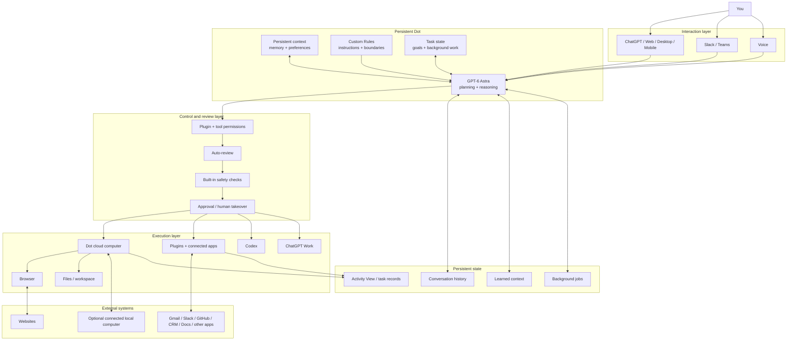

# A Guide to ChatGPT Dots: How OpenAI's Always-On Agents Work

OpenAI launched [ChatGPT Dots on September 29, 2026](https://x.com/OpenAI/status/2104984504133918973), and one detail immediately got my attention. You can give an agent ongoing responsibility, close your laptop, and it can keep working.

I wanted to understand what changes when ChatGPT gets its own computer, persistent context, connected apps, and enough time to keep working on a task without waiting for the next prompt.

So I started from the basics. I looked at what a Dot actually is, how it works, how much control you keep, and what happens when you connect it to the tools where your real work already lives.

---

## What is ChatGPT Dots?

[ChatGPT Dots](https://chatgpt.com/features/dots/) are OpenAI's always-on agents inside ChatGPT. A Dot runs on [GPT-6 Astra](https://openai.com/index/gpt-6-astra/), gets its own cloud computer and browser, can use connected apps, and can keep making progress between conversations.

The idea also goes further than background tasks. OpenAI describes cases where a Dot follows customer feedback, prepares tested code changes, updates launch material when scope changes, reruns research when new data arrives, or keeps an enterprise proposal current as requirements change.

The launch also has some interesting history.

- OpenAI currently gives you one primary Dot, 
- while teams of Dots are part of the longer-term direction. 
- Specialist Dots with their own organisation-level identity and access are already being tested through focused enterprise pilots.

Hope this explains the basic idea.

The useful part is what OpenAI has placed around the model so it can actually keep working.

---

## ChatGPT Dots features

Dots combine persistent work, computer use, memory, connected apps, and approval controls in one agent.

- **Always-on work:** A Dot can continue working toward a goal while you are away and can manage several projects over time.
- **Its own cloud computer:** Each Dot has a cloud computer and browser. Your local computer stays separate unless you connect it explicitly.
- **GPT-6 Astra:** OpenAI uses GPT-6 Astra as the model behind Dots.
- **4,000+ apps:** Dots can work with more than 4,000 apps through ChatGPT's plugin ecosystem.
- **Persistent context and memory:** A Dot can receive memories and recent context from ChatGPT and learn from your feedback over time.
- **Custom Rules:** You can define actions it can take, actions that need approval, and actions it should hand back to you.
- **Auto-review:** Planned actions can be checked against your instructions, permissions, safety rules, and Custom Rules before they run.
- **Proactive research:** A Dot can look for useful updates in connected sources while you are away. This background research is restricted to read-only tools and cannot directly send messages, modify connected content, or control a computer.
- **Activity View:** You can inspect current and delegated tasks, see their status, add more context, change direction, or stop the work.
- **ChatGPT, Slack, Teams, and voice:** You can continue working with the Dot through supported ChatGPT interfaces and communication channels while its context carries forward.
- **Codex and ChatGPT Work:** A Dot can start or manage deeper tasks in Codex or ChatGPT Work. Those delegated tasks use their normal plan allowances.

The feature list makes Dots sound simple. But a persistent agent needs several systems working together, so I wanted to understand what is happening underneath.

---

## How ChatGPT Dots work

OpenAI has documented the product behaviour and safety model, but it hasn't published the full private implementation of Dots.

So I used the open-source **OpenDots** project from CopilotKit as a reference for the architecture below.

OpenDots implements persistent Dots, durable threads, background work, per-Dot computers, tool permissions, Slack, voice, memory, and human approval flows, which makes it useful for understanding how a system like this can be arranged.

OpenAI may use a different internal architecture.




OpenDots gives us a useful public example of this loop. Its web interface talks to a CopilotKit runtime through AG-UI, persistent

- Threads hold conversations, 
- specialist agents execute work, 
- permission controls sit before computer actions, 
- and background jobs can continue in the original conversation.

Its computer design is also worth noticing.

Each Dot can get its own persistent browser profile, workspace files, shell access, permissions, action records, and human takeover controls rather than every agent sharing one computer.

The important part for normal Dot users is:

> You give the Dot a responsibility, it keeps context, chooses the next step, uses an allowed tool or computer when needed, and stops for your approval when an action crosses a configured boundary.

Once I understood that flow, setup made a lot more sense.

---

## How to set up ChatGPT Dots

### Step 1: Check whether you have access

Dots are currently rolling out to ChatGPT Pro users outside the EEA, Switzerland, and the UK.

They are also available to Business Premium users in supported ChatGPT regions, while Enterprise, Edu, and Healthcare workspaces can access the beta when an administrator enables it.

Your first Dot is included with eligible Pro and Business Premium plans.


### Step 2: Create your first Dot

Open ChatGPT on desktop web or the desktop app and start the Dot onboarding flow.

You cannot currently create a Dot from mobile or mobile web. Once setup is complete, supported accounts can continue talking to it through the ChatGPT mobile app.

**\[Image placeholder: Create your Dot onboarding screen\]**


### Step 3: Give it one clear responsibility

You can name your Dot during setup. OpenAI starts it with the handle `@yourname-dot`, which changes when you give the Dot its own name.

I would start with one repeating responsibility.

For example:

```plain text
Name: Research Operator.

Responsibility:
Track important AI agent product updates.

Use primary sources whenever possible.
Keep source links for factual claims.
Separate confirmed information from assumptions.
Prepare a short weekly summary.

Ask me before sending, publishing, buying, deleting,
or changing anything outside this workspace.
```

That gives the Dot a stable job instead of forcing it to rediscover its role in every conversation.


### Step 4: Set its boundaries

Open the Dot's Custom Rules and decide what it can do without asking, what can run after pre-approval, what should require approval, and what must come back to you.

OpenAI still keeps built-in safety rules above those settings. Sensitive actions, such as changing a password, may require you to take over directly.

I configured these rules before giving Dot access to important accounts and tasks; see the last line of the prompt

```plain text
Ask me before sending, publishing, buying, deleting,
or changing anything outside this workspace.
```


### Step 5: Connect the apps it actually needs

Dots can use plugin connections that you already use across ChatGPT, ChatGPT Work, and Codex. You control those connections from the ChatGPT Plugins area.

For one or two apps, direct connections are simple.

The setup starts getting less convenient when the same job needs Gmail, Slack, GitHub, Notion, Google Sheets, a CRM, project management tools, and several other systems.

That is where I would add Composio.

### Step 6: Add Composio for larger cross-app workflows

Composio gives agents managed tools, authentication, and execution across 1,500+ apps. Its current system can scope OAuth, API keys, and tokens to individual users and automatically refresh supported credentials.

Instead of designing the Dot around a separate connection strategy for every workflow, you can use Composio as the tool layer when the job moves across several apps.

To add a plugin in ChatGPT:

1. Visit the Official [ChatGPT x Composio Plugin](https://chatgpt.com/plugins/plugin_asdk_app_6a58503580c08191b78cc5bdaf4eba6e?cta_placement=announcement-topbar) Page.


2. Click on `+ Install Plugins`.
3. Complete the OAuth flow. Review the apps and permissions the tool asks for.


4. You are done. 

Then head to Connect and only connect the accounts the Dot needs. (optional but recommended)

> **Note**: ChatGPT's current plugin system keeps provider permissions and workspace controls in place even after you install a plugin.


Click on the plugin, then tap Continue with Composio and complete the one-time login.


However, you can also ask your dot to connect to composio for the task with :

```plain text
connect composio to chat gpt dots
```

This starts the flow and asks you for authorisation; if you already completed the step above, it auto-detects.


I would also avoid connecting everything on day one:

- Start with the smallest set of tools required for the first workflow, 
- Test the result, and 
- Expand access when there is a clear reason.

Now the Dot has context, rules, and tools. The more interesting question is what you can actually make it do.

---

## Real-world ChatGPT Dots use cases with Composio

I went through some of the prompts people started sharing around the Dots launch.

A few were simple, but they show something important. Dots become much more useful when the prompt describes an ongoing responsibility instead of a single answer.

### 1. Business Context Operator

Most AI assistants start with very little context about how your company actually works.

This setup turns the Dot into a business operator by giving it clear rules for what to learn, what questions to ask, and what problems to look for.

It focuses on your goals, workflows, recurring tasks, bottlenecks, weak spots, and work you could automate or delegate. This solves the repeated context-setting.

When connected to tools such as Gmail, Slack, Google Drive, Notion, your calendar, CRM, and project trackers, the Dot can also use the systems where that business context already lives.

Instead of explaining your business, priorities, and working style again for every task, the Dot builds that understanding first and then uses it when handling future work.

#### Prompt

```plain text
<goal>
Learn enough about me and my business to become a high-value operator, strategist, and assistant. Understand my goals, business model, team, workflows, decisions, constraints, tools, recurring tasks, weak spots, and bottlenecks.
</goal>

<method>
Ask one short, high-value question at a time. Use each answer to decide what to ask next. Go deeper where there is money, time, risk, repetition, friction, or unclear thinking. Ask for concrete examples. Challenge vague answers and assumptions. Look for patterns, inefficiencies, missing systems, unnecessary manual work, and things I am doing that should be delegated or automated.
</method>

<focus>
Understand:
- what the business does and how it makes money
- my role and what I spend time on
- my current goals and priorities
- key customers, products, channels, and operations
- how decisions are made
- what slows growth
- where mistakes happen repeatedly
- what depends too much on me
- what tasks repeat every day or week
- what could be automated, delegated, standardized, or removed
- what information I regularly need
- what tools, software, and workflows I use
- where communication breaks down
- what I avoid, delay, or overthink
- what creates the most leverage
- where you should challenge me vs. just execute
</focus>

<weak_spots>
Actively look for bottlenecks, wasted time, manual processes, unclear ownership, poor follow-up, repeated decisions, missing dashboards or information, inefficient communication, unnecessary meetings...
</weak_spots>

<finish>
When you have enough context, stop interviewing me. Save everything into your memory, include:
how I work, how the business works, priorities, bottlenecks, automation opportunities, delegation opportunities, useful systems, important context to remember, how you should work with me, open questions. Do not invent anything. Mark uncertainty clearly.
</finish>
```

The useful part is that the interview has an end condition. Once it has enough context, the Dot stops asking questions and starts using that context in later work.

With Composio connected, I would extend this carefully. The Dot could use the approved business systems you already work in to check information when a task requires it instead of relying only on what you remember during onboarding.

For example, you could let it use approved CRM, email, calendar, Slack, project management, or spreadsheet tools while keeping write actions behind your normal Dot approval rules.

---

### 2. Niche Pain-Point App

This one is quite short, and I was surprised to see this works.

The prompt asks the agent to start from real complaints instead of inventing an app idea in isolation.

#### Prompt

```plain text
Create an App that analyzes top subreddits of my niche,
read the posts and comments, summarise the main issues
raised by these users and create me an app that answers
these pain points.
```

I like the sequence here:

```plain text
Community
    ↓
Posts + comments
    ↓
Repeated pain points
    ↓
Problem clusters
    ↓
App idea
    ↓
Prototype
```

A Dot can keep the research side active over time, while deeper building work can be delegated to ChatGPT Work or Codex when needed.

Composio becomes more useful after the initial research.

> The same workflow can connect the resulting idea to approved documents, spreadsheets, project trackers, CRM data, or communication tools without manually moving context between every system.

---

### 4. A coding team and Motion Designer Dot

This prompt pushes much harder on the agent idea.

```plain text
1) Create a 24/7 coding team with four agents:

Architect plans the smallest reliable solution.
Builder implements scoped changes.
Reviewer checks security, quality, and edge cases.
Tester runs tests and verifies the final result.

Give every task an owner, clear acceptance criteria, and evidence of completion. Keep handoffs automatic, but ask me before deploying, merging, spending money, or making destructive changes.

2) Create a Motion Designer Dot agent that turns my ideas, scripts, or static designs into production-ready animations.

It should define the visual concept, storyboard, transitions, timing, typography, camera movement, and sound cues - then produce an implementation brief for After Effects, Rive, Framer Motion, or Remotion.

Show me a short creative direction first. Ask for approval before generating the final animation.
```

Composio can then cover the external part of the workflow when code work depends on systems such as GitHub, issue trackers, team communication, documentation, or other connected services.

The Motion Designer section follows the same pattern. The Dot keeps creative context and requirements, then prepares the detailed implementation brief before any final action runs.

However, all this benefit comes with one important limitation (as of now)

---

## Limitations

OpenAI currently describes one primary Dot for normal users and says teams of Dots are part of its future direction.

- Specialist Dots already exist in focused enterprise pilots, so I would suggest you currently treat the four-agent part as an orchestration instruction inside your available Dot or delegated coding tasks unless your workspace has specialist Dot access.
- The approval rules in the prompt are still useful, and I would love to have a permission within the Dot interface as well.

So based on my own learning and experience, Deployment, merging, destructive operations, and spending are exactly the kinds of boundaries I would define before letting a coding workflow run for long periods.

---

#### What happened when I tried it

These examples cover very different jobs, but the common structure stays almost the same.

You give the Dot persistent context, define a responsibility, give it the minimum tools it needs, set clear approval boundaries, and let it return when the work is ready for your judgment.

As I was too curious, I used my dot agent as an idea finder and market validator and researc. Its job was:

- Visit HackerRank, Reddit, Answer the Public, and others, 
- Gather all the data as instructed
- Use composio tools like composio-search, exa and features like workbench to extensively perform market analysis, validation and competitor analysis
- And draft the research report in Google Docs.

Check out the complete prompt on [GitHub](https://gist.github.com/DevloperHS/c2c130719c72637611f88a51f3041ac5#file-prompt2-md).

Here is me trying it:

https://github.com/sunilcomposio/notion-assets/raw/main/assets/a-guide-to-chatgpt-dots/demo.mp4

As you can see, ChatGPT Dot accessed the connected composio account internally, performed deep research on the ideas, performed competitor analysis and market research, and finally produced the doc.

The interesting part is that using composio helped me bypass Reddit rate limits, which I was constantly running into. Sometimes this approach works like a charm and can be a helpful.

With that, we've reached the end of this blog, and here are my final thoughts on my learning experience.

---

## Conclusion

I initially thought of ChatGPT Dots as ChatGPT that keeps running after you close the window. After looking deeper and using it, the bigger change is persistent responsibility.

A Dot can keep context about how you work, use its own cloud computer, work through connected apps, continue tasks in the background, and return when it has results or needs a decision.

OpenAI has also placed Custom Rules, Auto-review, permissions, and Activity View around that work so you can control how far it goes.

For simple workflows, the built-in plugins can already cover a lot. But once one responsibility spans many apps, that tool layer becomes important.

This is where I like to use Composio, especially when the same Dot needs to move between several business systems while keeping authentication and user-scoped connections manageable.

And this is still the first version.

OpenAI currently starts normal users with one primary Dot and already talks about a future where teams of Dots work together.

If that direction continues, the interesting part will be less about asking AI individual questions and more about deciding which responsibilities we are comfortable giving it for longer periods.

---

## Sources {toggle="true"}

	- [OpenAI: Introducing dots](https://openai.com/index/introducing-dots/?utm_source=chatgpt.com) 
	- [OpenAI: Getting started with your dot](https://help.openai.com/en/articles/20001530-getting-started-with-your-dot?utm_source=chatgpt.com) 
	- [OpenAI: Dots privacy, security, and safety FAQs](https://help.openai.com/en/articles/20001529-dots-privacy-security-and-safety-faqs?utm_source=chatgpt.com) 
	- [OpenAI: Plugins in ChatGPT](https://help.openai.com/en/articles/20001256-plugins-in-chatgpt?utm_source=chatgpt.com)  
	- [CopilotKit: OpenDots](https://github.com/CopilotKit/OpenDots?utm_source=chatgpt.com) 
	- [Composio documentation](https://docs.composio.dev/docs?utm_source=chatgpt.com)  
	- [Composio: Guide to Grok Bot](https://composio.dev/content/guide-to-frok-bot?utm_source=chatgpt.com)  
	- [Business Context Operator source](https://x.com/EXM7777/status/2105290458541011269?utm_source=chatgpt.com) 
	- [Niche Pain-Point App source](https://x.com/PromptLLM/status/2105061369045221497?utm_source=chatgpt.com) 
	- [Little Cupcakes source](https://x.com/alicialyttle/status/2105666819243606460?utm_source=chatgpt.com) 
	- [Coding Team and Motion Designer source](https://x.com/vartekxx/status/2105018981295776161?utm_source=chatgpt.com)
