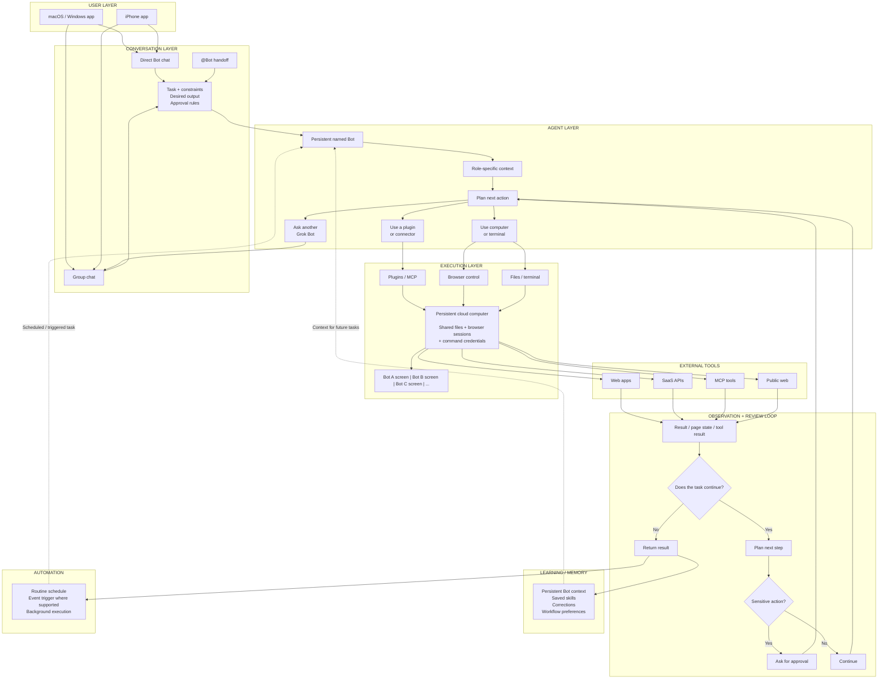

# A Guide to Grok Bot: How xAI's Always-On AI Teammates Work

[Grok Bot](https://x.ai/bot) launched on [August 11, 2026](https://x.ai/news/introducing-grok-bot), and it caught my attention for one simple reason. You can create persistent AI teammates, give them access to a cloud computer, and let them continue working after you close your laptop.

I wanted to understand how far that idea could go. A research Bot is useful, but what happens when four Bots have separate roles, share context, use the same external tools, and pass work between themselves?

So I started from the basics. I wanted to understand what Grok Bot actually does, how the system works, and what changes when you give these Bots access to real tools.

## What is Grok Bot?

Grok Bot is SpaceXAI's early-beta product for persistent AI agents. It launched on August 11, 2026, after starting as an internal prototype that SpaceXAI teams used for sales, marketing, operations, and engineering work.

A Bot is a persistent, named agent. You message it from the Grok Bot app, give it a job and access to the required tools, and it can continue working on a cloud computer while your own computer is offline.

This release also has some useful history:

- SpaceXAI added scheduled Automations to Grok in July, 
- Then added large parallel workflows to Grok Build.
- Finally, Grok Bot brings several related ideas into a teammate-style interface where persistent agents can coordinate.

Grok Bot currently works on macOS, Windows, and iPhone. Initial access includes SuperGrok Heavy, Cursor Ultra, and eligible Cursor team plans, while enterprise availability is still rolling out. Linux desktop, Android, and iPad were not supported at the initial launch.

## Grok Bot features

The interesting part is how these pieces work together, because Grok Bot combines persistent execution, computer use, tools, and multiple Bots inside one product.

- **Persistent cloud computer:** Your Bots work on a cloud computer with browser access, files, and command-line tools. Work can continue after you close your laptop.
- **Shared workspace:** All Bots on your account share the same cloud computer, files, browser sessions, and command-line credentials. Each Bot has a separate screen for parallel computer work.
- **Computer use:** Bots can work through websites when a connector or clean API is unavailable. Some sites can still block automation or require a CAPTCHA or human confirmation.
- **Plugins and MCP:** Grok Bot can use connectors, plugins, and MCP servers for structured tool access. xAI recommends a connector when one is available because it can give the Bot a more reliable integration path.
- **Multi-Bot collaboration:** You can put two to six Bots into a group chat. They can message each other, pass ownership, and continue work without you manually moving information between chats.
- **Skills:** A successful process can become a reusable skill with steps, decision rules, output requirements, and approval boundaries.
- **Routines:** A Bot can run workflows on a schedule or, where supported, after an event.
- **Teach a task:** Where the feature is enabled, you can perform a browser workflow once while the Bot watches. Grok Bot then creates a draft skill that you can review and test.
- **Approvals:** You can require approval for actions such as sending messages, publishing content, deleting data, purchasing, or changing production systems. Passwords, 2FA codes, CAPTCHAs, and similar steps stay with the human through computer takeover.

That gives us the product surface. The next question is what actually happens underneath when you send one of these Bots a task.

## How Grok Bot works

SpaceXAI has documented Grok Bot's public execution model, but it has not published the complete internal orchestration code.

So the diagram below is a **conceptual architecture** based on documented Grok Bot behaviour, arranged in layers similar to an OpenManus-style agent architecture, that I tried.



The main detail to remember is the shared computer. Your Bots can have separate roles and screens, but files, browser sessions, and command-line credentials on that cloud machine can be available to all of them.

xAI also says not to treat separate Bots as separate security boundaries..

---

### Shared context vs individual Bot memory

One thing I didn't realise at first is that sharing one computer doesn't mean every Bot has the same memory.

Each Bot can keep its own role, stable preferences, and summaries from earlier work. Its conversation and learned context stay separate, while shared files, browser sessions, group messages, and direct handoffs can move context between Bots.

This becomes useful when you start building a swarm. In my company simulation, each agent keeps its own role and persona while shared work still moves between them.

I later saw [Nate Herk ](https://x.com/nateherk/article/2089917020087210160)use a similar approach. He separates information that should be available to the wider agent setup from context that should stay with one Bot.

For important or changing facts, xAI also recommends checking the current source rather than relying only on Bot memory.

That architecture also explains why setup is fairly short. Next, let's look at how to set up Grok Bot.

---

## How to set up Grok Bot

### Step 1: Check access

You need an eligible Grok Bot account. Current documented options include SuperGrok Heavy, Cursor Ultra, eligible team access, and some trial access.


### Step 2: Install Grok Bot

Download the [Grok Bot](https://x.ai/bot) desktop app for macOS or [Windows ](https://x.ai/news/introducing-grok-bot)and sign in with your Cursor account.

On iPhone, you can use the[ Grok Bot companion app](https://apps.apple.com/us/app/grok-bot/id6794501026). The same Bots and conversations sync between supported signed-in devices.


### Step 3: Create your first Bot

Select a suggested role or create your own.

Give it a short name, one main job, and a clear description of how it should work. xAI recommends focused Bots because a focused role gives the Bot more useful context over time.

For example:

```plain text
Name: Researcher

Job: Competitive research

Description:
Research AI agent products using public sources.
Keep direct source links for every important claim.
Separate verified facts from assumptions.
Do not publish or send anything externally.
```

This should be your 1st prompt; it sets the persona, goals, tasks, and role. See the title changed to Name: Researcher


### Step 4: Give it a real task

A useful first prompt should tell the Bot the result you want, the sources it can use, its limits, the output format, and when you want to review its work.

For example:

```plain text
Find the five most important AI agent platform announcements
from the last seven days.

Use public sources only.

Return:
1. Product
2. Announcement
3. Date
4. Source
5. Why it matters

Do not publish or send anything.
```

That is enough for basic research. But things become less convenient when one workflow needs several external tools.

#### Add Composio when your Bot requires secure access to apps you use

Grok Bot can sign into websites through its browser, and it can also use connectors and plugins. Browser access is flexible, but xAI recommends using a connector when one exists because structured integrations are more reliable.

If you only need one website, signing in directly can be fine. If your workflow moves between GitHub, Slack, Gmail, Linear, Salesforce, Notion, and other services, managing every connection separately becomes more work.

This is where I added [Composio](https://composio.dev/).

Composio is available as a[ Grok Bot plugin](https://x.com/composio/status/2087565326221259156), and Composio currently exposes tool discovery and execution across more than 1,000 apps. Its authentication layer supports user-scoped OAuth connections and automatic token refresh for supported services.

### Step 5: Install the Composio plugin

Open:

```plain text
Settings → Plugins → Marketplace
```


Search for **Composio** and install it.


Grok Bot's plugin settings are the place where supported connectors and packaged skills are discovered and managed. The same applies to other supported tools.

### Step 6: Connect tools only when you need them

Most people ask, why do I connect to Composio when I can connect with their own provided connector? The answer is simple: safety, context, security, efficiency and usability.

You don't need to connect every app before you start.

With Composio, the agent can discover tools when a task needs them. When an app requires authentication, the connection flow can ask you to approve the account in your browser and then reuse that connection later.

For public research, there is also a useful option. Composio Search is a no-auth toolkit for web, news, location, financial, and other public search data.

This keeps the Grok Bot setup fairly simple even when a workflow needs more than one external service.

---

## Real-world Grok Bot use cases with Composio

I was so into testing and pushing the limits that I planned to simulate an entire company.

The idea was to fetch a company's top individuals, analyse their personas and simulate decision-making within the organisation. Something many CTOs, CXOs, and CEOs often do in silos.

So if you are one, this might help.

#### 1. Finding personas

I went to Reddit and X, looked at people's past tweets and company registration docs, and also the company website itself; based on all that, I generated a persona for each. Prompt I used:

```plain text
Give me a list of all the top members at <company> and their roles as well - fetch from X, Reddit, the company Teams page and the company registration. Output (bullet point):
 
Name - job role and one-liner description
```

```plain text
Ok, based on people's bios, tweets, Reddit posts, replies, and content-posting behaviours, create a persona for each one. I want it to closely match their online and offline presence.
 
Output: name as section title. Person: 3-5-liner short sentences.
```

#### **2. Creating Swarm Agent Prompt**

Next, I used the generated persona to create a prompt that generates a swarm of agents in Grok Bot. This is the prompt I used.

> Note: To keep things specific and simple, I have used the composio connector keyword. This will make the agent swarm aware of the plugin

```plain text
Cool, now I am giving you a prompt; you need to modify it and include the persona of core members, and while building the agents for them, the core goal is to simulate <company>. Also, use Composio as the connector for outside apps when needed; if it is not connected, prompt the user to connect it.
 
The aim here is to replicate the entire company so that I can talk to any of the people (agent with that person's persona) and then finalise the decisions/task that need to be performed (routes to the right agent personas/role - can be multiple as well). I want to simulate the entire <company> inside Grok bot.

//// Prompt to modify: 

Create an entire company inside Grok Bot with CEO, Manager, Researcher, Engineer, Marketing specialist, Worker 1, Worker 2. Give everyone their own role, duties and responsibilities.” Output: Agents interact, coordinate, and improve skills autonomously (video demo of behaviour).
 
Original: https://x.com/Debuggerdam/status/2087304735535554808 \   

///Important (Output Format)

Output the entire updated prompt, without placeholders, that I can put in Grok Bot to create the agent and do this simulation thing. Format it into multiple paragraphs, and for names, use the same role
```

This generates a prompt that one can put in Grok Bot.

#### **3. Creating the Swarm**

> Note: The swarm creation is a heavy token usage process, so best be on the max / super grok plan and take time to optimize, remove all the unnecessary personas and workflow, as grok now went into weekly limit mode.

Now I added the generated prompt and let it execute in auto mode. In a few minutes, the entire agent swarm was ready.


This creates a swarm activated by the prompting in current chat/ to an individual agent.

#### 4. Test Time!

I added the task next: A New Eval Launch

```plain text
“Hey team, I need help with this:

We’re launching a new public eval report next week comparing the top 5 coding agents (Claude Code, Cursor, Codex, OpenCode, and our own setup) on real multi-app workflows (GitHub + Linear + Slack + Gmail).

I want:

1. **Alice and Bob** to decide the positioning and what message we should own.
2. **Charlie** to design the exact eval criteria and failure modes we should measure.
3. **Delta** to prototype a small internal agent that can run parts of the eval using **< company>**.
4. **Echo and Bravo** to draft the narrative + the first blog post / announcement.
5. Anyone who needs external tools (GitHub, Linear, etc.) should use **< company>**. If something isn’t connected, just tell me what to connect.

Can you align on the plan, assign owners, and come back with a clear and clean output?

```

As the prompt went in:

- The agent analysed the steps required, 
- Distributed them according to its role and persona.
- Communicate with others while keeping its specific task running in parallel. 

If it hits a roadblock:

- wait for the previous task to finish, then start executing it, and 
- finally provide the result along with the summary.

Then the worst happens: the weekly limit is exceeded, and the agent gets stuck mid-task (same goes for Hermes and Codex). This is the drawback I mentioned at the start of this section.

However, this is how it looked mid-task.


As we explicitly mentioned composio, the agent checked the pre-blocker - Slack and Linear were not connected, so it asked to connect them with a one-click connect option while other agents were working in parallel.

I was truly amazed by what I could do with simple English instructions.  The only bottleneck is the weekly limit, which hits fast for swarm agentic flow.

## Bonus Tasks (Use Cases)

> **Note:** I have not personally run or verified the tasks below end to end. Treat these as inspiration / ideas for what you can build, not as guaranteed implementations.

Here are a few more ways you could push Grok Bots beyond simple single-agent workflows:

- **Competitive intelligence swarm:** Use four specialised bots to research AI agent platforms, collect pricing and feature data, rank competitors, and produce an executive brief.
- **Open-source project audit:** Give one bot a public GitHub repository and have it analyse recent commits, active issues, risks, and remediation priorities.
- **Market trend synthesis:** Research recent AI agent announcements and discussions, structure the findings into a dataset, identify market segments, and forecast emerging trends.
- **Multi-agent research pipeline:** Have separate bots discover sources, verify claims, score evidence quality, and combine everything into a timeline and gap analysis.
- **Autonomous code generation:** Ask a bot to research a problem, build a complete Python utility, generate tests, and validate the expected behaviour.
- **Fact-verification engine:** Give a bot a public claim and have it gather supporting and contradicting evidence before producing a scored verdict.
- **Parallel scenario planning:** Run optimistic, base-case, and pessimistic research agents in parallel, then use another bot to combine their findings into a decision matrix.

Grok Bot is especially useful for work involving **parallel agents, handoffs, specialised roles, shared context, tool use, and multi-step coordination** within a single workflow.

---

### Keep track of what every Grok Bot is doing

Once several Bots start working in parallel, another problem appears: tracking who owns what, what is running, and where the work is blocked.

One setup I found interesting was [Nate Herk's](https://x.com/nateherk/article/2089917020087210160) approach of making his Bots log their work to ClickUp. He uses it to see what each agent is doing, who it handed work to, and where a task is stuck.

You can use the same idea with any task tracker your Bots can access. For my company swarm, I would use it to keep the task, owner, status, and handoffs visible while the agents work in parallel.

It fits naturally with how Grok Bot already works.

Bots can coordinate in parallel, pass context through direct messages and group chats, and hand work to each other, while the tracker gives you one place to follow the workflow.

However, like everything else, this also comes with a caution.

---

## Security and governance for Grok Bot

One thing to keep in mind before connecting Grok Bot to sensitive systems:

All Bots for one user share the same cloud computer. That means files, browser sessions, and command-line credentials on the machine can be accessible across your Bot roster. Therefore, don't use separate Bots as separate security boundaries.

For consequential actions, keep explicit approval rules in the prompt and in Grok Bot's Auto Review controls where available.

Specifically, sending, publishing, purchases, deletion, permission changes, and production changes are actions where approval boundaries are most useful.

And prefer a structured connector when it exists. Browser control gives Grok Bot broad coverage, but websites can change, reject automation, present CAPTCHAs, or require human confirmation. Even XAI warns about the [same](https://docs.x.ai/grok-bot/approvals-security-and-privacy).

This becomes more important when you start adding several MCP servers. Integrating & Managing them securely and efficiently becomes a production bottleneck.

That’s why[ Composio's MCP Gateway](https://composio.dev/mcp-gateway) sits between the agent and those servers, and gives users one place to manage access, credentials, and tool activity instead of handling each MCP connection separately.

They can also limit access by organisation, team, user, or individual action, and record the user, tool, action, and outcome for calls that pass through the gateway.

For teams & business, this means Grok Bot can keep approval around sensitive work, while the MCP Gateway adds another governance layer around which MCP actions the Bot can access in the first place.

Personally, I use it for my projects for the same reasons, and it really helps me ease my mind.

---

## Conclusion

Grok Bot is one of the more interesting agent products I have looked at recently because several useful ideas now sit in the same interface.

You get persistent named Bots, a cloud computer, browser and terminal access, plugins and MCP, group chats, agent-to-agent handoffs, skills, routines, and human approvals. The work can also continue while your own device is closed.

The multi-Bot part is what I find most interesting. You can assign one Bot to research, another to verify, another to analyse, and another to produce the final deliverable.

Grok Bot handles its own communication, while a tool layer such as Composio can give it structured access to public search or connected apps.

There are still clear boundaries. Grok Bot is in early beta, browser automation can still hit website restrictions, and all Bots under one user share the same computer security boundary. Those details matter once you move from experiments to real company systems.

It will be interesting to see how performant the Grok bot is in those settings.

---

## Sources {toggle="true"}

[https://x.ai/news/introducing-grok-bot](https://x.ai/news/introducing-grok-bot) · [https://x.ai/bot](https://x.ai/bot) · [https://docs.x.ai/grok-bot/overview](https://docs.x.ai/grok-bot/overview)  [https://docs.x.ai/grok-bot/get-started](https://docs.x.ai/grok-bot/get-started) · [https://docs.x.ai/grok-bot/chat-and-collaboration](https://docs.x.ai/grok-bot/chat-and-collaboration) ·[https://docs.x.ai/grok-bot/computer-and-apps](https://docs.x.ai/grok-bot/computer-and-apps) · [https://docs.x.ai/grok-bot/skills-routines-and-automations](https://docs.x.ai/grok-bot/skills-routines-and-automations) · [https://docs.x.ai/grok-bot/approvals-security-and-privacy](https://docs.x.ai/grok-bot/approvals-security-and-privacy) [https://docs.composio.dev/docs](https://docs.composio.dev/docs) · [https://docs.composio.dev/docs/composio-connect](https://docs.composio.dev/docs/composio-connect) [https://composio.dev/toolkits/composio_search](https://composio.dev/toolkits/composio_search) [https://x.com/composio/status/2087565326221259156](https://x.com/composio/status/2087565326221259156) [https://github.com/henryalps/OpenManus](https://github.com/henryalps/OpenManus) [https://x.com/milesdeutscher/status/2087754775496699923](https://x.com/milesdeutscher/status/2087754775496699923) [https://x.com/bot/status/2087224798078517251](https://x.com/bot/status/2087224798078517251). [https://composio.dev/mcp-gateway](https://composio.dev/mcp-gateway)
