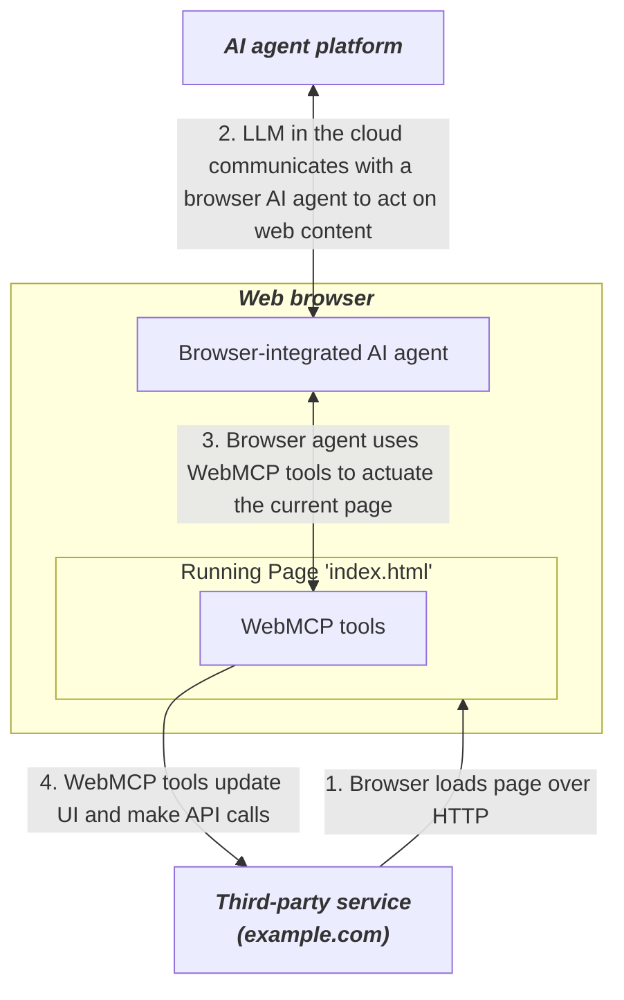

# A Guide to Web MCP: How Websites Can Expose Tools to AI Agents

For more than a decade, developers have automated websites using tools such as Selenium, Puppeteer, and Playwright. More recently, browser agents and computer-use models have made it possible to automate the same interfaces with natural-language instructions. Yet both generations of automation face the same underlying problem.

A browser has no standard way for a website to tell an agent, “These are the actions I support, these are the inputs they require, and this is how you should call them.”

As a result, automation must first interpret the interface—reading the page, locating elements, filling forms, and simulating clicks. Even a small design change can break that workflow.

That recurring limitation is what led to [WebMCP](https://developer.chrome.com/docs/ai/webmcp).

I started reading the specification, Chrome implementation, browser positions, emerging tooling, and examples from websites already using it. This guide covers what I learned.

## What is WebMCP?


WebMCP is a proposed browser API that lets a website expose its own JavaScript functions and HTML forms as structured tools for AI agents.

Each tool can have a name, description, input schema, and execution logic that connects to the same application code the human interface already uses.

A useful way to think about it is that the current web page can provide an MCP-like tool layer inside the browser.

The agent can discover those tools (similar to MCP) and call them while sharing the same page state, UI, and signed-in browser session as the user.

Backend MCP still makes sense for server-side integrations, while WebMCP focuses on actions that belong to the active web experience.

However, this was not standardised from day one; some standard facts worth knowing:

- WebMCP first focused on agents built into browsers, but developer demand pushed the proposal toward in-page agents and cross-origin iframe agents.
- A proposal is made, but as of September 2, 2026, it remains a W3C Web Machine Learning Community Group draft rather than a W3C Recommendation. 
- Mozilla has given the proposal a neutral position, while WebKit currently opposes it in its present form.

As is evident, the ecosystem is moving faster than the standards process, and companies are proving it.

- Shopify enabled[ WebMCP tools](https://shopify.dev/docs/api/web-mcp) on every Liquid storefront on August 5, 
- Cloudflare launched its [developer preview](https://blog.cloudflare.com/webmcp/) on August 6, and 
- OpenAI started a [WebMCP Challenge](https://openai.com/webmcp-challenge/) with Chrome, Cloudflare, Shopify, Vercel, Render, and Netlify on August 25. 
- ChatGPT's built-in desktop browser, ChatGPT Work, and Codex can now discover WebMCP tools on compatible pages.

That gives us the basic idea. The useful part is what WebMCP exposes once a page starts using it.

---

## WebMCP features

WebMCP stays fairly small at the API level, but those pieces cover most of what a browser agent needs to work with an application.

- **Imperative tools:** A site can use `document.modelContext.registerTool()` to expose existing JavaScript application logic as a tool.
- **Declarative tools:** Existing HTML forms can expose their purpose and fields to agents through WebMCP form annotations.
- **Structured inputs:** Tools describe their arguments using JSON Schema, so the agent knows which inputs exist and what types they accept.
- **Dynamic discovery:** Tools can appear and disappear as the page, route, user state, or authentication state changes.
- **Shared browser state:** The agent works with the current page and user session, so the application doesn't have to rebuild all browser state in a separate agent backend.
- **Visible execution:** A WebMCP action can update the same interface the user is viewing, keeping the user and agent in the same application state.
- **Tool annotations:** Developers can mark read-only tools and outputs that contain untrusted content. These are hints for agents and should not replace server-side security checks.
- **Tool lifecycle:** Current registration uses an `AbortSignal`, which gives applications a clean way to remove tools when a route or component goes away.
- **Cross-origin controls:** Sites can control which iframe origins can discover tools through Permissions Policy and explicit origin exposure.
- **Fallback automation:** If a page does not expose a suitable tool, an agent can still fall back to screenshots, the DOM, accessibility information, or normal browser automation.

That last feature matters because WebMCP does not require every action on a site to become a tool. An agent can use structured tools where they help and use the normal interface for everything else.

So the next question is what actually happens between the user prompt and that JavaScript function.

---

## How Web MCP works

The basic flow is simple: the website publishes tools, the browser exposes them to an allowed agent, and the agent calls the most useful tool using structured input.



This follows the same broad architecture documented by the[ WebMCP project and Chrome. ](https://developer.chrome.com/docs/ai/webmcp)The important difference from a traditional remote MCP server is where the tool executes.

WebMCP runs through the active page, so it can reuse client-side state and update the visible interface.

A tool call normally moves through five stages:

1. **Registration:** The page registers its available tools.
2. **Discovery:** The agent asks which tools are active on the current page.
3. **Selection:** The model chooses a tool and prepares arguments that match its schema.
4. **Execution:** The browser invokes the page's JavaScript or declarative form workflow.
5. **Response:** The result goes back to the agent, and the page can update at the same time.

This also explains one detail most initially overlook. The WebMCP tools can change as the UI changes.

For example;

A product page might expose `add_to_cart`. The cart route might expose `update_cart` and `checkout`.  An admin page might expose a completely different set.

Tools can follow application state rather than becoming one large static list.

Shopify already uses this pattern. Its Liquid storefronts now expose catalogue, cart, checkout, order, policy, and FAQ tools, and the actions run through the shopper's active session.

Once you understand the theory, the practical setup becomes much easier.

---

## How To Set Up WebMCP

There are 2 ways to set up WebMCP for your project:

- Imperative: We define different types of tools with standard JavaScript functions like form input, navigation tools, state management, or others.
- Declarative: We add annotations to a standard HTML form to create a WebMCP tool an agent can use.

Since the goal is to understand how to integrate WebMCP with products, we'll use an imperative flow. Let’s begin.

For this demo, we will explore how to integrate WebMCP into a customer portal. Please don’t get bogged down in UI details; the goal is to understand how it works.

Create a workspace like the one below.

```plain text
customer-portal-web-mcp/
├── index.html
└── app.js
```

To clarify things a bit:

- `index.html` : serves as our Customer Support Dashboard page with buttons to select Alice/Bob or reset, and a selected-customer panel. It also contains a WebMCP debug section that lists available tools, and a script that loads (for our understanding.
- `app.js` : holds the mock customer data, handles the interactivity and registers and exposes 2 tools as (`get_current_customer` always, `get_customer_orders` selection based) to serve. It also adds a debug dump, think console logs.

You can find code for both files at the [web-mcp gist](https://gist.github.com/DevloperHS/7371521455a064346952c08079611d31).

Now time to test the integration!

Open the terminal, ensure you are at the project root and run the server with :

```plain text
npx serve .
```

This will open the web page.

Next, press F12 to open dev tools, and you can see the console already states the tool `get_current_customer` as it was defined as always available per load using `r`**`egisterBaseTools`**`()` and no gating was added in lines 231-233. (refer to code)


To test that this all works, press **Alice or Bob**, then in the console and copy and paste the following:

```javascript
const tools = await document.modelContext.getTools();

const ordersTool = tools.find(
  tool => tool.name === "get_customer_orders"
);

const result =
  await document.modelContext.executeTool(
    ordersTool,
    "{}"
  );

console.log(result);
```

As you press Enter, the console shows the current customer and their details from the mock data.


This happens because, once you click a customer, `registerCustomerTools()` adds `get_customer_orders` to the current page state, and later the snippet finds, runs and prints the customer order details.

> Note: Here the console and its commands plays the role of chrome webmcp / agent. For simplicity and easy understanding I have kept it like this, but you can use prompt with agents as well.

Now at this point, you can implement WebMCP directly. But a small ecosystem has also appeared around exposing, testing, and consuming these tools.

---

## Best providers for WebMCP

Well, since WebMCP is still in beta, there is no formal WebMCP provider yet.

So this section lists those platforms or toolkits that make WebMCP easier to expose, consume, test, or add to an existing application.

### 1. Cloudflare WebMCP Agent


Cloudflare is probably the easiest option if your website already sits behind Cloudflare and you want to experiment without changing the origin application.

Cloudflare launched WebMCP as a developer preview on August 6, 2026. With it, you can inject a same-origin bridge at the edge, register WebMCP tool packs, and even connect those page tools to an existing site MCP server.

**How to install**

The simplest option is to connect Cloudflare Browser Run to your coding agent through MCP.

Create a Cloudflare API token with **Browser Rendering → Edit** permission, get your Account ID, and add this MCP server to Claude Code, Codex, or Cursor:

```json
{
  "mcpServers": {
    "browser-rendering-cdp": {
      "command": "npx",
      "args": [
        "-y",
        "chrome-devtools-mcp@latest",
        "--wsEndpoint=wss://api.cloudflare.com/client/v4/accounts/<ACCOUNT_ID>/browser-rendering/devtools/browser?lab=true",
        "--wsHeaders={\"Authorization\":\"Bearer <CLOUDFLARE_API_TOKEN>\"}"
      ]
    }
  }
}
```

Then:

- Add the MCP server to Claude Code, Codex, or Cursor.
- Replace `<ACCOUNT_ID>` with your Cloudflare Account ID.
- Replace `<CLOUDFLARE_API_TOKEN>` with your Browser Rendering token.
- Keep `lab=true` enabled for experimental WebMCP support.
- Ask the agent to inspect the page for available WebMCP tools or use the[ chrome mcp inspector](https://github.com/ChromeDevTools/chrome-devtools-mcp) to debug

When to use

- Your website already runs through Cloudflare.
- You want to test WebMCP without changing application code.
- You already expose a same-origin MCP server.
- You want to add standard tool packs quickly.
- You want to experiment before committing engineering time to a native implementation.

The main thing to remember: it remains a developer preview, so expect bugs.

### 2. Stagehand by Browserbase

Stagehand helps the agent consume WebMCP tools from websites.


Browserbase added WebMCP support to Stagehand in June, and Stagehand v4 now exposes a cleaner `page.tools()` API.

It can discover page tools, invoke them, wait for results, cancel long-running calls, and fall back to its normal browser primitives when a WebMCP tool is unavailable.

Learn more at [WebMCP - Stagehand](https://docs.stagehand.dev/v4/basics/webmcp)

**How to install**

The simplest option is to install Stagehand directly in the project.

```bash
npm install @browserbasehq/stagehand
```

Then discover the tools available on the page:

```javascript
const tools = await page.tools();
```

From there:

- Open the project in Claude Code, Codex, or Cursor.
- Install `@browserbasehq/stagehand`.
- Navigate Stagehand to a WebMCP-enabled website.
- Call `page.tools()` to discover its tools.
- Let your coding agent write and run the Stagehand workflow.

When to use

- You are building a browser agent rather than adding tools to your own site.
- Your workflow spans sites with and without WebMCP.
- You need WebMCP plus ordinary browser automation.
- You want browser sessions to run remotely.
- You want direct structured calls when possible and UI automation as a fallback.

I like this pattern because adoption does not have to be all or nothing. The agent can use WebMCP when a site supports it and fall back to the normal interface when it doesn't.

### 3. Angular WebMCP


Angular now has experimental WebMCP support built into the framework.

This matters because route and component lifecycle management becomes one of the first problems when you add WebMCP to a large SPA.

The workaround is that Angular can bind tool registration to its dependency-injection lifecycle and can also generate tools from Signal Forms.

Learn more at the Angular [WebMCP docs](https://angular.dev/ai/webmcp).

**How to install**

Angular can generate the coding-agent configuration for you.

For Claude Code:

```bash
ng generate ai-config --tool=claude-code
```

For Codex:

```bash
ng generate ai-config --tool=open-ai-codex
```

For Cursor:

```bash
ng generate ai-config --tool=cursor
```

Then:

- Run the command for the coding agent you use.
- Open the Angular project in that agent.
- Ask it to use Angular's experimental WebMCP APIs.
- Register the tools you want to expose.
- Run the app and test the tools in a WebMCP-compatible browser.

**When to use**

- Your application already uses Angular.
- Tools should follow the application or route lifecycle.
- You want to inject existing Angular services inside tool handlers.
- You have Signal Forms that map naturally to agent actions.
- You prefer framework-managed registration over manually wiring every tool.

Angular still labels WebMCP as experimental, so I would expect API changes while the browser proposal continues to move.

### 4. Nekuda WebMCP Kit


Nekuda's WebMCP Kit takes a different approach.

Instead of manually finding every useful action yourself, you can give the repository to Claude Code or Codex.

The plugin reads the application, proposes a small tool plan, waits for approval, adds the tools, and verifies them in a real browser.

Learn more at [Nekuda WebMCP Kit Docs](https://docs.nekuda.ai/)

**How to install**

For Claude Code:

```plain text
/plugin marketplace add nekuda-ai/webmcp-kit
/plugin install webmcp-kit@nekuda
```

Then run:

```plain text
/webmcp-kit:implement
```

For Codex:

```bash
codex plugin marketplace add nekuda-ai/webmcp-kit
codex plugin add webmcp-kit
```

Then:

- Open the website repository in Claude Code or Codex.
- Ask it to make the site WebMCP-ready.
- Review the proposed tool plan.
- Approve the tools you want.
- Let the kit implement and verify them in a real browser.

Nekuda does not currently document a native Cursor integration.

**When to use**

- You already have a large website and do not know where to begin.
- You want a coding agent to inspect routes and application logic.
- You want approval before code changes happen.
- You want browser verification as part of implementation.
- You use Claude Code or Codex for application development.

I would still review the generated tool boundaries carefully. Choosing which operations an agent should access is a product and security decision, even when an agent can generate the code.

### 5. OpenTiny NEXT-SDK


OpenTiny is useful if you need a polyfill or want to experiment beyond browsers that currently expose native WebMCP.

Its NEXT-SDK provides a WebMCP compatibility layer, browser control, remote communication, WebAgent components, and a CLI that can inject its page tooling into existing websites.

**How to install**

The simplest option is to install the WebMCP CLI.

```bash
npm install -g @opentiny/webmcp-cli
```

Then open a page:

```bash
webmcp-cli tabs open https://example.com
```

Inspect its available tools:

```bash
webmcp-cli state
```

And call one:

```bash
webmcp-cli run <tool-name> '<json>'
```

Then:

- Install `@opentiny/webmcp-cli`.
- Open the project in Claude Code, Codex, or Cursor.
- Let the coding agent run the CLI through its terminal.
- Use `webmcp-cli state` to discover available tools.
- Use `webmcp-cli run` to execute them.

**When to use**

- Native browser support is too limited for your experiment.
- You want a WebMCP polyfill.
- You need remote page control.
- You work across React, Vue, or Angular applications.
- You want a CLI that combines browser inspection with tool invocation.

This is a community implementation, so I would keep the native specification as the reference contract and treat additional OpenTiny behaviour as an extra layer.

These tools make implementing and consuming WebMCP much easier.

But once I started thinking about real workflows, another limitation became obvious.

---

## Where Composio fits in

WebMCP works very well when the action belongs to the page that the user already has open.

For example, imagine a support dashboard exposing:

- `get_current_customer` 
- `get_active_ticket` 
- `change_ticket_priority`

The agent can use these tools because the dashboard owns these actions in the code.

But now suppose the task becomes:

- Get the current customer. → Find their last five Gmail conversations. → Check the related Linear issues. → Look for discussion in Slack. → Create a summary in Notion. → Then send the summary to the account owner.

The real problem starts to emerge.

The first step can come from WebMCP. After that, the workflow leaves the current website.

The output of one tool becomes the input of another:


At this point, registering another WebMCP tool for every external application adds extra work.

You need OAuth flows, token refresh, credentials, tool discovery, schemas, permissions, execution, large-result handling, and enough context for the model to decide which tool to use next.

This is where I use  [Composio](https://composio.dev/).

- Composio provides tool discovery, execution, authentication, and context management across 1,000+ [toolkits](https://composio.dev/toolkits).
- Its [Tool Route](https://docs.composio.dev/reference/api-reference/tool-router/postToolRouterSession)r can search for tools from the user's intent, and its managed authentication layer handles connected accounts and supported OAuth flows.

For more complex workflows, Composio also supports programmatic tool calling through a [workbench. ](https://docs.composio.dev/toolkits/meta-tools/remote_workbench)

This lets an agent chain several tools while keeping large intermediate responses outside the main model context.

Composio's MCP Gateway can also put one governed layer in front of managed integrations and your own MCP servers, with action-level access controls and an audit trail.

So I would separate the responsibilities like this:


Best part? They can also work in the same workflow.

A WebMCP tool can return the current customer ID. The agent can then use that ID with Composio to discover and call Gmail, Slack, Salesforce, Linear, Notion, or another external service.

With this flow;

WebMCP now gives the agent a clean way to interact with the application in front of the user, while Composio handles the wider tool graph around it.

---

## Conclusion

The underlying idea behind WebMCP is familiar.

Developers have exposed functions, built APIs, automated browsers, and wrapped application actions for years.

WebMCP adds a common browser interface for publishing those actions directly to agents.

Instead of forcing an agent to understand every button and field first, the site can explain which actions it supports and how to call them.

To implement, I suggest starting small:

- Pick one important workflow. 
- Expose two or three good tools. 
- Test them against a real agent. 
- And keep the normal interface working as the fallback.

And when that workflow starts moving across Gmail, Slack, GitHub, Linear, Salesforce, Notion, and other systems, add a tool layer such as [Composio ](/p/323f261a6dfe80dea64ffdae4a77feee?pvs=25)instead of rebuilding those connections inside the page.

WebMCP is still experimental.

The August 26 specification remains a [Community Group draft](https://webmachinelearning.github.io/webmcp/); [Chrome ](https://developer.chrome.com/docs/ai/webmcp/use-cases)support is still experimental; Mozilla is neutral; [WebKit ](https://github.com/WebKit/standards-positions/issues/670)currently opposes the proposal; and several parts of the design are still evolving.

At the same time, [Shopify](https://www.shopify.com/in), [Cloudflare](https://www.cloudflare.com/), [Angular](https://angular.dev/), [Browserbase](https://www.browserbase.com/), [OpenAI](https://openai.com/), [Netlify](http://netlify.com/), and others are already testing what the model looks like in real products.

So I would build with it, but I would keep the implementation small and easy to change.

If you're building the internet of the future, WebMcp is no pushover; implement it now and give the agent a clear tool, rather than guessing.

---

## Sources {toggle="true"}

	- WebMCP specification: [W3C WebMCP draft, August 26, 2026](https://webmachinelearning.github.io/webmcp/?utm_source=chatgpt.com)
	- WebMCP explainer and architecture: [WebMCP GitHub explainer](https://github.com/webmachinelearning/webmcp/blob/main/README.md?utm_source=chatgpt.com)
	- Chrome overview: [Chrome WebMCP guide](https://developer.chrome.com/docs/ai/webmcp?utm_source=chatgpt.com)
	- Chrome tool design guidance: [Building useful WebMCP tools](https://developer.chrome.com/docs/ai/webmcp/build-tools?authuser=9&utm_source=chatgpt.com)
	- Current standards work: [WebMCP GitHub repository](https://github.com/webmachinelearning/webmcp?utm_source=chatgpt.com)
	- Mozilla standards position: [Mozilla WebMCP position](https://github.com/mozilla/standards-positions/issues/1412)
	- WebKit standards position: [WebKit WebMCP position](https://github.com/WebKit/standards-positions/issues/670?utm_source=chatgpt.com)
	- OpenAI support and current challenge: [OpenAI WebMCP Challenge](https://openai.com/webmcp-challenge/?utm_source=chatgpt.com)
	- ChatGPT WebMCP announcement: [Build agent-ready websites with ChatGPT](https://community.openai.com/t/build-agent-ready-websites-with-chatgpt/1392588?utm_source=chatgpt.com)
	- Shopify implementation: [Shopify WebMCP support for Liquid and Hydrogen](https://shopify.dev/changelog/webmcp-liquid-hydrogen)
	- Cloudflare implementation: [Cloudflare WebMCP developer preview](https://blog.cloudflare.com/webmcp/?utm_source=chatgpt.com)
	- Stagehand v4: [Stagehand WebMCP documentation](https://docs.stagehand.dev/v4/basics/webmcp)
	- Angular integration: [Angular WebMCP documentation](https://angular.dev/ai/webmcp?utm_source=chatgpt.com)
	- Nekuda implementation toolkit: [WebMCP Kit](https://github.com/nekuda-ai/webmcp-kit?utm_source=chatgpt.com)
	- OpenTiny implementation: [OpenTiny NEXT-SDK WebMCP repository](https://github.com/opentiny/webmcp-sdk?utm_source=chatgpt.com)
	- Netlify current API notes and starter: [Netlify WebMCP resources](https://www.netlify.com/webmcp-challenge/resources/?utm_source=chatgpt.com)
	- Composio tool and authentication API: [Composio API reference](https://docs.composio.dev/reference?utm_source=chatgpt.com)
	- Composio governance layer: [Composio MCP Gateway](https://composio.dev/mcp-gateway?utm_source=chatgpt.com)
