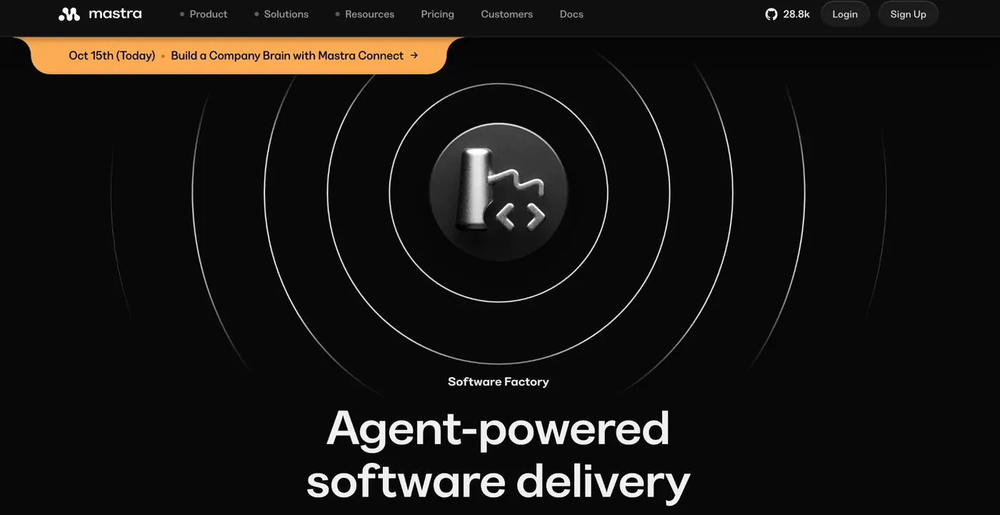
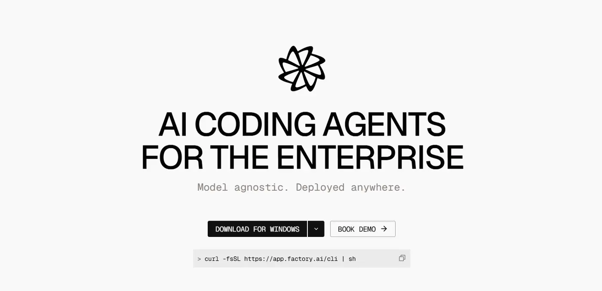
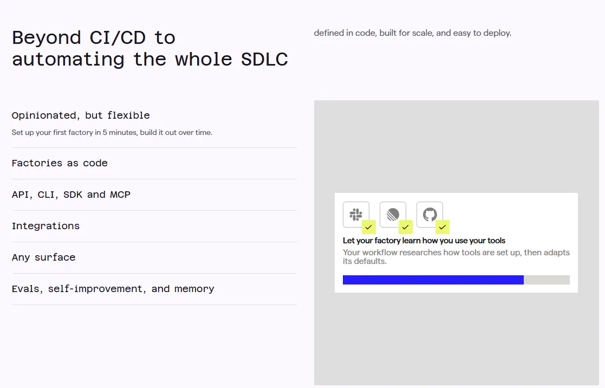
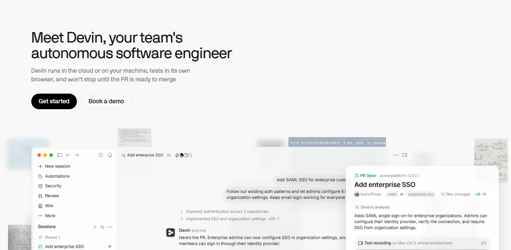
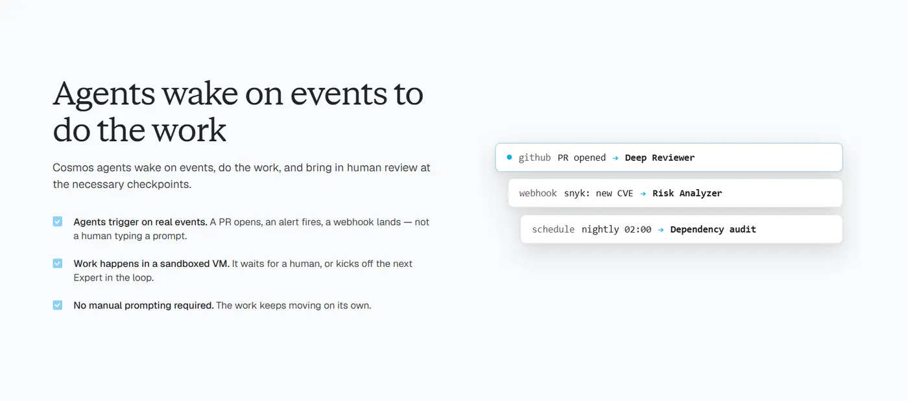

# Best AI Software Factories in 2026

Your team probably uses coding agents every day. But each developer runs them in a different way, and nobody can see all of that work in one place.

The problem gets bigger as your team grows. Agents start tasks from chat threads, terminals, and issue comments. You lose track of who asked for what, and you can’t see the plan that the agent used. Then pull requests arrive faster than your reviewers can read them, so review becomes the slowest step in your process.

This volume is real. GitHub says agents started [more than 40% of the pull requests on its platform in September 2026](https://visualstudiomagazine.com/articles/2026/10/29/github-octoverse-agents-started-more-than-40-percent-of-september-pull-requests.aspx), and in March that number was 17%.

A software factory gives you one place to start, track, and approve agent work.

This guide compares five software factories, so you can give that work a clear structure.

## What is a software factory?

A [software factory](https://mastra.ai/articles/what-is-ai-software-factory) is a system that runs AI coding agents on your team’s real work. It takes work items from GitHub issues, Linear tickets, or Slack requests. Then it moves each item through investigation, planning, implementation, and pull request review.

You keep control of the key decisions. You approve the plan before the agent writes code, and you decide if the pull request merges. The agents do the work between those checkpoints.

A software factory differs from a coding agent in your editor. An editor agent helps one developer with one task. A software factory runs tasks for the whole team, and it keeps a record of each step from issue to pull request.

## Quick comparison

| Tool | Best for | Open source | Self-hosting | Model choice | Starting price |
| --- | --- | --- | --- | --- | --- |
| [Mastra Factory](https://factory.mastra.ai/) | Full control and ownership | Yes | Every part, any plan | Your provider, key, or subscription | Free to run |
| [Factory](https://factory.com/) | Agents in every developer tool | No | On-premise on Enterprise | Frontier and open-weight models, BYOK | Free with your own inference |
| [Warp Factories](https://www.warp.dev/factories) | Measuring and tuning agent runs | No | Workers on Enterprise | Warp Agent, Claude Code, Codex | \$0 + usage |
| [Devin](https://devin.ai/) | Many intake sources and Git hosts | No | VPC on Enterprise | Frontier models plus SWE-2 | Free; Pro \$20/mo |
| [Harness Cosmos](https://www.harness.io/products/cosmos-software-factory-agent) | Teams that already deploy with Harness | No | No public option found | Several models, including Claude | Free trial; contact sales |

## 1. [Mastra Factory](https://factory.mastra.ai/)

**Best for:** Teams that want an open source software factory with configurable workflows, model choice, and flexible deployment.

[Mastra Factory](https://mastra.ai/factory) is an open source environment where coding agents work with your team to turn repository issues into plans, code, and reviewed pull requests. It comes from the team behind the open source [Mastra TypeScript agent framework](https://github.com/mastra-ai/mastra).

Each session works in its own repository checkout. With cloud sandboxes, commands run in an isolated environment; local execution runs them on the Factory Server’s machine. You can use Factory in a web or mobile browser, or interact with its agents through Slack. [factory.mastra.ai](https://factory.mastra.ai/what-is-factory)

Mastra uses Factory on its own repository. In its [November 2026 update](https://mastra.ai/blog/announcing-new-capabilities-in-mastra-factory), the team reported an average of 16.9 merged pull requests per engineer per week, up from 9.5 before Factory. Median triage time fell from 6.9 hours to 11 minutes, with agents handling 91% of triage. Recent Factory-authored fixes had a median issue-to-merge time of 28.2 hours, compared with 56.4 hours for human-authored fixes before Factory.

### Why choose Mastra Factory

- **You control when agents act.** The default workflow waits for you to start work and approve plans. You can configure individual stages to start automatically, while custom boards can also automate plan approval. Pull requests go through your repository’s merge process. [factory.mastra.ai](https://factory.mastra.ai/using/work-and-approvals)
- **You shape the workflow.** Configure the stages work moves through, then give each stage its own skills, tools, and approval rules.
- **You connect existing work sources.** Factory supports repositories and issues from GitHub and GitLab, with additional work intake from Linear, Jira, and incident.io.
- **You choose where it runs.** Run everything on Mastra platform, run the server locally with platform resources, or [self-host everything](https://github.com/mastra-ai/template-factory-self-hosted). Authentication, storage, and sandbox providers can be configured independently.
- **Use your existing AI subscription.** Connect a supported Claude or Codex subscription, use an API key, or choose models through Mastra Gateway or an OpenAI-compatible endpoint.
- **You can inspect and change the code.** The core code is open source, with separate licensing for certain enterprise features.
- **You can test changes through app previews.** Ask the agent to run your app and share a browser link from a supported sandbox before reviewing the pull request.

### What to consider

- Initial setup includes creating a Factory project, connecting a repository, and configuring model access and issue intake.
- Its flexibility brings configuration decisions. Teams that prefer a predefined process should consider how much customization they need.

### Pricing

The core open source code is free to use, but running Factory can involve hosting and model costs. Mastra uses Apache 2.0 for most of its codebase and a separate enterprise license for certain features in production. These include RBAC, fine-grained authorization, and the Mastra Studio sign-in screen with a third-party provider. Check the [license documentation](https://mastra.ai/docs/license) for your configuration.

[Mastra platform](https://mastra.ai/pricing) has Free at \$0/month, Starter at \$25/month, Team at \$250/month, and Enterprise with custom pricing. These are base prices per workspace, with additional charges possible beyond included usage allowances, including sandbox compute. Model usage is paid through your connected provider or your organization’s Mastra credits when using Mastra Gateway.

## 2. [Factory](https://factory.com/)

**Best for:** Teams that want agents in the terminal, IDE, desktop app, and chat tools.

Factory builds its platform around coding agents that it calls Droids. You run Droids from a desktop app, a CLI, an SDK, or IDEs such as VS Code and JetBrains. Factory moved its main site from factory.ai to factory.com.

Factory connects to Linear, Jira, Slack, Sentry, Notion, and other apps. Its Droid Action runs code reviews and security scans on your pull requests.

### Why prefer Factory

- **You can run agents in the cloud or on your machine.** Background agents work in both environments.
- **You can build custom Droids.** Give each Droid its own prompts, tools, and models.
- **You bring your own model.** Use your own key, or use Factory's Droid Core open-weight models.
- **It's proven with large teams.** Factory has strong enterprise adoption and a large app catalog.

### What to consider

- It is closed source, and the license reserves all rights
- On-premise deployment needs the Enterprise plan
- Usage limits reset on rolling 5-hour, 7-day, and 30-day windows

### Pricing

On the pricing page, Free costs \$0 with your own inference. Pro costs \$20/month, Plus costs \$100/month, and Max costs \$200/month. Teams costs \$60/month per team plus \$40/month per seat, for up to 10 seats.

## 3. [Warp Factories](https://www.warp.dev/factories)

**Best for:** Teams that want to define their factory as code and measure every agent run.

Warp Factories coordinates coding agents, and it turns requests from issue trackers, repos, and chat into pull requests. A [foreman agent](https://docs.warp.dev/factories/factory-agents/) creates a work item for each request. Then it sends the work to agents for triage, planning, building, and review. Warp [launched it in August 2026](https://www.warp.dev/blog/open-infrastructure-for-building-a-software-factory), and the docs still list it as Early Access.

By default, the factory stops in three places. A person approves the spec, answers unclear questions, and decides on the merge. You keep the factory definition in files, and you can store them in your own GitHub repository.

### Why prefer Warp Factories

- **You measure every run.** Scorers and benchmarks rate each agent run, and self-improvement proposals arrive as pull requests.
- **You choose the harness.** Warp Agent, Claude Code, or Codex.
- **You can start work from many tools.** Intake comes from Slack, Microsoft Teams, GitHub, GitLab, Azure DevOps, Linear, Jira, and webhooks.
- **You choose where agents run.** Warp-hosted sandboxes by default, or self-hosted workers on Enterprise.

### What to weigh in?

- It is in Early Access, so your team may need approval to get in
- Self-hosted workers need the Enterprise plan, and Warp keeps the control plane
- You can connect Linear or Jira, but not both at once

### Pricing

On the Factories pricing tab, Pay as you go costs \$0/month, and usage costs 20% above API rates. Build costs \$20/month, Business costs \$50/user/month, and Enterprise uses custom pricing. Warp bills inference, compute, and agent usage separately.

## 4. [Devin](https://devin.ai/)

**Best for:** Teams that need many intake sources and Git hosts, including Bitbucket.

Devin is an autonomous AI software engineer from Cognition. It runs in cloud environments, takes tasks from your tools, and opens pull requests. Cognition now offers Devin Cloud, Devin Desktop, and a CLI.

Devin’s docs list native integrations with Slack, Microsoft Teams, Jira, Linear, and Azure DevOps. Its pricing page also lists GitHub, GitLab, and Bitbucket.

### Why prefer Devin

- **It's the most widely used tool on this list.** Devin has the largest user base and a low entry price.
- **You can ask about your codebase.** DeepWiki and Ask Devin answer questions about your repositories.
- **You can automate intake.** Linear triggers start work when tickets match your rules.
- **You choose your model.** OpenAI, Anthropic, Google, xAI, or Cognition's SWE-2.

### What to weigh in?

- It is closed source
- Cloud agents need a paid plan, and VPC deployment needs Enterprise
- Quotas reset daily and weekly

### Pricing

On the pricing page, Free costs \$0. Pro costs \$20/month, and Max costs \$200/month. Teams costs \$80/month plus \$40/month per full seat, for up to 100 users.

## 5. [Harness Cosmos](https://www.harness.io/products/cosmos-software-factory-agent)

**Best for:** Teams that already use Harness to test, secure, and deploy software.

Harness Cosmos started as Augment Code’s Cosmos. Harness [bought it and other Augment Code assets](https://www.harness.io/blog/harness-acquires-augment-code-cosmos) in October 2026, and it now calls the product the Harness Cosmos Software Factory Agent.

Cosmos takes a ticket or bug report and turns it into a reviewed pull request. Its agents plan the change, write the code and tests, and open the pull request. They [keep working when a reviewer leaves comments, a check fails, or a merge conflict appears](https://www.harness.io/blog/shipped-in-october-2026). The agents write and test code inside [isolated VMs](https://thenewstack.io/harness-augment-cosmos-acquisition/).

Then other Harness agents test, secure, and deploy the change. If they find a problem, they send it back to Cosmos with the context to fix it.

### Why prefer Harness Cosmos

- **You get a full ticket-to-pull-request loop.** Agents plan the change, write the code and tests, and open the pull request.
- **The agents keep working after review.** They fix review comments, failed checks, and merge conflicts on their own, inside isolated VMs.
- **Your code connects directly to deployment.** Other Harness agents test, secure, and deploy the change, and they send problems back to Cosmos with the context to fix them.
- **You keep your current tools.** Cosmos works next to your existing coding tools, and it connects to your Harness account with OAuth.

### What to weigh in?

- It is a new product with limited public docs on price, hosting, and models
- The New Stack reports that the feature that learns from failed deployments has not shipped yet
- You get the most value only if you already use Harness

### Pricing

Harness offers a [free trial of Cosmos](https://www.harness.io/products/cosmos-software-factory-agent) with no credit card. I found no public price for paid use, so contact Harness for a quote.

### Other tools worth a look

These two tools did not make my top five. But they can fit some teams better.

### GitHub Copilot cloud agent

You assign an issue to Copilot, and it [works in a temporary environment on GitHub Actions](https://docs.github.com/en/copilot/how-tos/copilot-on-github/use-copilot-agents/watch-and-fix-pull-requests). It runs tests and linters, and then it opens a pull request for your review. GitHub says [Copilot cloud agent grew 230% in one year](https://fourweekmba.com/ai-github-says-agents-now-start-over-40-of-its-pull-requests/), so it is one of the most used agents today.

I left it out because it is one agent inside GitHub. Research and planning work only on GitHub.com, and its Jira, Linear, and Slack integrations only create a pull request. Pick it if your code, issues, and CI are all on GitHub.

### OpenHands

[OpenHands](https://www.openhands.dev/) is an MIT-licensed coding agent platform. Its [GitHub repository](https://github.com/OpenHands/openhands) had more than 76,000 stars in June 2026. You can self-host it, use any model, and run issue-to-pull-request work from GitHub, GitLab, Slack, and Jira.

I left it out because it still gives you fewer built-in team workflow steps, such as intake boards and plan approval gates. Its [Agent Canvas](https://www.openhands.dev/product/canvas) workspace adds parallel agents, Git worktrees, and automations from GitHub, Slack, and schedules, but you assemble more of the factory workflow yourself. Pick it if you want a fully open source agent and a large community.

### Codegen (ClickUp)

[Codegen](https://codegen.com/) is an AI coding agent built into ClickUp. You assign it a ClickUp task or mention it in a comment, and it returns a GitHub pull request. ClickUp acquired Codegen in late 2025 and discontinued the standalone service in January 2026.

I left it out because it works only inside ClickUp. Pick it if your team already manages work there.

### How to choose the right software factory

Start with your hardest requirement, and then match it to a tool:

- **You need self-hosting and a full factory workflow:** Pick Mastra Factory. If you only need an open source agent, also look at OpenHands.
- **You need clear approval gates, or you want to test each change in a live preview:** Pick Mastra Factory.
- **You want agents in the IDE, CLI, and chat:** Pick Factory.
- **You want to measure and tune agent runs:** Pick Warp Factories, if you can get Early Access.
- **You use Bitbucket or Azure DevOps:** Pick Devin.
- **You already deploy with Harness:** Pick Harness Cosmos.
- **You use GitHub for everything:** Pick GitHub Copilot cloud agent.

Whichever tool you pick, start small. Connect one repository, and give the agent one low-risk issue first.

## FAQ

### What is an AI software factory?

It is a system that moves work items from issue to pull request with coding agents. Agents investigate, plan, and implement, and humans approve the key decisions.

### Is Mastra Factory free?

Yes, you can run the open source code for free. Mastra platform plans start at \$0, and you pay your model provider separately.

### Can a software factory merge code without a human?

In Mastra Factory, a merge always waits for a person. In Warp Factories, your repository rules control merges. Factory, Devin, and Harness Cosmos open pull requests, and your team reviews and merges them.

### Which software factory can I self-host?

Mastra Factory supports a fully self-hosted setup on any plan. Factory, Warp Factories, and Devin offer self-hosted or private deployment on Enterprise. I found no public self-hosting option for Harness Cosmos. OpenHands is also open source, and you can self-host it.

### Do I need to change my model provider?

Usually you don’t. Mastra Factory uses your provider, and Factory, Warp Factories, and Devin also accept your own keys or plans on some tiers.

## Conclusion

All five software factories turn issues into pull requests. But they differ on control, hosting, openness, and adoption. Mastra Factory leads this list because it combines open source code, approval gates at each step, full self-hosting, your own model, and a live preview of each change. Factory and Devin have more users today, and Warp Factories has the best tools to measure agent runs. You can set up Mastra Factory in a few minutes. Run `npm create factory@latest my-factory`, connect a repository, and send your first issue through.
