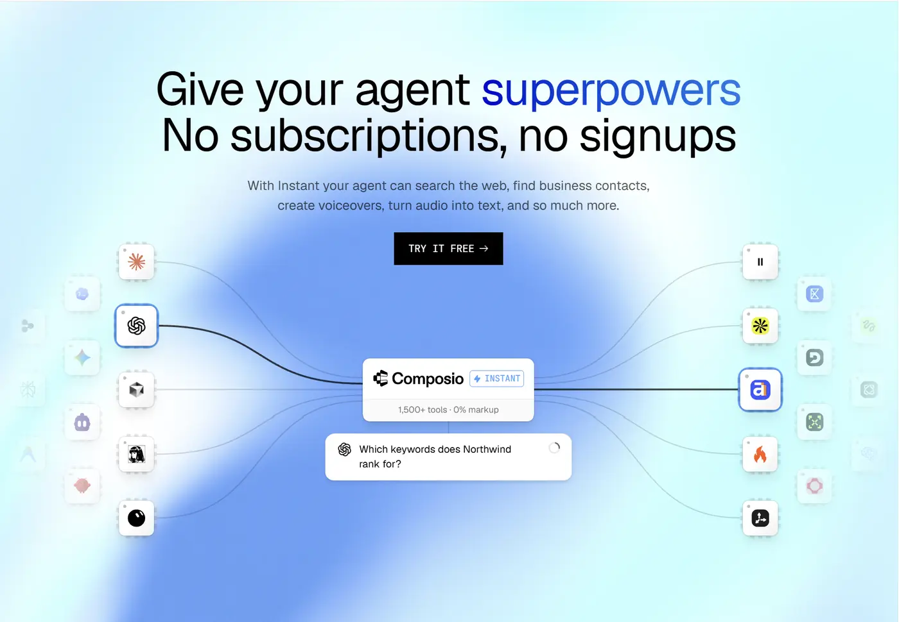
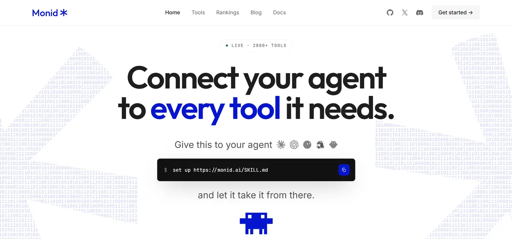
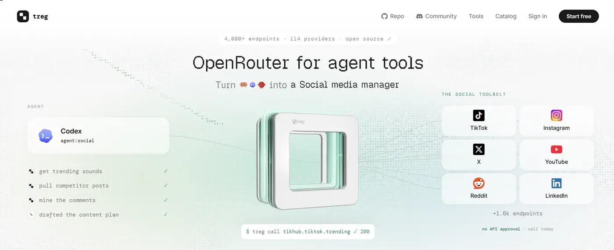
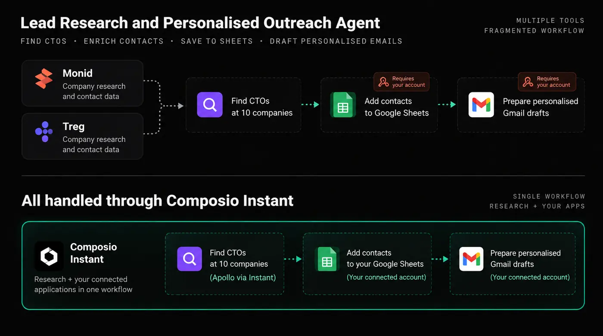
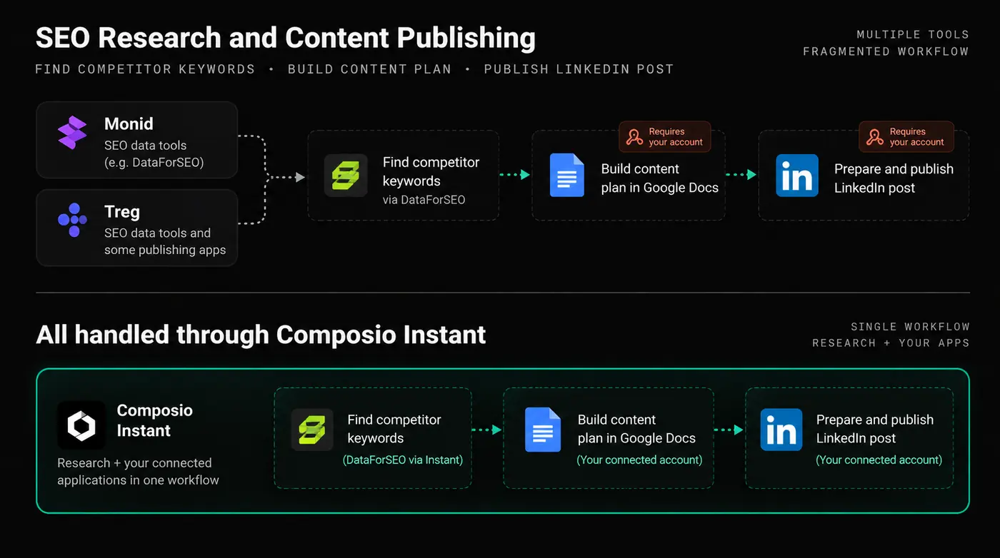
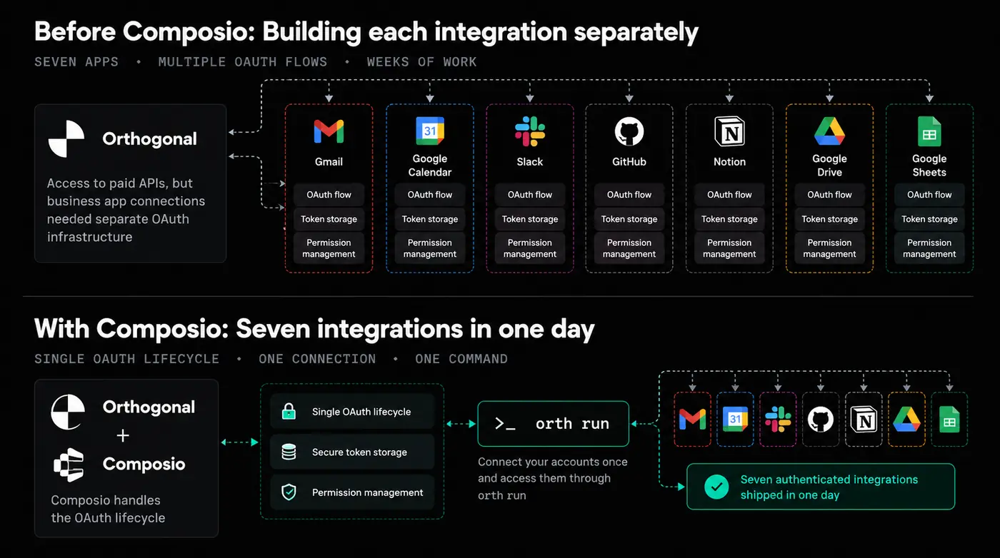
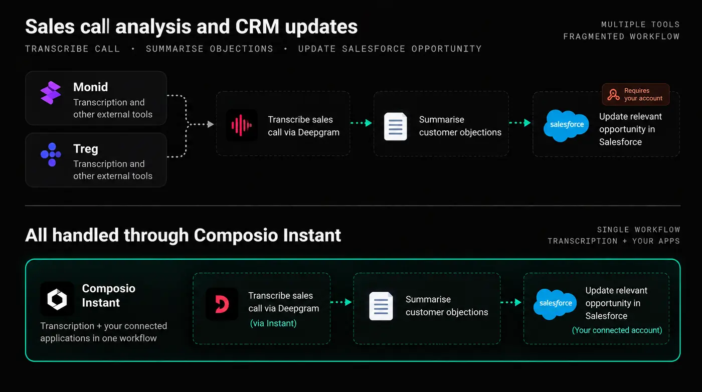

# Best API tool routing platforms in 2026

One of the trendiest field in tech right now is simplifying access to tools and rightfully so. Agents can use tools quite efficiently but the bottleneck is maintaining API keys for all the services you use such as Clay, Apollo, Higgsfield, SEMrush, Exa, etc. API tool routing services essentially simplifies this by having all the services behind a single API or MCP and wallet.

So, you only pay for

These API tool routing services

AI agents use paid APIs to search the web, find leads, scrape websites, transcribe audio, and generate media. But connecting each service separately means setting up provider accounts, managing API keys, and tracking costs across multiple billing systems.

Composio Instant, Monid, and Treg simplify this by letting agents discover and call paid API tools through a single interface. Their catalogues, pricing models, and developer features differ, so the best choice depends on which services you need and how you plan to use them.

This comparison looks at tool coverage, pricing, ease of setup, developer experience, security, and production maturity to help you choose a platform for your agent.

---

## What are Composio Instant, Monid, and Treg?

Composio Instant, Monid, and Treg give AI agents a single interface to discover and use paid external tools, so users don’t have to manage a separate provider account or API key for every services like ..

Their API services overlap, but each offers a different combination:

- **Composio Instant** supports research, lead enrichment, scraping, transcription, and audio and video generation through services such as Apollo, Exa, Parallel, Deepgram, and ElevenLabs. The wider Composio platform adds authenticated actions in apps such as Gmail, Google Sheets, Slack, and Salesforce.
- **Monid** focuses on external research, SEO data, scraping, enrichment, and generation services, with providers such as Apollo, Ahrefs, Exa, and Firecrawl.
- **Treg** offers SEO, enrichment, social data, and research APIs, alongside support for teams’ own provider credentials and custom tools.

The key distinction is how they combine these external services with access to users’ own business applications.

### 1. Composio Instant

[Composio Instant](https://composio.dev/instant) was launched on October 8, 2026. It lets AI agents access paid tools through a shared wallet.

Agents can use services such as Apollo, Exa, Parallel, Deepgram, and ElevenLabs without even creating separate provider accounts or managing their API keys. All one needs is a wallet and some credits (gift: 2\$ per new account)

What makes it particularly interesting is that Instant works alongside Composio's existing integration platform, so agents can use paid external tools and connected business applications within the same workflow.

- **Own-account connections:** Through Composio, users can connect their Gmail, Google Docs, LinkedIn, Instagram, Slack, Salesforce, and other accounts using managed OAuth. Instant uses the user's own provider connection first when one is available.
- **More tools:** Instant launched with 100+ paid tools for research, enrichment, scraping, audio, video, and other tasks. The wider Composio platform advertises 1,500+ managed app integrations and 50,000+ individual tools.
- **Maturity:** Composio reports more than 1 billion tool calls and 1 million connected accounts. Instant is new, but it operates alongside an established integration platform.
- **Developer experience:** Python and TypeScript SDKs, MCP support, user sessions, dynamic tool discovery, and execution logs. Developers can enable Instant and connected applications within a session. SDKs give developers maximum freedom to use Composio however they need.
- **Security:** Composio documents SOC 2 Type II and ISO 27001:2022, along with credential protection, permission controls, and independent security reviews.
- **Enterprise adoption:** Composio publishes customer stories involving Amazon Quick, Zoom, and Glean, although these references do not establish that those customers use the newly launched Instant feature.

For me, the main advantage is simple. I can let an agent research information using paid tools and then act on that information through a user's authenticated business applications.

### 2. Monid

[Monid](https://monid.ai/) gives AI agents access to external tools through one prepaid balance. Agents can discover APIs, check their prices, and execute them without setting up separate provider subscriptions.

This approach works well when the main goal is to access data or external services without managing multiple API keys.

- **Own-account connections:** Monid supports OAuth for applications accessing Monid on behalf of users, but its public documentation does not describe a comparable managed integration system for their Gmail, Google Docs, or other business accounts.
- **Tool coverage:** 1,700+ tools across 55+ providers, including Apollo, Ahrefs, Exa, and Firecrawl.
- **Maturity:** Monid has an active product and documentation, but a shorter publicly documented production history than Composio.
- **Developer experience:** MCP, CLI, skills, and HTTP APIs for discovering, inspecting, and running tools. Lacks an SDK for all around support for developers.
- **Security:** API authentication and OAuth support. Public SOC 2 Type II or ISO 27001 certification could not be verified.
- **Enterprise adoption:** Might be there, but I didn’t find any public documentation verifying named enterprise deployments.

Monid is a strong option for agents that mainly need external research, scraping, enrichment, or generation services.

But if I want the same agent to update a customer's CRM or send an email through their Gmail account, I still need to arrange that application access.

Related: [Composio vs Monid](https://composio.dev/compare/composio-vs-monid)

### 3. Treg

[Treg](https://treg.to/) is an open-source tool gateway that combines paid external APIs with a team's own tools and credentials. It supports BYOK, OAuth connections, and self-hosting.

This is useful for developers who want control over their credentials and infrastructure while accessing external services through one interface.

- **Own-account connections:** Treg supports OAuth, token refresh, shared credentials, and custom tools. However, configuring business application connections may require more work than using Composio's ready-made managed integrations.
- **Tool coverage:** Its catalogue advertises 4,000+ endpoints across 114 providers, including SEO, enrichment, social data, and research services.
- **Maturity:** Treg has a public open-source codebase and an active developer community, while its hosted service terms describe an early-access offering without an uptime commitment.
- **Developer experience:** CLI, MCP, custom tool registration, BYOK, and self-hosted deployment. No SDK for custom agent development, no per-user OAuth. If you’re building product on top of it look for [agent integration platform](https://composio.dev/content/ai-agent-integration-platforms).
- **Security:** Encrypted credentials, team access controls, and OAuth token refresh. Public SOC 2 Type II or ISO 27001 certification could not be verified.
- **Enterprise adoption:** Team credential management is supported, but comparable named enterprise deployments are hard to find.

Treg is useful when one wants a common interface for external APIs and team-managed tools. However, the team needs to assess how much work it will take to configure and maintain specific SaaS integrations to meet the needs.

The catalogue numbers also count different things. Monid lists marketplace tools, Treg lists endpoints, and Composio lists application integrations and actions, so I wouldn't rank them by raw numbers alone.

## When to use what?

The choice depends on whose accounts your agent needs to use and how much integration work you want to manage.

- **Choose Composio with Instant** when your agent needs paid external tools and access to each user’s business applications. For example, it can research leads through Apollo, add them to the user’s Google Sheets, and prepare Gmail drafts. Composio handles the managed app connections, while Instant provides access to supported paid tools.
- **Choose Monid** when your agent mainly needs external services for research, scraping, enrichment, or content generation through one prepaid balance. If you already handle business application connections elsewhere, evaluate Monid on the tools and per-operation prices your workflow needs.
- **Choose Treg** when you want an open-source gateway with self-hosting, your own provider keys, and custom tools. It is worth considering for internal agents that use team-managed credentials, provided your team can configure and maintain the required connections.

For the sales agent in this article, I’d choose Composio with Instant because the workflow needs both paid research and actions inside each user’s Google account. If you only need external data, compare the specific tools and their costs before choosing.

---

## Why Composio Instant stands out for production AI agents

After comparing the three, the feature that swayed my decision is how Composio Instant integrates with the broader Composio platform.

With Monid, I can discover and pay for external tools. Treg offers a similar model and supports my team's own credentials and registered tools.

Composio Instant offers paid access to tools and works alongside managed connections to business applications. This matters when an agent must use external information and then complete a task inside a user's account.

Here is why I think the combination makes a difference.

### 1. Composio knows when to use an existing connection and when to use Instant

One challenge with production AI agents is deciding which account should execute a tool call.

For example, imagine an agent that needs to update a Salesforce opportunity. If the user has already connected Salesforce, the agent should use that connection instead of requesting another account or relying on paid tool access.

Composio handles this through a connection selection order:

1. **Existing user connection:** Prefer the user's connected provider account.
2. **Shared connection:** Use an available shared connection when appropriate.
3. **Composio Instant:** Use Composio-provided access when the eligible tool needs it.

This is where the difference becomes useful:

- Monid focuses on access to paid external tools, while Treg supports custom credentials and registered tools.
- With Composio, connection selection works alongside Instant within the wider platform.

The practical benefit is that an agent can reuse existing account access without an additional Instant charge for that operation, while still using Instant for eligible external tools when needed.

### 1. One agent can use paid tools and users' own connected accounts

Monid and Treg already provide useful catalogues for search, scraping, enrichment, and other paid APIs. Treg also supports team credentials and registered tools.

But what happens when an agent needs to use that research inside a user's business application?

Imagine an agent that finds potential customers through Apollo, adds qualified contacts to Google Sheets, and prepares personalised outreach in Gmail.

- With Monid, you can access the research tool, but you still need a separate way to manage the user's Google connections.
- Treg supports authenticated tools, but you may need to configure the appropriate connections and actions.

With Composio, Apollo can run through Instant using Composio's paid tool access, while Google Sheets and Gmail run through the user's connected accounts.

This extends beyond Google applications. Composio also provides actions across 1,660+ managed application integrations, including Salesforce, Slack, and Notion.

Another detail I like is how Composio handles account selection.

> Composio prefers a user's existing provider connection, followed by an available shared connection, and uses Instant when an eligible tool needs a Composio-provided account.

So if a user already has the required provider account connected, the agent can use it without an additional Instant charge.

This is where Composio stands out for me: I can combine paid research tools with a large catalogue of authenticated business applications without building a separate integration layer for every workflow.

### 3. Composio has a more established production platform

Instant is a recent launch; however, the wider Composio platform already reports more than 1 billion tool calls and 1 million connected accounts. It also has published customer deployments and established authentication infrastructure.

This matters because the difficult parts of production are often user isolation, token refresh, permissions, and reliable execution across applications.

Monid and Treg are actively developed, but their publicly documented deployment histories are less extensive.

### 4. Developers can manage Instant and connected tools within one session

Monid makes external tool discovery simple through its discover, inspect, and run workflow. Treg lets developers access catalogue tools and register their own integrations.

With Composio, you can now create a user session that includes Instant-supported tools and authenticated applications.

For example, the official SDK documentation shows a session that includes Parallel for research and Gmail for account-specific actions.

Developers can also restrict which Instant tools are available and enable charge reporting. This lets them track paid tool usage without building a separate billing integration for every provider.

For strict spending limits, you still enforce approval and budgets in your application because Composio Instant does not provide a built-in per-session dollar cap.

### 5. Security covers both external tools and user credentials

Security becomes more important when an agent works with real customer accounts.

Composio keeps connected-account credentials out of the model's context and provides scoped access controls, execution logs, and enterprise governance.

Instant also uses Composio's provider accounts for eligible paid tools, so developers do not need to distribute those provider API keys to their agents.

Composio has SOC 2 Type II attestation and ISO 27001:2022 certification.

Monid and Treg document their own authentication and credential-handling features, but I they lack the public compliance evidence for either platform.

### 6. Enterprise deployments provide evidence of real-world usage

Finally, I wanted to see whether larger companies were already using the integration infrastructure.

Composio has published customer stories involving Glean, Zoom, and Amazon Quick. These describe how companies use its integration capabilities to let agents take actions inside external systems.

This gives me more evidence about the infrastructure supporting its connected-account capabilities.

However, I couldn't find comparable named enterprise deployments for Monid or Treg; they may be early.

---

## Where Composio Instant makes a practical difference

The biggest advantage becomes clear when a workflow needs external tools and authenticated business applications together.

Here are three examples I'd use to evaluate the platforms.

### 1. Lead research and personalised outreach

**The task:** Find CTOs at ten companies through Apollo, add their contact information to Google Sheets, and prepare personalised Gmail drafts.

Monid and Treg can help with the external research, but the Google Sheets and Gmail actions also need authenticated account access.

Composio combines Apollo through Instant with the user's connected Google applications, and its official launch article describes this exact workflow with an illustrative total cost of \$1.

### 2. SEO research and content publishing

**The task:** Find competitor keywords through DataForSEO, build a content plan in Google Docs, and prepare an approved LinkedIn post.

Monid and Treg provide SEO data tools, and Treg supports some social publishing connections, but they lack permission and control.

With Composio, the research can use Instant, while the user's own connected accounts handle the document and publishing actions, subject to the relevant application permissions.

### 3. Orthogonal: Seven integrations in one day

**The task:** Give AI agents access to Gmail, Google Calendar, Slack, GitHub, Notion, Google Drive, and Google Sheets alongside paid APIs, without building separate authentication infrastructure for each application.

[Orthogonal](https://www.orthogonal.com/) has already proven that this works!

It already provided access to paid APIs through a single interface, but accessing users' business accounts still required OAuth authentication, secure token storage, and permission management.

So, Orthogonal used Composio to handle the OAuth lifecycle.

With this bottleneck removed, Orthogonal shipped seven authenticated integrations in just one day instead of spending weeks building them independently.

Its users can now connect their accounts once and access them through Orthogonal's existing `orth run` command.

This also enabled workflows that combine external research with authenticated actions, such as finding leads through paid APIs, organising them in Google Sheets, and sending personalised emails through Gmail.

### 4. Sales call analysis and CRM updates

**The task:** Transcribe a sales call through Deepgram, summarise customer objections, and update the relevant Salesforce opportunity.

Monid and Treg can provide transcription and other external tools, but Salesforce access still needs a suitable authenticated connection.

Composio can use Instant for the supported Deepgram operation and its Salesforce integration for the account-specific update.

In each example, Instant handles the paid external capability while Composio's managed integrations handle the business application actions.

But pricing for all 3 is where the decision becomes quick

---

## Composio Instant vs Monid vs Treg pricing

Pricing matters, especially when an agent makes many API calls. But I would compare external paid tools and connected-account actions separately because the billing models are different.

### 1. Pricing for Instant and external paid tools

These include search, scraping, transcription, lead enrichment, and media generation.

| Platform | Pricing model | Free credit and markup |
| --- | --- | --- |
| **Composio Instant** | Pay per supported provider operation using the Composio wallet | 0% provider markup; regular Composio tool-call fees still apply. \$2 starter credit |
| **Monid** | Prepaid balance, priced per call or result | \$1 starting credit; endpoint-specific pricing |
| **Treg** | Prepaid balance, billed at provider rates | 0% markup; \$1 starting credit |

All three let you access external services without purchasing separate subscriptions for each provider.

Composio Instant also provides charge reporting, and calls through a user's own provider connection do not incur an Instant usage charge.

> One important detail is that Composio requires a Pro plan to add more funds to an Instant wallet. The Pro plan costs \$29 per month and includes \$29 in monthly usage credit, that’s more than enough to perfrom video generation with higgsfield multiple time. (personally did it)

This was for composio instant vs rest. But composio also has a separate pricing tier, and it's the only one.

### 2. Pricing for calls using your own connected accounts

These include Gmail, Google Docs, Slack, Salesforce, and other authenticated applications.

| Platform | Pricing | Connected-account support |
| --- | --- | --- |
| **Composio** | 100K free tool calls/month with your own app credentials; then \$0.0003 per regular call on Pro | Managed OAuth, user sessions, token refresh, and broad SaaS integrations |
| **Monid** | No directly comparable managed SaaS account pricing verified | OAuth for Monid account access; separate app integration requirements |
| **Treg** | No Treg metering for your own keys, registered tools, or connected accounts | OAuth, shared credentials, BYOK, and custom tools |

For Composio-managed OAuth apps, up to 20K calls are included within the overall free allowance, followed by \$0.0005 per call. Other optional execution and security features may add charges.

So if I only need paid external data, I'd compare Monid, Treg, and Instant based on the specific API rates and available tools.

But if my agent also needs to work inside users' own Gmail, LinkedIn, Google Docs, or Salesforce accounts, Composio becomes more attractive because the managed integration layer is already there.

---

## Conclusion

Composio Instant, Monid, and Treg all make it easier for agents to access paid external tools without managing separate provider accounts.

I'd consider Monid for an agent focused on external data and API discovery. Treg is appealing when I want an open-source gateway, BYOK, and control over registered tools and credentials.

> But **for a production agent that needs both paid external tools and access to users' own business applications, I'd choose Composio Instant integrated in the wider Composio platform anytime.**

Instant handles supported paid services through a shared wallet, while Composio manages authentication, permissions, and actions across its large application catalogue.

This combination matters because most useful business agents need to do more than collect information. They need to use it to update records, create documents, draft messages, and complete tasks inside the applications people already use.

For the type of agent enterprise wants to ship to real customers, Composio offers the most complete documented solution among these three.

---

## Sources

Official sources verified as of October 23, 2026.

- [Composio Instant launch, October 8, 2026](https://composio.dev/blog/composio-instant)
- [Composio Instant overview](https://composio.dev/instant)
- [Composio Instant developer documentation](https://docs.composio.dev/docs/instant-tools)
- [Composio pricing](https://composio.dev/pricing)
- [Composio enterprise platform](https://composio.dev/enterprise)
- [Composio customer stories](https://composio.dev/customers)
- [Composio credential security remediation, October 21, 2026](https://composio.dev/content/how-composio-rebuilt-credential-security-after-may-2026)
- [Monid official website](https://monid.ai/)
- [Monid pricing documentation](https://docs.monid.ai/guide/pricing.html)
- [Monid OAuth documentation](https://docs.monid.ai/guide/quickstart-oauth.html)
- [Treg official website](https://treg.to/)
- [Treg pricing](https://treg.to/pricing)
- [Treg GitHub repository](https://github.com/superdesigndev/treg)
