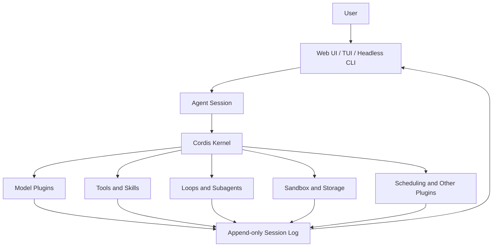

# Best Plugins for DeepSeek Harness

DeepSeek opened its [**DeepSeek Harness**](https://deepseek.com/harness/en/)** v0.1** in developer preview on August 13, 2026. Six days later, its open-source GitHub repository already has **164,000 stars**, so I decided to see what people were building around it.

The interesting part is how [DeepSeek](https://www.deepseek.com/en/) designed it. Models, tools, skills, sessions, storage, sandboxes, scheduling, and even the UI can all be composed as plugins.

So I went through the community plugin topic, individual repositories, install instructions, and the projects getting real attention to see which ones are actually worth using.

From that, I narrowed the list down to the DeepSeek Harness plugins I would try first, based on what they add, how easy they are to install, and where they fit into a real workflow.

## TL;DR

1. **dsh-web-ui** — Adds a complete UI workbench with task management, Git views, mobile access, skins, SSH tools, and other utilities.
2. **DSH-better-sidebar** — Places files, a terminal, Git tools, browser tabs, and subagent views beside the chat.
3. **ModLens** — Gives text-only DeepSeek models vision through structured OCR, layout, entity, and relationship analysis.
4. **dsh-vision-toolkit** — Provides advanced visual workflows such as long-screenshot OCR, grounding, UI reconstruction, and pixel comparison.
5. **dsh-TUI** — Adds a keyboard-first terminal interface with streaming output, session navigation, model switching, and rewind-and-fork support.
6. **dsh-at-file** — Lets you reference workspace files and folders in prompts using searchable `@` mentions.
7. **dsh-market** — Adds an in-app marketplace for discovering, installing, updating, enabling, and removing plugins.
8. **dsh-find-plugin** — Lets the agent search GitHub’s DSH plugin ecosystem and return ranked recommendations with installation commands.
9. **dsh-genui** — Enables models to render interactive components such as dashboards, charts, forms, tables, and quizzes inside responses.
10. **dsh-mnemon** — Adds persistent preferences, project documents, and searchable memory across sessions.

## What is DeepSeek Harness?

DeepSeek Harness, or `dsh`, is an open-source agent harness from DeepSeek. It sits around the model and gives the agent access to its environment, tools, sessions, files, workflows, and other runtime capabilities.

The important part is its plugin-first architecture. DeepSeek uses the Cordis kernel to manage plugin mounting, dependencies, and communication, so developers can swap or extend capabilities through configuration instead of changing the Harness source.

It also keeps an append-only session log of prompts, reasoning, tool calls, results, subagent scheduling, and context injection. You can then resume, fork, search, or replay sessions from that same event stream.

At a high level, the architecture looks like this:



This architecture is the reason why community plugins can change much more than a toolbar or theme. And because plugins live inside profiles, installing them is also fairly straightforward.

## How to install plugins in DeepSeek Harness

DeepSeek Harness installs external plugin bundles into a **profile**. Most plugins in this guide target the `web` profile because they extend the Web UI, while plugins such as dsh-TUI create or use their own profile.

The basic pattern is:

```bash
### Install a plugin
dsh plugin --profile web add <package-or-source>

### Optional: verify that the plugin was added
dsh --profile web --dump-config

### Restart the Web UI when the plugin requires it
dsh web
```

DSH also supports packages installed directly from GitHub.

However, I will recommend reviewing third-party sources before allowing build scripts, and pinning versions or commits where possible, because Git installs can execute package code on your machine.

With that out of the way, these are the plugins I would actually consider.

## Best plugins for DeepSeek Harness

### 1. dsh-web-ui: Turn the Web UI into a complete workbench


The moment I installed and opened the DeepSeek Harness Web UI, I wanted to change it immediately, so I searched for the option and luckily found this one.

[**dsh-web-ui**](https://github.com/zhu1090093659/dsh-web-ui) is a collection of UI plugins, not a single feature. It includes a task board, Git graph, mobile remote access, token information, skins, an image tool, SSH tools, a desktop pet, and an integrated right-side workbench.

The nice part is that you can install the full collection or pick individual packages later.

**How to install**

```bash
dsh plugin --profile web add @linxin666/dsh-web-ui-all@latest
```

Then restart:

```bash
dsh web
```

The repository specifically recommends restarting the process rather than only refreshing the browser.

**Use it when:**

- You want the default Web UI to feel more complete
- You want task management, Git views, mobile access, and other UI tools together
- You prefer one package instead of installing many small UI plugins

One thing to keep in mind is that the full bundle already integrates `dsh-better-sidebar`. So if you only need the sidebar workbench, the next plugin is the cleaner choice.

### 2. DSH-better-sidebar: Add files, terminal, Git, and browser beside the chat


I like this one because it fixes a very specific problem.

When I work with a coding agent, I don't want to keep jumping between the chat, terminal, files, and Git.

[**DSH-better-sidebar**](https://github.com/omdsh-dev/DSH-better-sidebar) puts those surfaces beside the conversation and turns the right side of the UI into a proper development workbench.

It includes a file explorer and editor, a real terminal, Git diff and history views, browser tabs, subagent views, and an API that lets other plugins register their own tabs. The repository currently has around 2.2k stars.

**How to install**

```bash
dsh plugin --profile web add dsh-better-sidebar@latest
```

Then hard refresh the browser with `Cmd/Ctrl + Shift + R`. The current README says client-side changes do not normally require a DSH restart, although host-side updates can.

**Use it when:**

- You want files, terminal, Git, and browser tools beside the conversation
- You prefer a VS Code-like workbench
- You want other plugins to register custom sidebar tabs later

Once the UI is sorted, the next limitation you may notice is that DeepSeek models can still need help with images.

### 3. ModLens: Give text-only DeepSeek models vision


Sometimes I am not working with text alone, and that’s where this and the next plug-in became my lifesaver.

[**ModLens**](https://github.com/liustack/modlens) adds a native vision tool to DeepSeek Harness. You can give it an image, and it returns structured evidence covering OCR, layout, entities, relationships, and other visual information.

That makes it useful for screenshots, design mocks, error dialogues, or other visual inputs when the model route you are using is text-only. It is also one of the more established DSH community plugins, with around 3.2k GitHub stars.

**How to install**

The best way to use it is by pinning the version(current `3.21.1` ):

```bash
npx -y @deepseek-ai/dsh plugin --profile web add @liustack/modlens@3.21.1
```

The explicit version is intentional because pnpm 11 can hold back packages published within its release-age window.

Restart `dsh web` after installation.

**Use it when:**

- Your main model route does not accept image input
- You regularly work from screenshots and error dialogues
- You want structured OCR and layout evidence
- You want a focused vision plugin without a larger visual tool suite

And if basic image understanding is not enough, there is a heavier option.

### 4. dsh-vision-toolkit: Advanced OCR, grounding, and UI reconstruction


[**dsh-vision-toolkit**](https://github.com/Anionex/dsh-vision-toolkit) goes further than basic image reading.

It combines visual tools with an agent skill for image Q&A, long screenshot OCR, visual grounding, cropping, tracing, UI reconstruction, and pixel comparison. It is designed specifically to bring stronger visual workflows into text-first agents.

The project currently has around 728 GitHub stars, so it is smaller than ModLens but already has meaningful adoption inside a very young ecosystem.

**How to install**

The current README recommends the npm package:

```bash
dsh plugin --profile web add @anionex/dsh-vision-toolkit
```

You can also install it into a headless profile if you need the same tools outside the Web UI.

**Use it when:**

- You need long screenshot OCR
- You want to rebuild UI from screenshots
- You need visual grounding or pixel-level comparison
- You want a dedicated vision skill and toolset together

For normal screenshots, I would start with ModLens. I would move to dsh-vision-toolkit when the visual task itself becomes part of the workflow.

### 5. dsh-TUI: Use DeepSeek Harness like a terminal coding agent


The default DSH experience focuses heavily on the Web UI, but as a developer I often prefer staying inside the terminal while coding.

[**dsh-TUI**](https://github.com/ccch1mneyyy/dsh-TUI) adds a full-screen terminal interface with a Claude Code-style workflow. It supports streaming Markdown and reasoning, live agent status, context usage, TPS, file references, session resume, compaction, export, model switching, and a double-Esc rewind-and-fork workflow.

**How to install**

The recommended route installs both the DSH CLI and TUI package:

```bash
npm install -g @deepseek-ai/dsh @deepseek-harness-tui/dsh-tui
dsh-tui
```

You will also need `pnpm` 10 or newer available on your system.

Or install it into its own profile:

```bash
dsh plugin --profile dsh-tui add @deepseek-harness-tui/dsh-tui
dsh --profile dsh-tui
```

**Use it when:**

- You prefer coding from the terminal
- You want a keyboard-first DSH experience
- You want live context and token information
- You use resume, rewind, or session navigation often

If I were using Harness mainly as a coding agent, this would probably be one of my first installs.

### 6. dsh-at-file: Add Codex-style @file references


This is a much smaller plugin, but it solves a friction point I notice constantly in coding agents. You can’t mention files within the work environment.

[**dsh-at-file**](https://github.com/omdsh-dev/dsh-at-file)** **fixes the issue and adds `@` file and folder references to the Web UI composer. Type `@`, search the active workspace, choose a path, and the plugin adds a validated workspace reference to your prompt.

One important detail you should not ignore!

Current versions **don't read or inject file contents themselves**. They pass the validated workspace path, and the agent uses its existing session tools to inspect that file.

**How to install**

The latest documented release is `v0.6.5`:

```bash
dsh plugin --profile web add https://github.com/omdsh-dev/dsh-at-file/archive/refs/tags/v0.6.5.tar.gz
```

Restart `dsh web` after installing.

**Use it when:**

- You reference workspace files constantly
- You do not want to type long paths manually
- You want cleaner prompts around specific files or directories
- You prefer a focused UI improvement instead of a large plugin bundle

The repository is currently around 400 stars, which is a decent signal for such a narrow feature.

### 7. dsh-market: Put a plugin marketplace inside Harness


After looking through enough GitHub repositories, plugin discovery itself becomes a problem. Luckily, we have dsh-market and dsh-find-plugin to rescue.

[**dsh-market**](https://github.com/dsh-market/dsh-market) adds a visual plugin market inside DeepSeek Harness Settings. It lets users browse and search plugins, install them, update them, remove them, manage enabled state, and work with backups without handling every operation from the terminal.

The project uses a curated plugin catalogue that is refreshed regularly.

**How to install**

```bash
dsh plugin --profile web add dshmarket
```

Then restart:

```bash
dsh web
```

Open:

`Settings → Plugin Market`

The current version requires `dsh web` 0.1.0-rc.6 or newer.

**Use it when:**

- You want to browse plugins from the browser
- You install and update community plugins often
- You want easier plugin management
- You do not want to search GitHub manually every time

If you would rather ask the agent to find the right plugin, there is an even more direct option.

### 8. dsh-find-plugin: Let the agent search for plugins


[**dsh-find-plugin**](https://github.com/awesome-dsh-plugin/dsh-find-plugin) gives the agent a tool that searches GitHub repositories under the official `dsh-plugin` topic.

You can ask for something like a Git diff viewer or notification plugin, and it searches the live ecosystem, ranks results by GitHub stars, and returns descriptions plus installation commands.

This one is still small, with around 59 GitHub stars, so I treat it as a useful discovery utility rather than one of the ecosystem's established core plugins.

**How to install**

```bash
dsh plugin --profile web add dsh-find-plugin
```

Then restart `dsh web`.

**Use it when:**

- You know the capability you need but not the plugin name
- You want discovery inside the conversation
- You do not want to keep browsing GitHub topics
- You want install commands returned with the results

That is especially useful right now because the DSH ecosystem is growing faster than any static list can keep up with.

### 9. dsh-genui: Render interactive interfaces inside answers


This was one of the more interesting plugins I found while going deeper into the community repositories.

[**dsh-genui**](https://github.com/omdsh-dev/dsh-genui) lets the model render interactive UI directly inside its replies. It supports more than 30 components, including cards, tables, charts, forms, tabs, quizzes, file trees, timelines, Mermaid diagrams, function plots, and even 3D scenes.

Buttons and other actions can also feed events back to the model, so the interface can continue the interaction instead of acting as a static visualisation.

**How to install**

```bash
dsh plugin --profile web add git+https://github.com/omdsh-dev/dsh-genui.git
```

Then restart `dsh web` and hard refresh the browser.

**Use it when:**

- You want dashboards and charts inside responses
- You are building internal tools with Harness
- You want interactive forms or quizzes
- You want the model to return a UI instead of only Markdown

I would not install this for every coding workflow, but it opens up a very different set of use cases once Harness becomes part of an internal app or data workflow.

### 10. dsh-mnemon: Add a proper cross-session memory layer


Memory was another area where I found several young community projects, but [**dsh-mnemon**](https://github.com/omdsh-dev/dsh-mnemon) is the one I'd choose right now.

It uses three memory tiers.

- Runtime Memory keeps compact preferences and project conventions available during turns,
- Documents preserve longer project material, and 
- Memory Spaces provide cross-session retrieval through Mnemon or other supported memory providers.

It also works across the Web UI, conversation interface, and headless profile.

The repository currently has 370+ commits, making it more developed than several newer DSH memory experiments I found.

**How to install**

For the default local-first setup, install Mnemon first.

On macOS:

```bash
brew install --cask mnemon-dev/tap/mnemon
```

Or on macOS and Linux with Go:

```bash
go install github.com/mnemon-dev/mnemon@latest
```

Then add the DSH plugin:

```bash
dsh plugin --profile web add dsh-mnemon
dsh --profile web
```

The plugin can also be installed separately into the `headless` profile.

**Use it when:**

- You want project preferences to persist across sessions
- You need searchable project documents
- You want cross-session facts and decisions
- You need more control over what becomes memory and where it is stored

At this point, plugins can improve almost every part of Harness itself.

But another problem arises when you want the agent to leave the coding environment and start working in other apps.

## How Composio fits into DeepSeek Harness

The plugins above mostly extend what DeepSeek Harness can do inside its own runtime. But once you want an agent to work across apps such as GitHub, Slack, Gmail, Linear, Calendar, or other SaaS tools, you also have to deal with authentication, credentials, token refresh, scopes, and the APIs behind each service.

That is the part [**Composio**](https://composio.dev/) handles.

Composio Connect can expose tools from more than 1,000 applications to an agent, load the relevant tools on demand, and manage OAuth, API keys, connected accounts, token refresh, and scopes.

For DeepSeek Harness, the simplest option is the Composio CLI because DSH already gives the agent shell execution through its base bundle. That route requires no separate MCP server configuration.

Install it with:

```bash
curl -fsSL https://composio.dev/install | bash
composio login
```

After that, the Harness agent can use the CLI to search available integrations, connect accounts, and execute supported tools as part of its normal shell workflow.

So I would think about the setup this way. Use DSH plugins to shape the Harness itself, then add Composio when the workflows need authenticated actions across external apps.

## Conclusion

DeepSeek Harness is still in developer preview, so I would avoid installing everything at once. The core APIs and plugins are still evolving, and DeepSeek explicitly warns that compatibility-breaking changes can happen.

Start with the problem you actually have. Use:

- **dsh-TUI** for terminal work, 
- **ModLens or** dsh-vision-toolkit for images, 
- **better-sidebar** for a stronger workbench, 
- **dsh-mnemon** for memory, and 
- Composio when the agent needs to work across external apps.

The ecosystem is only a few days old, and there is already a surprising amount to try. Pick two or three that match your workflow, review the source before installing, and add it to your **DeepSeek Harness now**.

---

### Sources {toggle="true"}

DeepSeek Harness: [https://deepseek.com/harness/en/](https://deepseek.com/harness/en/)

DeepSeek Harness GitHub: [https://github.com/deepseek-ai/deepseek-harness](https://github.com/deepseek-ai/deepseek-harness)

DeepSeek plugin installation docs: [https://deepseek-harness.github.io/deepseek-harness/en/develop/basic/publish](https://deepseek-harness.github.io/deepseek-harness/en/develop/basic/publish)

DSH community plugins: [https://github.com/topics/dsh-plugin](https://github.com/topics/dsh-plugin)

dsh-web-ui: [https://github.com/zhu1090093659/dsh-web-ui](https://github.com/zhu1090093659/dsh-web-ui)

DSH-better-sidebar: [https://github.com/omdsh-dev/DSH-better-sidebar](https://github.com/omdsh-dev/DSH-better-sidebar)

ModLens: [https://github.com/liustack/modlens](https://github.com/liustack/modlens)

dsh-vision-toolkit: [https://github.com/Anionex/dsh-vision-toolkit](https://github.com/Anionex/dsh-vision-toolkit)

dsh-TUI: [https://github.com/ccch1mneyyy/dsh-TUI](https://github.com/ccch1mneyyy/dsh-TUI)

dsh-at-file: [https://github.com/omdsh-dev/dsh-at-file](https://github.com/omdsh-dev/dsh-at-file)

dsh-market: [https://github.com/dsh-market/dsh-market](https://github.com/dsh-market/dsh-market)

dsh-find-plugin: [https://github.com/awesome-dsh-plugin/dsh-find-plugin](https://github.com/awesome-dsh-plugin/dsh-find-plugin)

dsh-genui: [https://github.com/omdsh-dev/dsh-genui](https://github.com/omdsh-dev/dsh-genui)

dsh-mnemon: [https://github.com/omdsh-dev/dsh-mnemon](https://github.com/omdsh-dev/dsh-mnemon)

Composio with DeepSeek Harness: [https://composio.dev/toolkits/cursor/framework/deepseek](https://composio.dev/toolkits/cursor/framework/deepseek)
