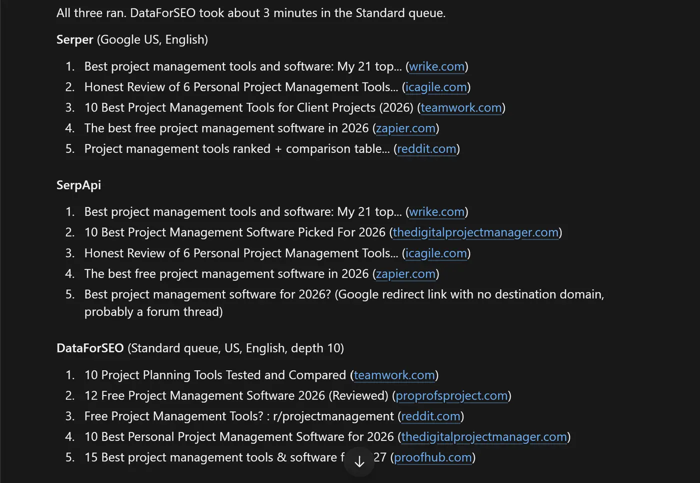
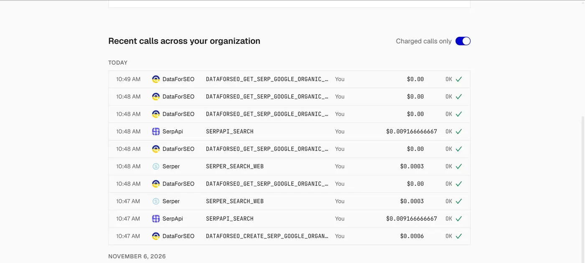

# Best SERP APIs Compared

Google no longer sells its search results to new developers. Its [Custom Search JSON API](https://developers.google.com/custom-search/v1/overview) is closed to new customers, and existing customers lose access on January 1, 2027. Microsoft retired the Bing Search APIs in August 2025. So when an agent or a script needs a results page as JSON, it goes through a third-party SERP API.

This article is a comparison of the cost of the first 1,000 Google searches, how billing works, what's free, and which search engines each tool covers.

## What a SERP API does

A SERP API runs your query on a search engine from its own IP pool, gets past CAPTCHAs and blocks, and returns the results page as structured data. You send a keyword and a location, and you get back JSON with organic links, ads, People Also Ask, local results and other page features, depending on the provider.

The four tools we will discuss in this article handle billing differently. SerpApi counts searches against a monthly plan. Serper sells credits. DataForSEO charges per results page from a prepaid balance. Bright Data charges per 1,000 successful requests. To compare them, the table converts everything to the cost of 1,000 basic Google searches at each provider's entry price.

## The four APIs at a glance

| API | Billing model | Entry price | Per 1,000 Google searches at entry | Free allowance | On Composio Instant |
| --- | --- | --- | --- | --- | --- |
| SerpApi | Monthly plan | \$25/month for 1,000 searches | \$25.00 | 250 searches a month | 44 of 59 tools |
| Serper | Prepaid credit packs, valid 6 months | \$50 for 50,000 credits | \$1.00 | 2,500 queries, once | 10 of 15 tools |
| DataForSEO | Prepaid balance, no expiry | \$50 minimum top-up | \$0.60 (Standard queue) to \$2.00 (Live) | \$1 trial credit | 193 tools |
| Bright Data | Pay as you go or monthly plan | \$1.50 per 1,000 requests | \$1.50 | 5,000 requests a month | SERP API not included |

## SerpApi

[SerpApi](https://serpapi.com) covers the widest spread of engines and verticals in this group, with APIs for Google, Bing, Baidu, DuckDuckGo, Yahoo, Yandex, Naver, YouTube, Amazon, eBay, Walmart, Yelp, Google Play and the Apple App Store.

[Pricing is a monthly plan](https://serpapi.com/pricing). The free plan gives 250 searches a month. Starter is \$25 for 1,000 searches, Developer is \$75 for 5,000, Production is \$150 for 15,000 and Big Data is \$275 for 30,000. Only successful searches count, and a response with 100 results uses the same single search as one with 10. There's no per-search overage. When you run out, you renew the plan early, by hand or automatically.

Two things push the price up. Speed modes multiply the plan price: Ludicrous Speed costs 2x and Ludicrous Speed Max costs 4x. The U.S. Legal Shield, which covers up to \$2 million for scraping and parsing search data, starts at the Production plan.

At \$25 for 1,000 searches, Starter is the most expensive entry point in this comparison. You're paying for the number of engines and a parser for each one.

Composio Instant covers 44 of the SerpApi toolkit's 59 tools, including Google search, Maps, News, Shopping, Trends, Scholar and Jobs. Amazon search, Google AI Overview and Google AI Mode aren't on that list, so those still need your own SerpApi key.

[Through Instant](https://composio.dev/pricing/platform), SerpApi's Google search is listed at \$0.025 per successful search, the same as the Starter plan's cost per search. However, there was a 63% discount on it when I tested, so each search cost me \$0.0092. The Instant search tool returns the top five organic results with position, title and link, and no snippets. In my runs, one or two of the five links came back as Google redirect URLs ([google.com/goto](http://google.com/goto)) in place of the destination page.

## Serper

[Serper](https://serper.dev) does Google and nothing else, and it's the cheapest way in at low volume. Its API covers Google web search, images, news, maps, places, shopping, Scholar, patents, videos, Lens, autocomplete and place reviews, plus a page scraper.

[New accounts get 2,500 free queries](https://serper.dev) with no credit card. After that you buy prepaid credit packs: \$50 for 50,000 credits (\$1.00 per 1,000), \$375 for 500,000 (\$0.75), \$1,250 for 2.5 million (\$0.50) and \$3,750 for 12.5 million (\$0.30). Credits are valid for six months.

A credit isn't always one search. A web search with 1 to 10 results uses 1 credit, and asking for 11 to 100 results uses 2. A Maps search uses 3 credits per page and a Shopping search uses 2.

The six-month expiry is the catch on the bigger packs. The \$0.30 rate only holds if you get through 12.5 million queries in that window.

[Composio Instant runs](https://composio.dev/pricing/platform) 10 of Serper's 15 tools at a listed \$0.001 per credit, the same rate as the \$50 pack without buying it. A 70% discount was running when I tested, so each web search cost me \$0.0003. Web search, batch search (1 to 10 queries in one request), news, images, maps, shopping, Scholar, autocomplete, place reviews and page scraping are on Instant. Lens, patents, places and videos aren't.

## DataForSEO

[DataForSEO](https://dataforseo.com/pricing/serp/google-organic-serp-api) is the cheapest per page once volume climbs, and it lets you pick speed or price on every request. A Google organic results page of 10 results costs:

- \$0.0006 in the Standard queue, about 5 minutes on average with a 45-minute target
- \$0.0012 in the Priority queue, about a minute
- \$0.002 in Live mode, about 6 seconds

That works out to \$0.60, \$1.20 and \$2.00 per 1,000 pages. The two queue modes take two calls, one to post the task and one to collect the result, so they need a little extra code. Deeper requests cost extra pages per task, up to 700 results per query.

[Billing is a prepaid balance](https://dataforseo.com/google-serp-api-data) with a \$50 minimum top-up, and credits don't expire. New accounts get a \$1 trial credit with no card. DataForSEO also sells keyword data, backlinks, on-page audits and app store data from the same balance, which is why its Composio toolkit is so large: 193 Instant tools.

[Through Instant](https://composio.dev/pricing/platform), the Standard-queue Google organic task costs \$0.006 per 10 SERPs. That's the same \$0.0006 per page as buying direct, and you skip the \$50 minimum. Live-mode Google organic isn't on Instant, so through the wallet you use the queue: post a task, then collect it. My task was ready in about three minutes, it cost \$0.0006, and the collect calls were free.

## Bright Data

[Bright Data](https://brightdata.com/pricing/serp) comes from the proxy business. Its SERP API shows: 195 countries with city-level targeting, desktop and mobile user agents, and no cap on concurrent requests. It returns Google, Bing, DuckDuckGo and Yandex results as JSON, Markdown or raw HTML.

[It has the largest monthly free allowance](https://brightdata.com/pricing/serp) in this group: 5,000 requests a month, no credit card. Pay as you go is \$1.50 per 1,000 requests after that. The Scale plan is \$499 a month with 380,000 requests included and \$1.30 per 1,000 beyond that.

[Bright Data bills only successful requests by default](https://docs.brightdata.com/products/serp-api/pricing-and-billing). That changes if you turn on custom headers or cookies for a zone, because then every request is billed, failed ones included. In async mode, sending the request is billed and collecting the result is free.

Bright Data's SERP API isn't on Composio Instant. To call it, you need your own Bright Data account and API key.

## Which SERP API should you use

- For an agent that runs a few hundred Google searches a month, Serper through Instant costs \$1 per 1,000 searches at the listed rate, with no pack to buy.
- For daily rank tracking on thousands of keywords, DataForSEO's Standard queue costs \$0.60 per 1,000 pages. Post the tasks overnight and collect them in the morning.
- For Amazon, YouTube, Yelp, Baidu or Naver results next to Google, SerpApi has a separate tool for each in one toolkit.
- For a free allowance that renews every month, Bright Data gives 5,000 requests and SerpApi gives 250 searches.
- For a new project that was going to use Google's Custom Search JSON API, pick any of the four. Google's API won't take new sign-ups.

## Test them side by side with one wallet

The easiest way to choose between these four tools is to send the same query to each provider and compare the JSON. [Composio Instant](https://composio.dev/instant) lets an agent call SerpApi, Serper and DataForSEO without a separate provider account for each. Every call is paid from one prepaid wallet at the provider's price.

1. Create a Composio account. The [Hobby plan](https://composio.dev/pricing/platform) costs \$0, needs no credit card and includes \$2 of credit.
2. In the dashboard, open the wallet and check that Instant usage is on.
3. Add Composio to your agent with the MCP address `https://connect.composio.dev/mcp`. The [Semrush walkthrough](https://composio.dev/content/use-semrush-claude-chatgpt-free) covers the steps for ChatGPT and Claude.
4. Send one prompt that hits all three providers: "Using Composio, search Google for 'project management software' with Serper and SerpApi, and post the same query as a DataForSEO Standard-queue task. Collect the DataForSEO result when it's ready, then show the top 5 organic results from each and what each call cost."

I ran that query and got these top five organic results from each provider:

| Position | Serper | DataForSEO | SerpApi |
| --- | --- | --- | --- |
| 1 | [wrike.com](http://wrike.com) | [teamwork.com](http://teamwork.com) | [wrike.com](http://wrike.com) |
| 2 | [icagile.com](http://icagile.com) | [proprofsproject.com](http://proprofsproject.com) | [thedigitalprojectmanager.com](http://thedigitalprojectmanager.com) |
| 3 | [teamwork.com](http://teamwork.com) | [reddit.com](http://reddit.com) | [icagile.com](http://icagile.com) |
| 4 | [zapier.com](http://zapier.com) | [thedigitalprojectmanager.com](http://thedigitalprojectmanager.com) | [zapier.com](http://zapier.com) |
| 5 | [reddit.com](http://reddit.com) | [proofhub.com](http://proofhub.com) | Google redirect link, no destination domain |



Serper and SerpApi agreed on Wrike, ICAgile and Zapier, though the order shifted, and SerpApi's fifth link was a Google redirect with no destination domain. DataForSEO's top five was mostly different. It shared [Teamwork.com](http://Teamwork.com) and Reddit with Serper and The Digital Project Manager with SerpApi, and added ProProfs and ProofHub. So don't compare positions across providers directly. Serper returned People Also Ask questions and related searches with its organic results. The SerpApi tool returned titles and links only.

The wallet charged \$0.0003 for the Serper search, \$0.0092 for the SerpApi search and \$0.0006 for the DataForSEO task. Together, the three calls cost about a cent.



The \$2 credit goes further than it sounds. At Serper's listed \$0.001 per credit, it covers 2,000 web searches, and about 6,600 at the discounted rate I paid. At \$0.0006 per page, it covers about 3,300 DataForSEO Standard-queue pages.

## Keeping an eye on spend

[Each Instant call shows its cost](https://composio.dev/blog/composio-instant) in the execution log, and failed calls aren't charged. Composio checks the wallet asynchronously, so the balance isn't a hard stop on each call. Once it's confirmed empty, Instant calls return an HTTP 402 error.

If you're building your own agent, you can limit which toolkits bill through the wallet. In this session the agent can see Serper and DataForSEO, but only Serper calls are paid from Instant. DataForSEO calls need your own connected account.

```python
session = composio.sessions.create(
    user_id="user_123",
    toolkits=["serper", "dataforseo"],
    instant={
        "toolkits": {"enable": ["serper"]},
        "return_instant_charge": True,
    },
)
```

With `return_instant_charge` set, each response carries the cost of that call.

## Where the free credit ends

[The free part is \$2, once, per account](https://composio.dev/pricing/platform). After that you top up the wallet. Plans that can't add funds need an upgrade, and Pro is \$29 a month with \$29 of credit that expires at the end of each billing month. Pro also lets you set spend caps. Regular Composio tool-call charges apply on top of provider charges, and the Hobby plan includes 100,000 tool calls a month. Get the free credit and run your first search at [composio.dev/instant](https://composio.dev/instant).
