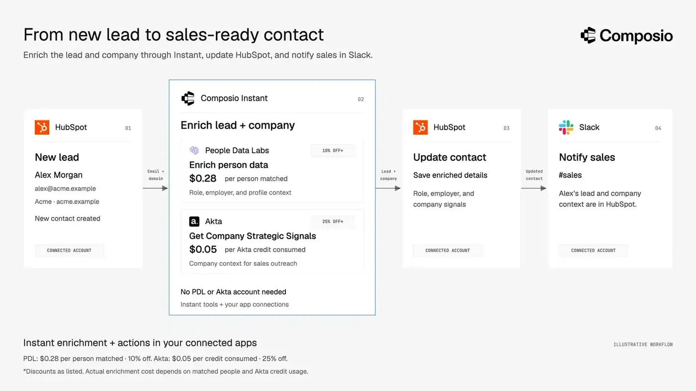

# Best Treg alternatives to consider in 2026

| Tool | Best for | Standout feature | Starter credit |
| --- | --- | --- | --- |
| [**Composio**](https://composio.dev/instant) | Combining paid APIs with your own or customers’ app accounts | Instant API tools alongside managed connections to Gmail, HubSpot, Slack, and more | \$2 |
| [**Monid**](https://monid.ai/) | Paid API workflows with background jobs and media files | Tracked runs, 1 GB of file storage, and direct USDC payments through x402 | \$1 |
| [**Orthogonal**](https://www.orthogonal.com/) | Accessing paid APIs with upfront price checks | Request-specific quotes before execution | \$1 |
| [**Treg**](https://treg.to/) | Sharing team tools and existing provider accounts alongside paid APIs | Hosted registry for private tools and API keys | \$1 |

Treg gives AI agents access to paid API tools through one token and a prepaid balance. Treg’s catalogue includes tools for SEO, people search, enrichment, media generation, etc. Teams can also register their own APIs, credentials, OAuth connections, CLIs, and skills alongside the public catalog.

This guide explores the best alternatives to Treg, Composio, Monid, and Orthogonal, and compares their features, pricing, and tradeoffs to help you choose the right fit for your agent workflows.

## Why consider an alternative to Treg?

### Your agents need more connectors to apps you use everyday

After researching a lead, your agent may need to update HubSpot, save the details to Google Sheets, and notify your team in Slack. To complete these steps, it needs connections to the apps you use.

Treg supports registered OAuth tools, and its [public guide](https://treg.to/skill.md) lists connections to Google Analytics, Search Console, and Business Profile. But it lacks connections some of the most useful bussiness apps.

If your agent regularly works across Gmail, HubSpot, Slack, Notion, and Google Sheets, a platform with more managed app connections could reduce that setup and maintenance work.

### You need controls beyond tool permissions?

Restricting an agent to approved tools does not determine whether every request it makes is appropriate. An allowed email tool could still send sensitive information, and incoming tool results could contain malicious instructions.

Evaluate whether a gateway can inspect the content of calls and results, alongside its permissions and spending controls.

### You’re building a customer-facing product?

Sharing credentials within your team differs from managing connections for hundreds of customers.

You may need to associate accounts with individual users, refresh their credentials, receive app events, and ensure each agent acts through the correct customer’s connection. Compare these capabilities separately from the paid API catalog.

### What if another catalog fits your tasks better?

Provider coverage matters more than the headline tool count. Check the endpoints your agent will actually use, their input requirements, pricing, response quality, and behavior after a failed request.

A larger catalog is useful only when it improves your ability to finish the task.

## Best Treg alternatives at a glance

| Evaluation criteria | Composio | Monid | Orthogonal |
| --- | --- | --- | --- |
| **Best suited to** | Combining paid APIs with users’ or customers’ connected apps | Paid API execution, background runs, and file handoffs | Paid API access with request-specific quotes |
| **Paid APIs without separate provider accounts** | Yes, through Instant | Yes, through a prepaid wallet | Yes, through a shared credit balance |
| **App connections** | Broad managed catalog, including Gmail, HubSpot, Slack, and Google Sheets | Comparable managed connections not verified | Comparable managed connections not verified |
| **Bring your own provider keys** | Supported through connected provider accounts | Supported in the local connector engine; not in the hosted service | Not documented |
| **Add private tools** | Custom tools; external MCP support is experimental | Write and run connectors locally; hosted private-tool registration not verified | Could not be verified |
| **Tool discovery and guidance** | Tool search with relevant Skills and usage guidance | Discover, inspect, and run endpoints | Discover endpoints, inspect schemas, and request quotes |
| **Content-aware security** | Firewall checks for outgoing actions and incoming results; paid and experimental | No such documented feature | No such documented feature |
| **Customer app connections and events** | Per-customer app connections and managed app-event triggers | Comparable capabilities not verified | Comparable capabilities not verified |
| **Pricing model** | Instant usage charges plus applicable platform and provider fees | Prepaid usage; per-call or per-result rates; some endpoints include platform fees | Pay per request; no monthly platform subscription |
| **Advertised starter credit** | \$2 | \$1 | \$0 |
| **Crypto payments** | No | USDC through x402 on Base or Monad; \$0.01 minimum per run; no time-metered endpoints | USDC on Base via x402; USDC.e on Tempo via MPP |

“Not verified” means the capability was not established in the public sources reviewed, rather than confirmed unavailable. Composio entries cover its broader platform as well as Instant. Starter credits and feature availability may change.

## 1. Composio

Composio combines pay-per-use API access with managed connections to applications such as Gmail, HubSpot, Google Sheets, Notion, and Slack.

[Composio Instant](https://composio.dev/instant) is the closest comparison to Treg’s paid catalog. Supported actions run through Composio’s provider accounts and charge a shared balance, without requiring separate provider accounts or API keys.

The broader platform connects those capabilities to the accounts where you work. An assistant could enrich a lead through Instant, update the contact in HubSpot, and notify your team in Slack.

### Why consider Composio over Treg?

#### Pair Instant tools with your everyday apps

Treg’s managed app connections focus mainly on social media and analytics. If your workflow also needs Gmail, HubSpot, Slack, or Google Sheets, you may need to build and maintain additional integrations.

Composio provides managed connections to 1600+ of these apps. You authorize each account, and [Composio handles credential storage and OAuth refresh](https://docs.composio.dev/docs/authentication) for supported connections.

Your agent can then use Instant to research a lead, save the results to Google Sheets, update HubSpot, and send a Slack notification through your connected accounts.

#### Get task guidance alongside tool discovery

Finding a tool does not always tell an agent how to use it correctly. Sending a Slack message, for example, may require resolving a channel ID first.

When a relevant Skill exists, Composio’s search returns recommended steps and known pitfalls alongside matching tools. These playbooks can help the agent perform prerequisite lookups and avoid common mistakes. [Skills documentation](https://docs.composio.dev/docs/skills)

Treg also offers workflow skills. Composio’s distinction is how relevant guidance appears during tool discovery.

#### Protect sensitive data and screen for prompt injection

For sensitive workflows, Composio’s [Firewall](https://docs.composio.dev/docs/firewall) supports configured checks on outgoing calls and incoming results, including prompt-injection screening.

For example, you could configure a check to block an email containing internal pricing. Firewall is experimental, requires configuration, and is available on paid plans with usage-based pricing.

#### Extend the workflow into your own product

Developers can associate app connections with individual customers and combine those connections with eligible Instant actions.

[App triggers](https://docs.composio.dev/docs/triggers) can deliver supported events to your application, with signing and retries. Your handler starts the agent’s work—for example, enriching a new lead, updating HubSpot, and notifying sales in Slack.

### What to weigh up

- Composio Instant does not provide a built-in Session dollar cap, so strict workflow or customer budgets require application-side enforcement.
- Treg has higher count of pay-as-you-go APIs \~4000 vs \~2400 Composio’s. Although, Composio’s broader catalogue is way higher 64000 tools.

### Pricing

Composio gives a starter credit of \$2 vs Treg’s \$1. This gives more head-space for new users to experiment and gauge the platforms capability.

Instant actions charge your Composio balance at their published rates. Calls through your own connected provider account do not incur an Instant charge; provider billing and applicable Composio platform fees still apply. Check the [current plans](https://composio.dev/pricing) alongside individual tool rates.

**Choose Composio if:** your agent needs paid API capabilities and managed access to your own or your customers’ app accounts.

## 2. Monid

Monid provides paid API endpoints through one interface and prepaid wallet. Agents discover an endpoint, inspect its schema and price, and execute it through MCP, a Skill, the CLI, or HTTP. [How Monid works](https://monid.ai/docs/guide/how-it-works)

### Why consider Monid over Treg?

#### 1. Follow longer operations through tracked runs

Monid’s [run API](https://monid.ai/docs/api/run) distinguishes immediate responses from background jobs. Background operations return a run ID that your application can use to check status and retrieve results.

This is useful when the task involves operations that do not finish within a single response.

#### 2. Pass files between media tools

Monid documents a remote file system with **1 GB of included storage** and signed URLs. This can help when a tool requires an accessible URL for an image or another input file. [Monid’s file workflow](https://monid.ai/SKILL.md)

### Where Treg is better?

#### 1. Private tools and BYOK

Treg lets teams register private tools and bring their own provider API keys to its hosted gateway, so agents can use existing provider accounts alongside the paid catalog.

Monid lets developers write connectors, run them locally with their own credentials, or submit them for catalog inclusion. Its hosted service uses Monid’s provider accounts and wallet, while using your own keys requires running the connector engine locally. Equivalent private-tool registration within a hosted workspace is not yet available. [Connector guide](https://github.com/monid-ai/monid#writing-a-connector)

#### 2. Personal app connections

Treg has some useful app connections such as Google Analytics, Search Console, and Business Profile, so agents can work with data from your connected accounts alongside paid API tools. Monid’s public documentation does not describe comparable managed app connections. [Treg’s tool and app guide](https://treg.to/skill.md)

Related: [Monid alternatives](https://composio.dev/content/monid-alternatives)

### Pricing: Monid vs Treg

**Monid** uses a prepaid wallet with no monthly subscription. Each endpoint has its own rate, charged per call or per result, sometimes with a base fee. Endpoints labelled “0 Markup” match the provider’s standard self-serve rate without an additional platform fee; other endpoints may include one. Monid advertises \$1 in starter credit. [Pricing documentation](https://monid.ai/docs/guide/pricing), [markup policy](https://monid.ai/legal/terms), [starter credit](https://monid.ai/).

**Treg** also uses a prepaid balance without a monthly subscription and advertises zero additional markup. Charges depend on the tool and may be calculated per call, returned row, keyword, or another unit. Registering tools, storing credentials, and using your own provider keys are free through Treg, although upstream provider charges still apply. Connections through Treg’s own X app are an exception and incur per-call charges. Eligible new verified accounts receive \$1 in starter credit. [Pricing and terms](https://treg.to/terms), [billing details](https://treg.to/skill.md).

#### Crypto payments

Monid supports paying directly for each run with USDC through x402 on Base or Monad, without funding a prepaid balance. Each run costs at least \$0.01 through this route, even if the quoted price is lower, and time-metered endpoints are excluded. You still need a Monid API key for discovery and inspection. [Monid’s x402 guide](https://monid.ai/docs/guide/pay-with-x402)

Treg documents a prepaid team balance with card payments and optional automatic top-ups. Monid is the choice if your agent needs to pay directly from a crypto wallet.

**Choose Monid if:** your tasks mainly need paid endpoints, tracked execution, and file handoffs.

## 3. Orthogonal

[Orthogonal](https://www.orthogonal.com/) provides search, scraping, enrichment, market data, and agent actions through REST, MCP, and CLI. Its public site advertises **60+ providers and 1,000+ endpoints**.

### Why consider Orthogonal over Treg?

Orthogonal is worth evaluating when its provider mix matches your workflow. Agents can discover endpoints, inspect schemas and prices, and request quotes where pricing depends on the input.

Orthogonal handles provider accounts and charges a shared balance, making it another option for accessing third-party APIs without managing each provider relationship separately.

### What to weigh up

Equivalent hosted private-tool registration, bring-your-own-provider-key support, and managed everyday app connections were not verified in the public sources reviewed. Check these requirements directly before treating it as a replacement for Treg’s team registry.

### Pricing

Its [pricing page](https://www.orthogonal.com/pricing) lists pay-per-request access without a monthly platform subscription, \$10 in starter credits, and custom enterprise credit packages.

**Choose Orthogonal if:** its endpoint coverage and pricing fit the API calls your agent needs.

## Feature comparison

| Capability | Treg | Composio | Monid | Orthogonal |
| --- | --- | --- | --- | --- |
| Paid API catalog and shared balance | ✓ | ✓ | ✓ | ✓ |
| MCP, CLI, and HTTP access | ✓ | ✓ | ✓ | ✓ |
| Own provider credentials in hosted gateway | ✓ | ✓ | Not verified | Not verified |
| App connections | Selected apps and registered OAuth tools | Broad managed app catalog | Not verified | Not verified |
| Custom tools | Hosted team registry | Custom tools; external MCP support is experimental | Connector framework | Not verified |
| Automatic provider fallback | Supported routed tools | Application logic | Not verified | Not verified |
| Content-aware screening | Not verified | Firewall; paid and experimental | Not verified | Not verified |

## Which should you choose?

Choose **Composio** when your agent needs to combine paid API tools with actions in your everyday apps or your customers’ connected accounts.

Choose **Monid** when your main requirement is discovering and executing paid endpoints, tracking background operations, and passing files between tools.

Choose **Orthogonal** when its provider catalog and per-request rates match your workload.

Stay with **Treg** when its combination of team tools, existing credentials, workflow skills, and supported provider routing already fits your needs. Its source also supports an internal team registry, subject to [additional license terms](https://github.com/superdesigndev/treg/blob/main/LICENSE) that restrict offering the software as a service to third parties without authorization.

Before switching, run the same real task on your shortlist. Compare usable results, setup effort, failure recovery, and total cost—including the actions needed after the first API call.

*Based on public documentation reviewed on November 2, 2026. This Composio-authored guide compares documented capabilities rather than results from a controlled performance benchmark.*
