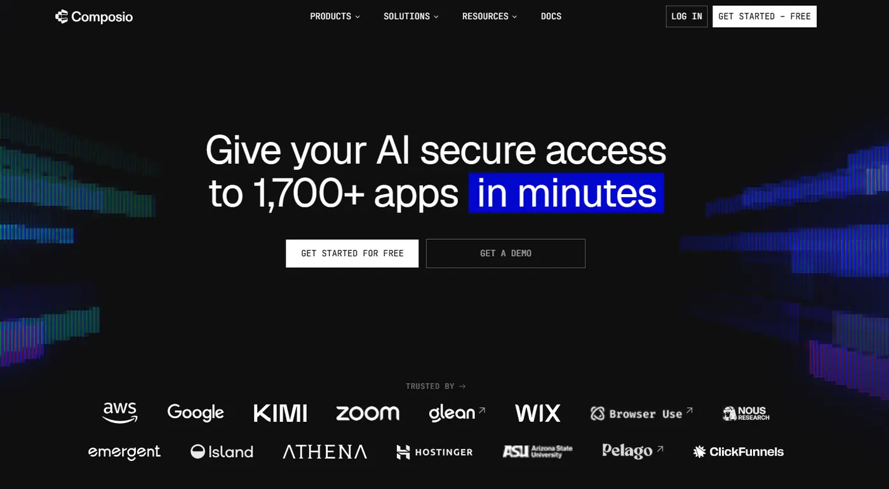
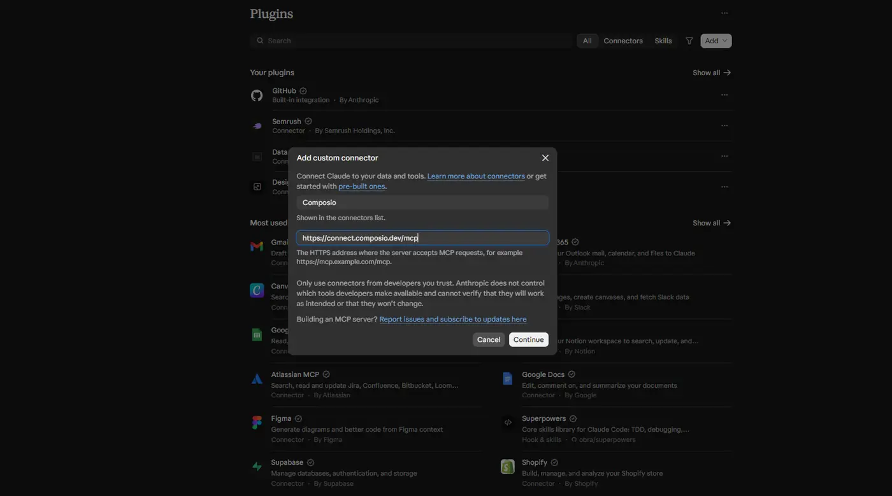
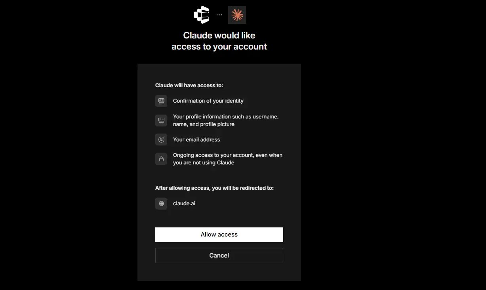
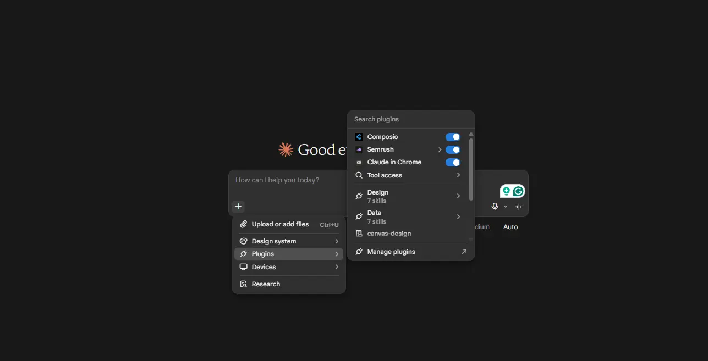
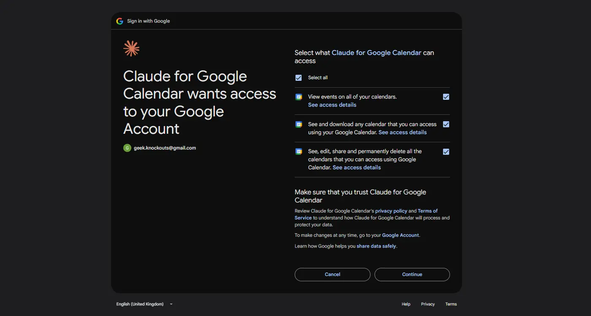
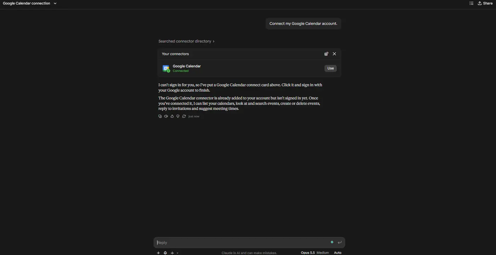
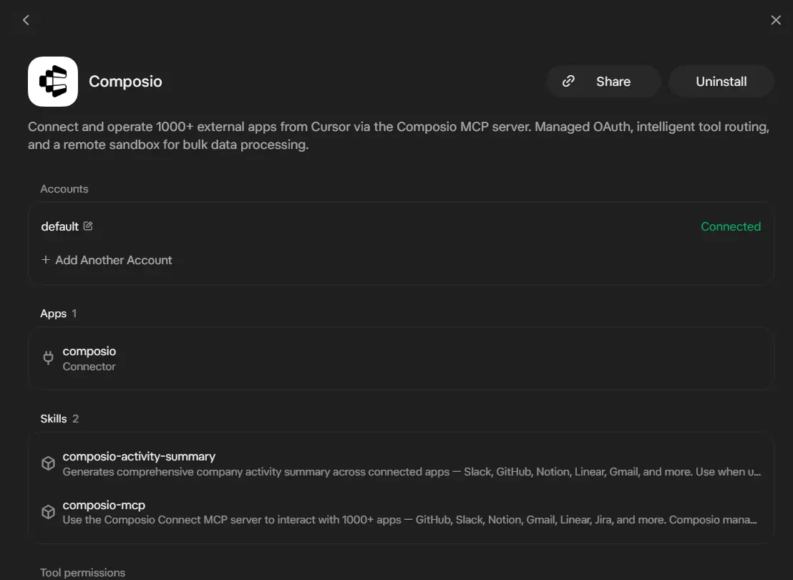

# How to avoid reconnecting connectors every time you switch agents

You open Claude on Monday morning to plan your week. After you connect Google Calendar, it lists your meetings and finds a free slot for a review call.

Later, you ask Grok Bot, “What’s on my calendar this week?” But it can’t use the connection you set up in Claude, so you have to sign in to Google again. When you try another agent the next day, you repeat the process. Each time you switch agents, you spend time connecting the same apps again.

Composio lets you reuse your app connections across agents. You still add Composio to each agent and authorize it with the same Composio account, but you don’t have to sign in to each app again when you switch. This guide shows you how to connect Google Calendar in Claude and use that connection in Grok Bot.

You may still need to reconnect an app if its authorization expires or you revoke access.

### Why you have to reconnect

When you connect Google Calendar directly to Claude, that authorization doesn’t automatically carry over to ChatGPT or Grok Bot. You have to authorize Google Calendar separately in each agent. And most of your saved skills are gone.

[Composio](https://composio.dev/mcp-gateway) stores your app tokens in one place, and it refreshes them for you. You add Composio to each agent, and every agent gets the same connections. On top of it Composio stores the repeatable skills from your workfllows so you can port your skills to all the agents.

This guide shows you how

### What you need

- A free [Composio account](https://dashboard.composio.dev/)



- A Claude account. Custom connectors work on all plans.
- Grok Bot. It comes with Cursor Ultra, Cursor Premium Teams, and SuperGrok Heavy. You can get the desktop app for macOS or Windows from [x.ai/bot](https://x.ai/bot).
- A Google account with access to Google Calendar. You can use a test account for this guide.

### Part 1: Connect your apps in Claude

#### Step 1: Add Composio to Claude

Open Claude in your browser, and go to [**Customize → Connectors**](https://claude.ai/customize/connectors). Click **Add custom connector**, and paste this URL:

```text
https://connect.composio.dev/mcp
```

You can also use the [one-click link](https://claude.ai/customize/connectors), and it fills in the form for you.



Click **Connect**, and approve Composio in the browser window.



If you use a Team or Enterprise plan, an Owner adds the connector first. Then you connect with your own account.


#### Step 2: Turn on Composio in your chat

Start a new chat. Click **+** at the lower left of the chat, or type `/`. Hover over **Connectors**, and turn on **Composio**.



#### Step 3: Connect Google Calendar one time

Ask Claude:

> “Connect my Google Calendar account.”

Composio sends you a sign-in link. Open it, select your Google account, and approve the access.



Composio saves the connection.



Then check that it works:

> “What’s on my calendar this week?”

#### Alternative: Use Claude Code

If you work in the terminal, you can use [Claude Code](https://code.claude.com/docs/en/quickstart). First, copy your API key from the **AI Clients** page in the [Composio dashboard](https://dashboard.composio.dev/). Then run this command:

```bash
claude mcp add --scope user --transport http composio https://connect.composio.dev/mcp --header "x-consumer-api-key: YOUR_API_KEY"
```

Start Claude Code, and type `/mcp` to check that Composio is on. Then follow Step 3 in Claude Code.

### Part 2: Switch to Grok Bot

#### Step 4: Add Composio to Grok Bot

Open Grok Bot, and create a bot. Then open the [Composio plugin page](https://x.ai/bot/plugin/32661537), and select **Add to Grok Bot**. Grok Bot opens the plugin, and you select **Add**.

#### Step 5: Sign in to Composio

Go to the **Installed** section, and select Composio. Select **Authenticate**, and then select **Authorize** on the Composio screen.

Use the same Composio account as in Claude. If you use a different account, you get a different set of connections.



#### Step 6: Use Google Calendar with no new sign-in

Ask your bot the same question:

> “What’s on my calendar this week?”

Check that Grok Bot returns the events for the same Google Calendar you used in Claude without asking you to sign in to Google again. If your calendar is empty, add a test event in Google Calendar and repeat the question. If Grok Bot asks you to connect Google Calendar again, follow the troubleshooting steps below.

### Use more apps with the same setup

Google Calendar is only one example. Composio supports [1,700+ apps](https://composio.dev/toolkits), such as [Gmail](https://composio.dev/toolkits/gmail), [Slack](https://composio.dev/toolkits/slack), [Notion](https://composio.dev/toolkits/notion), [Linear](https://composio.dev/toolkits/linear), and [HubSpot](https://composio.dev/toolkits/hubspot). When you connect another app, agents authorized with the same Composio account can reuse that connection within the permissions you approved. For example, you can connect Gmail in Claude and use it in Grok Bot without signing in to Google again, as long as the connection remains valid.

### Tips

- **Use the same Composio account in every agent.** Your connections belong to that account.
- **Manage connections in the dashboard.** When you remove a connection there, it stops working in all your agents.
- **Approve only the access you need** when you connect an app.
- **Turn on Composio in each new Claude chat.** If Claude doesn’t use your apps, check the Connectors menu.

### Understand what access you grant

Treat each agent you authorize with Composio as a potential user of your connected apps. An app connection limits actions to the permissions you approved, which may include reading data or making changes. Review the authorization screen and any tool controls your agent provides before you use it with sensitive accounts.

Removing the Composio connector from one agent removes that agent’s configured connection. Disconnecting Google Calendar in Composio affects every agent that uses that app connection. Choose the action based on whether you want to stop using one agent or stop sharing the app connection across agents.

### Troubleshooting

If Grok Bot asks you to connect Google Calendar again, check the following:

1. **Use the same Composio account.** Confirm that Claude and Grok Bot are authorized with the account you used to connect Google Calendar.
2. **Check the app connection.** Open the Composio dashboard and confirm that Google Calendar is connected to the expected Google account. You can also ask the agent to check the connection’s status.
3. **Check that Composio is enabled.** In Claude, check the Connectors menu for the current chat. In Grok Bot, check that the plugin is installed and authenticated.
4. **Repair an authorization error.** Ask the agent to inspect the Google Calendar connection. If it reports an unhealthy connection, follow its prompts to disconnect and reconnect the app, then retry the calendar question. Reconnecting may be necessary if authorization has expired or access was revoked.
5. **Request a fresh sign-in link.** If an authorization link expires or fails to open, ask the agent to retry the connection so Composio can generate a new link.

If the issue continues, contact [Composio support](mailto:support@composio.dev) with the error message. Don’t include API keys or access tokens.

### Conclusion

With Composio, you can connect Google Calendar in Claude and reuse that connection in Grok Bot. You still authorize Composio in each agent, but you avoid repeating the Google sign-in while the app connection remains valid. You can also add Composio to other compatible agents, such as [Cursor](https://composio.dev/toolkits/microsoft_teams/framework/cursor) and [Codex](https://composio.dev/toolkits/microsoft_teams/framework/codex).
