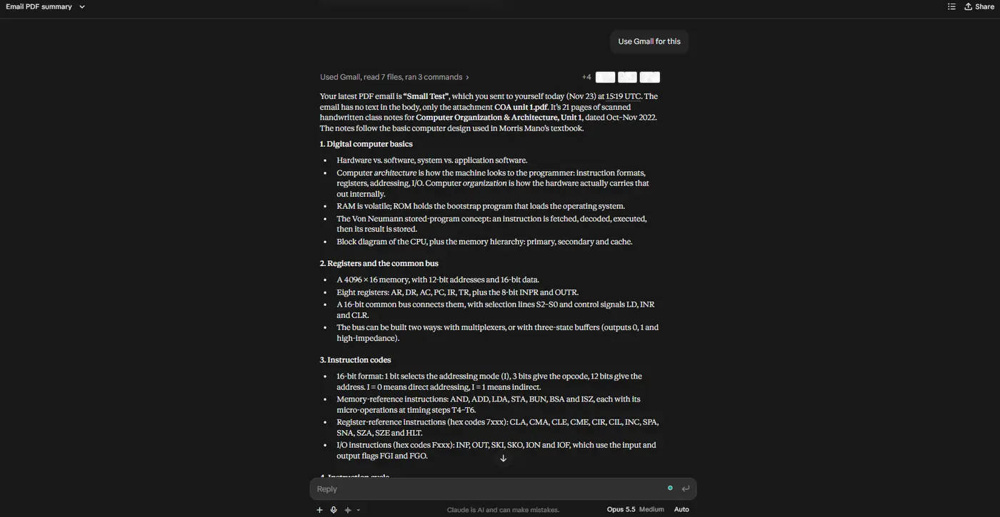
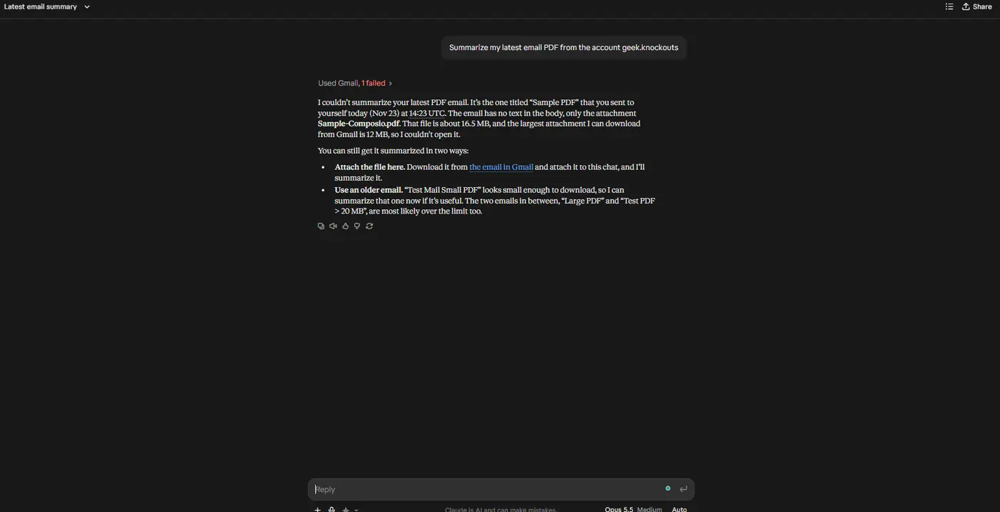
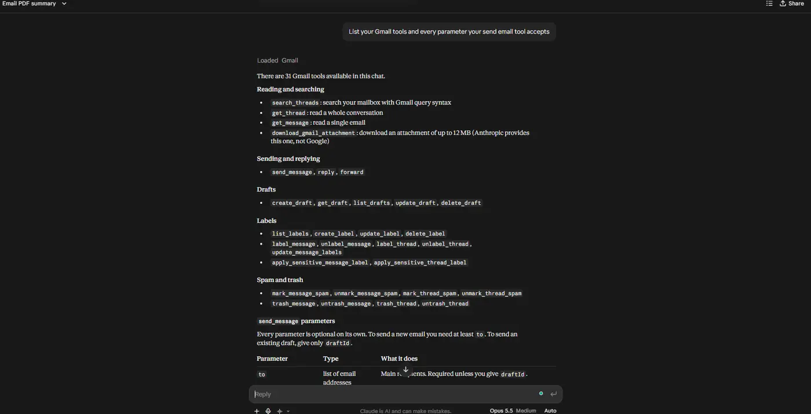
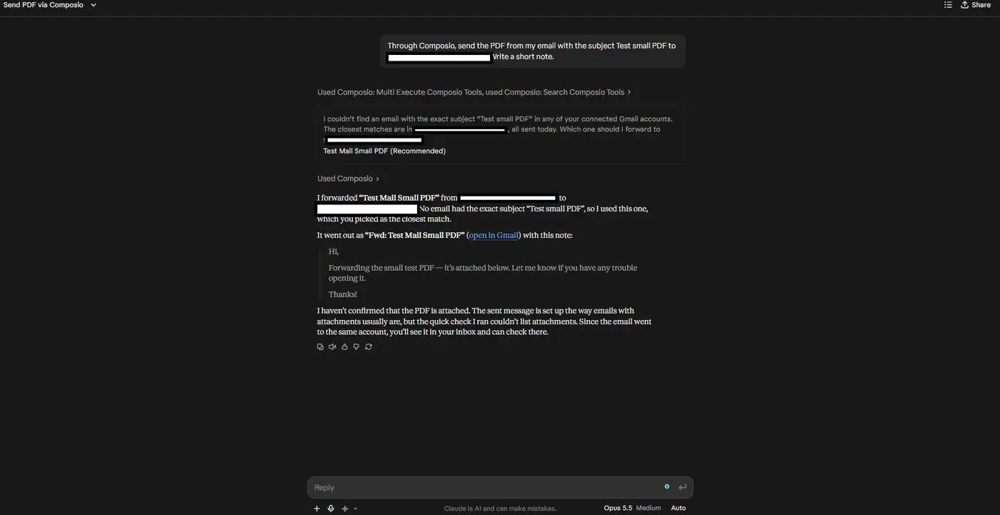
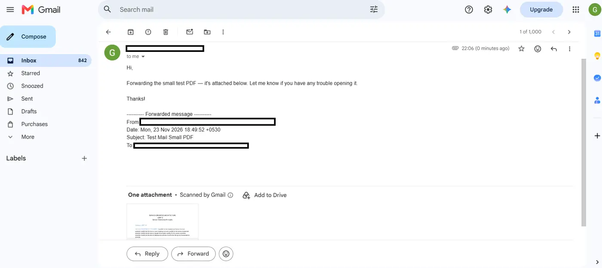

# How to Read and Send Gmail Attachments more than 12MB in Claude (2026)

Claude's built-in Gmail connector can now read attachments up to about 12 MB when you enable code execution and file creation. However, it still has limits when you want to work with larger files or send emails with attachments. If you ask Claude to send that file to a different person, it cannot attach it. The email goes without the file, or Claude tells you that it cannot do the task.

You can fix both problems in a few minutes.

Add Composio to Claude as a custom connector, and then connect your Gmail account to it. Claude can then retrieve larger Gmail attachments through Composio, subject to file limits. It can also use Composio's Gmail tools to send emails with attachments. This guide shows you how to set it up, which prompts to use, and what to check before you let Claude use your inbox.

### What Claude's Gmail connector can and cannot do with attachments

Anthropic's [Google Workspace connectors article](https://support.claude.com/en/articles/10166901-use-google-workspace-connectors) lists the tasks that the built-in Gmail connector can do. This table compares it with Composio, as of November 2026:

| Task | Claude's Gmail connector | Claude + Composio |
| --- | --- | --- |
| See the name and type of an attachment | Yes | Yes |
| Read an attachment smaller than about 12 MB | Yes, if you turn on code execution and file creation | Yes |
| Read an attachment larger than about 12 MB | No | Yes, subject to Gmail and Composio file limits |
| Read attachments when your organisation turns off this feature | No | Yes, if your admin approves Composio |
| Send, reply to, and forward emails | Yes, after you approve each one | Yes, after you approve each one |
| Attach a file to an email that Claude sends | No | Yes, one or more files, up to 20 MiB in total |
| Send a file from one email to a different person | No | Yes |
| Search more than one Gmail account | No, it uses one account at a time | Yes |

We asked Claude's built-in Gmail connector to read a 16 MB invoice PDF, and it could not open the file because the file is larger than the 12 MB limit.

We asked Claude's built-in Gmail connector to list the parameters of its send tool.

Simple tasks now work without extra setup. For example, "Summarise the PDF that Sarah sent" works if the PDF is small and code execution is on. But tasks that send files still stop before Claude can attach the file. Two examples are "Send the signed contract back to the client" and "Email this month's invoices to accounting."

You can download each file and attach it in Gmail yourself, but this takes a long time when you have more than two or three emails.

### How to read and send Gmail attachments in Claude with Composio

You add one connector to Claude, and then you connect Gmail to it. After that, you ask Claude to read or send the file. This works in Claude on the web and in Claude Desktop. It works on all plans that let you add custom connectors.

#### Add Composio to Claude

Click here: [Composio \<\> Claude](https://claude.ai/customize/connectors?modal=add-custom-connector&connectorName=Composio&connectorUrl=https%3A%2F%2Fconnect.composio.dev%2Fmcp)

1. This will take you to the Claude Custom Connector modal
   

2. Click Continue
3. And in the next modal, click Add
   

4. It will take you to the authentication page. So, sign in to Composio and approve the connection.
   

Then:

1. Return to Claude and make sure Composio is enabled.

You only need to do this once.

### Quick check

Start a new Claude chat and ask:

> *What Composio tools do you have available?*

If Claude lists Composio tools, you are ready for the next step.

### Connect Gmail

1. In a new chat, type: "Connect my Gmail account to Composio."
2. Click the sign-in link Claude provides, choose your Google account, and approve the permission request from Google.
   

3. Go back to Claude; it should tell you that your account is connected.

### Check that it works, then ask for the file

1. Ask Claude about the attachment, for example: "Summarise the PDF in the latest email from Acme." Claude finds the email, downloads the attachment through Composio, and reads the text.

Claude asks you before it runs each Composio tool.

### Read an attachment

Ask Claude about the attachment. For example:

> Summarise the PDF in the latest email from Acme, through Composio.

Claude finds the email, downloads the attachment through Composio, and reads it. You can also retrieve files larger than 12 MB through Composio, as long as they meet Gmail's and Composio's file limits. You do not need Claude's built-in code execution feature to retrieve the attachment.

### Send an attachment

Ask Claude to send a file. For example:

> Through Composio, send the PDF from the latest Acme email to me@example.com with a short note.

Claude downloads the attachment and attaches it to a new email. Then it asks you to approve the email. Check your inbox to make sure that the file arrived. For your first test, send the email to your own address.

Claude asks you before it uses each Composio tool. Read the recipient and the file name on the approval card before you click **Allow**. After Gmail sends an email, you cannot get it back.

### What happens after you send the prompt?

**When you ask Claude to read a file,** it can search your inbox with `GMAIL_FETCH_EMAILS` using a query such as `from:acme has:attachment`. It then uses the message ID and attachment ID with `GMAIL_GET_ATTACHMENT` to retrieve the file. Claude can process its contents when the required file-reading tools are available.

**When you ask Claude to send a file,** it first retrieves the attachment using `GMAIL_GET_ATTACHMENT`. The file must then be available as a Composio upload. Claude can pass the uploaded file reference to `GMAIL_SEND_EMAIL`, along with the recipient, subject, and message. Gmail then sends the email with the attachment.

You can attach more than one file to an email, but the total size must be 20 MiB or less. If you want to send a full message with its original attachments, Claude can use `GMAIL_FORWARD_MESSAGE`.

For more information about each tool, read the [Gmail toolkit reference](https://docs.composio.dev/toolkits/gmail).

**Plan notes:**

- On Claude Free, you can add only one custom connector. Remove all other custom connectors before you add Composio.
- On Team or Enterprise, an Owner may have to add Composio for the organisation first. Then each member connects their own accounts.
- The Composio free plan gives you up to 100,000 tool calls each month, and you do not need a credit card.

## Prompts to try

These prompts work after you connect Composio and Gmail. Change the senders, recipients, and dates so that they match your emails.

### Prompts that read attachments

| Prompt | What Claude does |
| --- | --- |
| Summarise the PDF in the last invoice email from Acme. | It finds the newest email that matches, downloads the PDF, and gives you the amount, the due date, and the line items. |
| Pull the totals from every receipt I got this month and put them in a table. | It searches for receipts with attachments from the 1st of the month. It reads each receipt, and it gives you the vendor, date, and total for each one. |
| What changed between the two contract drafts Sarah sent? | It reads the two attachments, and it shows you the clauses that are different. |
| Read the spreadsheet attached to the Q3 budget email and flag anything over plan. | It opens the attachment and compares each row with the plan figures. Then it shows you the rows that are over plan. |
| Save every attachment from this week's vendor emails to my Drive folder "Invoices 2026". | It downloads each file from Gmail, and it uploads the file to Drive with the Google Drive toolkit. Connect Drive first, in the same way that you connected Gmail. |

### Prompts that send attachments

| Prompt | What Claude does |
| --- | --- |
| Send the contract Sarah emailed yesterday to legal@company.com and ask them to review it by Friday. | It downloads the contract from Sarah's email and attaches it to a new email to legal. Then it asks you to approve the email. |
| Collect every invoice PDF from this month and email them to accounting in one message. | It finds the invoice emails and downloads each PDF. Then it sends one email with all the PDFs attached, up to 20 MiB in total. |
| Email Acme the purchase order they sent last week and ask them to confirm the delivery date. | It finds the purchase order and attaches it to a new email to Acme. Then it asks you to approve the email. |
| Forward the email with the boarding pass to my partner. | It forwards the original message, and the message keeps its attachments. |

## What to know before you use it

- **File types.** Composio gets the text directly from PDFs, Docs, CSVs, and images. For other formats, such as Word and Excel files, it uses its workbench.
- **Attachment size.** Claude can attach up to 20 MiB of files to one email. If your files are larger, ask Claude to upload them to Google Drive through Composio, and then send a link.
- **Sent emails stay sent.** Claude asks you before it sends each email. But after you approve it, you cannot get the email back. Test each new prompt on your own address first.
- **Large searches run in steps.** Each step in the workbench can run for 3 minutes or less. So a request such as "every receipt this year" runs in many steps. To make it faster, search for one sender or a shorter date range.
- **Tell Claude which connector to use.** If the built-in Gmail connector is also on, Claude can use it instead of Composio. This is fine when you read small files. But when you send a file, the built-in connector cannot attach it. Add "through Composio" to your prompt, or turn off the built-in Gmail connector for that chat.
- **Where your files go.** When Claude reads or sends an attachment, Composio keeps a copy of the file in Composio storage. If your emails are confidential, make sure that your company's data policy lets you do this.
- **Google Workspace accounts.** Your Google Workspace admin may limit third-party apps. If so, they must approve Composio before you can sign in to Gmail.
- **More than one inbox.** Composio can connect to more than one Gmail account at the same time. You can search your work email and your personal email from one chat. For the steps, read [how to connect multiple Gmail accounts to Claude](https://composio.dev/content/how-to-connect-multiple-gmail-accounts-to-claude-(in-2-minutes)).

## FAQ

### Can Claude read Gmail attachments on its own?

Yes, but there are limits. Claude's built-in Gmail connector can read attachments up to about 12 MB when you enable code execution and file creation. Your organisation may also restrict this feature. Composio can retrieve larger attachments, subject to Gmail and Composio file limits.

### Can Claude's built-in Gmail connector send attachments?

No. It can send, reply to, and forward emails, but it cannot attach a file to an email that it writes. Anthropic's help article does not list this feature. When we asked the connector to send a PDF, it could not attach the file.

### Can Claude send an email with an attachment through Composio?

Yes. `GMAIL_SEND_EMAIL` can attach one or more files, up to 20 MiB in total. Claude can attach a file that it downloaded from a different email, and it can forward a full message with its attachments. Claude asks you to approve each email before it sends it.

### Does this work on Claude Free?

Yes. On the Free plan, you can add one custom connector, as [Anthropic's custom connector guide](https://support.claude.com/en/articles/11175166-get-started-with-custom-connectors-using-remote-mcp) says. Composio uses that one connector, and Gmail and all your other apps connect through it.

### Can Claude read attachments from more than one Gmail account?

Yes. Connect each account to Composio. Then tell Claude which inbox to search, for example, "in my work Gmail."

### Do I need to set up a Google Cloud project?

No. Composio uses Google sign-in, so you do not have to set up anything in Google Cloud. If your team wants to use its own OAuth app, you can add your own credentials.
