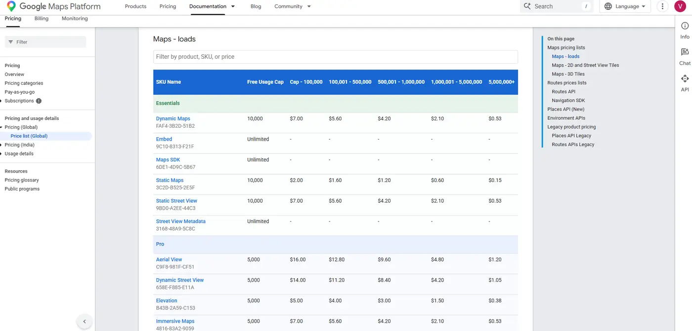
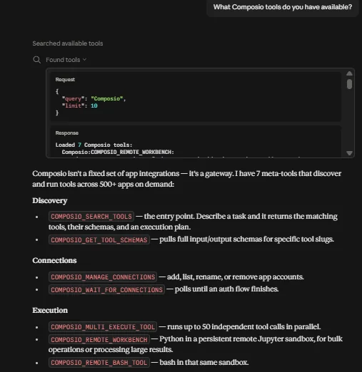
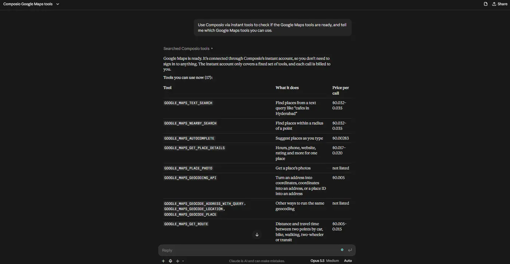
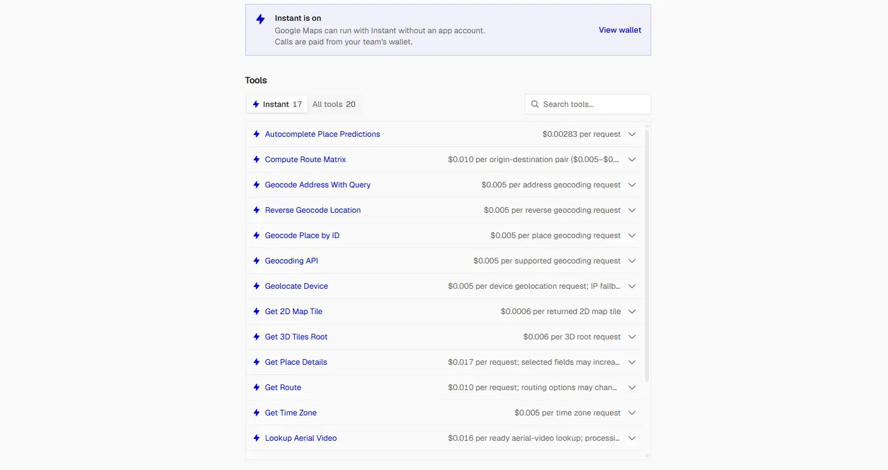
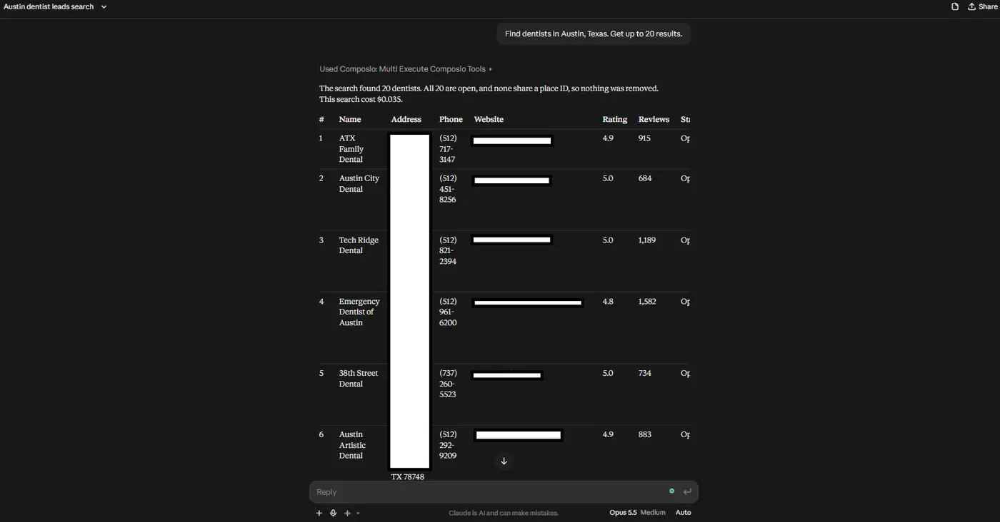
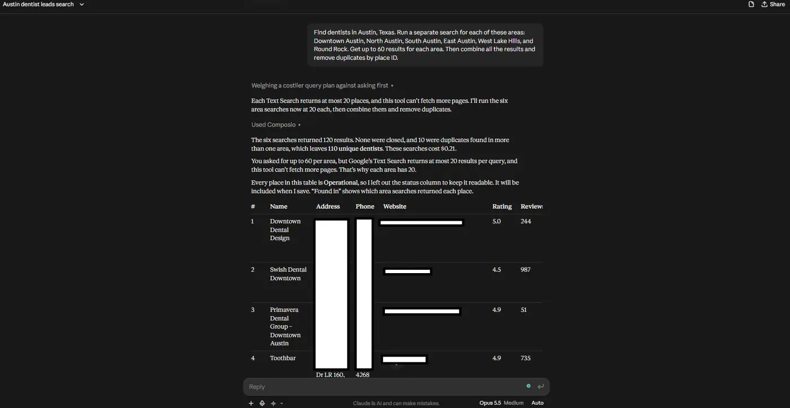
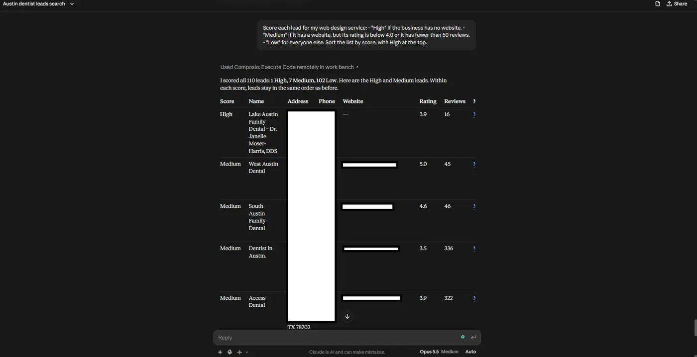
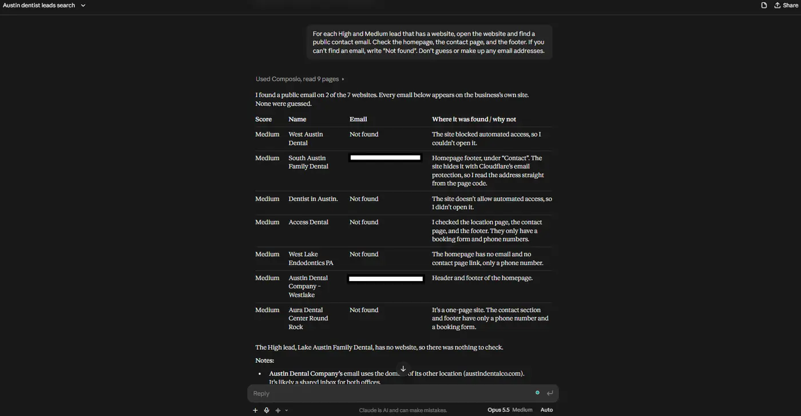
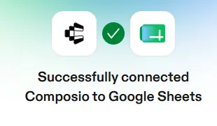
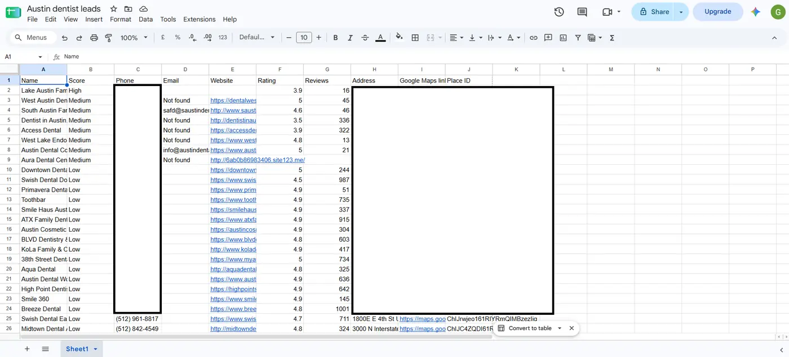

# How to Scrape Google Maps for Leads with Claude

Google Maps lists millions of local businesses. Each listing shows a name, an address, a phone number, a website, a rating, and reviews. If you sell to local businesses like dentists, gyms, or restaurants, this is one of the best places to find leads.

Most guides tell you to scrape Google Maps with a browser bot. That breaks Google’s terms, and Google often blocks those bots. In this guide, I show you a better way. You connect Claude to Google’s official Maps tools through Composio, and then you ask for leads in plain English. Claude finds the businesses, filters them, finds their emails, and saves them to a Google Sheet.

#### TL;DR

- **Claude can search Google Maps through Composio.** [Composio’s Google Maps](https://composio.dev/toolkits/google_maps) tools use Google’s official Places API, so you don’t need a scraper.
- **Claude runs many focused searches at once.** Composio lets Claude run several Google Maps searches in one step, like one for each area of a city. Each search returns up to 20 businesses, and Claude combines them into one clean list with no duplicates.
- **Google Maps gives you names, phone numbers, websites, ratings, and review counts.** It doesn’t give you emails, so Claude finds them on each business’s website.
- **Claude saves the final list to a Google Sheet,** with a score for each lead.

---

#### Why I Don’t Use a Scraper

A scraper opens Google Maps in a browser and copies the data from the page. It causes three problems:

1. [**Google’s terms don’t allow it.**](https://cloud.google.com/maps-platform/terms) Google can block your IP address or your account.
2. **It breaks often.** When Google changes the page layout, the scraper stops working, and you have to fix it.
3. **It’s slow.** The scraper has to scroll, click, and wait for each listing to load.

The Places API gives you the same business data in a clean format. Google supports it, and it doesn’t break when the page changes. Composio connects Claude to this API, so you don’t write any code.

---

#### What Data You Get from Google Maps

| Field | How you can use it |
| --- | --- |
| Business name | Personalize your message |
| Address | Filter by area |
| Phone number | Call the business |
| Website | Find an email, or spot businesses that need a website |
| Rating and review count | Spot businesses that need help with reviews |
| Business status | Skip businesses that are closed |
| Google Maps link | Open the listing to check it |
| Place ID | Find the same business again later |

Google Maps doesn’t give you emails or owner names. In Step 7, Claude finds emails on each business’s own website.

---

#### The Limits You Need to Know

| Limit | Value |
| --- | --- |
| Businesses per call | Up to 20 |
| Businesses per search (Composio Instant) | Up to 20 (no next-page option) |
| Cost per call | Composio charges Google’s price per call, with no markup |



On Composio Instant, every call is billed. Google’s free monthly caps below apply only if you connect your own Google API key.

| Google pricing tier | What it includes | Free calls per month | Price after that |
| --- | --- | --- | --- |
| Text Search Pro | Name, address, type, business status | 5,000 | \$32 per 1,000 calls |
| Text Search Enterprise | Adds phone, website, rating, review count | 1,000 | \$35 per 1,000 calls |

Google charges per call, and one call can return 20 businesses. So 1,000 free Enterprise calls can return up to 20,000 businesses in a month.

> 💡 [Google bills each call ](https://developers.google.com/maps/billing-and-pricing/pricing-categories)at the tier of the most expensive field you ask for. If you only need names and addresses, ask for those fields only, and Google bills the cheaper Pro tier.

---

### **Step 1: Add Composio to Claude (One-time process)**

1. Open the [Composio \<\> Claude ](https://claude.ai/customize/connectors?modal=add-custom-connector&connectorName=Composio&connectorUrl=https%3A%2F%2Fconnect.composio.dev%2Fmcp).
2. This opens Claude's custom connector dialog.


1. Click **Continue**.
2. On the next screen, click **Add**.


1. You'll be redirected to Composio's sign-in page. Log in (or create a free account) and approve the connection.


Then:

1. Return to Claude and confirm Composio shows as enabled under Connectors.


You only need to do this once, no matter how many Google accounts you connect afterward.

#### Quick check

Start a new chat and ask:

> What Composio tools do you have available?

If Claude lists Composio's tools, you're ready to connect Google Sheets.



---

#### Step 2: Check That Google Maps Is Ready

Composio includes Google Maps as an Instant tool. You don’t need to sign in to Google or add an API key. Composio runs the calls for you and charges them to your Composio wallet.

Start a new chat and ask:

```text
Use Composio to check if the Google Maps tools are ready, and
tell me which Google Maps tools you can use.
```



If Claude lists tools like Text Search and Get Place Details, you’re ready.

> 💡 New Composio accounts get \$2 of free Instant credit. That’s enough to test the steps in this guide. You can see what each call cost in your Composio execution logs.

   

---

#### Step 3: Set the Rules for Your Search

Tell Claude what data you want and how to handle it. Then it asks for only the fields you need, and it keeps your list clean. I paste this block at the start of every lead search:

```text
I want to find business leads on Google Maps. Follow these rules:
- Use the Composio Google Maps Text Search tool.
- Ask only for these fields: name, address, phone number, website,
  rating, review count, business status, Google Maps link, and
  place ID.
- Skip businesses that are permanently or temporarily closed.
- Remove duplicates by place ID.
- Show me the results in a table before you save anything.
```

> 💡 If you use Claude Projects, put this block in the project instructions. Then Claude follows it in every chat.

---

#### Step 4: Run Your First Search

Start with one small search, so you can check the data before you search at scale.

```text
Find dentists in Austin, Texas. Get up to 20 results.
```

Claude runs one Text Search call and shows you a table of businesses.



Check the table. If the results are too broad, make your search term more specific. For example, “cosmetic dentists” or “pediatric dentists” give you a smaller and more focused list.

---

#### Step 5: Get More Leads by Splitting the Area

Each search returns up to 20 businesses. A big city can have hundreds of dentists, so one search misses most of them. To get more, search each part of the city on its own. You can also run a few versions of the search term in each area, like “family dentist” or “cosmetic dentist”.

```text
Find dentists in Austin, Texas. Run a separate search for each
of these areas: Downtown Austin, North Austin, South Austin,
East Austin, West Lake Hills, and Round Rock. Get up to 20
results for each area. Then combine all the results and remove
duplicates by place ID.
```



Areas overlap at their edges, so the same business can show up twice. The place ID is unique for each business, so Claude uses it to remove the duplicates.

---

#### Step 6: Score Your Leads

Now you have a long list, but some businesses are better leads than others. Tell Claude what makes a good lead for you, and it scores each one.

Here’s an example for a web design service:

```text
Score each lead for my web design service:
- "High" if the business has no website.
- "Medium" if it has a website, but its rating is below 4.0 or
  it has fewer than 50 reviews.
- "Low" for everyone else.
Sort the list by score, with High at the top.
```

Change the rules to fit what you sell. For example, if you sell review management, give a high score to businesses with low ratings. If you sell ads, give a high score to businesses with many reviews, because they likely have money to spend.



Don’t be surprised if you get only a few High leads in a well-established niche. In my test, only 1 of 110 Austin dentists had no website. Smaller towns or less online-heavy businesses may give you more.

---

#### Step 7: Find Contact Emails

Google Maps doesn’t list emails, but many businesses show one on their website. Claude can open each website and look for it.

```text
For each High and Medium lead that has a website, open the
website and find a public contact email. Check the homepage, the
contact page, and the footer. If you can't find an email, write
"Not found". Don't guess or make up any email addresses.
```

> ⚠️ This step opens one website per lead, so it takes time. Run it in batches of 20 to 30 leads. And keep the “don’t guess” rule, because made-up emails bounce and hurt your sender reputation.

Some websites block automated visitors, so Claude can’t open them. Others hide their email behind a spam-protection script. When that happens, Claude writes “Not found”, so it’s worth opening those sites yourself to check.



---

#### Step 8: Save Your Leads to Google Sheets

Google Sheets holds your own data, so you need to connect your Google account once. Ask Claude to “Connect my Google Sheets account through Composio”, click the sign-in link it sends, and click **Allow**. Then go back to Claude and type **done**.



```text
Connect my Google Sheets account through Composio. Then create a
new sheet called "Austin dentist leads" with these columns:
Name, Score, Phone, Email, Website, Rating, Reviews, Address,
Google Maps link, Place ID. Add all the leads, sorted by score.
```



Keep the Place ID column. You need it to get fresh details for each business later.

---

#### How Many Calls a Typical Search Uses

| Task | Calls |
| --- | --- |
| First test search | 1 |
| 6 area searches, 1 call each | 6 |
| Scoring the leads | 0 |
| Finding emails | 0 Google Maps calls |
| Saving to Google Sheets | 1 to 2 Google Sheets calls |
| **Total Google Maps calls** | **7** |

That gives you up to 140 businesses before duplicates. On Composio Instant, Text Search costs \$0.035 per call when you ask for phone, website, or rating, so the whole run costs about \$0.25. With your own Google API key, it stays far below the free monthly caps.

---

#### Follow the Rules

- **Check the storage rules before you build a lead list.** [Google’s terms let you keep place IDs. ](https://developers.google.com/maps/documentation/places/web-service/policies)Google restricts how you can store data from the Places API. You can save Place IDs for later use, but storing business names, phone numbers, addresses, and ratings may violate its terms. For a reusable lead list, save the Place IDs and any contact information you collect independently from sources that allow storage. Check Google's data usage rules before exporting or retaining Places data.
- **Follow outreach laws.** [Email and phone laws are different in each country](https://www.ftc.gov/business-guidance/resources/can-spam-act-compliance-guide-business), so check the rules for the places where your leads are. In most places, you must say who you are, and you must give people a way to opt out.
- **Check before you contact.** Businesses close or change their details. Before you call or email, check that the business is still open.

---

#### Tips to Get Better Leads

- **Use specific search terms.** “Emergency plumbers” gives you a more focused list than “plumbers”.
- **Search small areas.** Use neighborhoods or nearby towns, so each search stays under the 20-result limit.
- **Ask for fewer fields.** Each extra field can move a call to a more expensive tier.
- **Keep your rules block.** Paste it at the start of each chat, so Claude follows the same steps every time.

---

#### FAQ

#### **Is this the same as scraping?**

No. A scraper copies data from the Google Maps page, and Google’s terms don’t allow that. This guide uses Google’s official Places API through Composio. The API has its own terms, though, including limits on storing data, so read the “Follow the Rules” section.

#### **Do I need a Google Cloud account or API key?**

No. Google Maps is an Instant tool in Composio, so Composio runs the calls for you. You don’t need a Google Cloud account or an API key. You only need a regular Google account to save leads to Google Sheets.

#### **Is it free?**

New Composio accounts get \$2 of free Instant credit. After that, you add funds to your Composio wallet, and Composio charges each call at Google’s price with no markup. If your balance runs out, Instant calls stop, and your other connected apps keep working. Google’s free monthly caps don’t apply to Instant calls. They apply only when you connect your own Google API key.

#### **Can Claude get reviews too?**

Yes. The Get Place Details tool returns up to five reviews for a business. Reviews use a more expensive pricing tier, so ask for them only when you need them.

#### **Does this work in ChatGPT, Cursor, or other AI tools?**

Yes. Connect Composio to your AI tool, and then connect Google Maps the same way.

---

#### Wrapping Up

You can find leads from Google Maps without building a scraper. Connect Claude to Google Maps through Composio, define your ideal customers, and search one area at a time. Then use Claude to score the businesses, find available contact emails with an enrichment tool, and save the results to Google Sheets.

If you found another useful way to generate leads with Claude, let me know.
