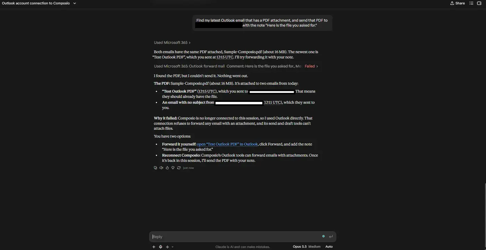
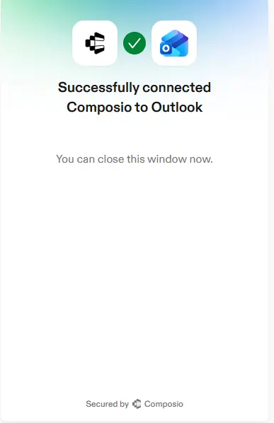
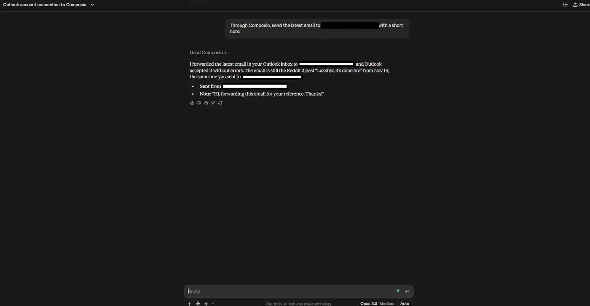
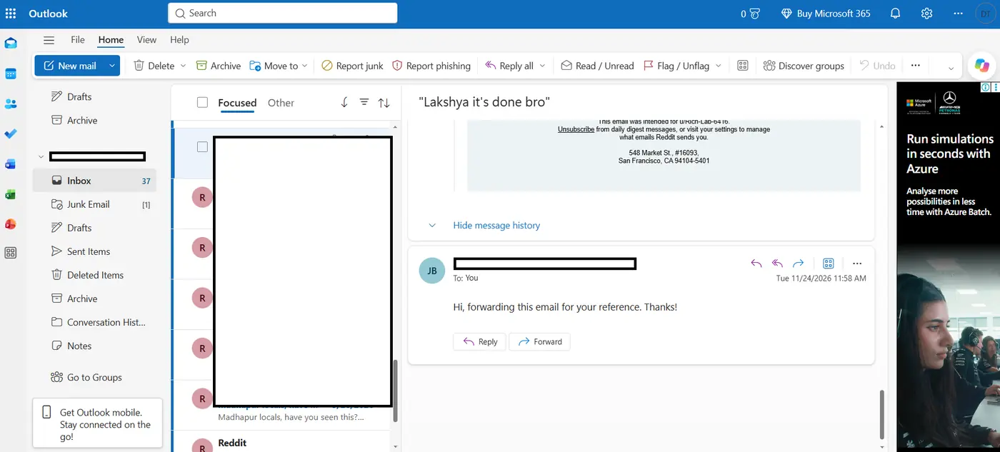

# How to Send Outlook Emails with Attachments from Claude (2026)

When you ask Claude to send a file from your Outlook account, it writes the email, but it cannot attach the file. This happens with work accounts and personal accounts, and it happens when you send, forward, or draft an email.

You can fix this in a few minutes. Add Composio to Claude as a custom connector, and then connect your Outlook account to it. Claude can then attach files to the emails that it sends. This guide shows you how to set it up, which prompts to use, and what to check before you let Claude send email for you. If you have not connected Outlook to Claude before, read our guide on [how to use Outlook with Claude through Composio](https://composio.dev/content/how-to-use-outlook-mcp-with-claude-for-email-management) first.

### Why Claude cannot send Outlook attachments

Claude's Microsoft 365 connector can read your Outlook email, and it can send email if your account allows write tools. But Anthropic's [Microsoft 365 help article](https://support.claude.com/en/articles/15183774-connect-to-microsoft-365) says this about attachments:

> "Attachments aren't currently supported in write tools."

So Claude cannot send, forward, or draft an email that has a file attached. This limit applies to work accounts and to personal accounts, such as Outlook.com and Hotmail.

This table compares the two connectors, as of November 2026:

| Task | Claude's Microsoft 365 connector | Claude + Composio |
| --- | --- | --- |
| Search and read Outlook email | Yes | Yes |
| Send and reply to email | Yes, if your account allows write tools | Yes |
| Send an email with a file attached | No | Yes |
| Forward an email with its attachments | No | Yes |
| Create a draft with a file attached | No | Yes |
| Send a file from one email to a different person | No | Yes |

You can download each file and attach it in Outlook yourself, but this takes a long time when you have more than two or three emails.

## How to send Outlook attachments from Claude with Composio

You add one connector to Claude, and then you connect Outlook to it. After that, you ask Claude to send the file. This works in Claude on the web and in Claude Desktop. It works on all plans that let you add custom connectors.

**Add Composio to Claude**

Click here: [Composio \<\> Claude](https://claude.ai/customize/connectors?modal=add-custom-connector&connectorName=Composio&connectorUrl=https%3A%2F%2Fconnect.composio.dev%2Fmcp)

1. This will take you to the Claude Custom Connector modal
   

2. Click Continue
3. And in the next modal, click Add
   

4. It will take you to the authentication page. So, sign in to Composio and approve the connection.
   

Then:

1. Return to Claude and make sure Composio is enabled.

You only need to do this once.

### Quick check

Start a new Claude chat and ask:

> *What Composio tools do you have available?*

If Claude lists Composio tools, you are ready for the next step.

### Connect Outlook

1. In a new chat, type: "Connect my Outlook account to Composio."
2. Click the sign-in link that Claude gives you. Select your Microsoft account, and then accept the Microsoft permission request.
   

3. Go back to Claude. Claude tells you that your account is connected.

If you use a work account, your Microsoft admin may have to approve Composio first. If you see "Needs admin approval", send this guide to your admin. If you use a personal account, such as Outlook.com or Hotmail, read [how to use your personal Microsoft account in Claude](https://composio.dev/content/how-to-use-your-personal-microsoft-account-for-microsoft-365-apps-in-claude).

### Send an attachment

Ask Claude to send a file. For example:

> Through Composio, send the latest email to me@example.com with a short note.

Claude finds the email and downloads the attachment. Then it attaches the file to a new email and asks you to approve it. Check your inbox to make sure that the file arrived. For your first test, send the email to your own address.

Then we asked Claude to send the same PDF through Composio, and it attached the file, and the email arrived in the recipient's inbox with the PDF.

Claude asks you before it uses each Composio tool. Read the recipient and the file name on the approval card before you click **Allow**. After Outlook sends an email, you cannot get it back.

## What happens after you send the prompt?

Claude searches your mailbox with `OUTLOOK_QUERY_EMAILS` or `OUTLOOK_SEARCH_MESSAGES`, and it finds the email that has the file. Then it gets the file with `OUTLOOK_DOWNLOAD_OUTLOOK_ATTACHMENT`.

What Claude does next depends on the file size:

- **Files smaller than 3 MB.** Claude attaches the file with `OUTLOOK_SEND_EMAIL`, or it adds the file to a draft with `OUTLOOK_ADD_MAIL_ATTACHMENT`.
- **Files of 3 MB or more.** Microsoft does not let Claude attach these files in one step. Claude creates a draft first, and then it uploads the file to the draft in parts with `OUTLOOK_CREATE_ATTACHMENT_UPLOAD_SESSION`. When the upload is complete, Claude sends the draft with `OUTLOOK_SEND_DRAFT`. Microsoft supports files up to 150 MB in this way, but your mailbox also has a limit for the total size of each email.

To send a full email with its original attachments, Claude can use `OUTLOOK_FORWARD_MESSAGE`.

For more information about each tool, read the [Outlook toolkit reference](https://docs.composio.dev/toolkits/outlook). For a list of everything Claude can do in Outlook through Composio, read the [Outlook and Claude integration page](https://composio.dev/toolkits/outlook/framework/claude-cowork).

**Plan notes:**

- On Claude Free, you can add only one custom connector. Remove all other custom connectors before you add Composio.
- On Team or Enterprise, an Owner may have to add Composio for the organisation first. Then each member connects their own accounts.
- The Composio free plan gives you up to 100,000 tool calls each month, and you do not need a credit card.

## Prompts to try

These prompts work after you connect Composio and Outlook. Change the senders, recipients, and dates so that they match your emails.

| Prompt | What Claude does |
| --- | --- |
| Send the contract Sarah emailed yesterday to legal@company.com and ask them to review it by Friday. | It downloads the contract from Sarah's email and attaches it to a new email to legal. Then it asks you to approve the email. |
| Collect every invoice PDF from this month and email them to accounting in one message. | It finds the invoice emails and downloads each PDF. Then it sends one email with all the PDFs attached. |
| Forward the email with the boarding pass to my partner. | It forwards the original email, and the email keeps its attachments. |
| Draft a reply to the latest email from Acme and attach the purchase order they sent last week. Do not send it. | It creates a draft reply with the purchase order attached, and it keeps the draft in your Drafts folder so you can check it. |
| Email Acme the purchase order they sent last week and ask them to confirm the delivery date. | It finds the purchase order and attaches it to a new email to Acme. Then it asks you to approve the email. |

## What to know before you use it

- **Tell Claude which connector to use.** If the Microsoft 365 connector is also on, Claude can use it instead of Composio, and then it sends the email without the file. Add "through Composio" to your prompt, or turn off the Microsoft 365 connector for that chat.
- **Large files take more steps.** Claude uploads files of 3 MB or more in parts, so these emails take longer to send. Each email must also fit in your mailbox's size limit. If the email is too large, ask Claude to put the file in OneDrive and send a link.
- **Sent emails stay sent.** Claude asks you before it sends each email. But after you approve it, you cannot get the email back. Test each new prompt on your own address first.
- **Work accounts.** Your Microsoft admin may have to approve Composio before you can connect. After your admin approves it, each person connects their own account.
- **Personal accounts.** Composio works with Outlook.com, Hotmail, and Live accounts, and you do not need an admin.
- **Where your files go.** When Claude sends an attachment, Composio keeps a copy of the file in Composio storage. If your emails are confidential, make sure that your company's data policy lets you do this.
- **More than one inbox.** Composio can connect more than one Microsoft account at the same time, and you give each account a name, such as "work" or "personal". Then you tell Claude which account to send from, for example, "from my work Outlook." For the steps, read [how to connect multiple Outlook accounts to Claude](https://composio.dev/content/connect-multiple-outlook-accounts-to-claude).

### Related guides

- [How to use Outlook with Claude through Composio](https://composio.dev/content/how-to-use-outlook-mcp-with-claude-for-email-management): set up Outlook in Claude for the first time.
- [How to connect multiple Outlook accounts to Claude](https://composio.dev/content/connect-multiple-outlook-accounts-to-claude): use your work and personal inboxes in one chat.
- [How to use your personal Microsoft account in Claude](https://composio.dev/content/how-to-use-your-personal-microsoft-account-for-microsoft-365-apps-in-claude): connect Outlook.com, OneDrive, and Excel with a personal account.
- [How to read and send Gmail attachments in Claude](https://composio.dev/content/read-gmail-attachments-in-claude): do the same tasks with Gmail.
- [How to connect multiple Gmail accounts to Claude](https://composio.dev/content/how-to-connect-multiple-gmail-accounts-to-claude-(in-2-minutes)): use more than one Gmail inbox in one chat.

## FAQ

### Can Claude send Outlook attachments on its own?

No. Claude's Microsoft 365 connector cannot send, forward, or draft emails with attachments. This applies to work accounts and personal accounts. Anthropic says this in its [Microsoft 365 help article](https://support.claude.com/en/articles/15183774-connect-to-microsoft-365), and our test showed the same result.

### Can Claude send an Outlook email with an attachment through Composio?

Yes. Claude can attach files smaller than 3 MB directly. For files of 3 MB or more, it uploads the file to a draft in parts, and then it sends the draft. Claude asks you to approve each email before it sends it.

### Does this work with personal Outlook accounts?

Yes. Composio works with personal accounts, such as Outlook.com and Hotmail, and with work or school accounts.

### Does this work on Claude Free?

Yes. On the Free plan, you can add one custom connector, as [Anthropic's custom connector guide](https://support.claude.com/en/articles/11175166-get-started-with-custom-connectors-using-remote-mcp) says. Composio uses that one connector, and Outlook and all your other apps connect through it.

### Do I need to set up an app in Microsoft Entra?

No. Composio uses Microsoft sign-in, so you do not have to set up anything in Azure. If your team wants to use its own app registration, you can add your own credentials.
