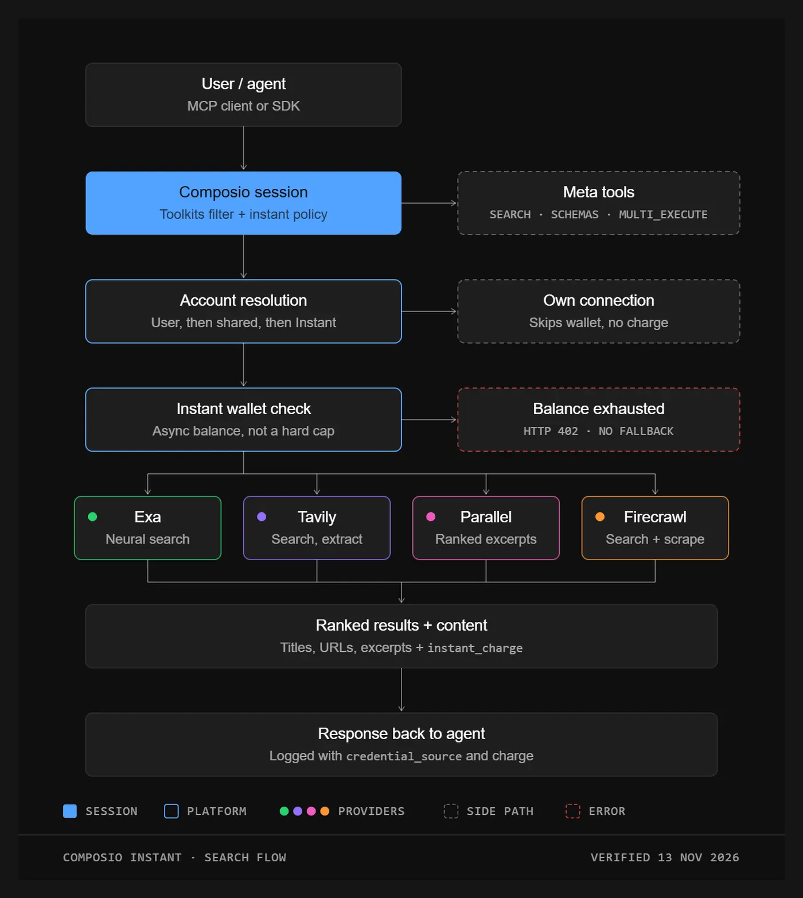
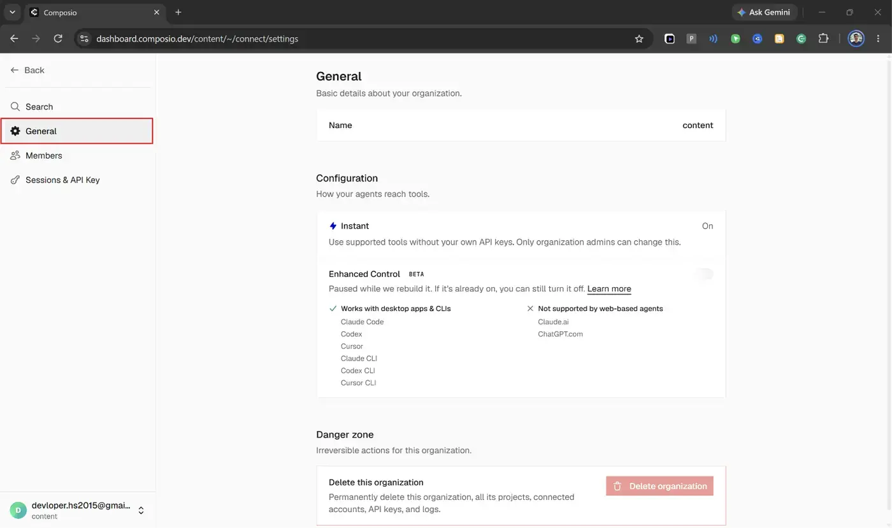
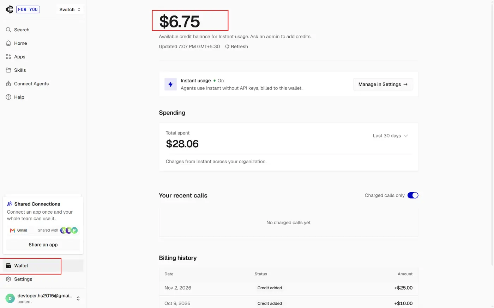
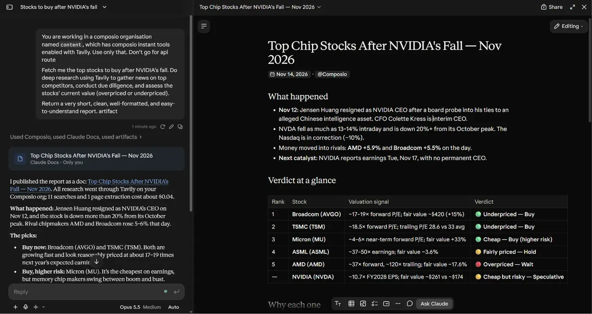
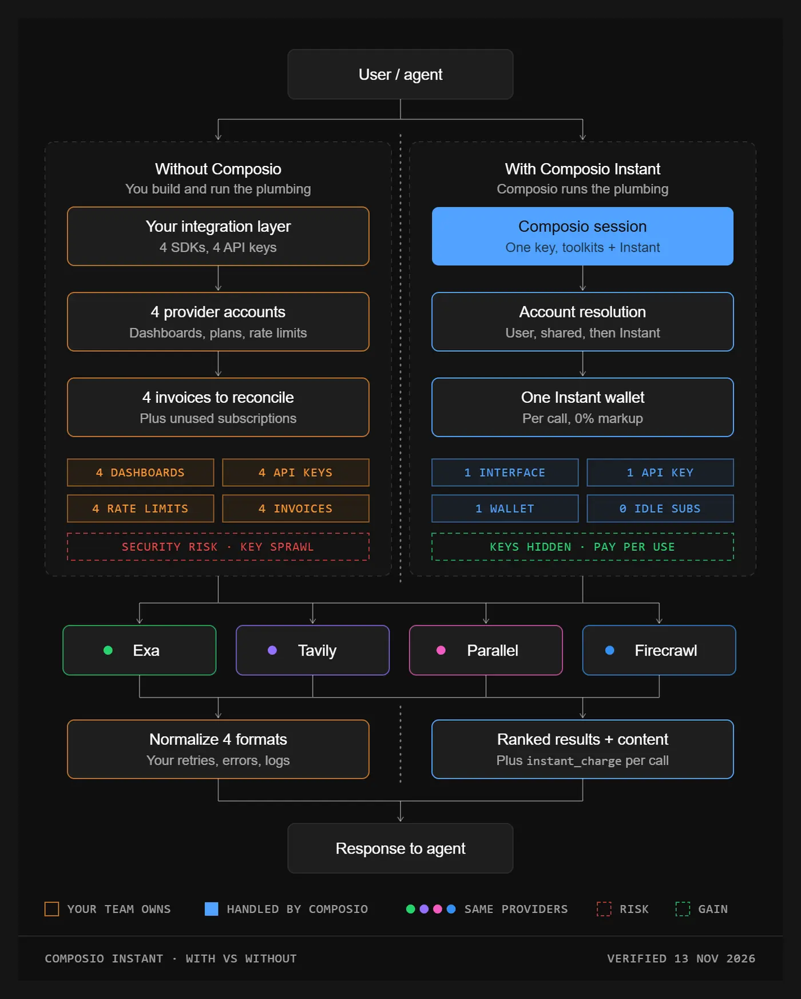

# How to use AI search APIs without a subscription

Most AI search APIs still push monthly subscriptions even when your usage is irregular, which quickly becomes expensive for apps, agents, or internal workflows.

Pay-as-you-go tools with generous free monthly credits solve the cost problem, but managing separate accounts, API keys, and billing for each one creates new friction.

[Composio Instant](https://composio.dev/blog/composio-instant) removes that friction by letting your agent or app call Exa, Tavily, Parallel, FireCrawl (and others) through one wallet and one interface, paying only for what is used.

---

### What Does AI-Powered Search Without Monthly Plans Mean?

AI-powered search APIs return ranked, LLM-ready results (often with content snippets or full page text) optimised for agents and RAG systems rather than human web pages.

Unlike classic SERP APIs, modern ones such as Exa (neural/semantic search on its own index) and Parallel focus on meaning, low latency, and clean excerpts.

Verified free tiers and pay-as-you-go pricing make recurring plans unnecessary for most developers, for e.g:

- [Exa gives \$10 in credits every month](https://exa.ai/docs/admin/pricing) (enough for thousands of Lite searches),
- [Tavily offers 1,000 free credits monthly](https://docs.tavily.com/documentation/api-credits),
- [Parallel](https://parallel.ai/pricing) and [FireCrawl](https://docs.firecrawl.dev/billing) provide free monthly allowances plus keyless/low-limit access options.

To use all of the tools together,

Composio Instant adds a prepaid wallet so agents can call these tools (and 1,500+ others) without creating provider accounts or subscriptions, with 0% markup on the provider’s published rates.

---

### Features of the Top Pay-as-You-Go Search Tools and Composio Instant

Together, these tools and Composio Instant give you high-quality AI search, flexible depth options, and a single secure billing interface that scales with actual usage instead of fixed monthly fees.

- [**Composio Instant wallet & interface**](https://composio.dev/instant): One prepaid wallet for Exa, Tavily, Parallel, FireCrawl and more; no separate accounts, API keys, or subscriptions required; 0% markup; unified tool calling; secure session controls and policies; works with Claude, Cursor, ChatGPT, Codex, and custom agents.
- [**Exa**](https://exa.ai/docs/admin/pricing): Semantic/neural search on its own index, Lite/Instant (\~\$4/1k), Auto (\~\$7/1k), Deep Search, Answer, Monitors, and Agent endpoints; contents/highlights included for up to 10 results; free \$10 monthly credits. [Exa API on Composio](https://composio.dev/toolkits/exa/api).
- [**Tavily**](https://docs.tavily.com/documentation/api-credits): Agent-optimised Search (basic 1 credit / advanced 2 credits), Extract, Map, Crawl, and Research; \~\$0.008 per credit on pay-as-you-go; 1,000 free credits/month; strong for clean, ranked results with content. [Tavily API on Composio](https://composio.dev/toolkits/tavily/api).
- [**Parallel**](https://docs.parallel.ai/search/modes): Ultra-low latency modes (Turbo \~200 ms, Fast \~700 ms at \$1/1k; Basic/Advanced at \$5/1k); natural-language objectives + compressed LLM-ready excerpts; proprietary index built for multi-hop agent research; MCP and free keyless access available. [Parallel on Composio](https://composio.dev/toolkits/parallel).
- [**FireCrawl**](https://docs.firecrawl.dev/billing): Search endpoint (2 credits per 10 results) that can also scrape full pages in the same call; credit-based with 1,000 free credits/month; excellent when you need both discovery and clean Markdown extraction. [Firecrawl API on Composio](https://composio.dev/toolkits/firecrawl/api).

---

### How It Works

With Composio and Composio Instant, your app or agent talks to a single Composio layer;

Instant routes the request to the chosen search provider, bills the wallet, and returns the results, eliminating multi-vendor auth and billing complexity.

This diagram illustrates how all connects and what goes wrong with the traditional approach.

---

### How to Set Up

1. Create a Composio account and [enable Instant Toolkits](https://docs.composio.dev/docs/instant-tools) in project settings.
   

2. Click on **Wallet** and add prepaid balance to your organisation wallet (or use any free promotional credits).
   

3. Ask your agent to connect to use the desired toolkits (e.g., `["exa", "tavily", "parallel", "firecrawl"]`) in Instant settings.
   

> **Optional**: Connect your own provider API keys if you prefer direct billing for high volume.

However, a real question arises: why use Composio? Hope this answers it.

#### Why Composio instead of connecting each tool separately

Managing four different dashboards, API keys, rate limits, and invoices is a constant hassle and security risk.

Composio Instant lets you use all of them securely through one interface and one wallet, so you only pay for actual usage and never maintain unused subscriptions.

---

### Real-World Use Cases with Composio

- Research agents that dynamically choose Exa for semantic discovery or Parallel for low-latency fact-checking.
- RAG pipelines that combine Tavily Search + Extract or FireCrawl Search + Scrape for fresh, clean context.
- Internal workflows or multi-agent systems that need occasional web search without fixed monthly costs.
- Voice or chat agents using Parallel Turbo for sub-second grounding.

These use cases are impressive;

But the best one I found was using it to [find leads and enrich contacts](https://composio.dev/content/best-people-search-apis) using Apollo, Clay, Firecrawl, and more. All it costs is \$0.02. The service is called **People Search (all details in the post)**

https://x.com/KaranVaidya6/status/2120895855528169794

Personally, I have seen many founders, indi-devs, and companies struggle with lead automation and burn \$ 100 to \$500+ for the best-quality leads.

Having People Search is like having your personal lead agent, who understands your needs and optimises the lead-gen workflow accordingly.

With this, we come to the end of the article, and here are my final thoughts.

---

### Conclusion

You can add high-quality AI-powered search to any app or workflow today without locking into monthly plans.

Combine the free tiers and pay-as-you-go rates of Exa, Tavily, Parallel, and FireCrawl with Composio Instant’s single wallet and interface for the simplest, most efficient, and most cost-controlled setup.

So what are you waiting for?

Go ahead, connect your agents with search providers or Composio (for multiple search providers) for verified, up-to-date data.

In the era of AI, adding search is not a commodity; it's a necessity. Update your agent workflow now.

---

### Sources

- Exa pricing & docs: [https://exa.ai/docs/admin/pricing](https://exa.ai/docs/admin/pricing)
- Tavily credits & pricing: [https://docs.tavily.com/documentation/api-credits](https://docs.tavily.com/documentation/api-credits)
- Parallel Search docs & modes: [https://docs.parallel.ai/search/search-quickstart](https://docs.parallel.ai/search/search-quickstart) and [https://parallel.ai](https://parallel.ai/)
- FireCrawl billing & search: [https://docs.firecrawl.dev/billing](https://docs.firecrawl.dev/billing)
- Composio Instant: [https://composio.dev/blog/composio-instant](https://composio.dev/blog/composio-instant) and [https://composio.dev/instant](https://composio.dev/instant)
- Supporting comparisons: Tavily vs Exa vs Parallel vs FireCrawl (Tavily blog) and Composio’s own Instant tool coverage notes.
