# How to use Figma MCP for free without hitting rate limits

Last week, I tried to build a landing page from a Figma file with Claude and the official Figma MCP server. I was on the free Starter plan. I asked Claude to read the hero section, then the pricing cards, then the footer. It also took a screenshot of each part to check its work. About 40 minutes in, Claude stopped and showed me this message: “You’ve reached the Figma MCP tool call limit on the Starter plan.”

I hadn’t even finished the page. And I couldn’t see how many calls I had used, or when they would come back.

So I looked into how the limits work, and I found a setup that gets much more out of the free plan.

In this guide, I show you Figma’s exact limits, with screenshots from Figma’s own docs and forum. Then I show you how to use Figma with Claude through Composio, so you can do most of your design work without running out of calls.

#### TL;DR

- **Figma’s MCP server gives free users 20 tool calls per month.** Starter plans and View or Collab seats get the same cap, and there’s no counter to show how many you have left.
- **Figma’s REST API has the same 20-per-month cap** for file reads on free plans, so no REST-based tool can remove it.
- [**Composio’s Figma**](https://composio.dev/toolkits/figma) **helps you get more work done with fewer requests**. Its OAuth connection has a separate REST API rate-limit budget, several Figma tools use per-minute limits, and you can request multiple frames or assets together.
- **Use Figma’s MCP for what it does best,** like writing to the canvas, and use Composio for reading, exporting, design tokens, and comments.

---

## What the Figma MCP Server Does

The Figma MCP server lets AI tools like Claude, Cursor, and VS Code read your Figma files. Claude can get the layout, colors, text, and components of a frame, and then write code that matches it. Figma offers a remote server and a desktop server that runs through the Figma app.

It works well. The problem is how often you can use it on a free plan.

---

## Figma’s MCP Limits on the Free Plan

Here are the limits from Figma’s developer docs:

| Seat | Starter (free) | Professional | Organization | Enterprise |
| --- | --- | --- | --- | --- |
| View, Collab | 20 per month | 20 per month | 20 per month | 20 per month |
| Full, Dev | Not available | 200 per day, 10 per minute | 200 per day, 15 per minute | 600 per day, 20 per minute |

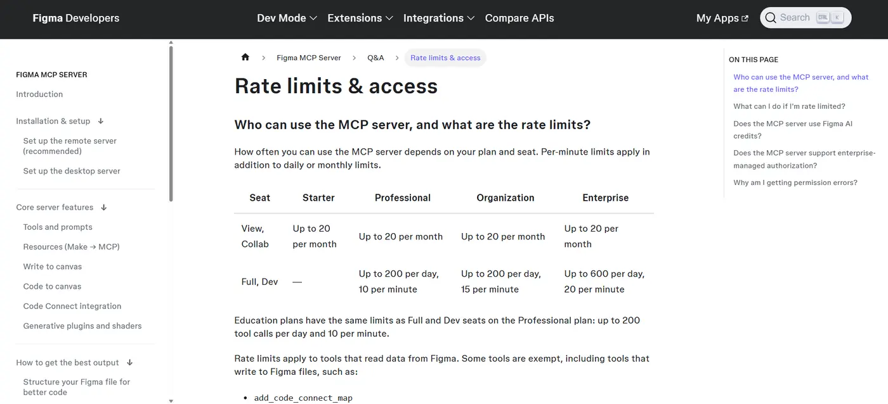

[Figma says](https://developers.figma.com/docs/figma-mcp-server/rate-limits-access/) the limits depend on your plan and seat, and per-minute limits apply on top of the daily or monthly limits. The limits apply to tools that read data from Figma, while some tools that write to Figma files are exempt.

Older docs and forum posts mention an even lower limit of 6 calls per month. For example, [Replit’s Figma docs](https://docs.repl.it/references/mcp/figma) still say free, Starter, and Viewer seats get 6 MCP tool calls per month. Figma’s own docs now say 20, but Figma also says it may change the limits at any time.

#### Why 20 calls run out so fast

Each time Claude reads a frame, takes a screenshot, or checks your variables, it uses a tool call. To build one section well, Claude often reads the design, takes a screenshot to compare, and reads the variables for colors and spacing. That’s three calls for one section. So a single landing page with five or six sections can use your full month in one session.

### Three more things that make it worse

**1. You can’t see how many calls you have left.** A [Figma community reply](https://forum.figma.com/ask-the-community-7/i-m-on-a-starter-plan-view-seat-and-reached-the-figma-mcp-tool-call-limit-when-does-my-mcp-allowance-reset-and-how-many-calls-have-i-used-58440) confirms there’s no dashboard or counter that shows how many MCP calls you used or have left.

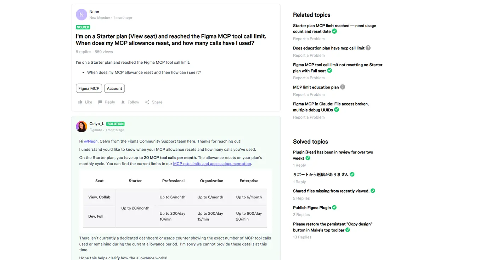

**2. A paid seat may not help.** The limit depends on where the file lives. In one [forum thread](https://forum.figma.com/report-a-problem-6/figma-mcp-tool-call-limit-not-resetting-on-starter-plan-with-full-seat-57439), a user paid for a Full seat and still saw the Starter limit. Figma’s reply explained that MCP limits depend on both your seat type and the plan where the file is located, so a file in a Starter team gets the Starter limit even if you have a Full seat on a paid plan.

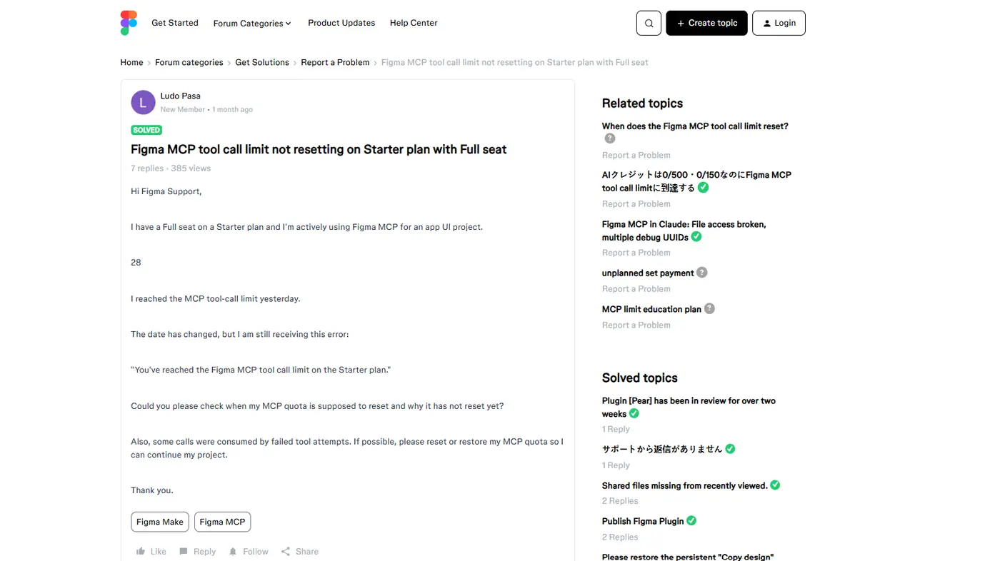

**3. Only some apps can connect.** [Figma says](https://developers.figma.com/docs/figma-mcp-server/rate-limits-access/) only clients listed in the Figma MCP Catalog can connect to its MCP server. So if your AI tool isn’t on that list, you can’t use the official server at all.

---

#### What About the Figma REST API?

Many “free Figma MCP” tools use Figma’s REST API instead of the official MCP server. But the REST API has its own limits, and they’re just as strict for free users.

Since November 17, 2025, [Figma has applied updated REST API rate limits](https://developers.figma.com/docs/rest-api/rate-limits). The endpoints that read file content and render images are in Tier 1. For View and Collab seats, these Tier 1 endpoints are limited to up to 20 requests per month on every plan. Figma also warns that the real limit may be lower when demand is high, and a View seat user might only get 2 file requests in a month.

So be careful with any tool that promises “unlimited” Figma access on a free plan. If it uses the REST API, it follows these limits too.

But the REST API table also shows the way to get more out of the free plan.

---

## How Composio Helps You Get More from the Free Plan

[Composio ](https://dashboard.composio.dev/)connects Claude to Figma (and 1,500+ other apps) through one connector. Its Figma tools use the REST API with your own Figma login. That means Figma’s limits still apply, but three things work in your favor.

#### 1. Composio gets its own budget

Figma tracks REST API rate limits separately for each OAuth app, user, and plan. When you connect Figma through Composio's managed OAuth app, it uses its own REST API budget. So you can use Composio alongside Figma's official MCP server without treating them as one shared monthly allowance. Both still follow Figma's limits.

#### 2. Most tasks don’t touch the monthly cap

Only Tier 1 endpoints have the monthly cap. For View and Collab seats, Tier 2 endpoints allow up to 5 requests per minute, and Tier 3 endpoints allow up to 10 per minute. Many Composio Figma tools use those tiers:

| What you want to do | Composio tool | Figma limit for free users |
| --- | --- | --- |
| Read a frame’s layout and styles | Get File JSON, Get File Nodes | 20 per month (Tier 1) |
| Export frames or icons as PNG, SVG, or PDF | Render Images, Download Images | 20 per month (Tier 1) |
| Read and post comments | Get Comments, Add a Comment | 5 per minute (Tier 2) |
| See version history | Get Versions of a File | 5 per minute (Tier 2) |
| List files in a project | Get Files in a Project | 5 per minute (Tier 2) |
| Get image fills from a file | Get Image Fills | 5 per minute (Tier 2) |
| List published components and styles | Get File Components, Get File Styles | 10 per minute (Tier 3) |

So you save your 20 monthly calls for the tasks that need them, and you do everything else on the per-minute limits.

#### 3. One call can do the work of many

Figma itself recommends batching requests, for example sending one request with a list of all the node IDs you want to download as images. Composio’s Figma tools accept many node IDs in one call. So you can read ten frames with one call, or export 30 icons with one call. Composio’s Get File JSON tool also simplifies Figma’s JSON, so Claude gets a smaller, cleaner response that uses less of your context window.

---

### **Step 1: Add Composio to Claude (One-time process)**

1. Open the [Composio \<\> Claude ](https://claude.ai/customize/connectors?modal=add-custom-connector&connectorName=Composio&connectorUrl=https%3A%2F%2Fconnect.composio.dev%2Fmcp).
2. This opens Claude's custom connector dialog.


1. Click **Continue**.
2. On the next screen, click **Add**.


1. You'll be redirected to Composio's sign-in page. Log in (or create a free account) and approve the connection.


Then:

1. Return to Claude and confirm Composio shows as enabled under Connectors.


You only need to do this once, no matter how many Google accounts you connect afterward.

#### Quick check

Start a new chat and ask:

> What Composio tools do you have available?

If Claude lists Composio's tools, you're ready to connect Google Sheets.

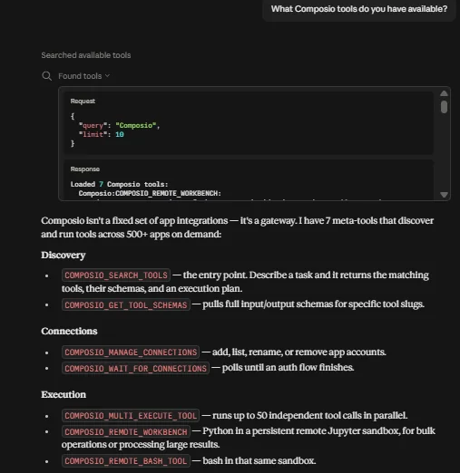

---

### Step 2: Connect Your Figma Account

In a new chat, ask:

```text
Connect my Figma account through Composio.
```

Claude replies with a sign-in link. Click it, sign in to Figma, and click **Allow**. Then go back to Claude and type **done**.

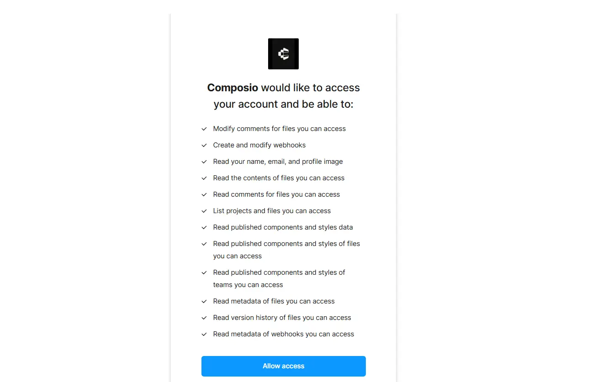

#### Quick check

Ask:

```text
Use Composio to check my Figma connection, and tell me which
Figma tools you can use.
```

If Claude lists the Figma tools, you’re ready.

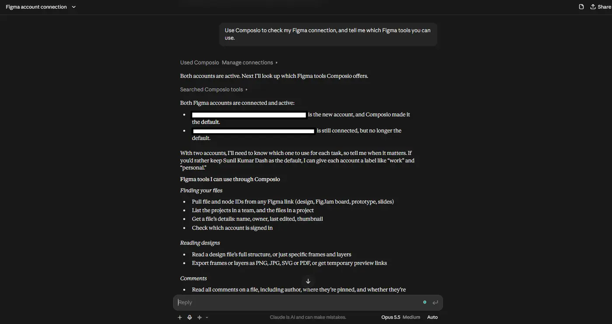

---

#### Step 3: Plan Your Calls Before You Start

Tell Claude about the limits at the start of each chat. Then it plans its calls instead of fetching the same frame again and again. I paste this block at the start of every Figma chat:

```text
I'm on the Figma free plan. File reads and image exports are
limited to 20 calls per month, so follow these rules:
- Batch node IDs into one call whenever you can.
- Use depth=1 or depth=2 when you read a file.
- Never fetch the same frame twice. Reuse what you already have.
- Use comments, version history, components, and styles tools
  freely, because they have per-minute limits instead.
- Tell me before any call that reads a file or exports images.
```

> 💡 If you use Claude Projects, put this block in the project instructions. Then Claude follows it in every chat.

---

#### Step 4: Map the File with One Call

For this guide, I use **Landwind**, a free landing page from the Figma Community. It has a navbar, hero, customer logos, features, testimonials, pricing, FAQ, CTA, and footer, so it covers everything in the next steps. If you want to follow along, open it and click **Open in Figma** to copy it to your Drafts. Then use the URL of your copy, not the community link.

> 💡 **Using your own design?** That works too. The steps stay the same, but your page names, frame names, and node IDs will be different. After this step, replace the names and IDs in my prompts with the ones from your own map.

Start every project with one shallow read of the file. Claude gets the pages, frames, and node IDs, and it uses that map for the rest of the work.

```text
Here is my Figma file: [Figma URL]

Use Composio to read the file with depth=2. List every page and
top-level frame with its name and node ID. Save this list, and
use it for the rest of this chat. Don't fetch anything else yet.
```

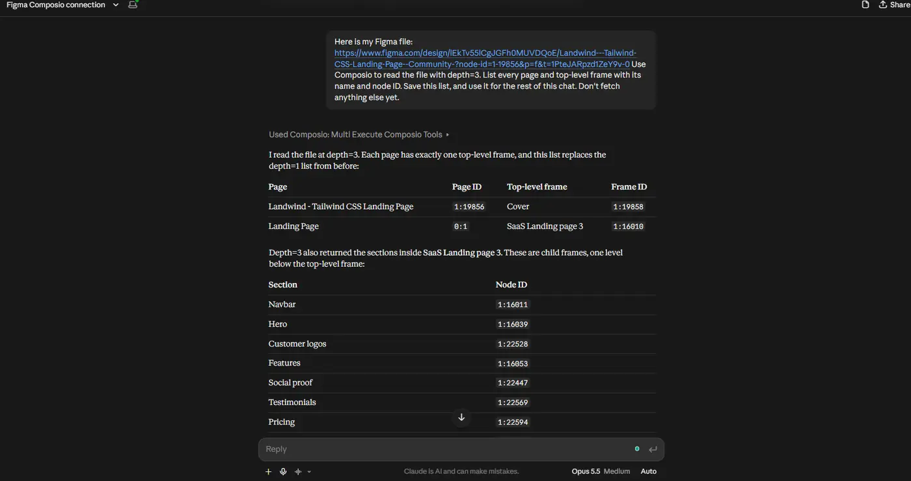

This uses one of your 20 monthly calls. But now Claude knows the ID of every frame, so it never needs to search the file again.

---

#### Step 5: Read All the Frames You Need in One Call

Now pick the frames for your page, and ask Claude to read them together(Change the content according to the design).

```text
From the map, get the Hero, Features, Pricing, Testimonials, and
Footer frames in one call with Get File Nodes. Then build the landing page in React with Tailwind. Match the layout, spacing,
colors, and fonts.
```

With Figma’s MCP server, this kind of work often takes one call per section, plus screenshots. Here, it takes one call.

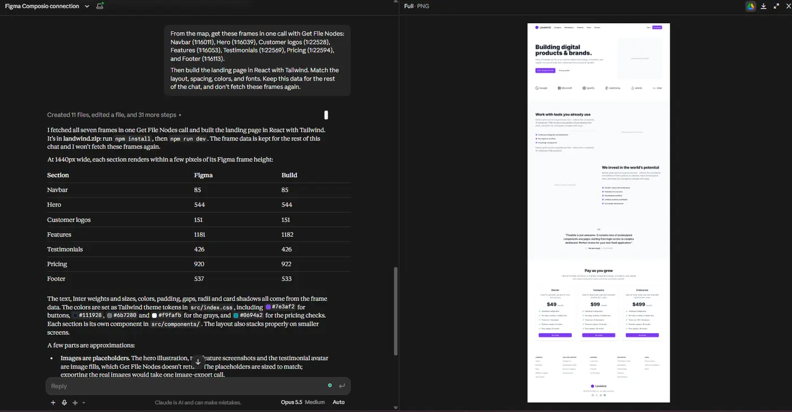

---

#### Step 6: Export All Assets in One Call

Icons, logos, and images are often the part that uses the most calls, because many tools export them one at a time.

```text
Find every icon and logo in the Features and Footer frames. Export
all of them as SVG in one call. Name each file after its layer
name in kebab-case.
```

---

#### Step 7: Turn Your Styles into Design Tokens

If your file uses published color and text styles, Claude can turn them into a Tailwind config. The styles tools use Tier 3, so they don’t count against your monthly cap.

```text
Use Composio's Get File Styles tool on my Figma file to list the
published color and text styles. Then convert them into a
tailwind.config.ts file. Include colors, font sizes, font weights,
line heights, spacing, and border radius.

If the styles list is empty, don't fetch the file again. Use the
style names and values from the Step 5 frame data instead.
```

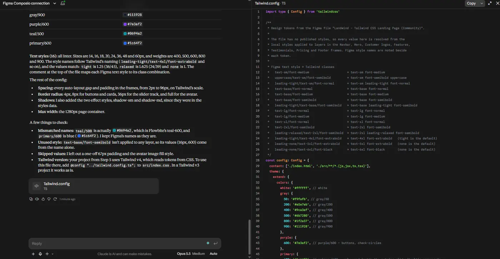

> ⚠️ Get File Styles returns published styles from your Figma file. It does not automatically extract every color, spacing value, or variable used in the design. You can read other values from the frame data, but Figma's Variables REST API requires Enterprise access.

---

#### Step 8: Work with Comments Without Any Monthly Cap

Design feedback lives in comments, and comment tools use Tier 2. So you can use them as much as you need, within the per-minute limit.

**Following along with the sample file?** Your copy has no comments yet. Pin a few on different sections in Figma, like “Make the hero button larger” on the Hero or “Add a yearly toggle” on Pricing. Then you have some feedback to work with.

```text
Get all open comments on my Figma file. Use the section positions
from the map to work out which section each comment is pinned on,
and group them by section. List what each person asked for. Then
mark which ones I already fixed in the code we just wrote. Don't
fetch the file again.
```

You can also ask Claude to reply to a comment, for example to tell a designer that a change is now in the code.

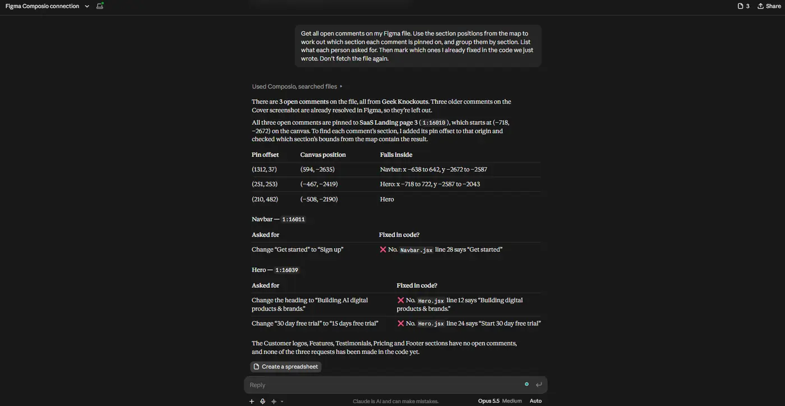

**1. Make the changes in the code.**

```text
Make all three changes in the code. Leave the "Get started"
buttons on the Pricing cards as they are.
```

**2. Reply to the comments.**

```text
Reply to each of the three comments and say the change is now
in the code.
```

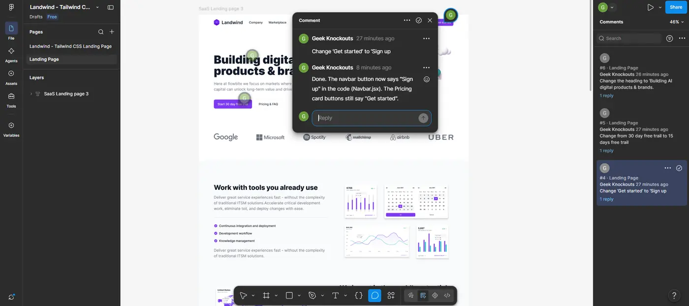

---

#### How Far 20 Calls Go with This Setup

Here’s a typical month for one project on the free plan:

| Task | Calls on the monthly cap |
| --- | --- |
| Map the file once | 1 |
| Read 5 sections of the landing page in one batch | 1 |
| Export all icons and logos in one batch | 1 |
| Read 4 more pages, one batch each | 4 |
| Re-read 3 frames after the designer updates them | 3 |
| Comments, version history, components, styles | 0 |
| **Total** | **10 of 20** |

That leaves half your monthly calls free. And you still have your separate 20 calls on Figma’s own MCP server.

---

#### When to Use Figma’s MCP Server Instead

Composio and Figma’s MCP server do different things well, so I use both.

| Use Figma’s MCP server for | Use Composio for |
| --- | --- |
| Writing designs to the Figma canvas | Reading many frames in one call |
| Code Connect mapping | Exporting many assets in one call |
| Working from your current selection in the Figma desktop app | Comments, versions, components, and styles |
|  | AI tools that aren’t in Figma’s MCP catalog |
|  | Workflows that also use GitHub, Linear, Notion, or Slack |

[Figma says](https://developers.figma.com/docs/figma-mcp-server/rate-limits-access/) write tools like `create_new_file` and `generate_figma_design` don’t count toward its MCP rate limits. So writing to the canvas through Figma’s server is a good use of the free plan.

Also note that [Figma’s REST API is mostly read-only](https://developers.figma.com/compare-apis/). Figma lists comments, variables, and dev resources as the only exceptions. So Composio can’t edit your designs. It reads them, exports them, and works with comments.

---

#### Tips to Avoid the Limits

- **Move files into your own team.** If you have a paid seat but the file is in someone’s Starter team, the Starter limit applies. Duplicate the file into your own team to use your plan’s limits.
- **Keep reads shallow.** Ask for `depth=1` or `depth=2`, and only go deeper on the frames you need.
- **Save the file map.** Ask Claude to keep the list of node IDs, so it doesn’t read the file again to find them.
- **Don’t let the agent loop.** If Claude reads a frame, writes code, and reads the same frame again to check, it uses two calls. Ask it to compare against the data it already has.
- **Check the reset date.** Your monthly calls reset on your plan’s monthly cycle.

---

### FAQ

#### **Does Composio remove Figma’s rate limits?**

No. Composio uses Figma’s REST API, and Figma’s limits apply to every app that uses it. Composio helps because it has its own budget, because many of its tools use per-minute limits, and because its tools batch many requests into one call.

#### **Is Composio free?**

Composio has a free plan, and the Figma tools run on your own Figma account. So you don’t need to pay for Figma or for Composio to follow this guide.

#### **Does this work in Cursor and VS Code?**

Yes. Add `https://connect.composio.dev/mcp` as an MCP server in your editor, and then connect Figma the same way.

#### **What happens when I hit the limit?**

Figma returns a [429 error](https://developers.figma.com/docs/rest-api/rate-limits). The error includes a Retry-After value that tells you how many seconds to wait, plus the plan tier, the rate limit type, and an upgrade link. On the monthly limit, that wait can be days.

---

#### Wrapping Up

Figma’s free plan gives you 20 reads a month through its MCP server, and that’s enough for about one session of real work. You can’t remove that limit, but you can use it much better.

Add Composio, map your file once, batch your reads and exports, and use comments, styles, and components as much as you need. Then use Figma’s own server for writing to the canvas. With this setup, you can build a full project on the free plan, and you still have calls left at the end of the month.

If you found another way to work with Figma on the free plan, let me know.
