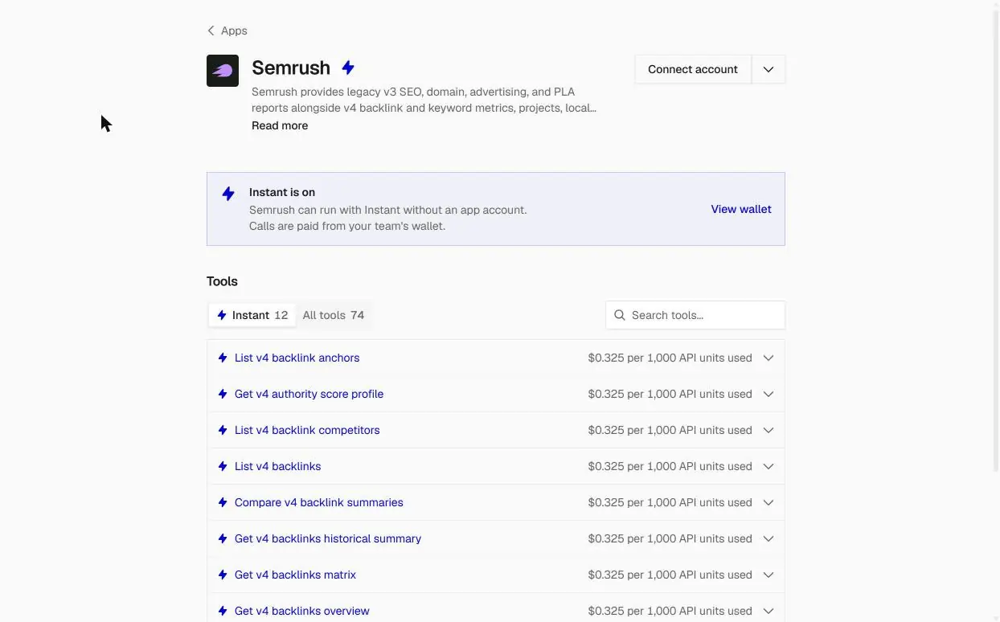
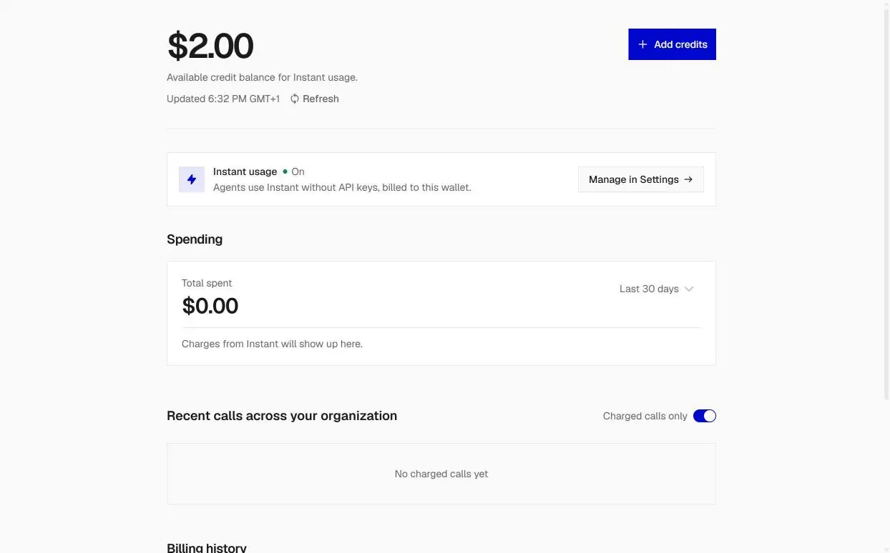
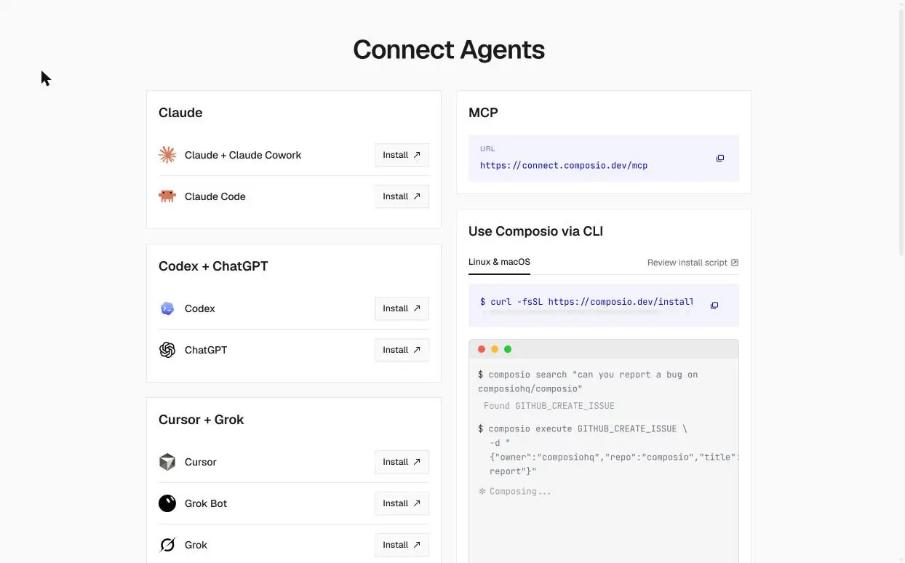
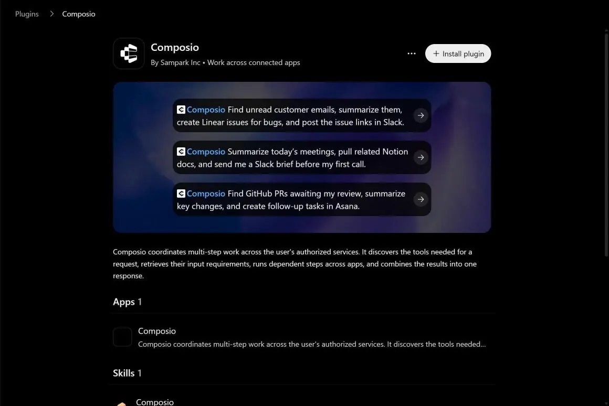
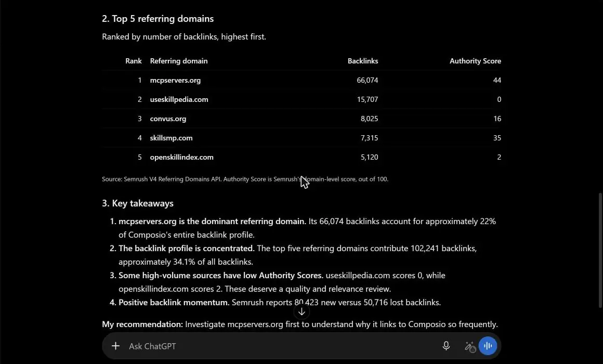
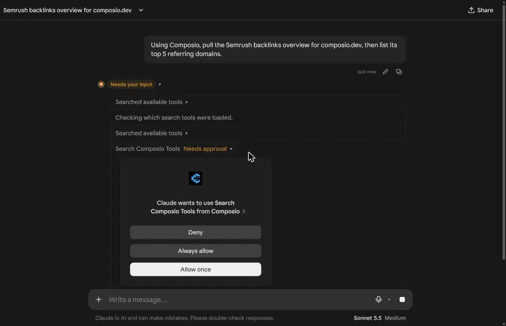
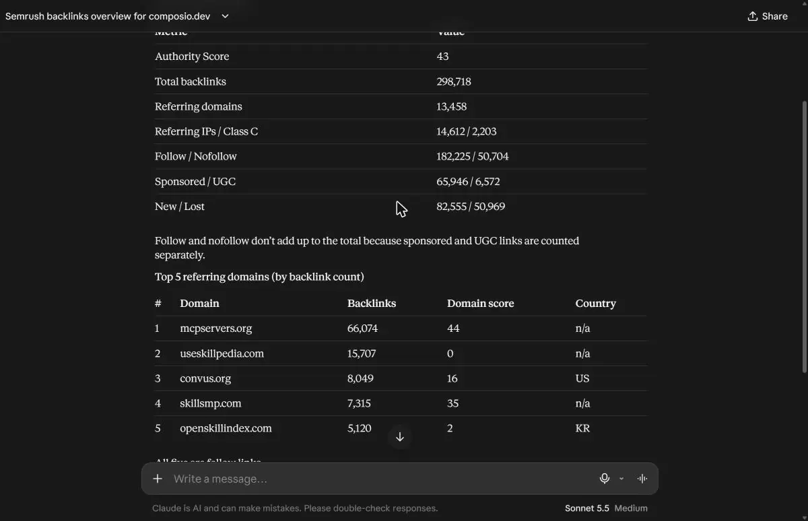
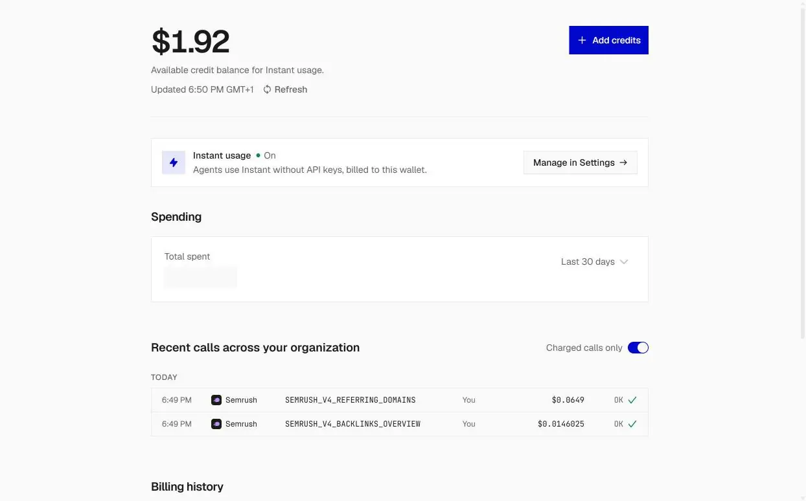

# How to use Semrush for free without subscription

If SEO, GEO and AEO are your priorities, then you want to know who links to a competitor's site. Recently I was vetting a guest post target and checking a domain's authority score before spending a week on outreach. This kind of data can be tracked on [Semrush](https://www.semrush.com/).

However, the API route to it starts with a paid plan. In Semrush, standard API access requires a Business plan subscription, and after upgrading, the API unit balance still reads zero. Units are a separate purchase. Semrush’s pricing page lists monthly plans from \$139 to \$299, with API access on a custom-priced Advanced plan, and its API docs don’t say what units cost.

That's a lot of setup for a handful of lookups. [Composio Instant](https://composio.dev/instant) takes the subscription out of the picture. I connected my agent to Composio, and it called the Semrush tools it needed, with each call paid from a prepaid wallet. Every new account starts with \$2 in that wallet. I didn't create a Semrush account, and I didn't copy a Semrush API key.

## How Composio Instant works

[Composio Instant](https://composio.dev/instant) is a unified API that gives your agent pay-per-call access to tools from providers such as Semrush, DataForSEO, Ahrefs and Serper. Every new account gets \$2 in free starter credit, so you can try supported tools without a provider subscription.

When your agent calls a supported tool, Composio uses its own provider account to run the request through the provider's official API, then deducts the cost from your wallet. There's 0% markup, so you pay the provider's price. The execution log shows which tool ran and how much the call cost.

These three things are important to note:

- If you've connected your own account for a tool, your agent uses it and Instant charges nothing.
- Composio checks the balance asynchronously, so the wallet isn't a strict cap on each call. Once the balance is confirmed empty, Instant calls stop with an HTTP 402 error.

Watch the full Claude code setup walkthrough on YouTube: [How to Use Semrush Backlink Data Without a Subscription (Composio Instant)](https://youtu.be/pms0eJtX7b8)

## What you can pull from Semrush with Composio

Composio's Semrush toolkit has more than 70 tools and normally runs on your own Semrush API key. Composio Instant covers 12 of them, all billed at \$0.325 per 1,000 API units used. Nine are backlink tools:

- Backlinks overview
- The full backlinks list
- Referring domains
- Referring IPs
- Backlink anchors
- Backlink competitors
- Backlinks historical summary
- Backlinks matrix
- A comparison of backlink summaries

The other three are the authority score profile, keyword metrics and a domain's indexed pages. Organic keyword research and ad data live in the larger toolkit. The Instant list doesn't include them, so those still need your own Semrush connection.

The Semrush page in the dashboard lists the 12 Instant tools, each priced at \$0.325 per 1,000 API units used.



With the split in the twelve tools, you can see who links to a rival, which anchors they use, who their backlink competitors are, and how a profile has moved over time, all without a plan.

## Set up Composio Instant

Start with a free Composio account, then connect it to ChatGPT or Claude.

1. Create a [Composio account](https://composio.dev/) on the free Hobby plan. It includes \$2 in credit and doesn't require a credit card.
2. Open the Connect Agents page in the Composio dashboard and turn on Composio Instant.
3. Choose your client and follow its install link. Composio works with Claude, ChatGPT, Codex, Cursor and other MCP clients. If you connect through a custom MCP server, use `https://connect.composio.dev/mcp`.

The sections below explain how to connect ChatGPT and Claude.



The wallet shows the \$2.00 starter credit with Instant turned on.



The Connect Agents page lists the MCP address and an install link for each client.

If you're building your own agent, enable Instant toolkits in your project settings because they're off by default. You can check your wallet balance under Billing and include the cost in each tool response by setting `return_instant_charge` (`returnInstantCharge` in TypeScript).

### Connect ChatGPT

You can use the official Composio plugin on ChatGPT's free plan, or add a custom MCP connector on a supported paid plan.

#### Install the Composio plugin

1. Open [the Composio plugin for ChatGPT](https://chatgpt.com/plugins/plugin_asdk_app_6a58503580c08191b78cc5bdaf4eba6e?cta_placement=works-with-chatgpt) and click **Install plugin**. Composio also offers an official plugin for Codex.
2. When ChatGPT asks you to sign in, log in to Composio, review the OAuth permissions and click **Allow access**.
3. Start a chat and type: "@Composio pull the Semrush backlinks overview for composio.dev, then list its top 5 referring domains."
4. Approve the authorization or tool-call request that ChatGPT shows on first use.

Keep manual confirmation turned on for write actions, such as sending messages.



The Composio plugin page in ChatGPT.

I tested this prompt on ChatGPT's free plan. ChatGPT asked me to approve the tool call, then returned the backlinks overview for composio.dev and its top five referring domains.



ChatGPT's answer with the top five referring domains for composio.dev.

#### Use a custom MCP connector instead

[Composio's ChatGPT guide](https://composio.dev/blog/chatgpt-mcp-how-to-connect-chatgpt-to-your-apps-without-code) also describes how to add Composio as a custom connector. This method requires ChatGPT Plus, Pro, Business, Enterprise or Edu because free accounts can't turn on Developer Mode.

1. If you're on Business or Enterprise, ask your workspace admin whether third-party app connections are allowed.
2. Open ChatGPT Settings and turn on **Developer Mode**. The guide lists two possible locations: **Apps → Advanced settings** or **Workspace Settings → Permissions & Roles**. Use the one your account shows.
3. Go to **Apps and Connectors**, click **Create** and name the app **Composio**. Enter `https://connect.composio.dev/mcp` as the server URL and choose **OAuth** for authentication.
4. Sign in to Composio in the browser window and authorize ChatGPT.
5. Start a new chat and ask: "Pull the backlinks overview for a competitor's domain from Semrush."

### Connect Claude

To add Composio as a custom connector in Claude:

1. Open **Customize → Connectors** and choose **Add custom connector**.
2. Name the connector **Composio** and enter `https://connect.composio.dev/mcp` as the server URL.
3. Follow the sign-in prompt to Composio, then authorize the connection.
4. When Claude calls a Composio tool, review the permission request and choose whether to allow it once or always allow it.

When I tested this connection, Claude asked for permission before each Composio tool ran.



You can also follow [Composio's Claude setup guide](https://composio.dev/claude).

#### Connect another client

For Claude Code, Cursor, Grok, Hermes or another client that supports remote MCP servers, follow the client-specific instructions at [composio.dev/works-with](https://composio.dev/works-with). That page also includes setup instructions for Claude.

### Run your first Semrush call

I asked Claude: "Using Composio, pull the Semrush backlinks overview for composio.dev, then list its top 5 referring domains." It came back with the overview, including authority score, backlinks and referring domains, and a table of the top five referring domains.



In the wallet, the two calls showed up as `SEMRUSH_V4_REFERRING_DOMAINS` at \$0.0649 and `SEMRUSH_V4_BACKLINKS_OVERVIEW` at \$0.0146. The balance went from \$2.00 to \$1.92.



## What you can do with it

With Instant switched on, a few prompts cover most of a link audit:

- Pull the backlinks overview for a competitor, then list their referring domains and the anchors they use.
- Compare backlink summaries across several domains before you pick an outreach target.
- Check a domain's authority score before you spend time on a guest post.
- Look at how a backlink profile has changed over time with the historical summary.
- Run the same pull through Ahrefs or DataForSEO and compare the results.

Competitor data is only half of an SEO picture. Your own site's data lives in your own accounts, and you can connect those to the same agent.

## Connect Search Console, Bing Webmaster and other apps

When you ask your agent to use an app you haven't connected yet, Composio gives you a Connect Link. You sign in once and Composio manages the credentials from then on. Because these tools run on your own account, Instant doesn't charge for them.

- [Google Search Console](https://docs.composio.dev/toolkits/google_search_console) has 9 tools. You can list, add and remove sites, inspect a URL's indexing status, list and submit sitemaps, and run search analytics queries for clicks, impressions, click-through rate and average position. It uses OAuth2, and Composio offers managed OAuth.
- [Bing Webmaster Tools](https://composio.dev/toolkits/bing_webmaster_tools) has 13 tools, including search, page and query performance, crawl diagnostics, inbound links, keyword research, URL submission and submission quotas. It uses an API key, which you create in your Bing Webmaster Tools account settings and paste into Composio's connection page.

Once both are connected, one prompt can combine them:

```markdown
Pull the top referring domains for a competitor from Semrush, 
then show my top queries from Search Console over the last 28 days." 
```

The first half uses your Instant wallet and the second half uses your own account.

## Keeping an eye on spend

Every Instant call lands in the execution log with its cost, so you can see what a task cost after it runs. You can switch Instant off for your team in one click, and agents keep working on any accounts you've connected yourself. There's no built-in dollar cap on a session, so developers who need a hard limit should set an application-side budget or turn Instant off in code with `instant=False`.

## The same wallet covers other SEO providers

Composio Instant also supports other SEO providers: 42 Ahrefs tools, 193 DataForSEO tools, and 10 Serper tools. Serper web search costs \$0.001 per credit. You can use the same wallet to check Semrush backlink data against another provider without opening another account.

## Where the free plan ends

The free part is \$2, once, per account. After that you top up the wallet. Plans that can't add funds need an upgrade, and Pro is \$29 a month with \$29 of credit that expires at month end.

Instant also covers core actions, not every screen in the Semrush product. If you need the full toolkit of more than 70 tools, bring your own Semrush API key, which means a paid Semrush plan again.

For a one-off backlink audit or a keyword check, I think \$2 goes a long way. Claim your \$2 and run your first Semrush call at [composio.dev/instant](https://composio.dev/instant).
