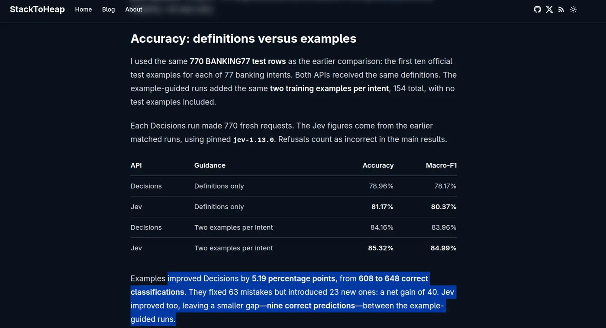
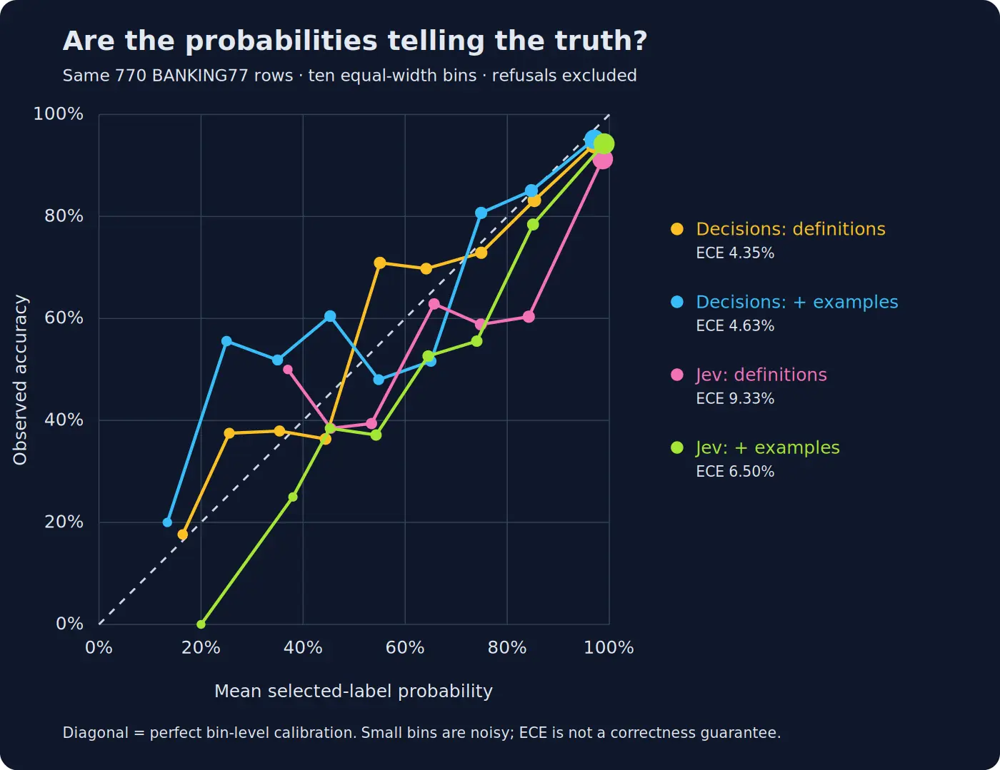
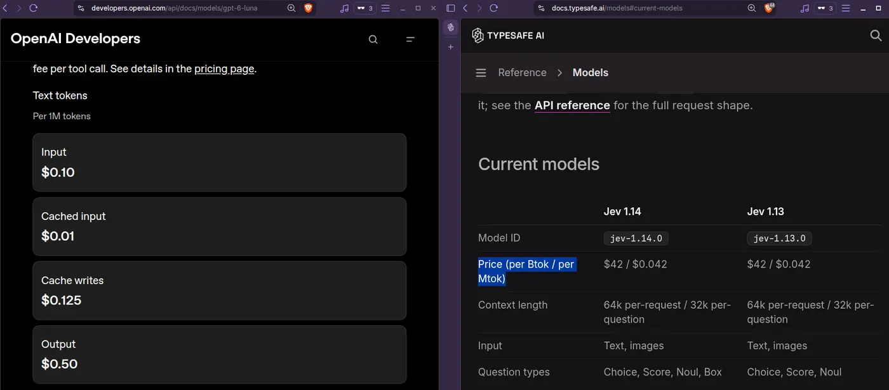
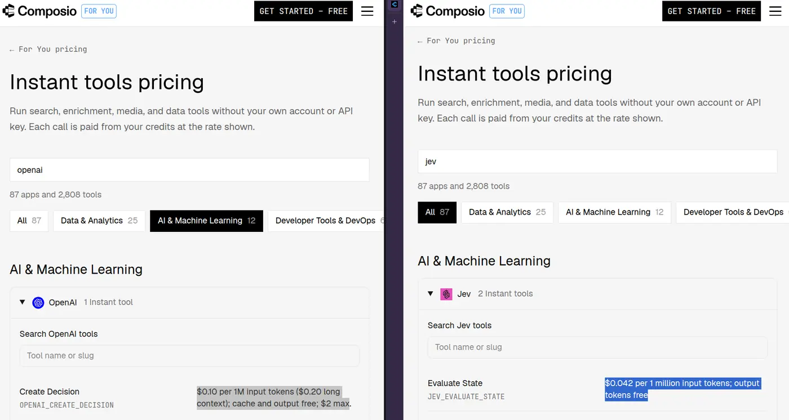
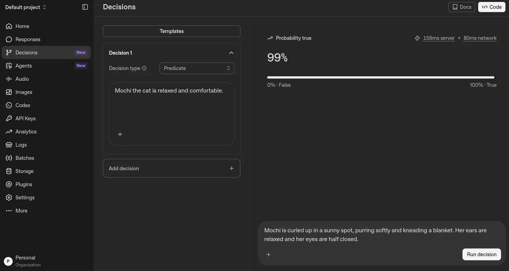
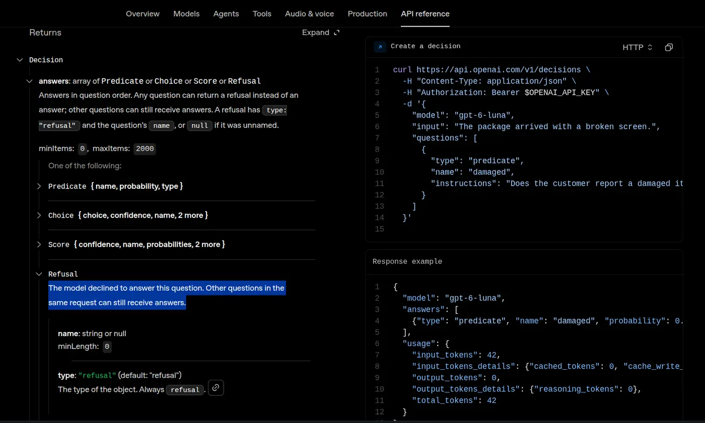
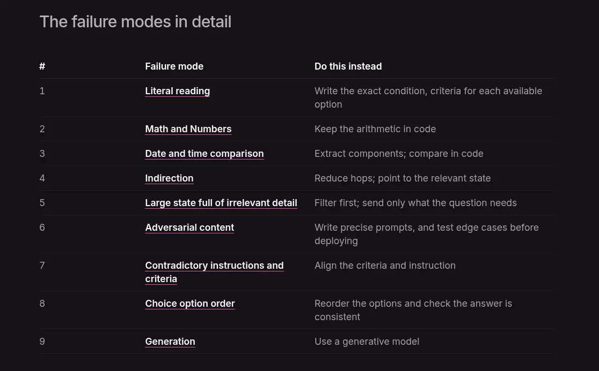

# Jev vs OpenAI Decisions API: Accuracy, Speed, Pricing, and When to Use Each

Three weeks.

That's how long it took OpenAI to ship an alternative to Jev. 🫩

TypeSafe released Jev on September 15. OpenAI introduced the Decisions API at DevDay on September 29, opened a public beta on October 6, and made it generally available on October 22. The similarities were clear enough that people started calling it OpenAI's "Jev competitor".


When I built my [Jev chat moderator](https://composio.dev/content/how-to-build-a-real-time-ai-chat-moderator-with-jev), the model had one job. It had to look at a chat message and tell me whether it should be deleted.

And most of what my agents ask a model looks a lot like that.

For that, a full LLM response is overkill.

Both Jev and OpenAI's Decisions API fix this in roughly the same way. You send some context and typed questions, and you get back typed answers with probabilities. No text generation and no parsing some random JSON-shaped response from an LLM.

So which one should you use?

Every number here comes from an independent test or official docs, and I'll tell you where it came from.

## TL;DR

|  | Jev | OpenAI Decisions API |
| --- | --- | --- |
| Model | Purpose-built System One model | `gpt-6-luna` |
| Question types | Choice, Score, Noul, Box | Choice, Score, Predicate |
| Input price | \$0.042 / 1M tokens | \$0.10 / 1M, \$0.01 cached |
| Images | Experimental | Generally available |
| Context | 64K, 262K experimental | Much larger |
| Version pinning | Yes | No snapshot documented |
| Latency in paired tests | \~184-520 ms | \~138-214 ms |
| Accuracy in paired tests | Slight lead on StackToHeap, tie on WallerChe | Very close |
| Enterprise | ZDR for enterprise, US hosting | ZDR/HIPAA if eligible, US/EU, Private Link |
| Composio Instant | Yes | Yes |

The short version is pretty simple. If you're classifying a lot of short text and care about cost, I'd pick **Jev**. It's 58% cheaper per input token, and it's at least as accurate in the paired tests I found.

If you need images, long inputs, EU processing, HIPAA, or you're already deep into OpenAI, pick **OpenAI's Decisions API**. But the accuracy gap is small enough that I'd still test both on your own data before committing.

And that's actually pretty easy now because both are available through **Composio Instant**, which I'll get to in a bit.

## What is Jev?


Jev is a model from TypeSafe AI that does not generate text. At all.

TypeSafe calls it a "System One" model. The name comes from Kahneman's System 1, the fast, intuitive kind of thinking, rather than slow, deliberate reasoning.

> 💁 The easiest way I think about it is: **An LLM generates text. Jev makes a judgement.**

You send Jev a `state`, which can be a string, JSON object, or array, plus a set of questions. It reads that state and answers those questions in parallel.

There are [four question types](https://docs.typesafe.ai/primitives):

- **Choice:** pick one option from up to 255.
- **Score:** place something on an ordered scale of 2 to 10 levels.
- **Noul:** yes/no, returned as the probability of "yes."
- **Box:** draw a bounding box on an image. Experimental in Jev 1.14.

Pricing is [\$0.042 per million input tokens](https://docs.typesafe.ai/models), and output is free. The current version is `jev-1.14.0`, and you can pin a version instead of relying on `jev-latest`. That's useful if you've already tested your production thresholds against a specific version.

Jev 1.14 also introduced images, Box, and a 262K context window, but TypeSafe puts these behind its "danger zone" label and says they aren't production-ready yet.

One thing I like about TypeSafe is how they frame Jev. In ["Don't call it a decision model"](https://typesafe.ai/blog/dont-call-it-a-decision-model), they argue that Jev should produce judgements, not entire business decisions.

Jev helps you with the judgement and judgement only. Your normal application code still decides what happens next.

TypeSafe also has a useful [jaggedness page](https://docs.typesafe.ai/model-jaggedness/jev-1.13) showing where Jev struggles, including math, counting, dates, double negatives, noisy context, and adversarial input. I really feel that more vendors should do this. 🫶

## What is OpenAI Decisions API?

https://youtu.be/FB6oCmrIj-Y

In short, OpenAI's Decisions API is a dedicated [`POST /v1/decisions` endpoint](https://developers.openai.com/api/docs/guides/decisions) that returns typed answers instead of generated text.

The big difference is that OpenAI didn't build a completely separate model for it. Decisions runs on **GPT-6 Luna**, which [OpenAI says](https://techcrunch.com/2026/10/22/openai-makes-its-jev-competitor-widely-available-as-decision-model-competition-heats-up/) it reconfigured for faster and cheaper decision inference.

Its question types map closely to Jev:

- **Predicate:** yes/no probability. Basically Jev's Noul.
- **Choice:** choose between 2 and 255 options.
- **Score:** score something across 2 to 10 ordered levels.

OpenAI can also return a **refusal** for an individual question. The overall request can still return HTTP 200, so you need to handle refusals separately in your code.

OpenAI supports a broader set of inputs, including text, JSON, images, conversation history, tool calls, and tool outputs. You can also ask up to 400 questions in one request.

Pricing is \$0.10 per million uncached input tokens and \$0.01 per million cached tokens. Output is free. There's also a GPT-Live integration, so voice-agent transcripts can be sent into Decisions directly.

## Why not just use a normal LLM?

If you've understood the use of these models, you might have this question:

> 🤔 Why do I need Jev or Decisions? I can already ask GPT or Claude to return JSON.

You can.

Before Jev, that's pretty much what I would've done: give an LLM a few options, ask for JSON, and parse the answer.

The difference is that Jev and Decisions are built around the judgement itself. You get probabilities for the allowed answers, no generated explanation, and much lower latency and cost.

That matters when the same small decision happens thousands or millions of times, like routing tickets, checking RAG chunks, or deciding whether an agent action needs review.

I'd still use a normal LLM when the task needs reasoning or an explanation. Always remember, these are built for judgements. And when you're answering simple yes/no or pick-one questions, using one of them becomes a pretty obvious choice.

But which one should you pick?

I'll go through a few more differences below.

## Where Jev and OpenAI Decisions actually differ

From the application side, these APIs look almost interchangeable. You send context, define questions, get probabilities, and let your code decide what happens.

But a few differences matter quite a bit in production.

### Jev is built specifically for judgements

[TypeSafe says](https://typesafe.ai/blog/introducing-system-one-models-and-jev) Jev uses a "parallel sampler" and a training approach called **Reinforcement Learning for Calibrated Decisions**, or RLCD. The model is designed around bounded judgements instead of language generation.

TypeSafe doesn't publish Jev's model size, training data, full architecture, or RLCD reward function, so I wouldn't treat "calibrated" as a guarantee.

OpenAI publishes even less about how Decisions generates probabilities. We know [it's Luna](https://openai.com/index/decisions-api/) and that the output is limited to the question type you define, but there's no Decisions-specific model card explaining the internals.

### OpenAI handles richer inputs

This is probably OpenAI's clearest advantage. You can pass images, conversations, tool history, large documents, and long agent traces.

Jev's image support and larger context mode are still experimental. For ticket classification or RAG relevance, that may not matter much. For checking an image or a massive agent trace, it obviously does.

### Jev lets you pin versions

With Jev, you can use `jev-1.14.0`, test it, set your thresholds around it, and keep that version in production.

OpenAI doesn't currently document an equivalent model snapshot for Decisions. For normal chat that might be fine, but for something sitting inside an approval flow, I'd rather know that the model I tested is the model I'm still running.

### Confidence isn't directly comparable

Jev [documents its Choice confidence formula](https://docs.typesafe.ai/confidence):

```text
(p_max - 1/n) / (1 - 1/n)
```


With four options and a top probability of 0.55, confidence works out to 0.40.

OpenAI gives you a [`confidence` field](https://developers.openai.com/api/reference/resources/decisions/methods/create) too, but doesn't publish exactly how it's calculated.

So don't use the same confidence threshold for both providers and assume it means the same thing. Test each model against your own data first.

## Accuracy: which one makes better calls?

There's no universal accuracy number here. Different tests use different datasets, model versions, prompts, and access paths, so combining all of them into one score wouldn't tell us much.

These are the useful paired results I found, from [StackToHeap](https://stacktoheap.com/blog/2026/10/08/jev-the-decisions-strike-back/) and [WallerChen/jev-measured](https://github.com/WallerChen/jev-measured):

| Test | Jev | OpenAI |
| --- | --- | --- |
| StackToHeap, BANKING77 definitions | 81.17% | 78.96% |
| StackToHeap, with examples | 85.32% | 84.16% |
| WallerChen simple tasks | 94.0% | 94.1% |
| WallerChen many-option tasks | 79.0% | 79.8% |



For fixed-category text classification, they're **really close**. Jev comes out a little ahead in the StackToHeap tests, while the WallerChen tests are basically ties.

Funny thing from StackToHeap is that a normal trained **MiniLM classifier beat both**, with 89.87% accuracy. 😂

That's a useful reality check. If you already have thousands of labeled examples and your categories barely change, a normal classifier can still be the better tool.

Decision models become more interesting when you don't have that dataset, your categories change often, or you need to add new judgements without training another classifier.

### Calibration matters too

Accuracy isn't the whole story because the point of these APIs is that they give you probabilities you can use in your application.

In StackToHeap's evaluation:

|  | Jev | OpenAI |
| --- | --- | --- |
| ECE, definitions | 9.33% | **4.35%** |
| Brier, definitions | **0.3078** | 0.3163 |
| ECE, with examples | 6.50% | **4.63%** |
| Brier, with examples | **0.2206** | 0.2472 |



OpenAI had better ECE, which means its probabilities were closer to the actual hit rate in that test. Jev had the better Brier score, which looks at the quality of the full probability distribution.

So neither wins outright.

Jev also has documented option-order bias, and [community tests](https://community.openai.com/t/results-from-toy-experiments-with-decisions-api/1404010) have found similar behavior with OpenAI. If you're comparing them, try changing the order of your options and see whether the result moves.

## Speed

Both are fast compared to normal LLM generation.

| Test | Jev | OpenAI |
| --- | --- | --- |
| StackToHeap | 298 ms | **144 ms** |
| StackToHeap with examples | 520 ms | **194 ms** |
| WallerChen p50 | 184 ms | **138 ms** |
| Anand median | 233 ms | **214 ms** |

OpenAI was faster in every paired test.

There are some caveats. Some tests ran on different days, others went through OpenRouter, and Jev is [hosted on the US West Coast](https://typesafe.ai/blog/introducing-system-one-models-and-jev), so your own server location can change the result quite a bit.

I wouldn't pick one just because it saved 50 ms, but based on the tests available right now, OpenAI has the latency edge.

## Pricing

For simple workloads, Jev is considerably cheaper.

|  | Jev | OpenAI Decisions |
| --- | --- | --- |
| Input | \$0.042 / 1M | \$0.10 / 1M |
| Cached input | Not documented | \$0.01 / 1M |
| Output | Free | Free |



For a request averaging 500 input tokens:

| Requests | Jev | OpenAI |
| --- | --- | --- |
| 10,000 | \$0.21 | \$0.50 |
| 100,000 | \$2.10 | \$5.00 |
| 1M | \$21 | \$50 |
| 10M | \$210 | \$500 |

So Jev is about 2.4x cheaper in that example.

But [OpenAI's caching](https://developers.openai.com/api/docs/models/gpt-6-luna) changes the picture. If every request contains a large shared policy document plus a small amount of new data, OpenAI can charge the shared cached part at a much lower rate.

So for short, mostly unique inputs, Jev usually wins on cost. If you're reusing a lot of the same context, OpenAI can become much more competitive.

And honestly, token cost may not even be the number that matters most. If 5% of one million judgements get sent to a human at \$0.50 each, human review costs \$25,000. Whether the API bill is \$21 or \$50 suddenly matters a lot less.

## The easiest way to test both: Composio Instant


This is where things get easy for me.

In my [Jev moderator](https://composio.dev/content/how-to-build-a-real-time-ai-chat-moderator-with-jev) post, I could call Jev through Composio, but I still needed my own TypeSafe account and API key.

With [**Composio Instant**](https://composio.dev/instant), you don't need to create a separate provider account for supported tools.

Your agent calls the tool through Composio's provider account, and the usage comes out of your Composio balance.

For this comparison, both APIs are available:

- **Jev:** [`JEV_EVALUATE_STATE`](https://docs.composio.dev/toolkits/jev)
- **OpenAI Decisions:** [`OPENAI_CREATE_DECISION`](https://composio.dev/toolkits/openai)

That means you can test both from the same agent without creating a TypeSafe account, an OpenAI account, storing two extra API keys, or setting up separate billing.

For a comparison like this, that's actually useful.

So if I actually wanted to choose between these two, this is probably how I'd test them.

Instead of reading benchmarks and guessing, you can take 300 or 500 examples from your own workload and send the exact same dataset to both.

> ℹ️ Instant is still experimental and off by default, so turn on **Instant Toolkits** in your [project settings](https://docs.composio.dev/docs/instant-tools) first.

For example, Jev can be called through an Instant session like this:

```python
from composio import Composio

composio = Composio()

TICKET = "I was charged twice and now my account is locked."
QUESTIONS = {
    "team": {
        "type": "choice",
        "instructions": "Which team should handle the request in `ticket`?",
        "criteria": {
            "billing": "Charges, invoices, refunds",
            "account_access": "Login, lockouts, permissions",
            "other": "Anything else",
        },
    },
}

session = composio.sessions.create(
    user_id="user_123",
    toolkits=["jev"],
    instant={
        "toolkits": {"enable": ["jev"]},
        "return_instant_charge": True,
    },
)

result = session.execute(
    "JEV_EVALUATE_STATE",
    arguments={
        "state": {"ticket": TICKET},
        "questions": QUESTIONS,
    },
    account="instant_account",
)

print(result)
print(result.instant_charge)
```

To test OpenAI Decisions, use the OpenAI toolkit and `OPENAI_CREATE_DECISION`.

That's the setup I'd use for an actual test:

1. Take a few hundred labeled examples from your real use case.
2. Run them through Jev.
3. Run the same examples through OpenAI Decisions.
4. Measure accuracy, false positives, calibration, latency, and cost.
5. Pick thresholds separately for each model.

And don't just compare overall accuracy.

If you're evaluating an agent safety check, measure how many dangerous actions get incorrectly approved.

If you're routing support tickets, measure how often things get sent to the wrong team.

Those errors have completely different costs.

Instant also makes this useful inside a bigger agent workflow.

Your agent might use Gmail, Salesforce, Slack, or GitHub through Composio, then call Jev or OpenAI Decisions for one small judgement in the middle of that workflow without you setting up another provider separately.

That's probably the case where Instant makes the most sense. You don't need a separate paid account for every service the agent touches.

There's one pricing note I want you to know. Composio [currently lists](https://composio.dev/pricing/for-you/instant-tools) `OPENAI_CREATE_DECISION` at **\$0.10 per 1M input tokens and \$0.20 for long context, with cached input and output free**. That's different from calling OpenAI directly, where cached input currently costs \$0.01 per million tokens.



Instant isn't automatically the cheapest option for every workload because regular Composio tool-call charges can still apply. If you're building a giant standalone classification pipeline, it still makes sense to compare the direct provider cost.

But if you're already building an agent with Composio, or you simply want to test Jev and OpenAI Decisions without setting up both providers separately, this is where Instant fits really well.

## Developer experience

Both APIs themselves are easy to start with.

OpenAI has the bigger ecosystem, with SDKs across more languages, its Decisions Playground, organization-level usage reporting, and the same account and billing you may already use for other OpenAI APIs.



Jev has official Python and TypeScript SDKs plus support through Vercel AI SDK, OpenRouter, Cloudflare Workers AI, LangChain, Spring AI, and Pydantic AI. I also prefer how openly TypeSafe documents where Jev fails.

If you want one SDK abstraction, Vercel AI SDK supports both through `experimental_decide`. If you're already building agents with Composio, Instant is another easy way to use both alongside the rest of your tools.

## Can you switch between them easily?

Mostly, yes.

The concepts map pretty closely:

| Jev | OpenAI Decisions |
| --- | --- |
| `state` | `input` |
| Choice | Choice |
| Score | Score |
| Noul | Predicate |

So the API change itself isn't the hard part.

The main thing you need to redo is your thresholds. If your app sends something to a human when Jev returns `0.8`, don't assume `0.8` from OpenAI means the same thing.

Run your test cases again and set the threshold separately for each model. You also need to handle OpenAI refusals, while Jev doesn't have the same refusal path.



So yes, switching is pretty easy from a code point of view. But the same logic may not work.

If you're still deciding between the two, this is another reason testing both through Composio Instant first makes sense. 😉

## Where both fall short

A valid typed answer isn't the same as a correct answer.

Both APIs can return something that perfectly matches your schema and is still wrong. That's probably the biggest thing to keep in mind with this whole category.

For example, Jev already documents all its failure modes in detail:



I wouldn't use either for a rule that normal code can handle. If you can calculate whether a refund is over \$500, calculate it instead of asking a model.

I also wouldn't let one model probability approve something irreversible like deleting a repository, moving money, or changing important customer data. For those cases, add another check or send the action to a human.

And if you have thousands of labeled examples for a stable classification problem, don't ignore normal classifiers. As the StackToHeap test showed, they can still beat both of these models.

These APIs make the most sense for the fuzzy parts of an application where normal rules aren't enough, but a full reasoning model is more than you need.

## So, Jev or OpenAI Decisions API?

I don't think there's one winner here.

### Pick Jev if:

- Most inputs are short text.
- You're running a lot of classifications.
- Cost matters.
- You want model version pinning.
- You want a documented confidence formula.
- You want something built specifically for judgements.

### Pick OpenAI Decisions if:

- You need production image support.
- You're sending long documents or full agent traces.
- You can make use of prompt caching.
- You need EU processing, HIPAA, ZDR, or Private Link.
- You're building around GPT-Live.
- Your stack already uses a lot of OpenAI.

### Try both through Composio Instant if:

- You don't want to create separate provider accounts just to test them.
- Your agent already uses Composio.
- You want to compare both using your own data.
- You want your decision model to sit alongside other connected and Instant tools.

### Pick neither if:

- You already have a lot of labeled data and stable categories.
- You need deep reasoning or an explanation with every result.

If I were choosing for production, I'd run both against a few hundred examples from the actual application. I'd test them with different option orders, use a separate threshold for each model, and see which one makes fewer costly mistakes for my use case.

A wrong support-ticket route might waste five minutes. A wrong agent approval might delete a repo. Those are very different mistakes.

## Conclusion

A few months ago, I would’ve used a normal LLM for this, asked it to return JSON, and moved on.

Jev and OpenAI Decisions API make this much cleaner. You give them a small judgement to make, they return a probability, and your code decides what happens next.


My takeaway is pretty simple:

- **Pick Jev** for short text, high-volume calls, lower cost, and model version pinning.
- **Pick OpenAI Decisions** if you need images, very long inputs, or things like HIPAA and EU processing.
- **Test both on your own data** if accuracy matters. The benchmark gap is small, and Composio Instant makes that pretty easy.

For agents, use decision models for the small calls you make again and again. Use a bigger model only when the task actually needs more thinking.

I don’t have much more to rant about here. Both are good. Just pick based on the job. 🥱
