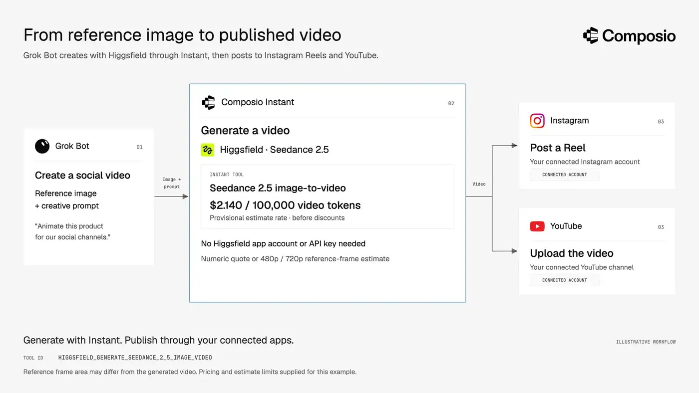
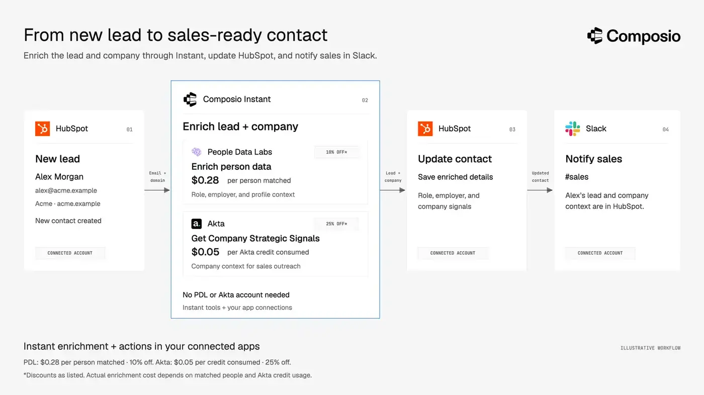

# Monid Alternatives

## Best Monid alternatives to consider in 2026

Monid is an API aggregator for AI agents that provides access to providers such as Apollo, Hunter, and Tavily through a single API and wallet. This reduces the need to manage multiple APIs and agent connectors and makes it easier to switch providers when one fails or returns no useful results. For example, if an agent cannot find a lead’s details in Apollo, it can try People Data Labs and then Hunter to complete the task.

This is a great interface for agents to get things done via a single wallet and a connector but API aggregation is one part of the puzzle. Monid as a true tool gateway leaves a few things to be desired.

One of those things is access to personal apps. For agents to be truly useful they should have controlled access your Gmail, CRMs, social media profiles, etc along with aggregated APIs. Additionally, cost, quality-of-life features, and how easily agents can discover and use the right tools all matter when choosing a platform.

This guide compares the top Monid alternatives across features, available tools, pricing, and how easy to use they are for users, developers and agents alike.

## Why consider an alternative to Monid?

Monid simplifies access to paid APIs through one interface and wallet. Whether you need an alternative depends on the workflows, account connections, and controls your agents require.

### What if you need to connect agents to personal apps?

Monid has tools for lead generation like Hunter, Apollo, and media generation like Higgsfield, Runway, etc. But, what would your agent do after finding leads, what would it do after creating a Higgsfield video?

You’d eventually want the agents to work with your personal accounts, CRMs like HubSpot, Salesforce or Google Sheet or your social media profiles like Instagram, LinkedIn, and Youtube. For that you’ll need external MCP connectors. Monid doesn’t have this.

For customer-facing products, you also need to manage each customer’s app connections, credentials, and token refresh separately.

### What if you need to use your own API key?

You may already have API accounts with unused credits, a paid subscription, or negotiated pricing. Bringing your own key lets your agent use those accounts without paying for the same provider through a separate wallet.

Monid’s hosted catalog runs requests through its provider accounts and wallet rather than your own API keys. If you want to keep using your existing provider accounts, consider an alternative with bring-your-own-key (BYOK) support, so you can access those services through the same tool gateway.

### What if your agent needs to react to events?

Some workflows begin when something changes in an app. When a lead enters HubSpot, an agent could enrich the contact, draft a follow-up, and notify your team in Slack.

Monid can supply the enrichment step, but it does not have built-in subscriptions to these app events. You may need a separate webhook handler or automation service to start the workflow. If event-driven automation is central to your application, compare platforms on trigger coverage and delivery reliability.

### What if finding the right tool is only the first step?

Monid’s [discover–inspect–run workflow](https://monid.ai/docs/guide/how-it-works) helps agents find endpoints and understand their inputs. Its [inspection API](https://monid.ai/docs/api/inspect) can also return operational notes, pitfalls, and next-step hints.

For longer tasks, evaluate how much guidance and coordination your agent still needs. Can it choose the right sequence of actions, pass results between tools, and recover from incomplete data?

Compare platforms using the same task—for example, finding verified contacts and preparing personalized follow-ups. Measure successful completion, human intervention, elapsed time, and total cost.

### **What if your company needs stricter security and deployment controls?**

Youma-that runs ’s own cloud or network. Monid lets you run your own proxy, but that proxy still sends requests to its hosted API. Its public docs don’t describe a self-hosted or private-cloud version, so you’ll need to check whether it supports that setup. If your security team requires the tool gateway to run inside your own infrastructure, you might need an alternative that does it well.

### What if you need to enforce boundaries on agent actions?

Monid provides workspace budgets and per-run spending caps to control tool usage costs. It also documents [building your own proxy](https://monid.ai/docs/integrations/proxy) to validate requests, allow or block endpoints, and transform responses.

These controls help manage spending and tool access. But an allowed tool can still be used inappropriately, and its results can contain malicious instructions. Monid’s public documentation does not describe built-in content-aware checks to block sensitive information from being sent or screen incoming results for prompt injection.

If your application needs these protections, you would need to add a separate enforcement layer or evaluate a platform that provides them.

## Best Monid alternatives at a glance

| Evaluation criteria | Monid | Composio | Treg | Orthogonal |
| --- | --- | --- | --- | --- |
| **Best suited for** | On-demand access to paid APIs | Combining on-demand access to paid APIs with users’ connected apps | Paid APIs alongside shared team tools and credentials | Paid API access with quotes and multiple payment options |
| **Paid APIs without individual provider accounts** | Yes, through one balance | Yes, through [Instant](https://docs.composio.dev/docs/instant-tools); | Yes, through its prepaid catalog | Yes, through one balance |
| **Managed app connections** | Not documented | Per-user connections, credential storage, and OAuth refresh | Limited apps for sociala, and analytics. | Yes, via Composio |
| **Bring your own provider API keys** | Supported in the local connector engine; not in the hosted service | Yes, your own key takes priority. | Yes; your own key takes priority | Not publicly documented |
| **Add your own tools** | Write a connector; run locally | Custom tools and toolkits are supported | Register private APIs, credentials, CLIs, and skills | Private-tool registration not documented |
| **Tool discovery** | Catalog search with price, health, and latency information | Search across available tools; relevant Skills can add task guidance | Catalog search with price, observed success, and speed information | Catalog search, endpoint schemas, prices, and quotes |
| **App events and automation** | Built-in app-event subscriptions not documented | Managed app-event triggers delivered to your application | Comparable app-event subscriptions not verified | Comparable app-event subscriptions not documented |
| **Agent controls** | Workspace budgets and per-run spending caps | Tool restrictions and Firewall policies, including prompt-injection protection | Team credential management; routed calls support a cost ceiling | Comparable content-aware enforcement not documented |
| **Deployment options** | Hosted service; connector engine can run locally | Cloud; private VPC and self-hosted options are available | Hosted or self-hosted registry | Hosted service; self-hosting not documented |
| **Pricing model** | Pay per use from one balance | Free tier and paid plans for managed ap; Instant usage billed separately | Catalog usage billed from a balance; own-key calls generally unmetered by Treg | Pay per call; no monthly platform subscription |

#### Summary:

- Composio is the best overall alternative. It offers almost everything out-of-the box: Paid APIs at excellent pricing, access to managed apps, developer tools to build.
- Treg is the best open-source alternative to Monid with support for custom APIs and MCP.
- Orthogonal is the developer tool alternative with better developer experience than Monid.

## 1. Composio

Composio combines pay-per-use API tools with managed connections to users’ own applications.

[Composio Instant](https://composio.dev/instant) is the closest direct comparison to Monid. Supported actions run on Composio’s provider accounts and charge a shared balance, without requiring separate provider accounts or API keys. The broader platform adds connections to apps such as Gmail, HubSpot, Google Sheets, and Slack. Your agents can access paid APIs and managed connections via the same MCP or CLI. See [setup guides](https://composio.dev/works-with) for AI apps.

### Why consider Composio over Monid?

You can use Composio as an individual user or also for building your product on top of it.

#### For users

**1. Pair Instant with your everyday apps.**

Composio offers 2,000+ on-demand API tools through Instant and 64,000+ tools across its broader catalog of [1,600+ apps and services,](https://composio.dev/toolkits) including Gmail, HubSpot, Instagram, and Google Sheets. This lets your assistant act on results in your own workspace. You authorize each account, and [Composio handles credential storage and token refresh](https://docs.composio.dev/docs/authentication).

For example, you could build a bot that generates UGC-style videos using Instant providers such as Higgsfield or fal, then publishes them through your connected social media accounts.

**2. BYOK**

Monid doesn’t support bringing your own API keys. Requests run through Monid’s provider accounts and are billed to its wallet, so you can’t use your existing provider keys or credits through Monid.

Composio gives you both options. If you connect your own API key for a provider, Composio uses it instead of charging your Instant wallet. If no key is connected, supported tools run through Instant using your shared balance.

**3. Get task guidance alongside tool discovery.**

When a relevant Skill exists, Composio’s search returns recommended steps and known pitfalls alongside matching tools. These usage-derived playbooks can help your agent perform prerequisite lookups and choose the right action sequence. [Skills documentation](https://docs.composio.dev/docs/skills). This can improve agent performance.

**4. Provider partnerships and offers.**

Composio has partnered with leading providers including Parallel, Exa, Bright Data, TinyFish, CarsXE, Luma Labs, Deepgram, Black Forest Labs, and Browser Use. Eligible tools may include partner credits, discounts, or launch offers that reduce usage costs.

#### For developers:

**1. Instant tools inside your product.**

Give your users access to supported search, scraping, enrichment, and generation tools without asking them to create provider accounts or supply API keys. Composio runs eligible actions on its provider accounts and charges your organization’s shared balance.

You can control which tools each agent session may use and enable charge reporting to track provider spending within your application. These tools can work alongside customers’ connected apps, such as Gmail or HubSpot.

Composio also provides Python and TypeScript SDKs to help you integrate Instant tools and managed app connections into your application.

See more in the [instant docs](https://docs.composio.dev/docs/instant-tools).

**2. Protect workflows that combine Instant with customer accounts.**

An agent might research prospects using Instant tools, then draft outreach through a customer’s Gmail connection. A retrieved page could contain malicious instructions asking the agent to forward private emails or disclose internal information.

[Composio Firewall](https://docs.composio.dev/docs/firewall) adds checks at these boundaries: it can screen incoming tool results for prompt injection and evaluate outgoing actions against configured policies before execution. This helps developers constrain how agents use information from Instant when acting through customers’ connected accounts.

**3. Start Instant-powered workflows from app events.**

When a new lead enters HubSpot, your agent could enrich the person’s profile with People Data Labs and research their company with Akta through Instant, then update the HubSpot contact and notify the sales team through the customer’s Slack connection.

Composio’s [built-in triggers](https://docs.composio.dev/docs/triggers) deliver events from connected apps to your application, giving your handler the signal to start that workflow. Composio manages provider connectivity, event delivery, retries, and signing; you supply the handler and agent logic.

### When Monid does better?

**Direct wallet payments through x402.**

Monid [supports paying for runs with USDC](https://monid.ai/docs/guide/pay-with-x402) rather than funding a workspace balance. Composio Instant uses payment from an organization’s prepaid balance. Monid may therefore suit agents already equipped with crypto wallets. Its x402 route has restrictions, including a **\$0.01 minimum payment** and no time-metered endpoints.

## 2. Treg

[Treg](https://treg.to/) combines a pay-as-you-go API catalog with a shared registry for your own tools and credentials. Like Monid, it lets agents discover and call paid APIs through one token and prepaid balance. At the time of writing, Treg advertises **4,000+ endpoints across 120 providers**, covering search, SEO, enrichment, social data, and media generation.

### Why consider Treg over Monid?

#### 1. More number of tools and providers

Treg advertises 4,000+ tools across 129 providers, compared with Monid’s 2,900+ tools across 93 providers. A broader catalog gives agents more options to find a suitable tool or try another provider when one returns incomplete results.

#### 2. Register your own tools alongside the public catalog

Treg lets you register your team’s APIs and credentials, then make them available to authorized agents through the same gateway. For example, an agent could enrich a lead through a catalog provider and call your internal API to update the record. [Treg documentation](https://github.com/superdesigndev/treg#share--use-your-own-tools)

Monid supports custom connectors through its open-source framework. You write and test a connector, then run it locally with your own credentials or submit it for review to join Monid’s shared catalog. Its public docs do not describe equivalent private-tool registration within a hosted workspace. [Monid connector guide](https://github.com/monid-ai/monid#writing-a-connector)

#### 3. Managed app connections

Treg has limited number of managed app connections for apps like Google Search Console, Analytics, Meta ads, or social platforms like Instagram, Tiktok, etc. This makes it useful for running SEO, paid ads, or social media posting much more convenient.

Monid as the date of writing does not have any managed connections.

#### 4. BYOK

Simillar to Composio, Treg lets you add your own API keys, so agents can use your existing provider accounts through the same gateway.

### Where Monid does better?

#### 1. Persistent files for workflows that reuse media

[Monid documents](https://monid.ai/SKILL.md#flow-2b-feed-a-local-file-to-an-endpoint-that-needs-a-public-url) a workspace file system with 1 GB of free storage, folders, file operations, and signed download URLs. Files remain until you delete them. This can be useful when an agent repeatedly uses product images or other reference assets across generation tasks.

[Treg’s documented](https://treg.to/skill.md#generate-video-images-voice-or-music) reference-media hosting accepts files up to 30 MB and keeps them for **seven days**, making it more suited to temporary uploads.

#### 2. More freedom to reuse the published code

Monid’s connector framework uses the [**MIT license**](https://github.com/monid-ai/monid/blob/main/LICENSE), which permits commercial modification and redistribution subject to its notice requirements. Treg[ license](https://github.com/superdesigndev/treg/blob/main/LICENSE) permits internal self-hosting but requires written authorization to offer its software as a hosted, managed, or embedded service to third parties.

If you plan to build a commercial product using the published code, Monid has fewer licensing restrictions. This applies to its connector framework, not a complete copy of Monid’s hosted platform.

## Orthogonal

[Orthogonal](https://www.orthogonal.com/) is a pay-as-you-go API gateway that gives agents access to search, scraping, enrichment, market data, and other external tools through one account and balance. It advertises **1,000+ API endpoints across 60+ providers**, with access through MCP, CLI, REST API, and a TypeScript SDK.

### Why consider Orthogonal over Monid?

Orthogonal leans more towards dev tool than a prosumer product like Monid. So,

#### 1. Developer tools for integrating paid APIs

Both Orthogonal and Monid let developers discover and call paid APIs through a shared balance. Orthogonal adds conveniences for moving those calls into application code.

**SDK and generated integration examples.** Orthogonal provides a TypeScript SDK and an `integrate` endpoint that generates SDK, HTTP, cURL, and payment examples. Monid documents direct REST calls with TypeScript and Python examples, but its public docs do not describe an equivalent code-generation endpoint. [Orthogonal integration docs](https://docs.orthogonal.com/api-reference/integrate) · [Monid API docs](https://monid.ai/docs/api/run)

**Price quotes before execution.** Orthogonal’s MCP `quote` tool checks a call’s price without running it or spending credits. Monid exposes pricing through discovery and inspection, alongside workspace budgets and per-run spending caps, but an equivalent standalone quote tool is not publicly documented. [Orthogonal MCP docs](https://docs.orthogonal.com/mcp/setup) · [Monid pricing discovery](https://monid.ai/docs/api/discover) · [Monid spending controls](https://monid.ai/SKILL.md)

**Batch calls through MCP.** Orthogonal supports up to 20 parallel API calls through `batch_use` and schema retrieval for up to 20 endpoints through `batch_get_details`. Monid documents individual execution requests, so developers would need to coordinate parallel calls in their own application. [Orthogonal batch tools](https://docs.orthogonal.com/mcp/setup) · [Monid execution API](https://monid.ai/docs/api/run)

#### 2. App connections through Composio

[Orthogonal](https://orthogonal.com) combines paid APIs with authenticated access to apps via Composio. Its[ launch documentation ](https://www.orthogonal.com/blog/composio-integrations-for-ai-agents)lists Gmail, Google Calendar, Slack, GitHub, Notion, Google Drive, and Google Sheets.

For example, an agent could find prospects through an enrichment API, organize the results in Google Sheets, and draft outreach through a connected Gmail account. This extends the workflow from retrieving data to acting on it in your workspace. Check the dashboard for current integration availability.

#### 2. Request-specific quotes and built-in batch calls

Orthogonal’s MCP server includes a `quote` tool that returns a call’s price without executing it or spending credits. This is useful when pricing depends on the request rather than a flat rate.

It also provides batch tools for executing up to **20 API calls in parallel** or retrieving details for 20 endpoints at once. An agent researching several companies can use these operations to group independent lookups. [MCP documentation](https://docs.orthogonal.com/mcp/setup)

Monid also exposes endpoint prices and supports concurrent calls through agent orchestration; the distinction here is Orthogonal’s explicit quote and batch operations.

#### 3. Generate integration code for discovered endpoints

After finding a useful endpoint, you can ask Orthogonal to generate an integration snippet. Its `integrate` operation supports the TypeScript SDK, direct HTTP requests, cURL, and x402 payment clients.

This can help developers turn an endpoint tested during an agent session into a repeatable application workflow. [Integration-code documentation](https://docs.orthogonal.com/api-reference/integrate)

### Where Monid does better?

#### **1. A larger advertised catalog.**

Monid lists **2,800+ tools across 90+ providers**, compared with Orthogonal’s **1,000+ endpoints across 60+ providers**. This offers more potential options, although you should compare coverage for your specific tasks.

#### **2. More information for choosing reliable tools.**

Monid exposes endpoint health, typical and tail response times—p50 and p95—and hints suggesting cheaper or better-fitting alternatives. Orthogonal’s documented endpoint details focus on parameters, verification, and pricing; equivalent live-health and latency fields are not documented there.

## Which Monid alternative should you choose?

| If your priority is… | Consider… | Why |
| --- | --- | --- |
| Paid API access | **Monid** | Agents can compare catalog providers before making a call. |
| Combining paid API tools with your personal or customers’ app accounts | **Composio** | Instant tools and managed app connections support workflows that research, create, and act. |
| Sharing your own API keys and private tools alongside a paid catalog | **Treg** | Its registry brings team credentials, custom APIs, CLIs, and catalog tools into one interface. |
| Paid API access with quotes and multiple payment methods | **Orthogonal** | Agents can inspect prices, request quotes, and pay through credits or supported payment protocols. |

Monid remains a useful choice when your main need is on-demand API access. Consider an alternative when the workflow also requires connected app accounts, private tools, or a different approach to payments and deployment. Start with the tools and controls your actual workflow needs, then compare the cost of running it.
