# The 10 Best People Search APIs in 2026

At different point of my career I have paid for Clay, People Data Labs, Apollo, ContactOut, and Hunter. And usually you need multiple of these services together cause you’re not getting every lead from one service alone.

I used Apollo to find people, the ContactOut extension to find emails Apollo missed, and Hunter to verify them before sending. Each plan had separate credits and a different renewal date. Some months, I used all my ContactOut credits in a week, while other months I barely used Hunter. But I still paid for all three every month.

Apollo has a big database, but it misses emails at small companies. ContactOut finds emails that Apollo can’t, but it costs more per contact. PDL has the deepest profile data, but it’s expensive if you only need an email. So most teams end up with three or four tools.

In this list, I compare the best and most used people search APIs that I haves used to find people and their contact details: what each one does well, where it falls short, and what it costs.

Then I show you how to use all ten from one Claude chat with Composio, with one balance and no extra fees.

---

#### Quick Comparison

| # | API | Best for | Cheapest useful call on Composio Instant |
| --- | --- | --- | --- |
| 1 | Apollo | Free people search with many filters | People Search: free |
| 2 | People Data Labs | Deep profile data and work history | Clean tools: free |
| 3 | ContactOut | Emails and phones from LinkedIn profiles | Availability check: free |
| 4 | Prospeo | Verified emails at a low price | Enrich Person: \$0.024 per email found |
| 5 | Lusha | Phone numbers and job change signals | \~\$0.125 per credit |
| 6 | Hunter | Finding emails by domain, and fast verification | Email Verifier: \$0.012 |
| 7 | Tomba | The lowest cost per found email | Find Email: \$0.017 per email found |
| 8 | LeadMagic | Teams with their own LeadMagic account | Enrich Company: \$0.020 per company |
| 9 | Icypeas | Finding LinkedIn URLs for a list of names | Count People |
| 10 | ZeroBounce | Deep email verification before you send | Validate Email: \$0.019 |

Quick Note: You can all the tools together from a single wallet via [Composio instant](https://composio.dev/instant). You don’t need subscriptions for all or API keys. Just one MCP server. That’s all.

---

#### How I Picked These

I looked at four things for each API:

- **Data quality:** how often the email or title is correct when I check it.
- **Coverage:** how many of my target people it finds, especially at companies with fewer than 200 employees.
- **Cost per useful result:** what I pay for each email or profile that I actually use.
- **Fit with AI agents:** if Claude can call it through [Composio Instant](https://composio.dev/instant) without a separate account.

---

### [1. Apollo](https://www.apollo.io)

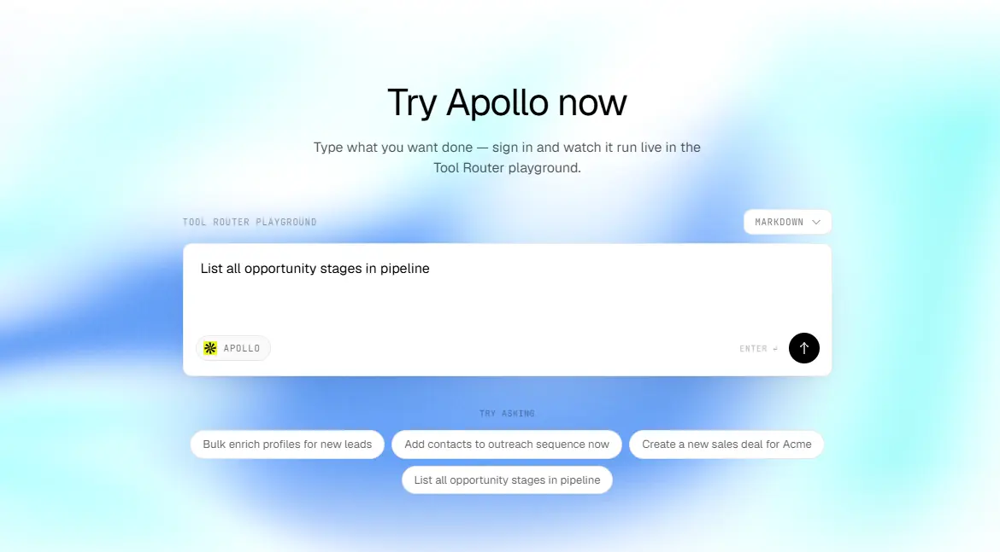

**Best for:** finding people with detailed filters, at no cost for the search.

Apollo is where most sales teams start. You can search by title, seniority, company size, location, industry, and company domain, and you can combine these filters in one query.

**What it does well**

The search is free on Composio Instant, and that’s the main reason I put Apollo first. You can run as many searches as you want to build a list, and you only pay when you enrich a person to get their email. Apollo also has strong company data, like headcount, funding, tech stack, job postings, and news. So you can qualify the company and find the person with one tool.

**Where it falls short**

[Apollo’s search results don’t include emails](https://docs.apollo.io/reference/people-api-search), and last names are often hidden until you enrich the person. At small companies, Apollo often has the person but no email, or an old email.

**On Composio Instant**

| Tool | Cost |
| --- | --- |
| People Search | Free |
| People Enrichment (single and bulk) | \~\$0.02 to \$0.18 per person |
| Organization Search | \~\$0.02 per page |
| Organization Enrichment, Job Postings, News | \~\$0.02 per call |

You need your own Apollo account for contacts, sequences, and deals. See [**how to connect Apollo to Claude Code**](https://composio.dev/toolkits/apollo/framework/claude-code)[.](https://composio.dev/toolkits/apollo/framework/claude-code)

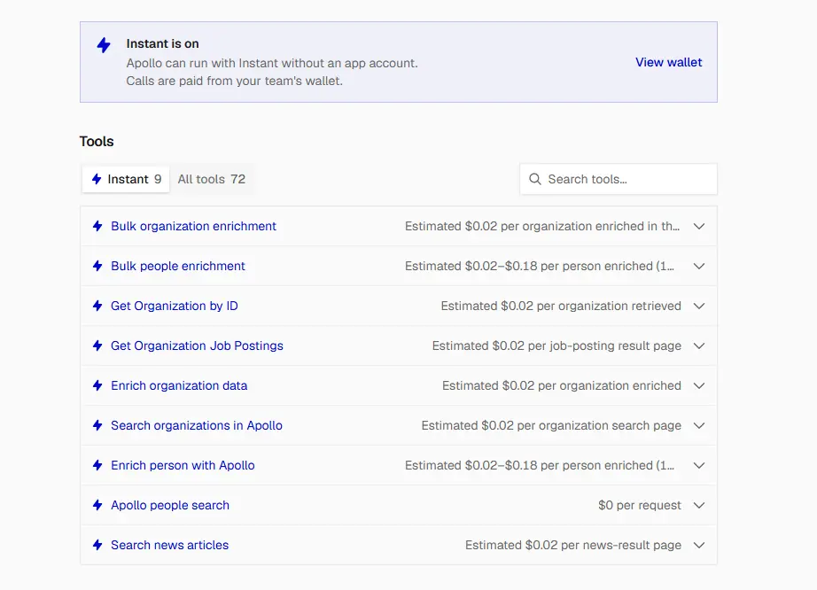

**Try this prompt**

```text
Use Apollo People Search through Composio Instant to find VPs and
Directors of Marketing at US software companies with 50 to 200
employees. Show 25 results with name, title, company, and
LinkedIn URL. Don't enrich anyone yet.
```

---

### [2. People Data Labs (PDL)](https://www.peopledatalabs.com)


**Best for:** deep profile data, like full work history, education, skills, and seniority.

PDL sells raw data to developers. It doesn’t have a sales app or a Chrome extension. You send it a name, an email, or a LinkedIn URL, and it returns a full profile with every job the person has had.

**What it does well**

[PDL](https://docs.peopledatalabs.com/docs/enrichment-api) returns the most complete profiles on this list. That matters when you need more than an email, for example when you want to know if someone worked at a competitor or how long they’ve been in their role. PDL only charges when it finds a match, and you can tell it to return a match only if the record has a work email. So you don’t pay for profiles without the data you need. Its clean tools are free, and they fix messy company names and locations before you search.

**Where it falls short**

PDL costs the most per person on this list. If you only need an email, Tomba or Prospeo costs much less. PDL data also updates in releases, so a job change can take some time to show up.

**On Composio Instant**

| Tool | Cost |
| --- | --- |
| Clean Company, Clean Location, Clean School | Free |
| Enrich Company, Search Companies | \$0.10 per company |
| Enrich Person, Search People | \$0.28 per person |
| Identify Person | \$0.55 per request |

**Try this prompt**

```text
Use PDL Enrich Person through Composio Instant for this LinkedIn
URL: [URL]. Set min_likelihood to 6, and require work_email.
Show me their current title, time in role, last three jobs, and
work email.
```

---

### [3. ContactOut](https://contactout.com)

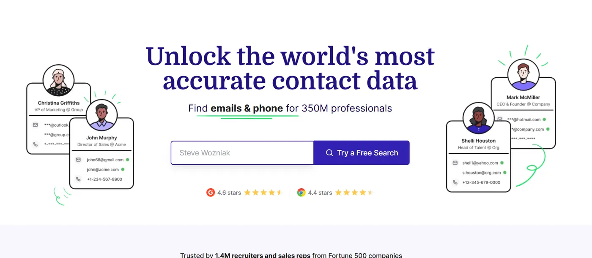

**Best for:** getting work emails and phone numbers from LinkedIn profiles.

ContactOut started as a Chrome extension for recruiters, and it still has some of the best email and phone coverage from LinkedIn profiles. Its API gives you the same data.

**What it does well**

ContactOut often finds emails that Apollo misses, especially at smaller companies. It has a [free tool](https://composio.dev/toolkits/contactout/framework/claude-cowork) that checks if a profile has a work email or a phone number, without revealing it. So you can check first and pay only for the people who have data. Its people search also has a filter for people who changed jobs in the last three months, and that is one of the best buying signals in B2B sales.

**Where it falls short**

Contact reveals cost more than the email finders on this list. On Instant, you can’t use ContactOut’s email verifier or personal emails.

**On Composio Instant**

| Tool | Cost |
| --- | --- |
| Count People, Check Contact Availability | Free |
| Search People, List Decision Makers | \~\$0.02 per profile |
| Get LinkedIn Contact Info | \~\$0.143 per email found, \~\$0.143 per phone found |

**Try this prompt**

```text
For each of these LinkedIn URLs, use ContactOut to check which ones
have a work email or phone. Don't reveal anything yet. Show me a
yes or no for each, and the total cost to reveal them.
```

---

### [4. Prospeo](https://prospeo.io)

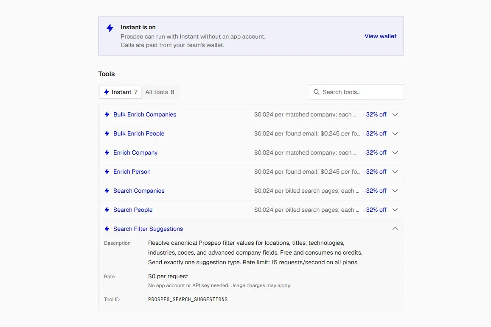

**Best for:** verified work emails at a low price, with strong search filters.

Prospeo has a people search and an enrichment API. You can find people by title, seniority, department, company size, and location, and then enrich them to get their email or mobile.

**What it does well**

Prospeo’s search returns up to 25 people per page, and it costs one credit per page instead of one per person. That makes it a cheap way to build a list. Its enrichment has a “verified email only” setting, so you only get emails that Prospeo has verified. [It doesn’t charge](https://prospeo.io/api-docs/bulk-enrich-person) when it finds no match, and it doesn’t charge again if you enrich the same person within 90 days.

**Where it falls short**

Mobile numbers cost ten times more than emails. Some advanced search filters, like funding, tech stack, and job change, depend on the plan, so they may not work on every account.

**On Composio Instant**

| Tool | Cost |
| --- | --- |
| Search People | \$0.024 per page (up to 25 people) |
| Enrich Person (single and bulk up to 50) | \$0.024 per email found |
| Enrich Person with mobile | \$0.245 per mobile found (includes email) |
| Bulk Enrich Companies | \$0.024 per company matched |

**Try this prompt**

```text
Use Prospeo Bulk Enrich People through Composio Instant for this
list. Use the LinkedIn URL when you have it, or the name and company
website. Set only_verified_email to true. Show the email for each
person, and mark the people with no match.
```

---

### [5. Lusha](https://www.lusha.com)

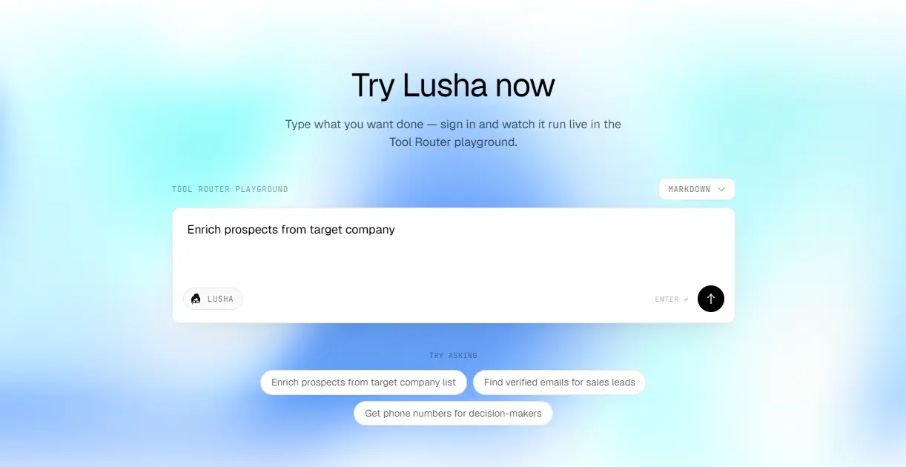

**Best for:** direct phone numbers and signals like promotions and job changes.

Lusha is popular with sales teams that make calls. It has a prospecting search with company and contact filters, and an enrichment tool that reveals emails and phone numbers.

**What it does well**

Lusha’s prospecting search has [filters for signals](https://docs.lusha.com/apis/openapi/signals), like people who got a promotion or moved to a new company, and for company data like funding, revenue, technologies, and intent topics. You can also cap the number of contacts per company, so you don’t pay for ten people at one account. It’s a good choice when your team calls prospects as well as emails them.

**Where it falls short**

Lusha costs more per credit than the email finders, and the credits for each call depend on what you request and what Lusha returns. So check your execution logs after the first few calls.

**On Composio Instant**

| Tool | Cost |
| --- | --- |
| Prospect Contacts (search by filters) | \~\$0.125 per credit |
| Search Contacts | \~\$0.125 per credit |
| Enrich Contacts (emails and phones) | \~\$0.125 per credit |
| Search and Enrich Contacts | \~\$0.125 per credit |

**Try this prompt**

```text
Use Lusha Prospect Contacts through Composio Instant to find Heads
of Sales in the US who changed companies in the last 90 days, at
B2B software companies with 50 to 500 employees. Return at most
one person per company. Show name, title, and company. Don't reveal
phones or emails yet.
```

---

### [6. Hunter](https://hunter.io)


**Best for:** finding emails by domain, and verifying emails before you send.

Hunter is one of the oldest tools in this space. It finds email addresses that a company has published on the web, and it uses them to guess the email pattern for each domain.

**What it does well**

Hunter’s Email Verifier is fast and cheap, at \$0.012 per check. It returns valid, invalid, accept-all, unknown, webmail, or disposable, and I run every email through it before I send. Hunter’s Domain Search also shows you the email pattern at a company, like [first.last@company.com](mailto:first.last@company.com).

**Where it falls short**

Hunter needs a name and a domain to find an email, so you can’t use it to search for people by title. It doesn’t return phone numbers, and it has lower coverage for people who don’t appear on the web.

**On Composio Instant**

| Tool | Cost |
| --- | --- |
| Email Finder | \$0.024 per email found |
| Domain Search | \$0.024 per search (1 to 10 emails) |
| Email Verifier | \$0.012 per verification |

**Try this prompt**

```text
Use Hunter Email Verifier through Composio Instant to check each
email in this list. Mark each one as valid, invalid, accept-all,
or unknown, and tell me which ones are safe to send to.
```

---

### [7. Tomba](https://tomba.io)

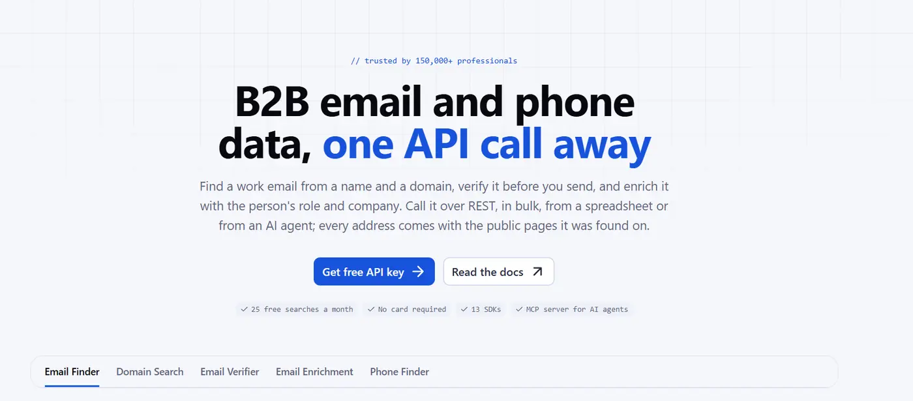

**Best for:** finding emails at the lowest cost per result.

Tomba does a lot of what Hunter does. It finds emails from a name and a domain, it searches a domain for contacts, and it verifies emails. It can also find emails from a LinkedIn URL and look up phone numbers.

**What it does well**

Tomba has the lowest price per found email on Composio Instant, and it only charges when it finds an email. That makes it the best first tool to try when you look for emails. Its LinkedIn email finder also means you don’t need to know the company domain.

**Where it falls short**

Tomba has smaller coverage than ContactOut for hard-to-find people, so you will still need a second tool for some contacts. It doesn’t search for people by title.

**On Composio Instant**

| Tool | Cost |
| --- | --- |
| Find Email, Find Email from LinkedIn | \$0.017 per email found |
| Search Domain Contacts | \$0.017 per search (up to 10 emails) |
| Verify Email | \~\$0.008 per credit |

**Try this prompt**

```text
For each person in this list, use Tomba Find Email through
Composio Instant with their name and company domain. Show me the
email and confidence score for each. Mark the people with no
email found.
```

---

### [8. LeadMagic](https://leadmagic.io)

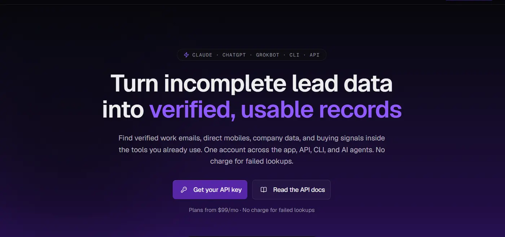

**Best for:** teams that already have a LeadMagic account.

LeadMagic has a full set of B2B data tools: people search, work email finder, mobile finder, email validation, and a tool that finds a person by role at a company.

**What it does well**

LeadMagic doesn’t charge when it finds no result, for both emails and mobiles. Its “find person by role” tool is useful when you know the company and the role, but not the name. For example, you can ask for “Head of Marketing at company.com” and get one person back.

**Where it falls short**

On Composio Instant, LeadMagic only covers company enrichment. To use its people search, email finder, and mobile finder, connect your own LeadMagic account through Composio.

**On Composio Instant**

| Tool | Cost |
| --- | --- |
| Enrich Company | \$0.020 per company |
| People search, email finder, mobile finder | Your own LeadMagic account |

**Try this prompt (with your own account)**

```text
Use LeadMagic to find the Head of Marketing at each of these
company domains. Then find their work email. Show name, title,
email, and the credits used.
```

---

### [9. Icypeas](https://www.icypeas.com)

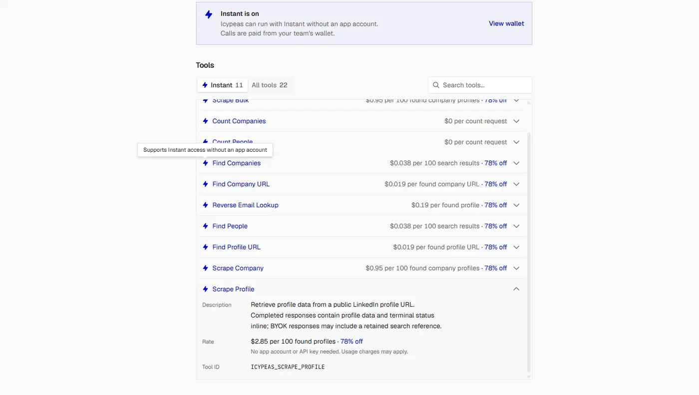

**Best for:** finding LinkedIn profiles and pulling profile data in bulk.

Icypeas is popular with outbound agencies. It finds people by filters, finds LinkedIn URLs from a name or email, and pulls profile data for many profiles at once.

**What it does well**

Icypeas is useful when you have names and emails but no LinkedIn URLs. It finds the LinkedIn profile for each person, and then ContactOut or PDL can use that URL to find more data. It also counts people for a set of filters, so you can check the size of a market before you search.

**Where it falls short**

On Instant, Icypeas can’t find or verify emails. You need your own Icypeas account for that.

**On Composio Instant**

| Tool | Cost |
| --- | --- |
| Count People | Free |
| Find People | \$0.038 per 100 results |
| Find Profile URL(single and bulk) | \$0.019 per profile found |
| Scrape Profile | \$2.85 per 100 profiles found |
| Find LinkedIn Profile by Email, Bulk Scrape | Check execution logs |

**Try this prompt**

```text
Use Icypeas through Composio Instant to find the LinkedIn profile
URL for each person in this list, using their name and company.
Show me the URL, or "not found".
```

---

### [10. ZeroBounce](https://www.zerobounce.net) (for Email Verification)


**Best for:** checking emails before you send, especially catch-all emails.

ZeroBounce doesn’t search for people. But every list in this guide ends with emails that you plan to send to, and ZeroBounce checks those emails more deeply than the other verifiers here. So it completes the list.

**What it does well**

Most verifiers tell you if an email is valid or invalid. ZeroBounce also flags spam traps, abuse emails, and disposable addresses. These are the emails that hurt your sender reputation the most. It also helps with catch-all emails. A catch-all domain accepts every email, so most verifiers can’t tell if the address exists. [ZeroBounce’s AI Scoring](https://zerobounce.net/docs/frequently-asked-questions/questions-about-our-services/what-makes-zerobounce-technology-superior) gives each email a quality score, so you can decide which ones are safe to send to.

**Where it falls short**

At list price, ZeroBounce costs more per check than Hunter. But Composio's discount on ZeroBounce is larger, and in my run AI Scoring cost about \$0.003 per email, less than Hunter's verifier. Use other tools to find emails, and use ZeroBounce only to check them.

**On Composio Instant**

| Tool | Cost |
| --- | --- |
| Validate Email | \$0.019 per validation |
| Batch Validate Emails (up to 200) | \$0.019 per validation |
| Activity Data | \~\$0.019 per matched record |
| AI Scoring | \~\$0.003 per email (from my run) |

**Try this prompt**

```text
Use ZeroBounce Batch Validate through Composio Instant to check
every email in this list. Remove invalid, spam trap, abuse, and
disposable emails. For catch-all emails, use AI Scoring, and keep
only the ones with a high score.
```

---

### Which One Should You Use?

| If you want to... | Use |
| --- | --- |
| Build a list of people for free | Apollo People Search |
| Build a list at a low cost per page | Prospeo Search People |
| Know everything about one important prospect | PDL Enrich Person |
| Find emails and phones from LinkedIn URLs | ContactOut |
| Find people who just changed jobs | ContactOut or Lusha |
| Get direct phone numbers | Lusha or ContactOut |
| Find an email at the lowest cost | Tomba, then Prospeo |
| Find LinkedIn URLs for a list of names | Icypeas |
| Verify emails fast and cheap | Hunter |
| Check catch-all and risky emails | ZeroBounce |

For most teams, the answer is “more than one.” Each tool finds some people that the others miss.

---

### How to Use All 10 Together with Composio

If you sign up for each tool, you get ten accounts, ten API keys, and ten bills. Composio removes all of that.

**One wallet.** You add money to one Composio balance, and every tool charges against it. You don’t need an account or an API key for Apollo, PDL, ContactOut, Prospeo, Lusha, Hunter, Tomba, Icypeas, or ZeroBounce. You get an initial \$2 credit to test. That covers the email workflow in this guide (\$0.34 for 10 people), but not the optional phone and PDL step (\$2.45).

**Zero markup.** Composio charges you the vendor’s own price for each call, and it doesn’t add a fee on top. For some tools, the price on Instant is even lower than buying direct.

**Pay per call.** You don’t pay monthly subscriptions. If you don’t use Lusha this month, you don’t pay for Lusha this month.

This also lets Claude do something that is hard to do by hand: try the cheapest tool first, and move to the next tool only for the people that the first one couldn’t find.

### **Step 1: Add Composio to Claude (One-time process)**

1. Open the [Composio \<\> Claude](https://claude.ai/customize/connectors?modal=add-custom-connector&connectorName=Composio&connectorUrl=https%3A%2F%2Fconnect.composio.dev%2Fmcp) .
2. This opens Claude's custom connector dialog.


1. Click **Continue**.
2. On the next screen, click **Add**.


1. You'll be redirected to Composio's sign-in page. Log in (or create a free account) and approve the connection.


Then:

1. Return to Claude and confirm Composio shows as enabled under Connectors.


You only need to do this once, no matter how many Google accounts you connect afterward. For more ways to add Composio, see [**how to add tools and integrations to Claude Desktop**](https://composio.dev/content/how-to-add-tools-and-integrations-to-claude-desktop)[.](https://composio.dev/content/how-to-add-tools-and-integrations-to-claude-desktop)

---

### Step 2: Understand Instant Tools

#### Quick check

Start a new chat and ask:

> Which people search and email tools can you use through Composio Instant?

If Claude lists Apollo, PDL, ContactOut, Prospeo, Lusha, Hunter, Tomba, Icypeas, and ZeroBounce, you’re ready.

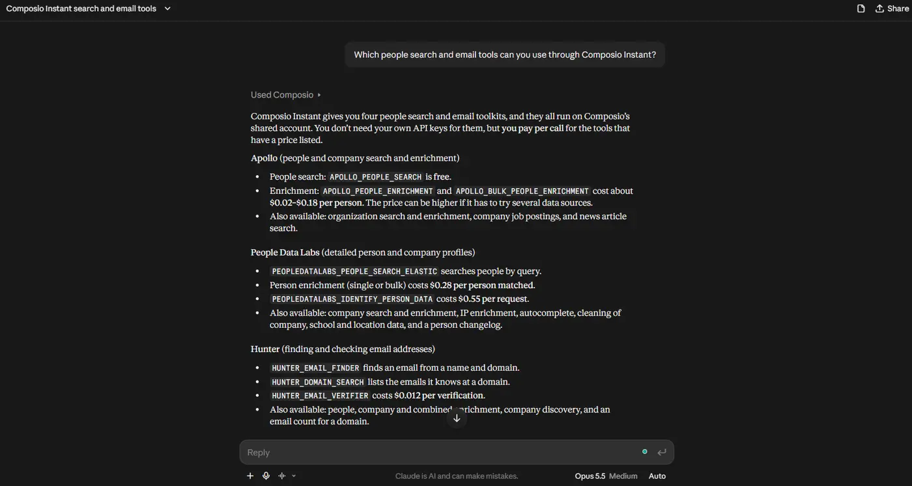

#### Step 3: Find People with the Free Search

Start with Apollo, because the search is free.

The search is free, but Apollo hides last names in search results, so you need enrichment to get the full name, domain, and LinkedIn URL that the email tools need.

```text
Use Apollo People Search through Composio Instant to find Heads of
Sales and VPs of Sales at US B2B software companies with 50 to 200
employees. Get 10 people. Then use Apollo People Enrichment to get
each person's full name, company domain, and LinkedIn URL. Tell me
the enrichment cost before you run it.
```

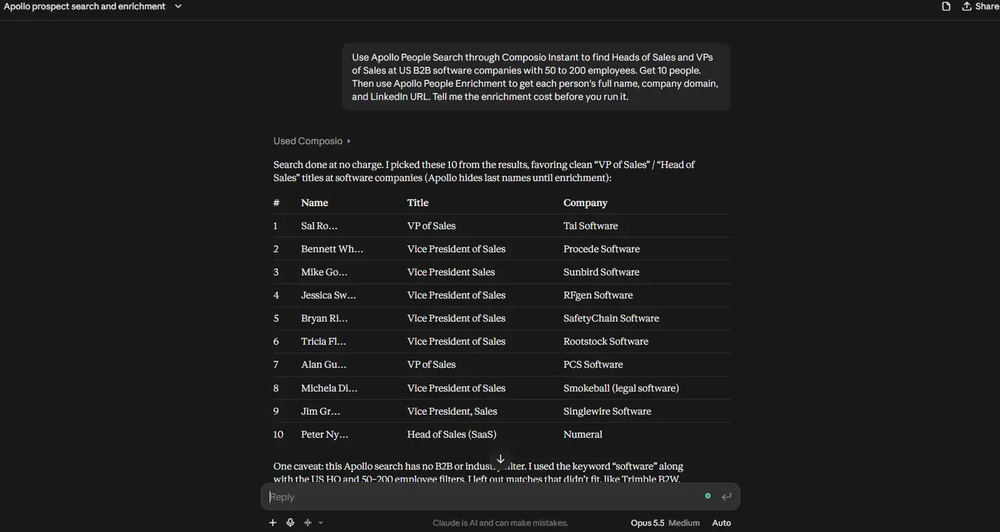

#### Step 4: Find Emails in the Cheapest Order

Now ask Claude to find emails, and tell it which tool to try first. I use this order, from the cheapest to the most expensive:

```text
Find a work email for each person in the list. Use this order:

1. Tomba Find Email with name and domain.
2. If Tomba finds nothing, try Prospeo Enrich Person with
   only_verified_email set to true.
3. If Prospeo finds nothing, try Hunter Email Finder.
4. If Hunter finds nothing, use ContactOut's free availability
   check on their LinkedIn URL. Reveal the email only if it shows
   a work email is available.
5. If none of them find an email, mark the person as "no email".

Show me which tool found each email. Tell me the estimated cost
before you start step 4.
```

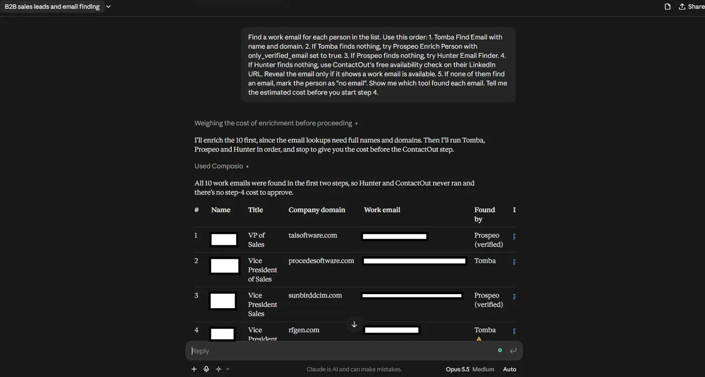

#### Step 5: Verify Every Email

Different tools find emails in different ways, so verify all of them before you send.

```text
Use Hunter Email Verifier to check every email we found. Remove
the invalid ones. For accept-all emails, use ZeroBounce AI Scoring,
and keep only the ones with a high score.
```

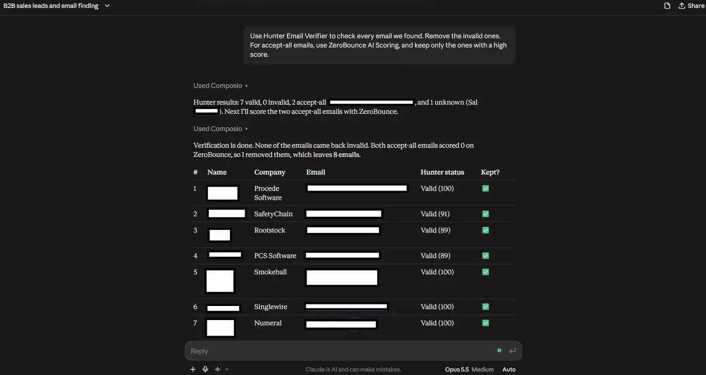

#### Step 6: Add Phones and Deep Data for Your Top Prospects

You don’t need phones and full profiles for everyone, because they cost more. Get them only for your best prospects. In this example I ran it on all 10 people to show the cost. On a bigger list, pick your top few.

```text
For the 10 people with the most senior titles:
1. Use ContactOut to reveal a phone number, if one is available.
2. Use PDL Enrich Person with their LinkedIn URL. Show time in role,
   previous companies, and flag anyone who worked at [competitor].
```

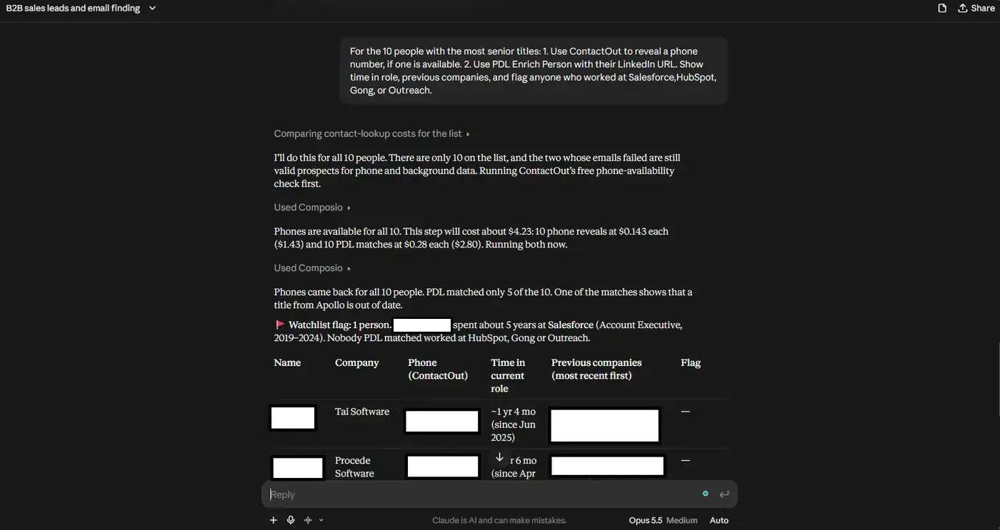

#### Step 7: Save the List

[Connect Google Sheets](https://composio.dev/content/connect-claude-to-google-sheets) or your CRM through Composio, and ask Claude to save the final list. Google Sheets and CRMs are not on Instant, so you connect your own account once.

```text
Connect my Google Sheets account through Composio. Then create a
sheet called "Sales Leaders - October 2026" with these columns:
Name, Title, Company, Email, Email Status, Found By, Phone,
LinkedIn URL.
```

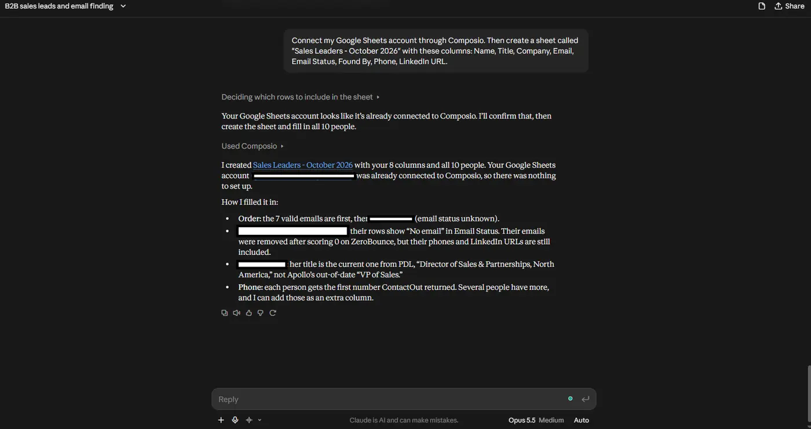

For a full lead generation workflow with scoring and email drafts, see our guide on [how to generate leads with Claude](https://composio.dev/content/how-to-generate-leads-with-claude-step-by-step-guide).

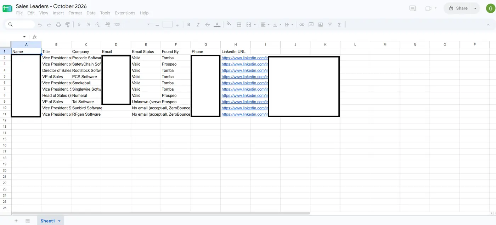

---

#### What This Costs

These are the actual charges from one run of 10 people. Your numbers depend on how many emails each tool finds.

| Step | Tool | Results | Cost |
| --- | --- | --- | --- |
| Search people | Apollo People Search | 10 people picked (4 searches) | Free |
| Get full names, domains, LinkedIn URLs | Apollo Bulk People Enrichment | 10 enriched | \$0.20 |
| Find emails, first try | Tomba Find Email | 10 tried, 6 found | \$0.01 |
| Find emails, second try | Prospeo Enrich Person (verified only) | 4 tried, 4 found | \$0.07 |
| Find emails, third try | Hunter Email Finder | Not needed | \$0 |
| Check the rest | ContactOut availability check | Not needed | \$0 |
| Reveal emails that exist | ContactOut Get Contact Info | Not needed | \$0 |
| Verify all emails | Hunter Email Verifier | 10 checked: 7 valid, 2 accept-all, 1 unknown | \$0.05 |
| Score accept-all emails | ZeroBounce AI Scoring | 2 scored, both 0, removed | \$0.01 |
| **Total** |  | **8 emails kept (7 valid, 1 unknown)** | **\~\$0.34** |

That’s about 5 cents per valid email, Apollo enrichment included. The email-finding steps alone cost \$0.08 for 10 emails. Revealing all 10 through ContactOut would have cost about \$1.43.

**Optional extras we added:**

| Step | Tool | Results | Cost |
| --- | --- | --- | --- |
| Check for phones | ContactOut availability check | 10 checked, 10 available | Free |
| Reveal phones | ContactOut Get Contact Info | 10 found | Combined: \$2.45 |
| Job history | PDL Enrich Person (bulk) | 10 tried, 5 matched | (with phones above) |
| Export | Google Sheets | 1 sheet, 10 rows | Free |
| **Grand total** |  |  | **\~\$2.79** |

The phone and job-history lookups were one call, so Composio billed them as a single \$2.45 charge. That was less than the listed prices suggested (\$1.43 + \$1.40), because Composio discounts some tools.

A few things to keep in mind:

- **Apollo search hides last names.** You need the enrichment step (about 2 cents per person) to get the full name and domain that the email finders use.
- **Failed lookups are free.** Tomba billed only for its 6 hits, and PDL billed only for its 5 matches, so the fallback order costs less than it looks.
- **Expect some emails to need a second check.** Hunter flagged 3 of 10 as accept-all or unknown even though Tomba and Prospeo had marked them valid.
- **Composio checks your balance after each call.** It doesn’t work as a strict spending limit, so add a small amount first and watch the execution logs.
- **Check the dashboard for exact amounts.** The costs above come from the charges Composio reported after each call, rounded to the nearest cent.

---

#### Use This Data the Right Way

- Check the rules where your prospects live. GDPR applies in the EU and UK, and [CAN-SPAM ](https://www.ftc.gov/business-guidance/resources/can-spam-act-compliance-guide-business)applies in the US.
- Use work emails for B2B outreach. Don’t load personal emails or phone numbers into a cold email tool.
- Check phone numbers against Do Not Call lists before you call.
- Verify every email before you send. Bounced emails hurt your domain’s sender reputation.
- Include a clear way to opt out in every email.

---

#### Wrapping Up

If you only pick one tool, pick Apollo, because the search is free and it covers the most use cases. But if you want the most emails at the lowest cost, use more than one, and let Claude try them in order from the cheapest to the most expensive.

That was the change that saved me the most money. I stopped paying for three subscriptions, and now I pay a few cents for each email that I actually use.

If you use a people search API that isn’t on this list, let me know.
