# Top 10 AI Sandbox Providers I'd Actually Use in 2026

AI agents are getting crazy good at writing code.

The problem starts when you let them actually run it.

Giving an agent direct access to your application, filesystem, credentials, or local machine is probably not the best idea. Especially when the code it wants to execute was generated by itself a couple minutes ago.

> This really is the case with almost everyone nowadays, we just don’t like to admit it. 🥱

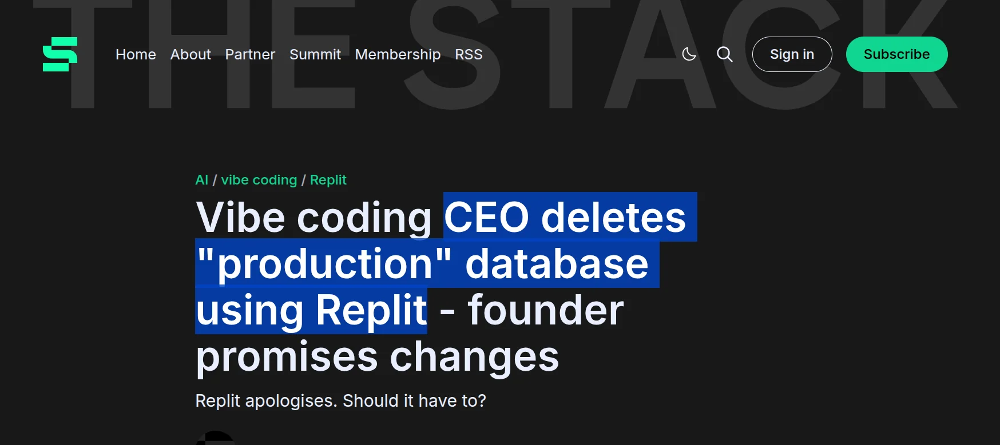

He’s the same founder. You don’t want to end up like this. 😪

That is basically why AI sandboxes have become such an important part of agent infrastructure.

You give the agent an isolated computer. It can write files, install packages, run commands, start servers, test code, and break things without breaking your actual system.

You can find tons of providers on the internet. Some are basically disposable computers. Some focus heavily on GPUs. Some give agents persistent development environments. Others combine code execution with tools, authentication, storage, or the rest of your agent stack.

So I went through the major options and picked the ones I would actually consider using today. ✅

> ⚠️ **Quick note **This is not a scientific ranking, but my picks. The right sandbox depends heavily on what your agent is doing.

## TL;DR — Best AI Sandbox providers

| # | Provider | I would use it for |
| --- | --- | --- |
| 1 | **Composio Sandboxes** | Agents that need code execution plus real tools and authenticated apps |
| 2 | **E2B** | General purpose agent sandboxes with a mature developer experience |
| 3 | **Tensorlake** | Persistent agent computers, filesystems, Git, and long running agent work |
| 4 | **AWS Lambda MicroVMs (Firecracker)** | Firecracker isolated sandboxes inside AWS without managing the virtualization layer |
| 5 | **Daytona** | Fast full development environments and GPU workloads |
| 6 | **Modal Sandboxes** | Large scale compute, ML workloads, RL, and GPUs |
| 7 | **Vercel Sandbox** | Code generation, previews, and web development agents |
| 8 | **Cloudflare Sandboxes** | Agents already running on Workers and the Cloudflare stack |
| 9 | **boat.dev** | Persistent full Linux VMs, coding agents, Docker, and desktop workflows |
| 10 | **Northflank** | Isolated agent sandboxes, GPUs, persistent storage, and BYOC infrastructure |

You definitely do not need all ten. Let’s get into what actually makes each one different and when to use what based on what you need.

## What is an AI sandbox

An AI sandbox is an isolated environment where an agent can execute code without getting unrestricted access to the machine running your application.

Think about a coding agent.

It might need to clone a repository, edit files, install dependencies, run `npm test`, start a server, check the output, and fix whatever it broke.

Running all of that directly inside your production infrastructure would be crazy.

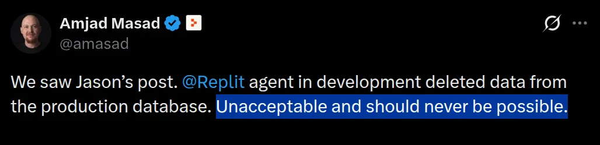

A sandbox gives that work its own boundary.

Depending on the provider, that environment could be a container, microVM, full VM, or another isolated runtime.

You increasingly get persistent filesystems, networking controls, shells, preview URLs, GPUs, secrets, storage, and sometimes even the tools the agent needs to interact with the outside world.

Enough setup.

Here are the ones I would look at.

## 1. Composio Sandboxes

> ℹ️ Best when your agent needs both a computer and authenticated tools.

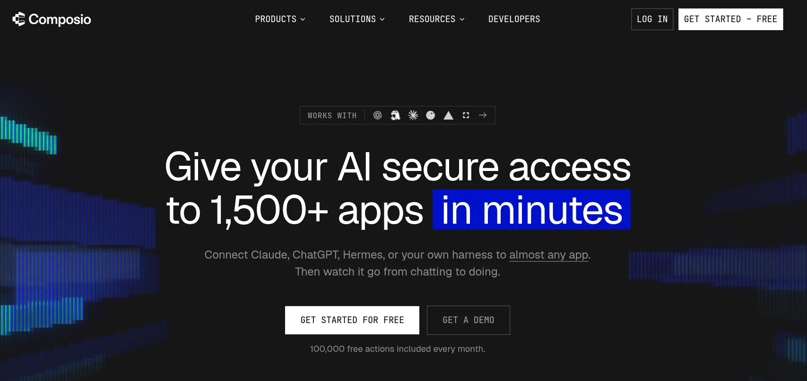

Most sandboxes solve one problem really well. They give the agent somewhere safe to execute code.

Composio takes a different route because the sandbox sits next to the tool layer your agent is already using.

The Remote Sandbox gives your agent a persistent Python environment where it can write and execute code while accessing Composio tools. State survives across calls inside the session, and the agent can also execute shell commands.

That combination becomes pretty useful for agents doing actual work.

Your agent can fetch something from GitHub, transform it with Python, call another authenticated application, write files, run shell commands, and continue working inside the same session.

There is also a Local Sandbox option.

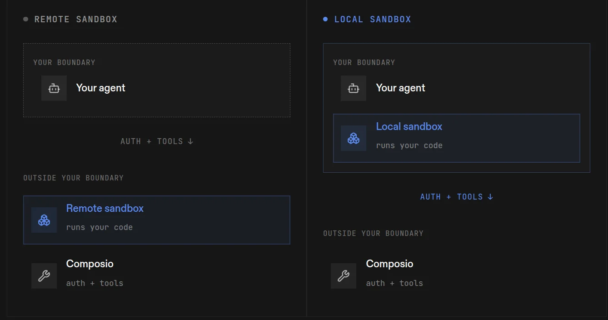

Instead of executing code inside Composio’s hosted sandbox, you can run it inside your own VM, container, CI worker, Kubernetes job, while still using Composio for tools and authentication.

### What it does

- Gives agents a persistent Python execution environment
- Runs shell commands through the remote bash tool
- Lets sandbox code call authenticated Composio tools
- Supports helpers for web search and optional LLM calls
- Keeps state across calls inside a session
- Offers both managed remote execution and a local execution model
- Lets local environments keep code execution inside your own security boundary

The local model is especially useful when your agent touches sensitive repositories or internal data.

Your agent keeps using the same helper interface while you control where its code actually executes.

### 💡 **When I would pick it**

I would use Composio when sandbox execution is only one part of a larger agent workflow.

If the agent needs to execute code and then work across GitHub, Slack, Salesforce, Gmail, databases, or other applications, having the execution and tool layer connected makes a lot of sense.

If all you need is raw disposable compute, there’s some other options for you.

**Resources**

- [Remote Sandbox documentation](https://docs.composio.dev/docs/sandbox/remote)
- [Local Sandbox documentation](https://docs.composio.dev/docs/sandbox/local)

## 2. E2B

> ℹ️ Probably the first name you’ll come across when looking for AI sandboxes.

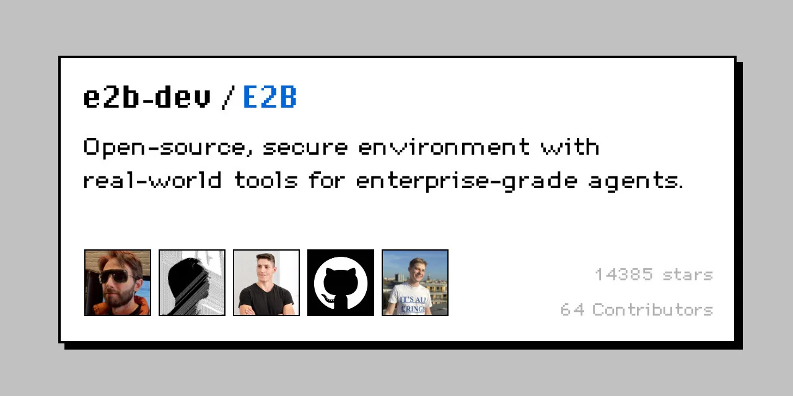

E2B is pretty much built around one idea. Give every agent its own isolated computer.

Each sandbox runs inside a microVM with its own filesystem, kernel, networking, and runtime environment.

The developer experience is probably its biggest advantage.

You create a sandbox, write some files, run commands, expose a port if needed, and destroy or pause it when you’re done.

Nothing too complicated.

E2B also works across a bunch of agent frameworks and coding setups, which is one reason it has become such a common default for agent code execution.

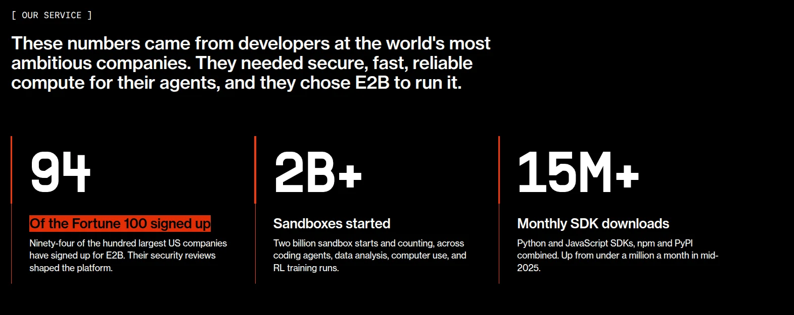

### What it does

- Runs each sandbox inside an isolated microVM
- Gives agents filesystem and shell access
- Supports command execution and file manipulation
- Lets you expose running applications through URLs
- Supports snapshots, pause, and resume
- Works well with parallel agent workloads

### 💡 **When I would pick it**

If I simply needed a general purpose sandbox for an agent, E2B would probably be one of the first options I would try.

It does the core sandbox stuff really well without making the setup unnecessarily complicated.

**Resources**

- [E2B](https://e2b.dev/)
- [E2B Documentation](https://e2b.dev/docs)

## 3. Tensorlake

> ℹ️ Best when your agent needs a persistent computer more than a disposable sandbox.

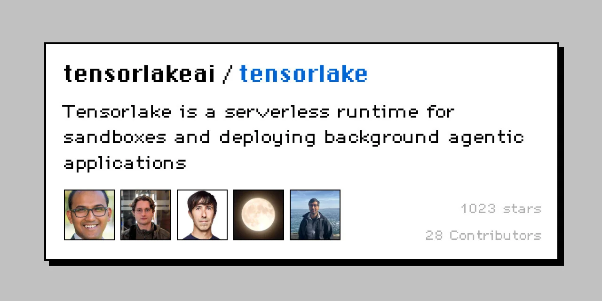

Tensorlake gets interesting when disposable environments aren’t enough.

Its sandboxes give agents a filesystem, shell, packages, and processes, but you can also keep that environment around instead of recreating everything for every task.

Sandboxes can sleep when they’re inactive and wake again later.

Tensorlake also combines this with hosted Git and a versioned filesystem, which makes it especially useful for coding agents or long running tasks where the generated files actually matter.

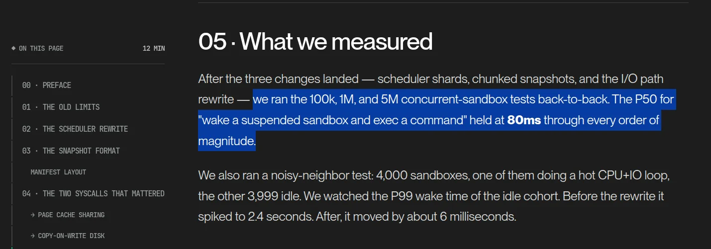

Instead of treating the sandbox like temporary scratch space, you can treat it more like the agent’s workspace.

### What it does

- Gives agents isolated Linux environments
- Supports persistent and temporary sandboxes
- Keeps files and packages between sessions
- Lets inactive sandboxes sleep and resume later
- Provides hosted Git
- Provides versioned filesystem storage
- Supports snapshots and rollback

### 💡 **When I would pick it**

I would use Tensorlake when the agent needs to continue working on the same environment over time.

Coding agents, long running development tasks, evals, and agent CI are probably the clearest fits.

**Resources**

- [Tensorlake](https://www.tensorlake.ai/)
- [Tensorlake Documentation](https://docs.tensorlake.ai/)

## 4. AWS Lambda MicroVMs (Firecracker)

> ℹ️ Best when you want Firecracker isolation without managing the virtualization layer yourself.

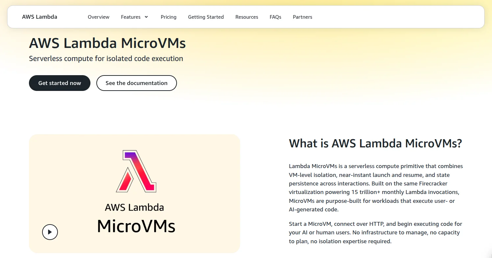

Firecracker is the open source microVM technology AWS uses underneath services like Lambda and Fargate.

But if you’re looking for something you can actually use as a managed sandbox, the more relevant product now is AWS Lambda MicroVMs.

Each environment runs inside its own Firecracker-isolated virtual machine and starts from a snapshot of your application environment.

A MicroVM can start, suspend, keep its memory and disk state, resume later, and then terminate when the session is finished.

That makes it much closer to an agent sandbox than a normal Lambda function.

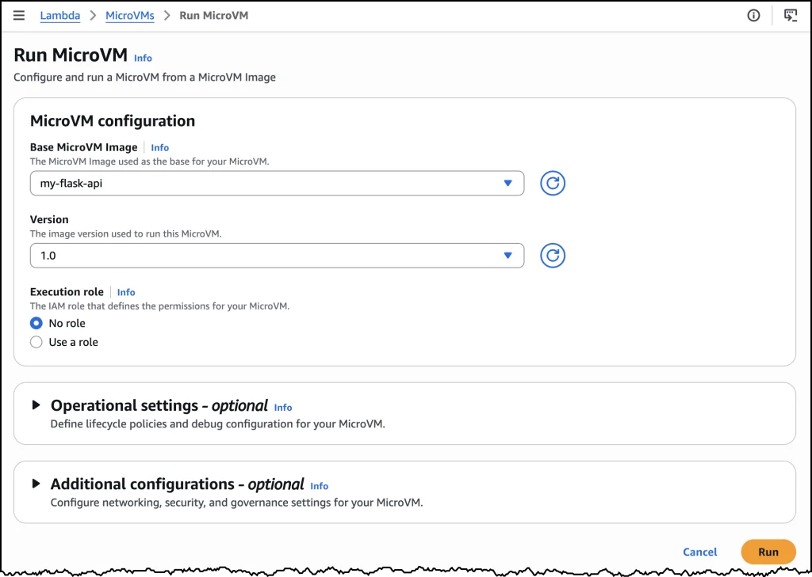

You also get the parts you would expect from AWS around it, including IAM execution roles, VPC networking, HTTPS endpoints, and CloudWatch logging.

The main limitation is duration.

A Lambda MicroVM can live for up to eight hours, including time spent suspended.

### What it does

- Runs each environment inside a Firecracker microVM
- Preserves memory and disk state across suspend and resume
- Gives every MicroVM its own HTTPS endpoint
- Supports IAM roles and VPC networking
- Lets you control start, suspend, resume, and termination through APIs
- Runs sessions for up to eight hours

### 💡 **When I would pick it**

I would use Lambda MicroVMs when most of the surrounding infrastructure already lives on AWS and I want strong isolation without operating my own Firecracker hosts.

It makes a lot of sense for agent execution, user generated code, notebooks, or multi tenant workloads that need access to other AWS services.

**Resources**

- [AWS Lambda MicroVMs](https://docs.aws.amazon.com/lambda/latest/dg/microvms-how-it-works.html)
- [Running and using Lambda MicroVMs](https://docs.aws.amazon.com/lambda/latest/dg/microvms-launching.html)

## 5. Daytona

> ℹ️ Complete development environments for agents, created really fast.

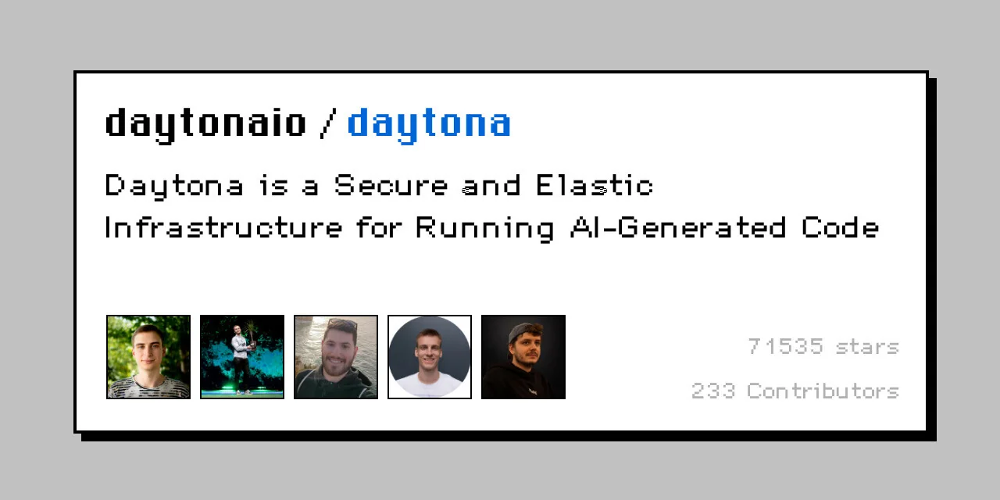

Each sandbox gets its own filesystem, network stack, compute, and isolated environment.

Your agent can install packages, compile projects, start servers, and run normal development workflows inside it.

Daytona also puts a lot of focus on startup speed and currently claims container sandbox creation in under 90 milliseconds. 😬

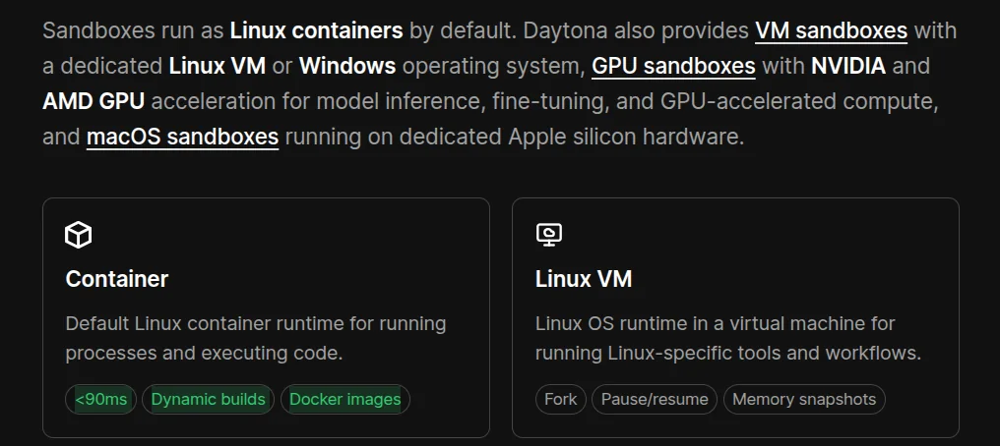

Another nice part is the range of environments available.

You can run standard Linux sandboxes, VMs, Windows, macOS, and GPU backed environments.

### What it does

- Creates full isolated development environments
- Supports containers and VMs
- Supports Linux, Windows, and macOS
- Offers NVIDIA and AMD GPU sandboxes
- Supports snapshots and persistent environments
- Gives agents shell, filesystem, and process access

### 💡 **When I would pick it**

I would use Daytona when the agent needs something closer to a complete developer machine.

It also makes a lot of sense when GPUs or different operating systems are part of the requirement.

**Resources**

- [Daytona](https://www.daytona.io/)
- [Daytona Sandboxes](https://www.daytona.io/docs/en/sandboxes/)

## 6. Modal Sandboxes

> ℹ️ The one I’d look at when sandbox execution starts becoming a compute problem.

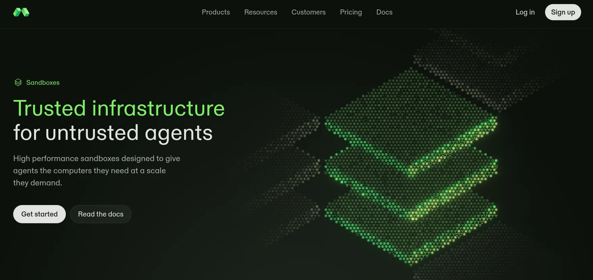

Modal is a little different from the options above.

It already focuses heavily on serverless compute and ML workloads, and its Sandboxes bring isolated agent execution into that same infrastructure.

You can control CPU, memory, filesystem, networking, dependencies, and runtime configuration.

And if your workload needs GPUs, Modal already has that side covered too.

This makes it particularly interesting for workloads where you’re not running one or two sandboxes, but potentially a lot of them in parallel.

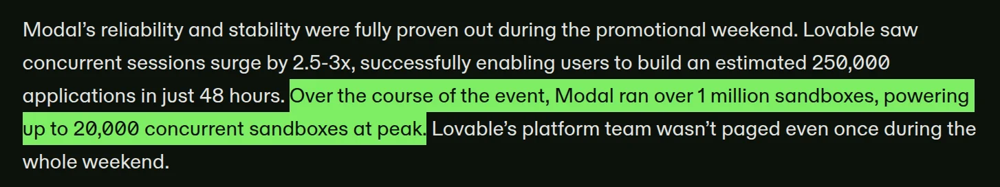

### What it does

- Runs isolated execution environments
- Lets you configure CPU and memory
- Supports GPU backed sandboxes
- Supports custom images and dependencies
- Supports persistent storage
- Works well with parallel workloads

### 💡 **When I would pick it**

I would look at Modal for compute heavy agents, ML workloads, reinforcement learning, evals, or anything that needs lots of parallel execution.

For tiny Python scripts, though, this is probably more than you need.

**Resources**

- [Modal Sandboxes](https://modal.com/products/sandboxes)
- [Modal Sandbox Documentation](https://modal.com/docs/guide/sandbox)

## 7. Vercel Sandbox

> ℹ️ Probably the most obvious pick here for agents generating web apps.

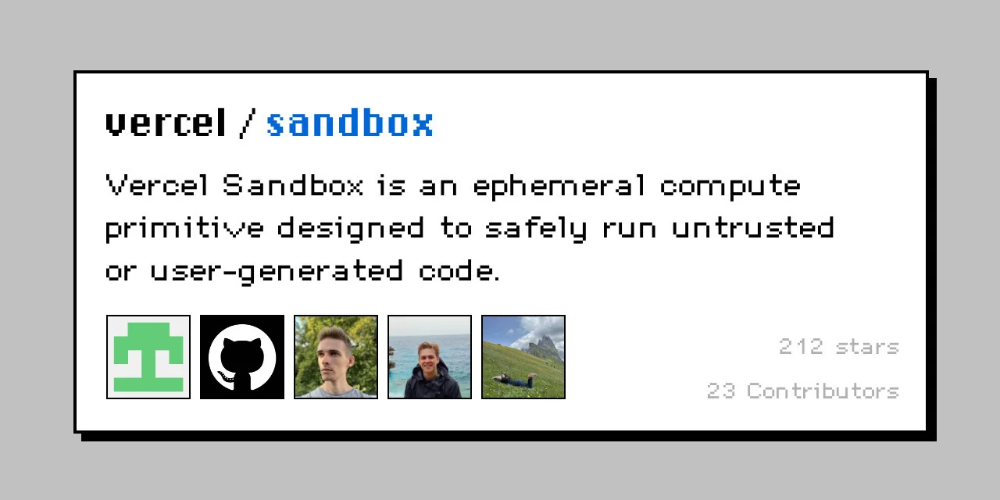

Vercel Sandbox is built for running untrusted and AI generated code inside isolated environments.

Each sandbox runs inside a Firecracker microVM with its own filesystem and network.

Where this gets really useful is application generation.

An agent can generate a React or Next.js app, install the dependencies, start the server, and give the user a working preview without running that generated code inside your actual application.

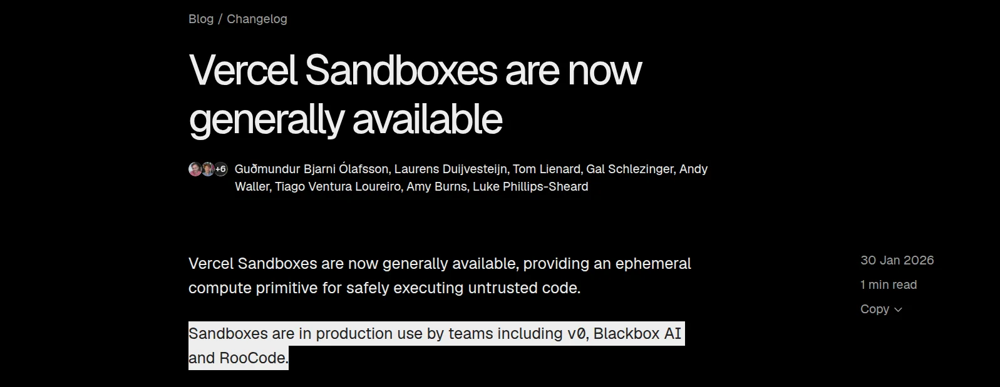

That makes the use case pretty easy to understand.

### What it does

- Runs AI generated and untrusted code
- Uses isolated Firecracker microVMs
- Supports command execution and file manipulation
- Lets agents run web applications
- Supports live previews
- Supports snapshots
- Provides SDK and CLI access

### 💡 **When I would pick it**

AI website builders, coding agents, and products where users need to preview generated applications.

If the rest of your stack already sits on Vercel, it becomes an even easier choice.

**Resources**

- [Vercel Sandbox](https://vercel.com/sandbox)
- [Vercel Sandbox Documentation](https://vercel.com/docs/vercel-sandbox)

## 8. Cloudflare Sandboxes

> ℹ️ Makes the most sense if your agent already lives inside Workers.

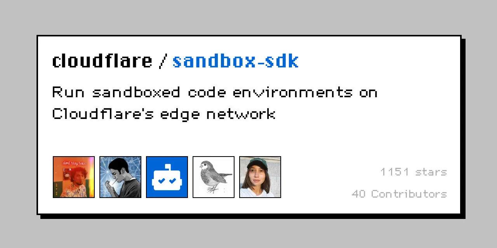

Cloudflare takes a slightly different approach.

Its Sandbox SDK lets Workers execute code inside isolated Linux environments while staying connected to the rest of the Cloudflare stack.

Your agent can run commands, modify files, start background processes, and expose services from the sandbox.

The nice part is how naturally this connects with things like Workers, Durable Objects, R2, D1, and Workers AI.

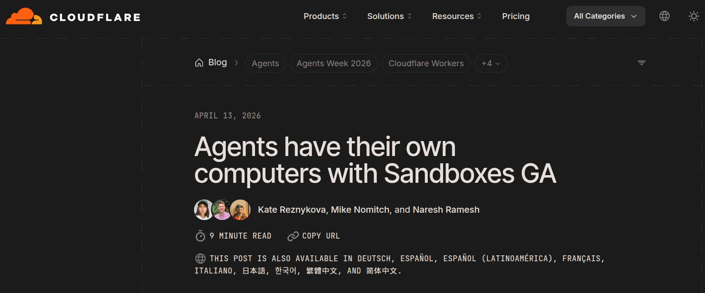

So if your agent already runs on Cloudflare, you don’t necessarily need to introduce another platform just for code execution.

### What it does

- Runs code inside isolated Linux environments
- Supports shell commands and file manipulation
- Runs background processes
- Can expose services and previews
- Works with Workers and Durable Objects
- Connects with Cloudflare storage and AI products

### 💡 **When I would pick it**

Pretty simple.

If most of my agent infrastructure already runs on Cloudflare, I would consider keeping the sandbox there too.

If you’re not using the Cloudflare stack, some of the other options on this list are easier standalone choices.

**Resources**

- [Cloudflare Sandboxes](https://developers.cloudflare.com/sandbox/)
- [Sandbox SDK Documentation](https://developers.cloudflare.com/sandbox/sdk/)

## 9. boat.dev

> ℹ️ Best when your agent needs a full persistent Linux machine instead of a narrow execution runtime.

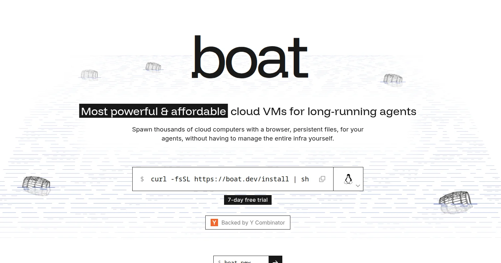

boat takes the full machine approach.

Each sandbox is a persistent Ubuntu VM with its own kernel, filesystem, SSH access, and normal Linux tooling.

Your agent can run Docker, systemd, databases, browsers, development servers, or basically the same workflows you would run on a regular developer machine.

The filesystem also stays around between sessions.

You can stop a sandbox, keep its disk, resume it later, or fork it into another machine when you want to branch the work.

There is also a virtual desktop and browser built into the environment, which makes boat interesting for agents that need to interact with graphical applications instead of only running shell commands.

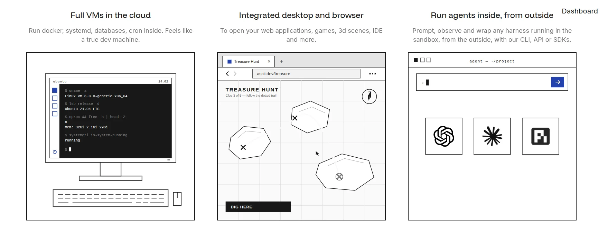

Claude Code, Codex, OpenCode, and other coding agents can run inside the machine, while the sandbox itself can be controlled through the CLI, API, or SDKs.

### What it does

- Gives each sandbox a full Ubuntu VM with its own kernel
- Supports SSH, SCP, Docker, systemd, and normal Linux tooling
- Keeps the filesystem between sessions
- Supports snapshots, stop and resume, and sandbox forking
- Includes a virtual desktop and browser
- Lets you expose applications through hosted URLs
- Provides CLI, API, Python, and TypeScript access

### 💡 **When I would pick it**

I would use boat when the agent needs something that behaves like an actual persistent developer machine.

Long running coding agents, browser based work, multi service applications, and workflows that need Docker or a real desktop are probably the clearest fits.

If all you need is a tiny disposable execution environment, a full VM is probably more than necessary.

**Resources**

- [boat.dev](https://boat.dev/)
- [boat Documentation](https://docs.boat.dev/)

## 10. Northflank

> ℹ️ Best when you want isolated agent sandboxes and the infrastructure around them on the same platform.

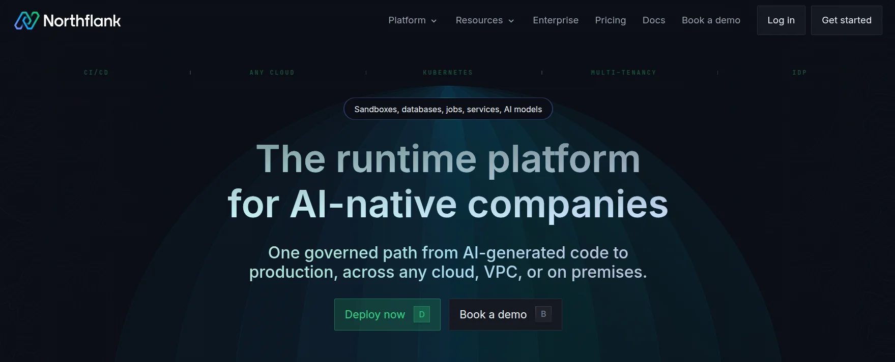

Northflank is broader than a standalone sandbox provider.

It already runs services, jobs, databases, GPUs, and deployment infrastructure, and its Sandboxes add isolated environments for running untrusted or AI generated code.

On Northflank Cloud, CPU sandboxes run inside microVMs and GPU sandboxes use gVisor isolation.

They boot in under a second, and you can create them, run commands, work with files, expose ports, and destroy them through the JavaScript or Python SDK.

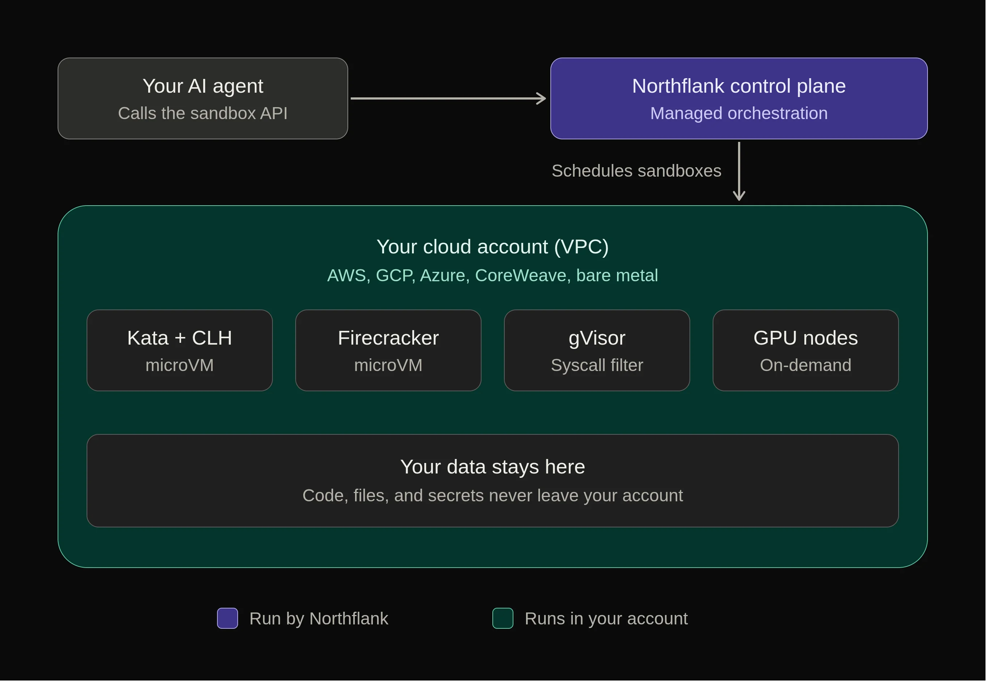

You can keep a sandbox disposable, or attach storage when the agent needs files to survive pauses and restarts.

Another useful part is deployment flexibility.

The same sandbox model can run on Northflank’s managed cloud or inside your own AWS, GCP, Azure, or other supported infrastructure.

### What it does

- Runs untrusted code inside isolated Linux environments
- Uses microVM isolation for CPU sandboxes on Northflank Cloud
- Uses gVisor isolation for GPU sandboxes
- Supports command execution, files, ports, and persistent storage
- Offers JavaScript and Python SDKs
- Supports GPU backed sandbox workloads
- Can run on Northflank Cloud or your own cloud infrastructure

### 💡 **When I would pick it**

I would use Northflank when the sandbox is part of a larger application platform rather than an isolated piece of infrastructure.

It makes sense if the agent needs GPUs, persistent storage, private infrastructure, or a path from experimentation into services and production workloads on the same platform.

For a simple throwaway Python environment, there are lighter options on this list.

**Resources**

- [Northflank Sandboxes](https://northflank.com/docs/v1/application/sandboxes/quickstart)
- [Sandboxes in your own cloud](https://northflank.com/docs/v1/application/sandboxes/sandboxes-in-your-own-cloud)

## Wrap Up!

There really isn’t one sandbox that makes sense for everyone.

If your agent needs **code execution plus authenticated tools**, I’d start with **Composio**.

For a solid **general-purpose sandbox**, **E2B** is probably the safest place to start.

If you need **persistent agent computers**, look at **Tensorlake**.

For **full development environments and GPUs**, **Daytona** makes more sense.

I definitely wouldn’t use all ten.

Figure out what your agent actually needs to run, how long the environment needs to stay alive, and what it needs access to.

Then pick the one that creates the least extra work.

If I missed an obvious one, let me know. ✌️
